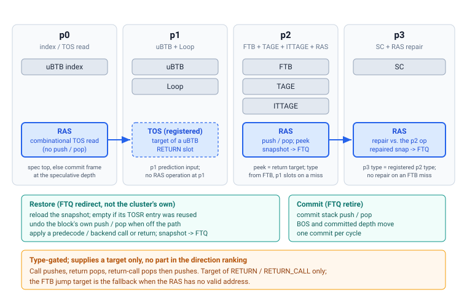
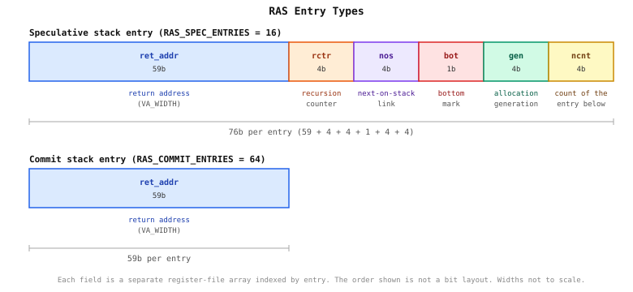
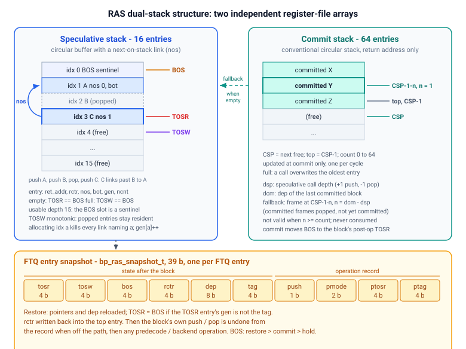
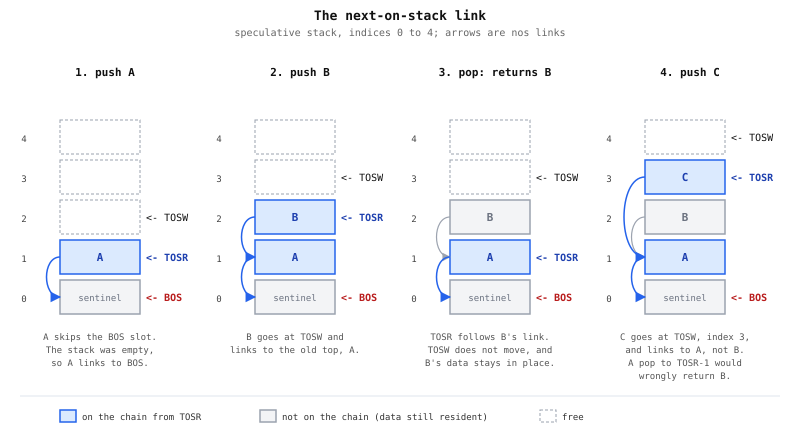
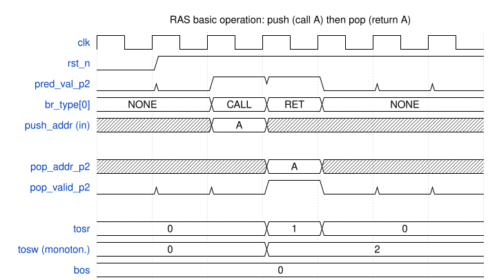

<!-- SPDX-License-Identifier: Apache-2.0                        -->
<!-- Copyright (c) 2026 Jeff Nye, uarchlabs.com                 -->
<!-- SPDX-FileCopyrightText: 2026 Jeff Nye <jeff@uarchlabs.com> -->

title: "RAS -- Theory of Operation"
author: Jeff Nye
date: 2026-11-22
copyright: "Copyright 2026 Jeff Nye"

<!--
```
 FILE:    BLOG_bpu_23_ras_theory_of_op.md (ras_top_v5.md)
          (condensed from ras_top_v4.md)

 SOURCE:  derived from session-050 / BP-062..BP-064; DOC-011;
          revised against ras.sv after BP-153 (sha f0d97fc) and
          ras_decisions.md (16 speculative entries, BP-154)
 STATUS:  DRAFT
 UPDATED: 2026-11-22
 CONTACT: Jeff Nye
```
-->

## RAS Theory of Operation

This covers the theory of operation of the return address stack (RAS), a
component in the BPU that predicts the targets of returns.

Unlike other articles in the Pacino series this is not a postmortem/status
report. This is a description of the Pacino RAS as currently specified at the
time of writing.

The Pacino RAS is built from two stacks: a small speculative stack that tracks
the calls in flight, and a larger commit stack that holds the committed call
stack.

The article is organized as follows:

- Sections 1 to 3 give background: the purpose of a RAS, call and return
  detection in RISC-V, and the RAS in the Pacino pipeline
- Section 4 describes the operation of the two stacks
- Section 5 covers the design choices and compares them with industry,
  open-source and research designs

## 1. Purpose of a RAS

Returns have unique characteristics that can be leveraged by dedicated return
predictors. Return address stacks have been proposed as return predictors since
at least 1981 [20], [21] and evaluated in the literature since 1991 [22], and
they remain a subject of research [19].

Recall that a return is an indirect branch whose target is, in principle, always
known. The return target is the address immediately following the matching
call.

A general indirect predictor such as ITTAGE can learn return targets, but only
as history-indexed patterns: it must learn each call site separately, and it
mispredicts when the history does not identify the caller. A BTB, which keeps
one target per return, mispredicts whenever the function was last called from a
different site [22].

The obvious insight is that the information needed to predict a return is
structural, not statistical. Calls and returns nest in last-in-first-out order,
so a stack reconstructs the target exactly: the return address is pushed when a
call is predicted and popped when a return is predicted, and the value at the
top of the stack is the predicted target.

On typical code, a return address stack predicts returns with high accuracy. The
design complexity arises in two areas in which this abstraction does not hold:

1. **Speculation.** A modern front end pushes and pops on predicted call/return
   flow many cycles before the prediction is confirmed. A mispredicted path (the
   "wrong path") corrupts the stack by pushing spurious entries or popping valid
   ones. The structure must therefore restore a known-good state at low cost on
   every pipeline redirect.

2. **Capacity.** The stack is finite. Layered software (runtime, framework,
   libraries, operating system) keeps tens of frames live at steady state, and
   recursion can push the same address repeatedly. The structure must degrade
   in a controlled manner on overflow.

The two requirements pull in different directions. Fast, exact recovery favors
a small structure with extra state per entry; capacity favors a large, simple
one. Pacino separates them into two stacks.

---

## 2. Detecting calls and returns in RISC-V

Before a return can be predicted it must first be detected. The RISC-V ISA has
no explicit call or return instruction. `JAL` and `JALR` are plain jumps that
write the return address to `rd`, and the operands of a jump determine whether
it is a call, a return or neither. Other ISAs mark calls and returns in the
opcode (x86 `CALL` and `RET`, Arm `BL`/`BLR` and `RET`).

The standard RISC-V calling convention uses `x1` (`ra`) as the return-address
register and `x5` (`t0`) as an alternate. Both are "link registers". The ISA
specification provides hints for RAS implementations: a jump that writes a link
register is a call and pushes onto the RAS, and a jump that reads a link
register is a return and pops from the RAS [23]. Pacino gives each jump a branch
type using this hint:

| Instruction | rd | rs1 | Pacino type | RAS action |
|---|---|---|---|---|
| `JAL` | link | -- | `DIRECT_CALL` | push |
| `JAL` | not link | -- | `DIRECT_UNC` | none |
| `JALR` | link | not link | `INDIRECT_CALL` | push |
| `JALR` | link | same as `rd` | `INDIRECT_CALL` | push |
| `JALR` | link | the other link register | `RETURN_CALL` | pop, then push |
| `JALR` | not link | link | `RETURN` | pop |
| `JALR` | not link | not link | `INDIRECT_NONRET` | none |

The compressed jumps take the type of their expansion: `C.JALR` is
`jalr x1, 0(rs1)`, and `C.JR` is `jalr x0, 0(rs1)`.

Two rows need explanation. A far call, `call offset`, is `auipc x1, ...`
followed by `jalr x1, ...(x1)` [24]. The `jalr` reads `x1` only to form the
target, so it is a call; the specification makes this case push-only so that
hardware can fuse the pair [23]. A `JALR` from one link register to the other
pops and then pushes, to support coroutines [23].

A tail call, `tail offset`, jumps through `x6` (`x7` when Zicfilp is available)
with `rd = x0` [24]. Neither is a link register, so a tail call leaves the stack
alone. These are hints: software that breaks the convention runs correctly and
only loses return prediction accuracy.

The type also decides which predictor supplies the target. The RAS supplies the
target of `RETURN` and `RETURN_CALL`; ITTAGE supplies the target of the other
indirect jumps. When the owning predictor has no target, the FTB's jump target
is used.

---

## 3. The RAS in the Pacino prediction pipeline

The RAS is one of seven predictors in the Pacino branch prediction cluster
(uBTB, Loop, FTB, TAGE, SC, ITTAGE, RAS). It supplies a target address only and
takes no part in the direction ranking. It acts only on the call, return and
return-call branch types.

The RAS participates at these points (Figure 1):

- **p0/p1.** The top of the speculative stack is read combinationally at p0. A
  uBTB entry of type `RETURN` or `RETURN_CALL` at p1 uses it as the target.
- **p2.** The RAS pushes for a call or pops for a return, using the FTB's
  branch type, and supplies the return target. If the p2 target differs from
  the p1 target, the cluster redirects at p2. The RAS writes a snapshot of its
  state into the block's FTQ entry.
- **p3.** The RAS repairs the p2 operation if the p3 view of the block
  disagrees with it (Section 4.4).
- **Restore.** On a redirect, the RAS reloads its speculative state from the
  FTQ snapshot of the redirecting block (Section 4.4).
- **Commit.** When the FTQ commits a block with a call or return, the RAS
  updates the commit stack (Section 4.3).



*Figure 1. The RAS contributes at p0 (top-of-stack read, registered as the
target of a p1 uBTB return), p2 (push/pop, the return target, and the snapshot
to the FTQ), and p3 (repair, and the repaired snapshot to the FTQ). Outside the
pipeline it acts on a restore and on a commit.*

The Pacino predictors produce up to two predictions (slots) per 32-byte fetch
block. Only a block's jump can be a call or return, and a taken jump ends the
predicted path in that block, so at most one slot of a block acts on the RAS.
The rest of this article describes one RAS operation per block.

---

## 4. The dual-stack organization

### 4.1 Two stacks, statically partitioned

The RAS contains two independent register-file arrays (Figure 3):

- a **speculative stack** of `RAS_SPEC_ENTRIES` = 16 entries, pushed and popped
  at prediction time, that tracks the calls between prediction and commit; and
- a **commit stack** of `RAS_COMMIT_ENTRIES` = 64 entries, a conventional
  circular stack updated only at commit, that holds the committed call stack.

The two entry types differ in cost (Figure 2). A commit entry holds a return
address only. A speculative entry also holds a next-on-stack link, a bottom
mark (the `bot` bit), a recursion count, an allocation generation and the count
of the entry below: the state that makes cheap, exact recovery possible
(Sections 4.2 and 4.4).



*Figure 2. The two entry types. A speculative entry holds the return address
and the fields that link and count entries; a commit entry holds the return
address only.*

The split assigns each requirement of Section 1 to one stack. The speculative
stack handles speculation: it is the only array the wrong path can change, and
the only one a restore touches. The commit stack handles capacity: the wrong
path never writes it, so it needs no recovery state, and its entries are cheap
enough to hold most of the depth.

The partition is static: two arrays of fixed size, each indexed by its own
pointers. There is no shared boundary to track.



*Figure 3. Two register-file stacks. The speculative stack is a circular buffer
with a next-on-stack link and a bottom mark per entry, and TOSR/TOSW/BOS
pointers; the commit stack is a conventional stack with CSP and an occupancy
count. Each FTQ entry holds a snapshot of the speculative state (Section 4.4).*

### 4.2 The speculative stack

Three pointers define the speculative stack (Figure 3):

- **TOSR** -- Top Of Stack Read: the current top, the entry a pop returns.
- **TOSW** -- Top Of Stack Write: the next free allocation slot.
- **BOS** -- Bottom Of Stack: the committed boundary. When a block with a call
  or return commits, BOS moves to that block's top of stack.

The stack is empty when `TOSR == BOS`. A push never allocates the entry at BOS,
so 15 of the 16 entries are usable.

A **push** writes the return address at TOSW, links the new entry to the old
top, moves TOSR to the new entry and TOSW past it. An entry pushed onto an
empty stack is marked bottom (its `bot` bit is set), so a pop of it moves TOSR
to BOS instead of following its link. A **pop** returns the TOSR entry and
moves TOSR along that entry's link, or to BOS if the entry is marked bottom. A
pop changes neither the array nor TOSW. Figure 4 shows a sequence of pushes and
a pop.

Two properties follow, and they are what make recovery cheap:

- **Popped data stays resident.** A popped entry keeps its contents until the
  allocator wraps around to it. A wrong-path return that pops valid frames does
  not destroy them, and restoring the pointers brings them back.
- **The entry below the top is found by a link, not by index.** Because TOSW
  only advances, after push A -> push B -> pop -> push C, C is at index 3 and
  the entry below it is A at index 1, not B at index 2. Each entry stores the
  index of the entry below it (`nos`), and a pop follows that link. A pop to
  TOSR-1 would return B and mispredict (Section 5.1).



*Figure 4. Push A, push B, pop, push C. The pop returns B and moves TOSR along
B's link to A; TOSW does not move, so B stays in the array. C is written at
TOSW, index 3, and links to A, the top when it was pushed. A pop of C follows
that link to A. Stepping down one index instead would reach B, a frame already
returned from.*

Because the allocator wraps around the array, it eventually reuses an entry
that something still points to: another entry's link, or a TOSR saved in a
snapshot. Two mechanisms prevent such a pointer from reading the wrong return
address. When an index is reallocated, every other entry whose link names it is
marked bottom, so its pop ends the speculative stack. And each entry carries a
generation that advances on each allocation; a snapshot records the generation
of its top entry, and a restore to an entry whose generation has changed reads
the stack as empty. In both cases the RAS predicts from the commit stack
(Section 4.3) instead of returning a wrong address.

Overflow is handled the same way. Once 15 entries have been allocated since BOS
last moved, the next push overwrites the oldest entry and is marked bottom,
leaving one reachable entry. The pop after it finds the speculative stack empty
and takes the commit-stack fallback (Section 4.3). No fault is raised, and the
commit stack limits the cost.

### 4.3 The commit stack and the depth-aware fallback

The commit stack has one pointer, CSP (Commit Stack Pointer), which names the
next free entry; the top entry is at `CSP-1`. The stack is updated only when
the FTQ commits a block with a call or return:

- a call writes its return address at CSP and advances CSP;
- a return moves CSP back, or does nothing when the commit stack is empty;
- a return-call does the return and then the call, which replaces the top.

CSP wraps, so it cannot tell an empty stack from a full one. A separate
occupancy count, 0 to 64, records how many entries are valid. A call committed
on a full stack overwrites the oldest entry.

The two stacks divide the call stack between them. The speculative stack holds
the frames pushed since the last commit; the commit stack holds every committed
frame. When the speculative stack is empty -- the speculative path has popped
down to BOS, the stack overflowed, or a reused entry cut a link -- the RAS
predicts from the commit stack instead. This read is the fallback.

**The fallback reads the committed frame at the speculative depth.** It cannot
simply read the commit-stack top. The commit stack changes only at commit, so a
frame the speculative path has already popped stays on top until its return
commits. A fallback that always read the top would give a later return that
frame again. The RAS therefore keeps two call depths:

- **dsp**, the speculative call depth. Every push increments it and every pop
  decrements it.
- **dcm**, the committed call depth: the dsp value recorded in the snapshot of
  the last committed call or return.

`n = dcm - dsp` is the number of committed frames the speculative path has
already popped, and the fallback reads entry `CSP-1-n`. When `n < 0` the
speculative path is deeper than the committed one, which with an empty
speculative stack happens only after an overflow, and the fallback reads
`CSP-1`. When `n` is at least the occupancy count, no committed frame is left
to read and the RAS gives no target; the FTB's jump target is used.

An example: main calls f, f calls g, and g calls h. All three calls commit, so
BOS reaches the top and the speculative stack is empty, with `dsp = dcm = 3`.
The return from h finds the speculative stack empty, reads `CSP-1` (the return
address into g), and takes dsp to 2. Before that return commits, the return
from g also finds the speculative stack empty. Now `n = 1`, so it reads
`CSP-2`, the return address into f, rather than reading the return address into
g a second time (Figure 3 shows this read at `n = 1`).

The fallback only reads the commit stack and never changes it. Only commit
does, so the commit stack needs no recovery on a redirect.

### 4.4 Recovery on a redirect

Every prediction block writes a snapshot of the speculative state into its FTQ
entry: the three pointers, the speculative depth, the top entry's recursion
count and generation, and a record of the push or pop the block itself made.
The snapshot is 39 bits.

On a redirect the FTQ gives the RAS the snapshot of the redirecting block, and
in the next cycle the RAS:

1. reloads TOSR, TOSW, BOS and the depth from the snapshot, or reads the stack
   as empty if the generation of the TOSR entry has changed since;
2. writes the snapshot's count back into the top entry; and
3. undoes the block's own push or pop if the redirect shows it off the path.

Nothing is replayed and the array is not cleared. Pushes after the restore
allocate from the restored TOSW, over entries the wrong path wrote, which
nothing can reach any more. Recovery takes constant time. This is the
pointer-restore mechanism of Skadron et al. [1], which saves the top-of-stack
pointer at each prediction and restores it after a mispredict.

Only the speculative stack is restored. The wrong path never wrote the commit
stack, so a restore leaves it alone. This is the second benefit of the split:
recovery is confined to the small array.

Two further corrections keep the speculative stack in step with the program:

- **p3 repair.** The p2 operation is made on a view that can change one cycle
  later, when SC reverses an earlier conditional and makes a call or return
  reachable or unreachable. At p3 the RAS undoes the p2 operation or applies
  the one p2 missed, and the repaired snapshot replaces the p2 snapshot in the
  FTQ. This is the realignment of Desmet et al. [2], which moves the recovered
  top-of-stack pointer by one entry rather than rebuilding the stack, applied
  one stage earlier.
- **Restore-time operations.** A call that only predecode finds, or a call or
  return that only the backend finds, would otherwise reach the RAS only at
  commit, and every later return would see the wrong stack. The RAS applies the
  operation on the restore for the redirect that corrects the block, so every
  call and return reaches the speculative stack.

A flush is a redirect, so it uses the same restore.

### 4.5 Recursion counter

Without a counter, a recursive call would use one speculative entry for each
repetition of the same return address. Each speculative entry has a 4-bit
count, `rctr`. A push of the same address as the top entry increments the count
instead of allocating, and a pop of an entry with a count above 0 decrements
the count and leaves TOSR in place. The count saturates at 15. The speculative
depth moves by one on every push and pop, whatever the count does.

The snapshot restores the top entry's count. A wrong path can also change the
count of an entry below the top, so each entry records the count of the entry
it links to when it is allocated, and a pop that follows the link writes that
count back.

The commit stack has no count: each committed call has its own entry.

---

## 5. Design choices and comparison with industry

The Pacino RAS represents a conservative point in a large design space. This
section describes the alternatives that were evaluated, followed by the
corresponding choices made in industry and in the literature.

### 5.1 Alternatives evaluated

**Linked circular array compared with simple circular buffer.** The first design
was a simple circular buffer, without the next-on-stack (`nos`) link of the
XiangShan Kunminghu linked circular array [3], in which each entry's link forms
an explicit chain. The grounds were that the literature did not establish an IPC
benefit for the linked structure, and that pointer snapshots already gave O(1)
recovery. Vandierendonck and Seznec [4] report that a RAS with no
speculative-state management, backed by the BTB when a detector finds it
corrupted, performs as well with 8 entries as a 64-entry self-checkpointing RAS.
The pointer rules built on that choice were wrong on the correct path. With TOSW
only advancing and a pop moving TOSR to TOSR-1, a pop that follows a pop and a
push lands on the slot just popped: f calls g, g returns, f calls h, h returns,
and f's return is predicted to g's return address. Those rules were the linked
array's pointers without its link, so the link was added. A push at TOSR+1 with
no TOSW was weighed and rejected, because that loses exact restore and rewrites
the pointer rules of Section 4.2. The link costs `RAS_SPEC_ENTRIES x
RAS_PTR_BITS` bits (64 at 16 entries), and a bottom bit per entry keeps the
empty test exact across commits. Recovery remains a snapshot restore.

**Making the link safe against reuse.** With the link in place, the allocator
still reuses a slot whenever it passes it, and an older entry linking to that
slot would pop into the reusing push. The design kills such links on allocation
and tags each entry with an allocation generation, so a restore or undo to a
reused entry reads empty. The cost at 16 entries is `16 x 4` generation bits, a
4-bit tag per snapshot, `4 x NUM_PRED_SLOTS` p3 bits and 16 comparators per
allocation.

**Restoring wrong-path recursion counts.** Two ways were weighed: the snapshot
carrying the top entry's count, and a per-FTQ-entry log of every in-place count
change, undone on restore (exact, 64 x 16 x 4 bits). The snapshot count was
chosen, and the per-entry count of the entry below covers the counts below the
top.

**Unified pool compared with static partition.** A single array shared between
speculative and committed state was evaluated and rejected in favor of a static
split. The only advantage of a unified pool is flexible balancing between
speculative and committed depth; against this, every overflow check, every
restore, and every commit would have to account for a shared, moving boundary.
The decision is to be re-evaluated if commit-stack overflow is a measured event
under representative workloads, in which case the partition is rebalanced before
the structure is changed.

**Stack depths.** With the depth-aware fallback the commit stack's capacity
bounds the call depth the RAS predicts, so most of the depth is in the commit
stack: 64 entries, because returns were measured lost in recursion deeper than
32 frames. The speculative stack is 16 entries; a 32-entry speculative stack was
measured and rejected (Section 5.3).

**Recursion counter inclusion.** Folding recursive repeats into a saturating
counter, rather than consuming one entry per repetition, is optional. It is
included because its cost is low (4 bits per entry) and it protects the limited
usable speculative depth against pathological self-recursion. The counter width
is consistent with established practice: 15 repetitions is well beyond the depth
at which a realistic workload would already have overflowed the stack.

**Push timing.** The authoritative push is made at p2 on the FTB type. A push at
p2 alone is not sufficient: a call the FTB does not hold is never pushed. A
predecode early hint was considered; the design instead applies the restore-time
operations of Section 4.4 when the predecode or backend redirect that corrects
the block is taken.

### 5.2 Corresponding choices in industry and the literature

The Pacino design choices are consistent with established practice. The
instances of divergence are intentional and are identified below.

**Recovery by checkpoint and pointer restoration.** Commercial high-performance
cores recover the RAS by checkpoint or pointer restoration on redirect, which is
the mechanism used by Pacino. The technique of saving the top-of-stack pointer
at each prediction for later restoration was established by Skadron et al. [1],
who reported return-prediction accuracy approaching 100 percent with this
repair. Jourdan et al. [5] characterized the recovery requirements of
branch-prediction storage structures under mispredicted-path execution. Desmet
et al. [2] showed that after a call or return misprediction the recovered
top-of-stack pointer should be realigned to the next or previous slot relative
to the checkpoint. Vandierendonck and Seznec [4] attribute the overwhelming
majority of return mispredictions to RAS overflow and to wrong-path overwrites
of the top entries. The Pacino p2/p3 repair and the restore-time undo apply the
realignment of [2] by following the link or restoring the recorded pre-operation
TOSR; the linked circular buffer with a monotonic TOSW addresses the wrong-path
overwrite source by retaining popped data until it is reallocated, and the
generation tag detects the reallocation when it happens.

**Stack depth.** Return-stack depth has increased as software has become more
layered. Intel Sandy Bridge has a 16-entry return stack buffer [6]; AMD's
Bulldozer family, Bulldozer through Excavator, has 24 entries [6], [7]; Zen 1 to
Zen 4 have 32 [6], [8]; and the Zen 5 optimization guide [9] documents a
52-entry RAS per thread. The determining factor is not recursion depth but the
number of stack frames live at steady state in layered software (runtime,
framework, libraries, operating system), which commonly reaches several tens of
frames in the absence of recursion. The Pacino configuration of 16 speculative
and 64 commit entries is within the range of contemporary commercial designs
while keeping the speculative array, which is timing- and recovery-critical,
small. The commit stack carries the depth: with the depth-aware fallback it
predicts returns up to 64 frames below the speculative stack.

**SMT partitioning and its security exposure.** The Zen 5 figure of 52 entries
[9] is per thread. On AMD Family 17h processors the return address predictor is
partitioned by SMT mode rather than duplicated: each thread uses a private 16
entries when both threads run, and a single active thread uses all 32 [10]. The
partitioning has a security consequence: after a switch between one-thread and
two-thread mode, a return may be predicted with a target the sibling thread left
(CVE-2022-27672) [10]. The Pacino parameter `NUM_PRED_SLOTS = 2` represents a
different axis: two prediction slots per cycle in one thread, of which at most
one operates on the RAS (Section 3).

**Call/return pair throughput.** The number of call/return pairs that a front
end can process per cycle is a recurring commercial design parameter, and
vendors allocate area and accept latency to increase it. Pacino handles one
RAS-operating instruction per prediction block. A call and its matching return
are in different blocks, since the call is taken and ends its block, and the
return's p2 pop sees the call's p2 push, made at least one cycle earlier.

### 5.3 Comparison with other designs

Two tables follow. The first compares capacity, which is the one property
commercial vendors publish. The second compares mechanism, for designs whose RTL
or design documents are public. The open-source entries were read at the
versions given in the references; they are live projects and may change.

**Capacity.**

| Design | Speculative entries | Commit / retire entries | Notes | Source |
|---|---|---|---|---|
| Pacino | 16 | 64 | separate arrays | this document |
| Intel Sandy Bridge | 16 | not published | near returns | [6] |
| AMD Bulldozer family (Bulldozer to Excavator) | 24 | not published | | [6], [7] |
| AMD Zen 1 to Zen 4 | 32 | not published | Family 17h: 16 per thread in two-thread mode | [6], [8], [10] |
| AMD Zen 5 | 52 | not published | per thread | [6], [9] |
| XiangShan Kunminghu V2 | 32 | 16 | 48 in all | [3], [11], [12] |
| XiangShan Kunminghu V3, in development | 32 | 16 | as V2; RTL only, its design document is a stub | [13] |
| XuanTie C910 | 12 | 6 (partial copy) | the retire copy restores the speculative stack; it adds no depth | [14], [15] |
| BOOM (v3, v4) | 32 | none | | [16] |
| NaxRiscv | 16 | none | | [17] |
| CVA6 | 2 | none | all shipped configurations | [18] |
| HRAS (Tan and Wang), research design | 8 | 12 or more | their best split for 20 or more entries; simulated 3-issue core with 32 branches in flight | [19] |

**Mechanism.**

| Axis | Pacino | XiangShan Kunminghu V2 [3], [11] | XiangShan Kunminghu V3, in development [13] | XuanTie C910 [14], [15] | BOOM [16] | NaxRiscv [17] | CVA6 [18] | HRAS (Tan and Wang), research design [19] |
|---|---|---|---|---|---|---|---| --- |
| Speculative structure | circular buffer, a link (`nos`) and a generation per entry | persistent queue, a link (`NOS`) per entry | as V2 | simple circular stack | simple circular array | simple circular stack | shift register | persistent stack in a circular queue, a link (`NOS`) per entry; entries leave in order at commit |
| Commit stack | yes, updated at commit | yes, updated at commit | as V2 | yes, a 6-entry copy of the most recent retired calls | no | no | no | yes, updated at commit; its own read pointer follows speculative calls and returns |
| Recursion counter | 4 bits, speculative stack only | 3 bits, speculative and commit stacks | as V2 | no | no | no | no | no |
| Empty speculative stack | commit-stack frame at the speculative depth | commit-stack top through a separate pointer (`ssp`) | as V2 | no prediction; the backend corrects | no empty test; the slot under the pointer is read | no empty test; the slot under the pointer is read | no prediction | commit stack read at its speculative read pointer; the indirect predictor's target when that entry is invalid |
| Overflow | wrap; one reachable entry, then the commit fallback | RAS prediction paused near overflow | as V2: no RAS operation near overflow | oldest entry overwritten | wrap, oldest overwritten | wrap, oldest overwritten | oldest entry dropped | detected in both structures; the indirect predictor's target is used |
| Recovery on redirect | snapshot of pointers, top count, depth and generation; the block's own push and pop undone | TOSR, TOSW, `ssp` and its counter restored | as V2, plus the top entry's link (`nos`) and return address | at retirement of the mispredicted branch: pointer reset and 6 entries copied back (a) | pointer and top entry restored | pointer restored from the ROB; contents not | none; cleared on exception, eret and debug entry | queue top and tail pointers restored; the commit stack's read pointer restored (d) |
| Later-stage repair | p3 repairs the p2 operation | s3 repairs the s2 operation | none in the main RAS, which operates at s3; a micro-RAS covers s1 to s3 | no | F4 recomputes after predecode and redirects | no | no | not described |
| Missed call or return applied on redirect | yes, predecode and backend | yes, the mispredicted instruction's own call or return | as V2 | no; blocks with a call or return stall while a mispredict is unretired | only a call or return the front end already marked | no | no | not described |
| Return-call (pop then push) | yes | not stated | not checked | classified; the new link may be lost (b) | not classified | classified; the new link is lost (c) | yes, top replaced in place | yes; the push takes a new entry and the old top is kept |
| Push / pop stage | p2, repair at p3 | s2, repair at s3 | s3; micro-RAS predicts from in-flight s1 to s3 operations | IB | F4 (F3 in v3) | decode | fetch predecode | fetch |

(a) and (b): read from the C910 RTL logic, not simulated. Two readings are
unconfirmed. After a recovery the stack may read empty in the common case, which
would make the copy-back matter only after a wrap. A return-call may lose its
new link, the push writing above the top.

(c): read from the NaxRiscv source. A push and a pop in one decode group leave
both pointers unchanged, and the push writes the slot above the top, so the old
top is read next.

(d): read from the paper's description in its section 2, which has no RTL. The
paper does not say which pointers a branch saves, beyond one stack pointer per
branch (its Table 3). The commit stack's read pointer is restored from that
saved state, or from the commit pointer.

XiangShan is the design closest to Pacino: both keep a linked speculative stack
beside a commit stack, and both read the commit stack at a speculative position
when the speculative stack is empty (`ssp` in XiangShan, the depth difference
`dcm - dsp` in Pacino). HRAS [19] does the same: its commit stack has a read
pointer that follows speculative calls and returns, and that pointer supplies
the prediction once the speculative queue no longer holds the frame. V2, the
released design, also repairs its second-stage operation one stage later, as
Pacino does. The two differ in the counter (Pacino keeps none on the commit
stack), in overflow (XiangShan pauses prediction, Pacino wraps), and in recovery
(Pacino carries the block's own operation record to undo it). V3, still in
development, moves the main RAS to s3 and adds a micro-RAS that predicts returns
from the operations still in flight in s1 to s3; its redirect record adds the
top entry's link and return address. Its design document has no RAS text yet, so
the V3 column is read from its RTL alone. The other open designs keep a single
speculative stack and recover its pointer at most, the approach Skadron et al.
[1] and Vandierendonck and Seznec [4] study; BOOM also restores the top entry,
as [1] proposes.

**Why Pacino's sizes differ from XiangShan's.** Against XiangShan, Pacino's
speculative stack is half the size (16 entries to 32) and its commit stack four
times the size (64 to 16). The two stacks are sized against different things,
and the raw counts overstate the difference.

The speculative stack bounds the calls that can be pushed between prediction and
commit. Pacino's allocator only advances (TOSW is monotonic), so an entry is
reused after `RAS_SPEC_ENTRIES - 1` younger allocations whether or not its call
has committed; the generation tag turns that reuse into an empty read and a
commit-stack fallback rather than a wrong address (Section 4.2). Both designs
have a 64-entry FTQ. XiangShan sized its queue from a measured need of about 28
entries and built 32 [3]. Pacino measured both sizes. At 16 entries the stack
occasionally reuses the entry of a call not yet committed; 32 entries removed
those mispredicts, 5 to 9 returns over 50 million instructions. The 32-entry
stack was rejected because its cost is too high for that gain: it doubles the
link-kill comparators on every allocation and widens the restore path. The
measurement covered resolve-to-commit latencies up to 8 cycles; at longer
latencies more calls are in flight.

The commit stack depths are closer than the counts. XiangShan's 16 commit
entries each carry a 3-bit recursion counter [3], [11], so up to 8 repeated
calls to the same return address fold into one entry. Pacino's commit stack has
no counter (Section 4.5): 64 entries hold 64 frames. With the depth-aware
fallback of Section 4.3 the commit stack's capacity bounds the call depth Pacino
predicts, and it has 64 entries because returns were measured lost in recursion
deeper than 32 frames. For distinct call frames Pacino holds 64 to XiangShan's
16; for deep self-recursion XiangShan's counter can hold more.

The organization, few speculative entries and most of the depth in the commit
stack, has support in four sources. Only the first measures the split:

- Tan and Wang [19] study it directly, for a hybrid RAS of the same
  organization: a retired stack updated at commit and a pointer-linked
  speculative queue. Returns whose call has committed are predicted from the
  retired stack and the rest from the queue, so the total mispredict rate
  separates into one term for each structure, which the authors confirm within 3
  percent. With the retired stack at 32 entries, an 8-entry queue predicted
  every return of the second kind, and the queue needs no more entries than
  there are branches in flight. With the queue at 16 entries, the retired
  stack's size governs overflow. Their best division of a fixed total puts 4 to
  6 entries in the queue for totals of 10 to 14, and for 20 or more entries
  holds the queue at 8 and gives the rest to the retired stack (their Table 5).
  The speculative side saturates; added capacity belongs in the commit stack.
  Their core holds 32 branches in flight, so the queue saturates at one entry
  per four in-flight branches. Pacino's 16 entries against a 64-entry FTQ are
  the same ratio. The study is of a small core (3-issue, 10 stages) on SPEC CPU
  2000, so it supports the shape of Pacino's division rather than fixing its
  values.
- XiangShan's design document states the principle: its commit stack exists "to
  compensate for the low storage density of the persistent queue" [3]. Linked
  speculative entries are costly, so depth goes in the plain stack. Pacino
  applies the same principle with a stronger skew, because its speculative
  entries carry the most per-allocation logic: the link kill compares every
  entry's link on each allocation, and the snapshot widens with the pointer
  width.
- Vandierendonck and Seznec [4] show that a small speculative RAS is enough when
  a reliable second source covers the cases it cannot: an 8-entry RAS backed by
  the BTB matches a 64-entry self-checkpointing RAS. Pacino's second source is
  the commit stack read at the speculative depth rather than the BTB, so this
  supports the shape of the design rather than its mechanism.
- Desmet et al. [2] find that wrong-path corruption is "concentrated around the
  recovered TOS". Speculative damage stays near the top, so the speculative
  region needs to cover only the in-flight window, and older frames can live in
  a structure the wrong path never writes.

Tan and Wang's best division of a fixed total (their Table 5 [19]), measured on
their simulated core with a 32-entry branch queue:

| Total entries | Speculative queue | Retired stack |
|---|---|---|
| 10 | 4 | 6 |
| 12 | 6 | 6 |
| 14 | 6 | 8 |
| 20 or more | 8 | 12 or more |

Tan and Wang [19] is the only published study of the division found, and
commercial vendors do not publish commit-stack sizes. Pacino's final sizes will
be set after performance analysis provides the data needed for a cost-benefit
decision in physical design. The 16 and 64 entries described here are the
current values, chosen from the measurements above.

### 5.4 Design-space summary

| Axis | Pacino choice | Main alternative | Rationale |
|---|---|---|---|
| Speculative structure | circular buffer with a next-on-stack link per entry | simple circular buffer (the first design, reversed) | after a pop then a push, TOSR-1 is not the entry below; keeps O(1) snapshot recovery; HRAS [19] uses a linked queue for the same reason |
| Slot reuse | link kill on allocation, generation tag per entry and snapshot | none (follow the link into the reused slot) | a reused entry reads empty and takes the fallback instead of a wrong address |
| Spec/commit storage | static partition, 16 + 64 | unified pool | fixed overflow limits; isolated restore/commit; HRAS [19] uses the same two-structure split and finds the speculative side saturates at 8 entries for 32 branches in flight (Section 5.3) |
| Empty handling | commit-stack frame at the speculative depth, not consumed | commit top (CSP-1); invalid | the commit top may be a frame the speculative path already popped; HRAS [19] also reads the commit stack at a pointer that follows the speculative depth |
| Recovery | snapshot restore with the top's count, the block's own push and pop undone, plus p2/p3 repair | per-op undo log / replay; full-content checkpoint | consistent with Skadron [1] / Desmet [2] repair and commercial practice; O(1) |
| Missed operations | applied on the restore of the predecode or backend redirect | applied at commit only | every call and return reaches the stack speculatively |
| Wrong-path data | retained resident (monotonic TOSW) | clear-on-pop | enables pointer-only re-expose on restore |
| Recursion | 4-bit saturating counter per entry, counts restored on restore (top) and pop (below) | one entry per repeat; no counter | protects limited speculative depth at low cost |
| Overflow | circular wrap, commit fallback catches the miss | stall / fault | returns are a prediction, not a correctness requirement; the wrap collapses reachable depth rather than dropping one entry (Section 4.2) |

---

## 6. Related documents

The Pacino RAS is specified in the planning documents below. Where this article
and those records differ, the records take precedence.

- `planning/arch/ras_decisions.md` -- canonical decisions (authoritative on any
  conflict).
- `planning/interfaces/ras_interfaces.md` -- ports and interface contracts.
- `planning/arch/bp_arb_spec.md` Section 7.2 -- RAS non-RAM status and
  snapshot/restore overview.
- `planning/arch/bp_cluster.md` -- pipeline staging, redirect architecture, FTQ
  entry layout.
- `rtl/core/frontend/bpu/rtl/ras.sv`, `.../tb/tb_ras.sv`, `.../tb/ras_assert.sv`
  -- RTL, directed tests and the reference model, and the RAS assertions.
- `rtl/core/frontend/ftq/rtl/ftq.sv` and `ftq_ifu.sv` -- where the restore-time
  operations and the undo inputs are formed.

### External references

[1] K. Skadron, P. S. Ahuja, M. Martonosi, and D. W. Clark, "Improving
    prediction for procedure returns with return-address-stack repair
    mechanisms," in Proceedings of the 31st Annual ACM/IEEE International
    Symposium on Microarchitecture (MICRO-31), 1998, pp. 259-271. DOI:
    10.1109/MICRO.1998.742787.

[2] V. Desmet, Y. Sazeides, C. Kourouyiannis, and K. De Bosschere, "Correct
    alignment of a return-address-stack after call and return mispredictions,"
    Workshop on Duplicating, Deconstructing, and Debunking (WDDD), 2005.
    https://pharm.ece.wisc.edu/wddd/2005/papers/WDDD05_desmet.pdf

[3] The XiangShan Team, "BPU Submodule RAS," XiangShan Open-Source Processor
    Design Document, Kunminghu V2R2, Beijing Institute of Open Source Chip,
    2024-2025, branch kunminghu-v2, commit 58d9e2ad (2026-07-12) (the persistent
    queue: TOSR, TOSW, BOS, and a NOS pointer per entry naming the previous
    entry; the commit stack, ssp, the s2/s3 repair, redirect recovery).
    https://github.com/OpenXiangShan/XiangShan-Design-Doc/blob/kunminghu-v2/docs/en/frontend/BPU/RAS.md

[4] H. Vandierendonck and A. Seznec, "Speculative return address stack
    management revisited," ACM Transactions on Architecture and Code
    Optimization, vol. 5, no. 3, pp. 1-20, Nov. 2008. DOI:
    10.1145/1455650.1455654.

[5] S. Jourdan, J. Stark, T.-H. Hsing, and Y. N. Patt, "Recovery requirements of
    branch prediction storage structures in the presence of mispredicted-path
    execution," International Journal of Parallel Programming, vol. 25, no. 5,
    1997.

[6] A. Fog, "The microarchitecture of Intel, AMD, and VIA CPUs: An optimization
    guide for assembly programmers and compiler makers," last updated
    2026-05-23, sec. 3.7 (Sandy Bridge and Ivy Bridge, 16 entries for near
    returns), sec. 3.12 (Bulldozer, Piledriver, Steamroller and Excavator, 24
    entries) and sec. 3.13 (Zen, 32 entries in Zen 1-4, 52 in Zen 5).
    https://www.agner.org/optimize/microarchitecture.pdf

[7] AMD, "Software Optimization Guide for AMD Family 15h Processors,"
    publication 47414, rev. 3.08, January 2014, sec. 2.6 (24-entry return
    address stack). Covers models 00h-4Fh (Bulldozer, Piledriver, Steamroller);
    Excavator, models 60h-6Fh, is not covered.

[8] M. Clark, "A new x86 core architecture for the next generation of
    computing," AMD, presented at Hot Chips 28, August 23, 2016, slide 8,
    "Fetch" (32-entry return stack, Zen).
    https://old.hotchips.org/wp-content/uploads/hc_archives/hc28/HC28.23-Tuesday-Epub/HC28.23.90-High-Perform-Epub/HC28.23.930-X86-core-MikeClark-AMD-final_v2-28.pdf

[9] AMD, "Software Optimization Guide for the AMD Zen5 Microarchitecture,"
    publication 58455, rev. 1.00, August 2024 (52-entry return address stack per
    thread).

[10] The Linux kernel documentation, "Cross-Thread Return Address Predictions,"
     admin-guide/hw-vuln (AMD Family 17h and Hygon Family 18h; CVE-2022-27672).
     https://docs.kernel.org/admin-guide/hw-vuln/cross-thread-rsb.html

[11] OpenXiangShan, XiangShan RTL, branch kunminghu-v2, commit 9c53db08
     (2026-11-20), src/main/scala/xiangshan/Parameters.scala: RasSize = 16
     (commit stack), RasSpecSize = 32, RasCtrSize = 3. MinimalConfig overrides
     them to 8 and 16 (top/Configs.scala).
     https://github.com/OpenXiangShan/XiangShan/tree/kunminghu-v2

[12] K. Wang et al., "XiangShan: An open-source project for high-performance
     RISC-V processors meeting industrial-grade standards," presented at Hot
     Chips 2024, August 2024, slide "Kunminghu uArch Overview" (48-entry return
     address stack).
     https://www.hc2024.hotchips.org/assets/program/conference/day2/29_HC2024.ChineseAcademy.XiangShan.Kaifan.final.pdf

[13] OpenXiangShan, XiangShan RTL, branch kunminghu-v3 (in development), commit
     b9638259 (2026-11-10), src/main/scala/xiangshan/frontend/bpu/ras/:
     Parameters.scala (CommitStackSize = 16, SpecQueueSize = 32,
     StackCounterWidth = 3; MinimalConfig 8 and 16), Ras.scala (the RAS operates
     at s3; the redirect record), RasStack.scala and MicroRas.scala (the
     micro-RAS over s1 to s3). The V3 RAS pages of the design document hold only
     a heading at commit 4e752556 (2026-11-13).
     https://github.com/OpenXiangShan/XiangShan/tree/kunminghu-v3

[14] T-Head (XuanTie), openc910 RTL, branch main, commit b91c9091 (2024-06-28),
     C910_RTL_FACTORY/gen_rtl/ifu/rtl/ct_ifu_ras.v (12 speculative entries, 6
     retire entries, recovery) and ct_ifu_ibctrl.v (the call/return stall).
     https://github.com/XUANTIE-RV/openc910

[15] T-Head (XuanTie), XuanTie C910 User Manual (in Chinese), 2024-06-27, sec.
     7.2.7 (return address predictor, 12 levels of call nesting), in the
     openc910 repository, doc/.

[16] riscv-boom, BOOM RTL, branch master, commit ba03175e (2026-10-08),
     src/main/scala/v4/ifu/bpd/ras.scala, v4/ifu/frontend.scala,
     v4/ifu/fetch-target-queue.scala and v4/common/parameters.scala
     (numRasEntries = 32, enableRasTopRepair = true).
     https://github.com/riscv-boom/riscv-boom

[17] SpinalHDL, NaxRiscv, branch main, commit 9f452d50 (2026-01-23),
     src/main/scala/naxriscv/prediction/DecoderPredictionPlugin.scala (rasDepth
     = 16, pointer heal on reschedule); documentation, "Branch prediction",
     "Decode prediction".
     https://github.com/SpinalHDL/NaxRiscv
     https://spinalhdl.github.io/NaxRiscv-Rtd/main/NaxRiscv/branch_prediction/index.html

[18] OpenHW Group, CVA6 RTL, branch master, commit 742dc82a (2026-10-23),
     core/frontend/ras.sv, core/frontend/frontend.sv and the configuration
     packages (RASDepth = 2); CVA6 design manual, "RAS (Return Address Stack)
     submodule".
     https://github.com/openhwgroup/cva6

[19] H. Tan and J. Wang, "A return address predictor based on persistent stack,"
     Journal of Computer Research and Development, vol. 60, no. 6, pp.
     1337-1345, 2023 (in Chinese, English abstract). DOI:
     10.7544/issn1000-1239.202111274. Sec. 3.3 and Table 5: the division of
     entries between the retired stack and the speculative queue. Simulated
     core: 3-issue, 128-entry ROB, 32-entry branch queue, 10 stages; SPEC CPU
     2000.
     https://crad.ict.ac.cn/en/article/doi/10.7544/issn1000-1239.202111274

[20] J. Losq, "Subroutine return address stack," IBM Technical Disclosure
     Bulletin, vol. 24, no. 7A, pp. 3255-3258, Dec. 1981. Not read; cited from
     US Patent 5,276,882, which describes it as a single stack operating with a
     branch history table.
     https://patents.google.com/patent/US5276882A/en

[21] C. F. Webb, "Subroutine call/return stack," IBM Technical Disclosure
     Bulletin, vol. 30, no. 11, pp. 221-225, Apr. 1988. Not read; cited from US
     Patent 5,276,882.

[22] D. R. Kaeli and P. G. Emma, "Branch history table prediction of moving
     target branches due to subroutine returns," in Proceedings of the 18th
     Annual International Symposium on Computer Architecture (ISCA), 1991; ACM
     SIGARCH Computer Architecture News, vol. 19, no. 3. DOI:
     10.1145/115953.115957.

[23] RISC-V International, The RISC-V Instruction Set Manual, Volume I:
     Unprivileged Architecture, sec. "RV32I Base Integer Instruction Set",
     "Control Transfer Instructions", "Unconditional Jumps", and the table
     "Return-address stack prediction hints encoded in the register operands of
     a JALR instruction". Read from src/unpriv/rv32.adoc, branch main, release
     riscv-isa-release-3142f66-2026-11-21.
     https://github.com/riscv/riscv-isa-manual

[24] RISC-V International, RISC-V Assembly Manual, sec. "A listing of standard
     RISC-V pseudoinstructions", table "Pseudo Instructions" (`call offset`,
     `tail offset`). Read from src/asm-manual.adoc, branch main.
     https://github.com/riscv-non-isa/riscv-asm-manual

---

## Appendix A. Worked timing examples

These waveforms illustrate the speculative stack of Sections 4.2, 4.4 and 4.5.
They are schematic: pointer values are shown as their registered state at the
start of each cycle, so an operation requested in cycle *n* updates the
pointers visible from cycle *n+1*. Addresses are symbolic (`A`, `B`). The
waveforms do not show the depth or the generation; the text below gives them
where they matter.

**A.1 Basic call / return**



*A push onto the empty stack allocates at index 1 (skipping the entry at BOS)
and marks the entry bottom: `tosr` 0->1, `tosw` 0->2, `dsp` 0->1. The pop
presents the `tosr` entry; the entry is bottom, so `tosr` goes to BOS, 0, while
`tosw` holds at 2 -- the monotonic-write property that retains popped data for
later restore. `dsp` returns to 0.*

**A.2 Recursion counter**


*The second push of the same address increments the top-of-stack `rctr` in
place (0->1) rather than allocating, so `tosw` holds; `dsp` still advances. The
first pop finds `rctr > 0`, decrements it (1->0), and holds `tosr`; only the
second pop, with `rctr == 0`, moves `tosr` (to BOS, the entry being bottom).
`rctr` saturates at 15.*

**A.3 Snapshot and restore**


*Each prediction block writes its post-operation snapshot into its FTQ entry.
The waveform shows the pointer fields `{tosr, tosw, bos}`. With the count and
the depth, `{tosr, tosw, bos, rctr, dep}`, it is `{1,2,0,0,1}` after pushing `A`
and `{2,3,0,0,2}` after pushing `B`. A redirect restores `A`'s snapshot. The
generation of index 1 still matches the snapshot's, so the RAS reloads the
pointers and the depth from it (`tosr` 2->1, `tosw` 3->2, `bos` 0 unchanged,
`dsp` 2->1) and writes `A`'s count back (0). The array data for `A` and `B` is
not cleared.*
