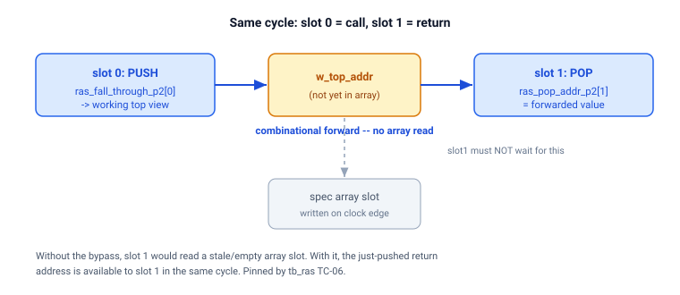
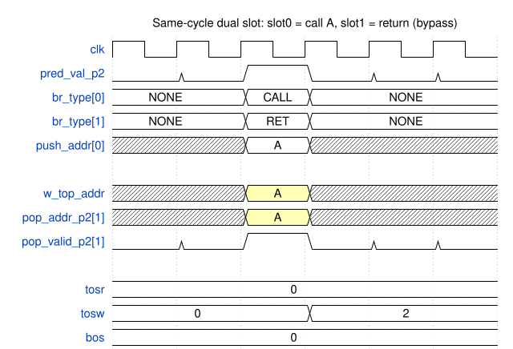
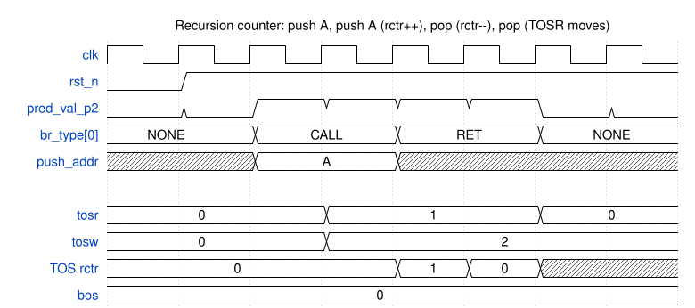
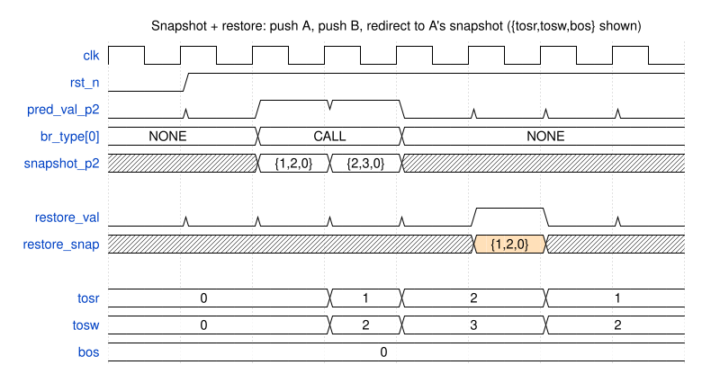

<!-- SPDX-License-Identifier: Apache-2.0                        -->
<!-- Copyright (c) 2026 Jeff Nye, uarchlabs.com                 -->
<!-- SPDX-FileCopyrightText: 2026 Jeff Nye <jeff@uarchlabs.com> -->

title: "RAS -- Theory of Operation"
author: Jeff Nye
date: 2026-11-21
copyright: "Copyright 2026 Jeff Nye"

<!--
```
 FILE:    BLOG_bpu_23_ras_theory_of_op.md
          (revision of misc/ras_theory_of_operation.md)
 SOURCE:  derived from session-050 / BP-062..BP-064; DOC-011;
          revised against ras.sv after BP-153 (sha f0d97fc) and
          ras_decisions.md (16 speculative entries, BP-154)
 STATUS:  DRAFT
 UPDATED: 2026-11-21
 CONTACT: Jeff Nye
```
-->

## RAS Theory of Operation

This is a theory of operation description of the return address stack,
a component in the BPU that assists call/return predictions. The tone
diverges from other blogs; this is less a postmortem of the co-design
of the RAS and more of a description of its operation with references
to the planning documents that were used in RAS creation and testing.

There will be a postmortem as well. This is a descriptive companion
to the canonical RAS records. Where this document and the canonical
records differ, the canonical records take precedence:

- `planning/arch/ras_decisions.md`   -- micro-architectural decisions
- `planning/interfaces/ras_interfaces.md` -- port and contract spec
- `rtl/core/frontend/bpu/rtl/ras.sv`  -- implementation
- `rtl/core/frontend/bpu/tb/tb_ras.sv` -- directed tests (TC-01..TC-83)
  against a reference model written from `ras_decisions.md` 12

This revision describes the design as `ras_decisions.md` records it
after BP-153, with a speculative stack of 16 entries. BP-152 and BP-153
are recorded there as built "for acceptance". Values that depend on
`RAS_SPEC_ENTRIES` are given at 16 entries; the tree holds a temporary
32-entry build until BP-154 runs.[^tree]

**A note on the planning documents.** The planning documents are
amended as decisions are made, and earlier text is not always updated
to match. A ruling that has been superseded is kept as the record of
the earlier choice and is marked SUPERSEDED; the ruling after it
governs. Other drift is not marked. As of this revision:

- `ras_decisions.md` 3.3 gives the commit stack as 32 entries, its
  size before RC10. The current size, 64, is in its sections 9 and 12
  and in this document.
- `ras_decisions.md` 3.2 credits the ACM TACO study of linked
  speculative stacks to Desmet et al. It is by Vandierendonck and
  Seznec [4]; the Desmet et al. study is [2].
- The comments beside the RAS parameters in `bp_defines_pkg.sv` give
  values at 16 entries while the parameters are at 32 (see the
  footnote above).

Where a planning document disagrees with itself, its later rulings and
section 12 hold. Where it disagrees with this document on a point
listed here, this document is current.

---

## 1. What a RAS is for

A return is an indirect branch whose target is, in principle, always
known: it is the address immediately following the matching call.
A general indirect predictor can learn return targets, but it does so
as one more history-indexed pattern, and it mispredicts whenever the
same function is called from more than one site, which is the common
case. The information needed to predict a return is structural, not
statistical. Calls and returns nest in last-in-first-out order, so a
stack reconstructs the target exactly: the return address is pushed
when a call is predicted and popped when a return is predicted, and the
value at the top of the stack is the predicted target.

On typical code, a return address stack predicts returns with an
accuracy approaching 100 percent. The design complexity arises in two
areas in which this abstraction does not hold:

1. **Speculation.** A modern front end pushes and pops on predicted
   call/return flow, many cycles before the prediction is confirmed. A
   mispredicted path corrupts the stack by pushing spurious entries or
   popping valid ones. The structure must therefore restore a
   known-good state at low cost on every pipeline redirect. A related
   problem is that the committed copy of the stack lags the
   speculative one: a frame the speculative path has already popped is
   still on the committed stack until that return commits.

2. **Capacity and reuse.** The stack is finite. Layered software
   (runtime, framework, libraries, operating system) keeps tens of
   frames live at steady state in the absence of recursion, and
   recursion can push the same address repeatedly. The structure must
   degrade in a controlled manner on overflow, must not return an
   entry that has been reused, and must avoid consuming one entry for
   each repetition of an address.

The pacino RAS is organized around these requirements. The remainder of
this document describes the implemented design, the alternatives that
were evaluated, and the corresponding choices made in industry and in
the literature.

---

## 2. Role and context in pacino

The RAS is one of seven predictors in the BP cluster (uBTB, Loop, FTB,
TAGE, SC, ITTAGE, RAS). It predicts only the target of return-type
indirect branches and does not predict branch direction.

It supplies a target and takes no part in the direction ranking
(`fe_decisions.md` 3.3). It is type-gated: it acts only on the RAS
types listed below. The RAS does not classify instructions; the type
is supplied on its ports by the cluster. Classification uses the
RISC-V link-register convention (link means `x1` or `x5`;
`bp_structs_pkg.sv` `bp_br_type_e`; the hint table is
`ras_decisions.md` 2):

- **Call (push):** `JAL` with `rd = x1` or `x5` (`DIRECT_CALL`);
  `JALR` with `rd` a link register and `rs1` either not a link
  register or equal to `rd` (`INDIRECT_CALL`); `C.JALR` with
  `rs1 != x5`.
- **Return (pop):** `JALR`/`C.JR` with `rs1 = x1` or `x5`, and
  for `JALR` only when `rd` is not a link register (`RETURN`).
- **Return-call (pop, then push):** `JALR` with `rd` and `rs1` both
  link registers and unequal, which includes `C.JALR` with
  `rs1 = x5` (`RETURN_CALL`). One instruction performs two RAS
  operations, the pop first (RAS-DS1). The `rd` qualifier of the
  return rule is what keeps the classes disjoint: `JALR rd=x1,
  rs1=x1` is a call, and `JALR rd=x1, rs1=x5` is a return-call.

This divides `JALR`-class branches between two predictors. The RAS
supplies the target of `RETURN` and `RETURN_CALL`; ITTAGE supplies the
target of every other indirect branch (`INDIRECT_CALL`,
`INDIRECT_NONRET`). The FTB jump target is the fallback for both,
taken when the RAS has no valid address for the slot or ITTAGE misses
(`bp_cluster.sv:1248-1258`). It is chosen by hit, not by branch type,
so it is not a third class (`ras_decisions.md` 2).

Where the type comes from depends on the stage and on the FTB:

- at p1, from the uBTB entry;
- at p2, from the FTB entry when the FTB answers; on an FTB miss, from
  the p1 view's taken call, return and return-call slots, which the
  RAS then operates on (BP-153 RC9, `bp_cluster.sv:1156-1167`,
  `:1812-1816`);
- on a restore, from a predecode correction or a resolved backend
  mispredict, for a call or return the RAS did not operate at p2
  (BP-152 C1, BP-153; Section 3.8).

The RAS participates at four points (Figure 1). At **p0** it presents
a combinational read of its current top of stack. The cluster
registers it (`bp_cluster.sv:740-741`), and at p1 the selection mux
uses it as the target of a uBTB slot typed `RETURN` or `RETURN_CALL`
(`bp_cluster.sv:876-880`); the read is an input to the p1 prediction
(`ras_decisions.md` 1). At **p2** the RAS performs the push or the pop
and gives, per slot, the address the slot's pop would read (the peek).
The peek is the return target. It enters the p2 successor of the slot,
and the p2 redirect fires when that successor differs from the one the
cluster formed at p1 (`fe_decisions.md` FE-4). At **p3** the RAS
performs a repair pass that reverses or completes a p2 operation when
the p3 view of the slot no longer agrees with it, and gives the
repaired snapshot back to the FTQ. On a **restore** it reloads its
state from an FTQ snapshot and may undo the restored block's own
operation or apply one the block did not make.


*Figure 1. The RAS contributes at p0 (top-of-stack read, registered
as the target of a p1 uBTB return slot), p2 (push/pop, the peek as the
return target, and the snapshot to the FTQ), and p3 (repair, and the
repaired snapshot to the FTQ). Outside the pipeline it acts on a
restore (snapshot reload, undo of the block's own operation, a
predecode or backend operation) and on a commit. It is gated by the
branch type and supplies a target only; it is not part of the
direction ranking.*

The RAS contains no PQ, UQ, or credit arbiter, and no synchronous
SRAMs. Both stacks are register files. Its update mechanism is pointer
snapshot and restore rather than a RAM write, as described in Section
3.7.

---

## 3. Current design

### 3.1 Two physical stacks, statically partitioned

The RAS contains two independent register-file arrays (Figure 2):

- a **speculative stack** of `RAS_SPEC_ENTRIES` = 16 entries[^tree]
  that tracks in-flight call depth between fetch and commit. It is a
  circular buffer whose entries each carry a next-on-stack link, a
  bottom mark, an allocation generation and the count of the entry
  below; and
- a **commit stack** of `RAS_COMMIT_ENTRIES` = 64 entries, a
  conventional circular stack that holds the committed call nest
  (32 until BP-153 RC10, accepted session-086).

The partition is static: two separate arrays rather than a shared
pool. The advantage is that each event affects mostly one array. Each
array wraps at its own fixed limit, with no shared moving boundary to
check; a mispredict restore reaches only the speculative array; commit
advancement reaches only the commit array and the speculative BOS.
Pointer arithmetic and the verification surface both remain small.

The speculative entry fields (`ras.sv:220-243`); the commit stack
holds a return address only (`ras.sv:248`, Section 3.6):

| Field | Width | Meaning |
|---|---|---|
| `ret_addr` | `VA_WIDTH` = 59 | return address (also the only commit-stack field) |
| `rctr` | `RAS_RCTR_WIDTH` = 4 | recursion counter |
| `nos`  | `RAS_PTR_BITS` | next-on-stack link (BP-120) |
| `bot`  | 1 | bottom mark (BP-138; also set by a link kill, BP-152) |
| `gen`  | `RAS_TAG_BITS` | allocation generation (BP-152, B1) |
| `ncnt` | `RAS_RCTR_WIDTH` | count of the entry below at allocation (BP-153, RC12) |

The values are fixed in `bp_defines_pkg.sv`. The pointer, depth and tag
widths are `localparam`s derived from the depths, not set
independently:

| Parameter | Value | Meaning |
|---|---|---|
| `RAS_SPEC_ENTRIES`    | 16 | speculative stack depth[^tree] |
| `RAS_COMMIT_ENTRIES`  | 64 | commit stack depth |
| `RAS_RCTR_WIDTH`      | 4  | recursion counter width (saturates at 15) |
| `RAS_ADDR_WIDTH`      | 59 | = `VA_WIDTH` (FE-19, BP-145) |
| `RAS_PTR_BITS`        | 4  | `$clog2(RAS_SPEC_ENTRIES)` |
| `RAS_COMMIT_PTR_BITS` | 6  | `$clog2(RAS_COMMIT_ENTRIES)` |
| `RAS_DEPTH_BITS`      | 8  | `$clog2(FTQ_DEPTH) + 2`, call-depth width |
| `RAS_TAG_BITS`        | 4  | `$clog2(FTQ_DEPTH / (RAS_SPEC_ENTRIES - 1) + 1) + 1` |
| `RAS_PMODE_BITS`      | 2  | pop-record mode |

[^tree]: BP-153 raised `RAS_SPEC_ENTRIES` to 32 (RC11) to remove the
    remaining wrap cases. Jeff rejected that in session-086, and
    BP-154 returns it to 16. Until BP-154 runs, the tree is built at
    32: `RAS_PTR_BITS` 5, `RAS_TAG_BITS` 3, a 41-bit snapshot, 31
    usable entries, and full at 30 allocations beyond BOS. The
    package comments in `bp_defines_pkg.sv` and `bp_structs_pkg.sv`
    already give the 16-entry values. This document describes the
    16-entry design throughout.

`ras.sv` declares its address ports and arrays with `VA_WIDTH`, which
`RAS_ADDR_WIDTH` equals. `VA_WIDTH` is 59 because, with the hypervisor
extension mandatory, a fetch PC under V=1 and vsatp.MODE=Bare is a
guest physical address of the widest G-stage mode (`fe_decisions.md`
FE-19; tb_ras TC-72a/b hold addresses above 2^41 in both stacks). The
commit-stack occupancy count is `RAS_COMMIT_PTR_BITS + 1` = 7 bits, a
`localparam` of `ras.sv` (`ras.sv:215`).


*Figure 2. Two register-file stacks. The speculative stack is a
circular buffer with a next-on-stack link and a bottom mark per entry,
TOSR/TOSW/BOS pointers and a reserved BOS sentinel slot; the commit
stack is a conventional stack with CSP and an occupancy count. Each
FTQ entry holds a snapshot of the three pointers, the top entry's
count, the speculative call depth, the top entry's generation and the
block's operation record (Section 3.7).*

### 3.2 The speculative stack and its pointers

Three pointers, each `RAS_PTR_BITS` wide, define the speculative
stack:

- **TOSR** -- Top Of Stack Read: the current top, the entry a pop
  returns.
- **TOSW** -- Top Of Stack Write: the next free allocation slot.
- **BOS**  -- Bottom Of Stack: the committed boundary.

A fourth register, **dsp**, is the speculative call depth (Section
3.6). Several aspects of the pointer discipline warrant explicit
description, because the majority of corner cases derive from them.

**The BOS sentinel.** Empty is detected as `TOSR == BOS`. To prevent a
single live entry from aliasing the empty condition, the BOS index is
treated as a permanent sentinel: a push that would allocate onto BOS
allocates at `BOS+1` instead. This occurs at cold start after reset and
on a full circular wrap. The consequence is that usable depth is
`RAS_SPEC_ENTRIES - 1` = 15. (In `tb_ras`, this is
why the first push after reset is placed at index 1 with `tosr=1,
tosw=2`; TC-02.)

**TOSW is monotonic across pops.** A pop presents the TOSR entry and
moves TOSR down; it does not overwrite array data and does not retreat
TOSW. Popped entries therefore remain physically resident. This
property is what makes pointer restore work (Section 3.7): a restore
can re-expose a previously popped entry by moving a pointer, because
the data is not overwritten until the allocator reaches the slot
again.

**The next-on-stack link.** Because TOSW only advances, the entry below
the top is in general not the slot below it. In the sequence push A ->
push B -> pop -> push C, C is at index 3 and the entry below it is A at
index 1 (`tb_ras` TC-29). Each entry therefore records the index of
the entry below it in `nos`, written by the push that allocates the
entry and followed by the pop that removes it. Before BP-120 a pop
moved TOSR to TOSR-1, which there is B's slot, and the correct path
mispredicted (TD#159; Section 4.1). TC-29 to TC-33 check the link.

**The link kill and the generation (B1, BP-152).** The allocator
reuses a slot whenever it passes it, whether or not the stack is full,
and the sentinel skip protects only the current BOS. An older entry
whose link names a reused slot would then pop into the reusing push's
address (BP-151 measured this as the second cause of return
mispredicts, `stale_below_bos`). So an allocation at index `a` makes
bottom every other entry whose link names `a` (`st_kill`,
`ras.sv:542-556`); the pop of such an entry goes to BOS and takes the
commit-stack fallback (Section 3.6). Each entry also carries an
allocation generation, advanced on each allocation of the index. A
snapshot records the generation of its TOSR entry (`tag`), and the p3
registers record that of the pre-operation TOSR. A restore, an
undo-pop or the undo of a whole return-call to an entry whose
generation has moved since reads the stack empty (TOSR = BOS). TOSR ==
BOS therefore stays the whole empty test (`ras_decisions.md` 12.12
IV1). The bound is the tag width: a snapshot whose TOSR entry is
reallocated `2^RAS_TAG_BITS` times during its life aliases
(`ras_assert.sv` RS6 checks it).

**TOSR below BOS is not a fault** (ruled session-084). Speculation runs
ahead of commit: a younger block's pop can take TOSR below the BOS
that the commits of older blocks leave, before their returns commit,
and a restore to an older snapshot can do the same. The entry at TOSR
is then below BOS in allocation order but still on the chain, and its
pop returns the address it was pushed with. A *held* entry is
therefore one a push wrote on the current chain and no allocation has
reused since (`ras_decisions.md` 3.2, 12.5 PO7, 12.12 IV1), not one
above BOS in allocation order.

The primitives that act on the stack (`ras.sv:503-725`):

- **Push** (`st_push`): with the recursion match (Section 3.5), increment
  the top's count. Otherwise write `ret_addr`, `rctr = 0`, the link and
  the count below to the TOSW slot (skipping the BOS sentinel), set
  `TOSR = alloc`, advance `TOSW = alloc+1`, advance the slot's
  generation and kill every other link that names the slot. The link is
  the current TOSR; it is BOS on the sentinel skip, on an empty stack,
  and when the allocation lands on the TOSR entry itself (TOSR below
  BOS with the allocator round to it, BP-152, TC-74a). In those three
  cases the new entry is marked bottom.
- **Pop** (`st_retract`): present the TOSR entry. With `rctr > 0`,
  decrement the count and hold TOSR. Otherwise TOSR follows the link,
  or goes to BOS as it is then when the entry is bottom. When the link
  leads to a live entry whose count differs from the `ncnt` the popped
  entry recorded at its allocation, the recorded count is written back
  (BP-153 RC12, `ras.sv:584-596`; Section 3.7).
- **Empty (`TOSR == BOS`):** a pop reads the commit-stack fallback at
  the speculative depth (Section 3.6); the commit entry is not
  consumed. A commit moves BOS, and four rules keep the empty test exact
  across commits (`ras_decisions.md` 3.2; `ras.sv:418-450`):
  1. A push onto an empty stack, or by the sentinel skip, marks its
     entry bottom; the pop that removes a bottom entry sets TOSR to
     BOS as it is then, not to the link (BP-138, TC-41c).
  2. A commit that moves BOS while TOSR == BOS moves TOSR with it
     (BP-138, TC-41a, TC-41b, TC-42).
  3. A p3 undo of an operation that began on an empty stack restores
     TOSR to BOS as it is at the undo (BP-138, TC-43).
  4. A `RETURN` commit whose snapshot is an empty stack (snapshot
     TOSR == snapshot BOS) leaves BOS where it is (BP-140; final,
     session-084, TD#189 closed; TC-44). That snapshot TOSR is the BOS
     of the cycle in which the return popped a bottom entry. The
     commits of older blocks have since moved BOS off that slot, and
     the sentinel skip protects only the current BOS, so allocation
     may have reused the slot for a younger push. Moving BOS back to it
     would leave BOS on an entry the stack holds. The current BOS is
     the entry the return popped, committed by its call, so the stack
     the return leaves is empty there.
- **Full (`TOSW+1 == BOS`):** `RAS_SPEC_ENTRIES - 2` = 14 slots have
  been allocated beyond BOS and one push remains;
  it leaves TOSW == BOS, and the push after it takes the sentinel skip
  (BP-142, TC-50; `ras_decisions.md` 12.4 PU4). A pop does not retreat
  TOSW, so these are the allocations since BOS last moved, not
  necessarily that many live entries (TC-44 walks TOSW around the
  buffer with at most one entry live).
- **Overflow (wrap):** the next push finds `TOSW == BOS` and takes
  the sentinel skip; its entry links to BOS and is bottom. This is not
  the loss of one entry. TOSR becomes `BOS+1`, so reachable depth
  collapses to a single entry in one push; the older entries stay
  physically resident but unreachable, and the following pop hits
  `TOSR == BOS` and takes the commit-stack fallback. No fault is
  raised, and the fallback bounds the damage, but the degradation is a
  cliff rather than a gradual slope. TC-18 checks only that the unit
  stays functional across the wrap. TC-82 (BP-153) shows the wrap
  for an uncommitted call; BP-154 makes it a capacity case at 16
  entries.

### 3.3 The prediction path: p0 read and p2 push/pop

At **p0** the RAS presents a purely combinational read of its top: the
speculative top when the stack is non-empty, otherwise the commit-stack
fallback at the current speculative depth, otherwise invalid. Both
prediction slots see the same p0 value (`ras.sv:348-362`). Because the
read is combinational off the registered pointers and arrays, an entry
pushed at p2 becomes visible at p0 in the following cycle (TC-19). In
the cluster the p0 read of a block is taken while the two blocks ahead
of it are at p1 and p2, so it does not reflect their operations; the
p2 operation of the block, two cycles later, does.

At **p2** the operation runs combinationally in the scan
(`ras.sv:762-1129`), gated per slot on `ras_pred_val_p2` and the type
on `ras_br_type_p2`. There is no reset-complete gate: until BP-142 a
registered `ras_rst_done` held the scan idle in the first cycle after
reset, which dropped an operation made in that cycle (TC-47c). Per slot
the scan produces:

- the pop address and valid, `ras_pop_addr_p2` / `ras_pop_valid_p2`,
  asserted only on a slot that pops. Valid is deasserted only when the
  speculative stack is empty and the fallback is not valid (the commit
  stack is empty, or the frame at the speculative depth is gone);
- the peek, `ras_peek_addr_p2` / `ras_peek_valid_p2` (BP-153 RC6,
  `ras.sv:1041-1049`): the address the slot's pop would read from the
  state the earlier slots leave, whether or not the slot pops. It equals
  the pop output for a slot that pops;
- the post-operation snapshot, `ras_snapshot_p2` (Section 3.7).

On an FTB hit the cluster presents a slot when its block is valid,
the slot holds a branch, and no earlier slot of the block is predicted
taken. On an FTB miss it presents the p1 view's taken RAS-typed slots
within the p1 view's reach (`bp_cluster.sv:1156-1167`). The return
target of a `RETURN` or `RETURN_CALL` slot is the peek when the peek
is valid, otherwise the FTB jump target (`bp_cluster.sv:1248-1254`).
The peek rather than the pop is used so that a return that an earlier
conditional made unreachable at p2, and that SC makes reachable at p3,
already has the target its p3 missed pop will read (BP-151 cause
`p3_reach`).

The FTQ entry takes the snapshot of the last slot,
`ras_snapshot_p2[NUM_PRED_SLOTS-1]`, for every valid p2 block
(`bp_cluster.sv:1358`; `ras_decisions.md` 4.2). The p1 value,
`bpu_pred_ras_p1`, is the same last-slot snapshot of the block ahead
with its operation record cleared, and only initializes the field
(`bp_cluster.sv:1000-1006`).

### 3.4 Slot formation and same-cycle operations

The front end predicts up to `NUM_PRED_SLOTS = 2` branches per
prediction block (a one-slot build is supported, BP-128;
`bp_defines_pkg.sv:55-66`). Both slots are branch fields of the one
32-byte block (`FTB_BLOCK_BYTES`) that starts at the request PC, each
located by its own position in the block (`ras_decisions.md` 6.1). At
p2 the cluster forms them from the FTB entry for that start
(`bp_cluster.sv:1059-1105`): slot 0 carries the entry's first
conditional field, `br0`; slot 1 its second, `br1`; and the entry's
single jump field goes to the lowest slot that holds no conditional.
The fields are in position order, so the slots are in program order.
At p1 the same holds for the uBTB entry, which since BP-140 stores its
fields in position order.

A branch the FTB reports that no slot carries is cut (BP-139): the
block ends at that branch's PC. The next block starts at that PC and
carries the branch in slot 0 (`bp_cluster.sv:1107-1133`,
`:1209-1217`). At one slot that branch is `br1`; at two slots it is
the jump when both slots hold conditionals. Since BP-140 the FTB ends
an entry at such a branch when it updates the entry. An entry then
holds at most `NUM_PRED_SLOTS` branches; the cut is a backstop that the
FTB's own entries do not reach.

Only the jump field carries a call, return or return-call type
(`bp_cluster.sv:1046-1057`, `:1096-1104`); a conditional slot is
`COND`, on which the RAS does nothing. An entry has one jump field, and
a RAS-typed branch is taken, so no later slot of the block is on the
predicted path (`w_reach_p2`, `bp_cluster.sv:1138-1143`). At most one
slot of a block therefore operates on the RAS (`fe_decisions.md`
FE-11). That slot may be slot 1, behind a not-taken conditional in
slot 0, which is the case `fd24_call_slot1` demonstrates.

Within `ras.sv`, every slot is evaluated in one cycle, slot 0 before
slot 1, slot 1 seeing the state left by slot 0. `ras_snapshot_p2[0]`
reflects the state after slot 0 only; `ras_snapshot_p2[1]` reflects
the state after both slots (TC-11). The module handles two operations
in one cycle: two pushes, two pops, return then call, and call then
return. For call then return, slot 1 must return the address that
slot 0 has just pushed, which the array does not hold until the clock
edge. The scan carries a
working top of stack (the `ras_ws_t` state, `ras.sv:452-491`) from step
to step, and slot 1's pop reads the pushed address from it with no
array read (`w.top_addr`, `ras.sv:1067`; TC-06, Figure 3). The working
state also carries the counts, allocations and kills the scan has made
so far, so a later step sees them before the array does (`cw_*`,
`al_*`, `kl`). The forwarding has no gating of its own on the two
slots' types; every step of the scan reads the same working state.
`tb_ras` covers these combinations (TC-04 to TC-07, TC-11, skipped at
one slot). Because `bp_cluster` never presents two RAS-typed slots in
one block, the integrated front end does not reach them
(`ras_decisions.md` 6.2 to 6.4, 12.7 SL4).

The two operations that do occur together are those of a
`RETURN_CALL`: one instruction in one slot, the pop first and then
the push applied to the state the pop left (RAS-DS1;
`ras.sv:1051-1106`; TC-22 to TC-25). The pop supplies the predicted
target. When the pop only decrements a recursion count, the slot makes
two array writes, which is why the scan has two write ports per slot
per pass (`ras.sv:191-200`; TC-24).



*Figure 3. Slot 0 call and slot 1 return in one cycle, at the module
level. The pushed return address reaches the slot-1 pop output from
the scan's working top of stack, before the array write that occurs at
the clock edge. `bp_cluster` does not present this combination.*

### 3.5 Recursion counter

Recursive calls would otherwise consume one entry per repetition of the
same return address. Each speculative entry carries a 4-bit `rctr` to
accommodate them:

- **Push** of an address equal to the current TOS `ret_addr` (with the
  stack non-empty) increments `rctr` in place rather than allocating;
  TOSW does not advance. The counter saturates at 15; further
  repetitions are suppressed (TC-08, TC-10). The p2 push and the
  restore-time push (Section 3.8) are made with this match enabled; a
  missed push applied by the p3 repair allocates without it
  (`ras.sv:986`, `:1095`, `:1286`).
- **Pop** when `rctr > 0` decrements `rctr` and holds TOSR; only when
  `rctr == 0` does the pop move TOSR (TC-09).

The speculative depth (Section 3.6) moves by one on every push and pop
whatever the counter does: a push that increments a count, or meets a
saturated one, still adds one to the depth.

When two slots push in one cycle (reached only in `tb_ras`, Section
3.4), the second push compares against the top the first left: two
pushes of the address on top increment the count twice, clamped at 15;
two pushes of a new address allocate once, and the second increments
that entry's count to 1. Recursion detection is speculative only.
The commit stack has no recursion count: every committed call is its
own entry, so depth is kept as repeated entries (TD #79 closed by
BP-133; the unused field was removed by BP-134; TC-39).

### 3.6 Commit path and the depth-aware fallback

The RAS has one commit port with no slot dimension
(`bp_cluster.sv:232-237`); the FTQ retires one entry per cycle, so the
RAS receives at most one commit event per cycle. `bp_cluster` passes a
commit only for a RAS-typed branch (`bp_cluster.sv:1734-1738`). The
commit arms (`ras.sv:1347-1368`, `:1483-1488`):

- a call writes the return address at CSP and advances CSP (TC-13);
- a return decrements CSP (TC-14); on an empty commit stack it does
  nothing;
- a return-call applies the return arm and then the call arm to the
  CSP the first leaves. With the commit stack non-empty it overwrites
  the committed top in place (TC-28); on an empty commit stack the
  return arm does nothing and the call arm writes at CSP and advances.

BOS moves as described in Section 3.7. Commit is registered: it takes
effect the cycle after `ras_commit_val` and does not interact
combinationally with the p2 path, except that when the scan leaves
`TOSR == BOS`, a commit that moves BOS moves TOSR with it (BP-138).

CSP is a free pointer: the top entry is at `CSP-1`. An occupancy
count beside it, 0 to 64, says whether the stack is empty (BP-126,
TD#121). A call committed on a full stack overwrites the oldest entry
and the count holds at 64, so a full stack still reads non-empty. A
return committed on an empty stack does nothing (TC-36, TC-37).

**The fallback reads the committed frame at the speculative depth
(A1, BP-152).** The commit stack changes only at commit, so a frame the
speculative path has already popped is still its top until that return
commits. Before BP-152 the fallback read CSP-1, and a later return that
found the speculative stack empty read that already-popped frame
(BP-151 measured it as 85 to 99 percent of mispredicted returns at most
sweep points, `fb_stale_top`, TD#207). The RAS now keeps two call
depths (`ras.sv:258-262`):

- **dsp**, the speculative path's call depth. Every push adds one and
  every pop takes one, by logical effect, whatever the stack did (an
  allocation, a count change, a saturated count, a fallback read,
  valid or not). A repair reverses or applies its component. It is
  carried in the snapshot (`dep`) and a restore loads it.
- **dcm**, the `dep` of the last block the RAS committed
  (`ras_commit_snapshot.dep`), the depth the commit stack's top stands
  at in the same count.

`n = dcm - dsp` is the number of committed frames the younger blocks
have popped and not yet committed. The fallback (`f_fb`,
`ras.sv:316-336`) reads:

- `CSP-1-n` when `0 <= n < count`;
- `CSP-1` when `n < 0` (the speculative path is deeper than the
  committed one, which only the wrap leaves empty);
- nothing (not valid) when `n >= count`: every committed frame has
  been popped, or the frame was lost to a full commit stack's
  overwrite.

The fallback is not consumed. It supplies both the p0 read and an
empty-stack pop (TC-15, TC-20, TC-73). `dcm` is taken from the snapshot
rather than counted at commit, so a call or return that commits
without having operated at p2 cannot leave the two depths apart for
good. Both depths are `RAS_DEPTH_BITS` = 8 wide and free-running; only
their difference is read, and it is bounded by the FTQ depth.

### 3.7 Snapshot and restore

This mechanism is central to speculative recovery and is the rationale
for the speculative-stack organization.

Every valid p2 block writes one `bp_ras_snapshot_t` into its FTQ entry
(Section 3.3; `bp_structs_pkg.sv:166-208`):

| Field | Width | Meaning |
|---|---|---|
| `tosr`, `tosw`, `bos` | 3 x `RAS_PTR_BITS` | pointers after the block |
| `rctr`  | `RAS_RCTR_WIDTH` | count of the entry at `tosr`, 0 when empty (BP-142) |
| `dep`   | `RAS_DEPTH_BITS` | speculative call depth after the block (BP-152, A1) |
| `tag`   | `RAS_TAG_BITS`   | generation of the entry at `tosr`, 0 when empty (BP-152, B1) |
| `push`  | 1                | the block pushed (BP-153) |
| `pmode` | `RAS_PMODE_BITS` | the block's pop: NONE, LINK, DEC or EMPTY (BP-153) |
| `ptosr` | `RAS_PTR_BITS`   | TOSR before the pop (BP-153) |
| `ptag`  | `RAS_TAG_BITS`   | generation at `ptosr` then (BP-153) |

The width is `4 * RAS_PTR_BITS + RAS_RCTR_WIDTH + RAS_DEPTH_BITS +
2 * RAS_TAG_BITS + RAS_PMODE_BITS + 1` = 39 bits[^tree] (28 after
BP-152, 16 after BP-142, 12 before; `ras_decisions.md` 4.1, 12.13
PM2). The `push`, `pmode`, `ptosr` and `ptag` fields are the block's
operation record: they say what the block did, so that a
restore can undo exactly that and nothing else.

**The p3 snapshot (BP-153, TD#149 closed).** When the p3 repair changes
the stack for the p3 block and no restore is taken that cycle, the RAS
gives that block's snapshot after the repair, with the repaired
operation record (`ras_rep_val`, `ras_rep_snapshot`,
`ras.sv:1007-1024`). The FTQ writes it over the block's p2 snapshot.

**The restore** (`restore_scan`, `ras.sv:1131-1317`;
`ras_decisions.md` 4.3, 12.9). On a redirect the FTQ drives
`ras_restore_val` with the snapshot of the entry the redirect names by
its index. The restore, in effect the next cycle:

1. Loads TOSR, TOSW, BOS and the depth from the snapshot. When the
   generation of the entry at `snapshot.tosr` is not `snapshot.tag`,
   that entry has been reallocated since, and TOSR loads as BOS: an
   empty stack (B1, RE1, TC-74b).
2. For a TOSR it keeps, writes `snapshot.rctr` back into that entry's
   count (TD#194 option A, ruled session-084, built BP-142; RE6,
   TC-45, TC-58). A count the wrong path changed in place on the top
   entry is thereby put back.
3. With `ras_rs_undo`, retracts the restored block's own push, which
   the redirect shows off the path, as the p3 undo-push does; the depth
   less one (BP-152, RE9, TC-76).
4. With `ras_rs_undo_pop`, undoes the restored block's own pop from the
   snapshot's pop record, as the p3 undo-pop does (BP-153, RE10, TC-78):
   LINK sets TOSR back to `ptosr` (or BOS if its generation moved) and
   writes that entry's count to 0; DEC increments the count at `ptosr`
   back; EMPTY changes no stack state; the depth plus one in every
   case.
5. With `ras_pd_val`, applies the restore-time operation (Section
   3.8).

Apart from these writes, the circular-buffer data is not cleared.
Pushes after the restore allocate from the restored TOSW, over slots
the wrong path wrote, which is correct because those slots are no
longer reachable. The restore takes strict priority over the same
cycle's scan: in a restore cycle neither the p3 repair nor the p2
operation writes the array or moves a pointer (RE3, RE4), and the p2
operation is registered as none for p3 (`ras.sv:1412-1440`,
`:1494-1496`; TC-12). The commit stack and `dcm` still update.

**Counts below the top (BP-153 RC12).** Step 2 restores only the
top's count. A wrong path can also change, in place, the count of an
entry below the restored top (it must pop past the top and push a
matching address). Each entry therefore records, at its allocation, the
count of the entry its link names (`ncnt`, 0 for a bottom entry). A pop
that follows the link to a live entry writes that recorded count back
when the array holds another (`ras.sv:584-596`; RE11, TC-83). Before
BP-153 such a count kept the wrong path's value.

`bp_cluster` applies the restore with two exceptions (BP-121,
`fe_decisions.md` FE-14). For the cluster's own p2 or p3 redirect the
restore is masked: the redirecting block's own operation already
stands, or is repaired at p3 in that cycle, and the restore would
discard it (`bp_cluster.sv:1481-1487`). The restore-time operation and
the two undo inputs are masked with it (`bp_cluster.sv:2144-2148`). A
block younger than a redirect is squashed: `ras_p2_keep` low drops its
p2 operation and registers it as none, while the p3 repair of the
older block in the same cycle still applies (`bp_cluster.sv:2134`;
`ras.sv:1445-1464`; TC-34, TC-35).

This provides constant-time (O(1)) recovery with no replay and no
per-operation undo log. It is exact while the buffer has not wrapped
(RE5): because TOSW only advances, a wrong-path push never overwrites
an entry the snapshot can reach (TC-32), and the generation check
turns a reuse into an empty read rather than a wrong address. Across a
wrong-path wrap only the bound is specified (RE7). This
checkpoint-and-restore approach corresponds to the pointer-fixup
mechanism described by Skadron et al. [1], which saves the
top-of-stack pointer at each prediction for restoration after a
misprediction.

The committed boundary is updated under the priority
**restore > commit > hold** (`ras.sv:1472-1480`): a restore in the same
cycle as a commit sets BOS from the snapshot; otherwise a commit moves
BOS to the committing entry's post-op TOSR, except a `RETURN` commit
whose snapshot is an empty stack, which leaves BOS (Section 3.2, rule
4); otherwise BOS holds. When a commit moves BOS and the scan leaves
`TOSR == BOS`, TOSR moves with it (rule 2, `ras.sv:1365-1367`,
`:1444`).

### 3.8 Restore-time operations: predecode and backend

A call or return that the RAS did not operate at p2 would otherwise
reach the RAS only at commit, and every return after it would see the
wrong stack. BP-151 measured this for calls only predecode finds and
for calls and returns only the backend finds. BP-152 and BP-153 apply
the operation on the restore of the redirect that corrects the block
(`ras_decisions.md` 7; `ras.sv:150-172`, `:1180-1296`):

- **Predecode (C1, BP-152).** On the restore of a winning predecode
  redirect whose corrected slot is a taken call, return or return-call,
  and whose entry held no taken RAS operation (or held one the
  correction leaves off the path, undone first), the FTQ drives
  `ras_pd_val` with the type and the call's own PC plus its length. The
  IFU raises a predecode mispredict for a JAL only, so in practice this
  arm carries direct calls (TC-75).
- **Backend (BP-153).** On the restore of a winning `RC_MISPREDICT`
  redirect with `_self` clear whose resolved type is a RAS type, the
  FTQ drives the same ports (`ftq.sv:580-689`, `bk_ras`). The
  operation applies when the entry holds no taken RAS operation before
  the redirect position, or at it as the same operation. A held
  operation after the position, or at it as another operation, is
  undone first (`ras_rs_undo`, `ras_rs_undo_pop`). An entry slot is
  held only when the snapshot's operation record says the RAS operated
  it (TC-77).

The operation follows the p2 rules: the pop first, then the push with
the recursion match. A pop on an empty stack reads nothing; the
redirect's own target comes from predecode or the backend. The
post-operation snapshot, with the operation's record, goes back to the
FTQ entry on `ras_pd_snapshot`, so the entry's later restores and its
commit read it. With these two arms and the p1 slots on an FTB miss
(Section 2), every call and return reaches the RAS speculatively, and
RAS-1 is closed (`ras_decisions.md` 7, 10).

### 3.9 p3 repair

The p3 pass exists because the p2 operation is made on a view that can
change one cycle later. In `bp_cluster` the p3 type of a slot is its
registered p2 type. On an FTB hit its p3 valid is qualified by p3
reachability, which uses the SC direction; on an FTB miss the p3 view
is the registered p2 view, and nothing is repaired
(`bp_cluster.sv:1828-1833`). When SC reverses an earlier conditional
so that a call or return becomes reachable or unreachable, the p3 view
differs from the p2 operation, and the RAS applies the inverse on the
speculative stack:

| p2 did | p3 says | repair |
|---|---|---|
| push  | no-op | pop  (undo the push) |
| no-op | pop   | pop  (apply missed pop) |
| pop   | no-op | push (undo the pop) |
| no-op | push  | push (apply missed push) |
| return-call | no-op | undo both: TOSR to its pre-op value |
| no-op | return-call | missed pop, then missed push |

The `push->pop` and `pop->push` transitions within a single p2/p3 pair
cannot occur. The labels denote restoration of stack height over
resident entries; only a missed push allocates (`ras.sv:851-1000`):

- **Undo-push** removes the pushed entry as a pop does. When the push
  allocated, TOSR follows the entry's link (TC-16, TC-31c), or goes to
  BOS for a bottom entry. When the push incremented a count, the count
  is decremented. The undo of a push that met a saturated count
  changes nothing, as the push changed nothing (BP-134, TC-40).
- **Undo-pop** restores the TOSR the pop started from, registered at
  p2, with no array write of an address, and increments back a count
  the pop decremented (BP-120, BP-133; TC-17, TC-21, TC-31a). When the
  generation of that entry has moved since p2, TOSR goes to BOS (B1).
- **Missed pop** is a pop: TOSR follows the link, or a count is
  decremented (TC-31b).
- **Missed push** is the only case that allocates: the registered
  fall-through is written at the frontier, linked to the current top,
  without the recursion match (TC-31d).
- The undo of a whole return-call restores the pre-op TOSR and the
  counts its pop and push changed (TC-26, TC-38); a missed return-call
  is a missed pop and then a missed push (TC-27).

Each component moves the speculative depth: an undo-push takes one, an
undo-pop adds one, a missed pop takes one, a missed push adds one, and
the undo of a whole return-call none.

An undo of an operation that began on an empty stack restores TOSR to
BOS as it is at the undo (Section 3.2, rule 3; TC-43). A return-call
paired at the other stage with a plain push or pop is not specified;
two of the four pairings give a wrong result as built, and none is
reachable from `bp_cluster`, because the p3 type is the registered p2
type (`ras_decisions.md` 1, TD#165 closed as unreachable; TC-33). If
the p3 type is ever taken from anywhere else, those two pairings must
be fixed first.

The repair's corrected snapshot goes to the FTQ (Section 3.7, the p3
snapshot), so the block's later restores and its commit see the
repaired stack. End-to-end, `tb_bp_cluster` CB2-RP4 reaches the
undo-pop over a recursion decrement by forcing SC (`tb_fe_top`
`rec_undo` was removed by BP-143: a program does not make SC reverse a
direction by construction).

This realignment-on-misprediction approach corresponds to the
correction described by Desmet et al. [2]: after a call or return
misprediction, the recovered top-of-stack pointer is moved to the next
or previous slot relative to the checkpoint rather than rebuilding the
stack. pacino applies the same principle one stage earlier, between p2
and p3. Its repair moves TOSR to the registered pre-operation TOSR or
along the link.

In the RTL, the repair and p2 passes share a single combinational scan,
the repair first and the p2 operation on the state the repair left. It
emits up to `2 x NUM_PRED_SLOTS x 2` speculative write requests, 8 at
two slots. Each slot has two per pass; repair writes take the low
indices and p2 writes the high. The writes are applied in index order,
so a later write to an index supersedes an earlier one in the same
cycle, and the link kills are applied last (`ras.sv:191-200`,
`:1447-1469`). With `ras_p2_keep` low the p2 writes are dropped and the
repair writes stay. A restore cycle has its own five write ports
(`ras.sv:201-209`).

### 3.10 Reset

On synchronous active-low reset, all pointers (TOSR, TOSW, BOS, CSP),
the commit-stack occupancy count, both call depths (dsp, dcm), every
speculative entry's `ret_addr`, `rctr`, `ncnt`, `nos`, `bot` and
generation, every commit `ret_addr`, and the p2-to-p3 registers clear
to zero (`ras.sv:1377-1407`), and both valid outputs deassert on the
first post-reset cycle (TC-01). A registered `ras_rst_done` is set
after reset; since BP-142 only observers read it (`tb_fe_top`,
`examples/fe_demo`). The scan stays in Verilator's `nba_sequent`
schedule without it, because it reads the pointer and array flops
(`ras.sv:264-271`; `ras_interfaces.md` 9.2).

### 3.11 Known limitations and closed items

Closed, with where each is checked:

- **TD #78 -- closed by BP-133.** An undo-pop over a pop that only
  decremented `rctr` restores the pre-op TOSR and increments the count
  back; the undo of a whole return-call restores the counts its pop and
  push changed. `tb_ras` TC-21 and TC-38; end to end `tb_bp_cluster`
  CB2-RP4.
- **TD #79 -- closed by BP-133, not a defect.** The commit stack has no
  recursion compression: every committed call is its own entry, so the
  commit fallback reads recursion at its true depth (`tb_ras` TC-39).
- **TD #101 -- closed by BP-126.** `ras_pc_p2` was removed. The pushed
  return address comes from `ras_fall_through_p2`, the call's own PC
  plus 2 or 4, or on an FTB miss the p1 fall-through
  (`bp_cluster.sv:1812-1813`; `ras_decisions.md` 8).
- **TD#189 -- closed session-084.** The empty-snapshot `RETURN` BOS
  rule (Section 3.2, rule 4) is final.
- **TD#194 -- closed by BP-142 (option A), extended by BP-153.** The
  top entry's count is restored from the snapshot; a count below it is
  restored by the `ncnt` write-back when a pop reaches it.
- **TD#149 -- closed by BP-153.** The p3 repair rewrites the FTQ
  snapshot.
- **RAS-1 -- closed by BP-152 and BP-153.** Every call and return
  reaches the RAS speculatively (Section 3.8).
- **RAS-4 / TD#207 -- closed by BP-153 (for acceptance).** Every RAS
  cause BP-151 classified measured 0 over its 25 runs. The 1,059
  return mispredicts left are not RAS causes: `ref_unmatched` (1,009,
  returns to targets no committed call linked) and `unwound` (50,
  returns that skip frames). The wrap returns with BP-154's revert to
  16 entries.

**RAS-3 is closed**, and is worth stating explicitly because the
unread `ras_flush_*` ports invite the opposite conclusion. There is no
flush-specific RAS behavior and none is coming. A flush is a redirect
(`fe_decisions.md` FE-14), so the RAS response to a flush is the
restore of Section 3.7, built and tested as `ras_restore_val`.
`ras_flush_val` and `ras_flush_snapshot` are redundant with that
restore group and are deliberately left unread (RE8); they are
evidence of a redundant port, not of an open question. See
`ras_decisions.md` 4.4 and 4.4.2. The port comment in `ras.sv` reads
"RAS-3 CLOSED" (`ras.sv:145-148`).

One correction to an older claim: the commit stack is architectural
only for frames no speculative return has popped (`ras_decisions.md`
4.4, corrected session-086). The depth-aware fallback of Section 3.6
is what keeps a popped frame from being read.

---

## 4. Other design choices

The pacino RAS represents a conservative point in a large design space.
This section describes the alternatives that were evaluated, followed
by the corresponding choices made in industry and in the literature.

### 4.1 Alternatives evaluated

**Linked circular array compared with simple circular buffer.**
Session-050 chose a simple circular buffer over the XiangShan
Kunminghu linked circular array [3], in which each entry carries a
next-on-stack (`nos`) pointer forming an explicit chain. The grounds
were that the literature did not establish an IPC benefit for the
linked structure, and that pointer snapshots already gave O(1)
recovery. Vandierendonck and Seznec [4] report that a RAS with no
speculative-state management, backed by the BTB when a detector finds
it corrupted, performs as well with 8 entries as a 64-entry
self-checkpointing RAS. BP-119 then found the pointer rules built on
that choice wrong on the correct path (TD#159).
With TOSW only advancing and a pop moving TOSR to TOSR-1, a pop that
follows a pop and a push lands on the slot just popped: f calls g, g
returns, f calls h, h returns, and f's return is predicted to g's
return address. Those rules were the linked array's pointers without
its link. Session-075 (Jeff) ruled to add the link. The ruling
reverses the session-050 choice. BP-120 built it in `ras.sv` with no
port or package change (`ras_decisions.md` 3.2). The ruling also
weighed a push at TOSR+1 with no TOSW and rejected it, because that
loses exact restore and rewrites the pointer rules of Section 3.2. The
link costs `RAS_SPEC_ENTRIES x RAS_PTR_BITS` bits (64 at 16 entries);
BP-138 added a bottom bit per entry to keep the empty test exact
across commits. Recovery remains a snapshot restore.

**Making the link safe against reuse (B1).** With the link in place,
the allocator still reuses a slot whenever it passes it, and an older
entry linking to that slot popped into the reusing push (BP-151). BP-152
chose to kill such links on allocation and to tag each entry with an
allocation generation, so a restore or undo to a reused entry reads
empty. The cost at 16 entries is `16 x 4` generation bits, a 4-bit tag
per snapshot, `4 x NUM_PRED_SLOTS` p3 bits and 16 comparators per
allocation; `stale_below_bos` fell from 11,213 to 30 over BP-151's 25
runs.

**Restoring wrong-path recursion counts.** TD#194 weighed option A, the
snapshot carrying the top entry's count, against option B, a per-FTQ
entry log of every in-place count change, undone on restore (exact,
64 x 16 x 4 bits). Option A was ruled (session-084). BP-153 later
added the per-entry `ncnt` for the counts below the top.

**Unified pool compared with static partition.** A single array shared
between speculative and committed state was evaluated and rejected in
favor of a static split. The only advantage of a unified pool is
flexible balancing between speculative and committed depth; against
this, every overflow check, every restore, and every commit would have
to account for a shared, moving boundary. The decision is to be
re-evaluated if commit-stack overflow is a measured event under
representative workloads, in which case the partition is rebalanced
before the structure is changed.

**Stack depths (RAS-2).** Session-050 set 16 speculative and 32 commit
entries. With A1 the fallback reads committed frames at any depth the
commit stack holds, so the commit stack's capacity bounds the call
depth the RAS predicts. BP-153 measured returns lost in recursion
deeper than 32 frames and raised the commit stack to 64 (RC10,
accepted session-086). It also raised the speculative stack to 32 to
remove the remaining wrap cases (RC11); Jeff rejected that in
session-086, and BP-154 returns the speculative stack to 16 and
measures the wrap at long resolve-to-commit latency.

**Recursion counter inclusion.** Folding recursive repeats into a
saturating counter, rather than consuming one entry per repetition, was
an optional feature. It was included in the initial design because its
cost is low (4 bits per entry) and it protects the limited usable
speculative depth against pathological self-recursion. The counter
width is consistent with established practice: 15 repetitions is well
beyond the depth at which a realistic workload would already have
overflowed the stack.

**Push timing.** The authoritative push is made at p2 on the FTB type.
The predecode early hint was originally deferred as an optimization
(RAS-1). BP-151 showed that p2 alone is not sufficient: a call the FTB
does not hold was never pushed. The resolution was not an early hint
but the restore-time operations of Section 3.8, applied when the
predecode or backend redirect that corrects the block is taken.

### 4.2 Corresponding choices in industry and the literature

The pacino design choices are consistent with established practice. The
instances of divergence are intentional and are identified below.

**Recovery by checkpoint and pointer restoration.** Commercial
high-performance cores recover the RAS by checkpoint or pointer
restoration on redirect, which is the mechanism used by pacino. The
technique of saving the top-of-stack pointer at each prediction for
later restoration was established by Skadron et al. [1], who reported
return-prediction accuracy approaching 100 percent with this repair.
Jourdan et al. [5] characterized the recovery requirements of
branch-prediction storage structures under mispredicted-path execution.
Desmet et al. [2] showed that after a call or return misprediction the
recovered top-of-stack pointer should be realigned to the next or
previous slot relative to the checkpoint. Vandierendonck and Seznec
[4] attribute the overwhelming majority of return mispredictions to
RAS overflow and to wrong-path overwrites of the top entries. The
pacino p2/p3 repair and the restore-time undo apply the realignment
of [2] by following the link or restoring the recorded pre-operation
TOSR; the linked circular buffer with a
monotonic TOSW addresses the wrong-path overwrite source by retaining
popped data until it is reallocated, and the generation tag detects
the reallocation when it happens.

**Stack depth.** Return-stack depth has increased as software has become
more layered. Intel Sandy Bridge has a 16-entry return stack buffer
[6]; AMD's Bulldozer family, Bulldozer through Excavator, has 24
entries [6], [7]; Zen 1 to Zen 4 have 32 [6], [8]; and the Zen 5
optimization guide [9] documents a 52-entry RAS per thread. The
determining factor is not recursion depth but the number of stack
frames live at steady state in layered software (runtime, framework,
libraries, operating system), which commonly reaches several tens of
frames in the absence of recursion. The pacino configuration of 16
speculative and 64 commit entries is within the range of contemporary
commercial designs while keeping the speculative array, which is
timing- and recovery-critical, small. The commit stack carries the
depth: with the depth-aware fallback it predicts returns up to 64
frames below the speculative stack.

**SMT partitioning and its security exposure.** The Zen 5 figure of
52 entries [9] is per thread. On AMD Family 17h processors the return
address predictor is partitioned by SMT mode rather than duplicated:
each thread uses a private 16 entries when both threads run, and a
single active thread uses all 32 [10]. The partitioning has a security
consequence: after a switch between one-thread and
two-thread mode, a return may be predicted with a target the sibling
thread left (CVE-2022-27672) [10]. The pacino parameter
`NUM_PRED_SLOTS = 2` represents a different axis (two prediction slots
per cycle in one thread). The RAS module evaluates both slots in one
cycle in slot order, but in the integrated front end at most one slot
of a block operates on the RAS (Section 3.4). Two RAS operations in one
cycle come from a single return-call in one slot.

**Call/return pair throughput.** The number of call/return pairs that a
front end can process per cycle is a recurring commercial design
parameter, and vendors allocate area and accept latency to increase it.
pacino handles one RAS-operating instruction per prediction block
(`fe_decisions.md` FE-11). A call and its matching return are in
different blocks, since the call is taken and ends its block, and the
return's p2 pop sees the call's p2 push, made at least one cycle
earlier. The module-level same-cycle path of Section 3.4 is not used by
the cluster.

### 4.3 Comparison with other designs

Two tables follow. The first compares capacity, which is the one
property commercial vendors publish. The second compares mechanism,
for designs whose RTL or design documents are public. The open-source
entries were read at the versions given in the references; they are
live projects and may change.

**Capacity.**

| Design | Speculative entries | Commit / retire entries | Notes | Source |
|---|---|---|---|---|
| pacino | 16 | 64 | separate arrays | this document |
| Intel Sandy Bridge | 16 | not published | near returns | [6] |
| AMD Bulldozer family (Bulldozer to Excavator) | 24 | not published | | [6], [7] |
| AMD Zen 1 to Zen 4 | 32 | not published | Family 17h: 16 per thread in two-thread mode | [6], [8], [10] |
| AMD Zen 5 | 52 | not published | per thread | [6], [9] |
| XiangShan Kunminghu V2 | 32 | 16 | 48 in all | [3], [11], [12] |
| XiangShan Kunminghu V3, in development | 32 | 16 | as V2; RTL only, its design document is a stub | [13] |
| XuanTie C910 | 12 | 6 (partial copy) | the retire copy restores the speculative stack; it adds no depth | [14], [15] |
| BOOM (v3, v4) | 32 | none | | [16] |
| NaxRiscv | 16 | none | | [17] |
| CVA6 | 2 | none | all shipped configurations | [18] |
| HRAS (Tan and Wang), research design | 8 | 12 or more | their best split for 20 or more entries; simulated 3-issue core with 32 branches in flight | [19] |

**Mechanism.**

| Axis | pacino | XiangShan Kunminghu V2 [3], [11] | XiangShan Kunminghu V3, in development [13] | XuanTie C910 [14], [15] | BOOM [16] | NaxRiscv [17] | CVA6 [18] | HRAS (Tan and Wang), research design [19] |
|---|---|---|---|---|---|---|---| --- |
| Speculative structure | circular buffer, a link (`nos`) and a generation per entry | persistent queue, a link (`NOS`) per entry | as V2 | simple circular stack | simple circular array | simple circular stack | shift register | persistent stack in a circular queue, a link (`NOS`) per entry; entries leave in order at commit |
| Commit stack | yes, updated at commit | yes, updated at commit | as V2 | yes, a 6-entry copy of the most recent retired calls | no | no | no | yes, updated at commit; its own read pointer follows speculative calls and returns |
| Recursion counter | 4 bits, speculative stack only | 3 bits, speculative and commit stacks | as V2 | no | no | no | no | no |
| Empty speculative stack | commit-stack frame at the speculative depth | commit-stack top through a separate pointer (`ssp`) | as V2 | no prediction; the backend corrects | no empty test; the slot under the pointer is read | no empty test; the slot under the pointer is read | no prediction | commit stack read at its speculative read pointer; the indirect predictor's target when that entry is invalid |
| Overflow | wrap; one reachable entry, then the commit fallback | RAS prediction paused near overflow | as V2: no RAS operation near overflow | oldest entry overwritten | wrap, oldest overwritten | wrap, oldest overwritten | oldest entry dropped | detected in both structures; the indirect predictor's target is used |
| Recovery on redirect | snapshot of pointers, top count, depth and generation; the block's own push and pop undone | TOSR, TOSW, `ssp` and its counter restored | as V2, plus the top entry's link (`nos`) and return address | at retirement of the mispredicted branch: pointer reset and 6 entries copied back (a) | pointer and top entry restored | pointer restored from the ROB; contents not | none; cleared on exception, eret and debug entry | queue top and tail pointers restored; the commit stack's read pointer restored (d) |
| Later-stage repair | p3 repairs the p2 operation | s3 repairs the s2 operation | none in the main RAS, which operates at s3; a micro-RAS covers s1 to s3 | no | F4 recomputes after predecode and redirects | no | no | not described |
| Missed call or return applied on redirect | yes, predecode and backend | yes, the mispredicted instruction's own call or return | as V2 | no; blocks with a call or return stall while a mispredict is unretired | only a call or return the front end already marked | no | no | not described |
| Return-call (pop then push) | yes | not stated | not checked | classified; the new link may be lost (b) | not classified | classified; the new link is lost (c) | yes, top replaced in place | yes; the push takes a new entry and the old top is kept |
| Push / pop stage | p2, repair at p3 | s2, repair at s3 | s3; micro-RAS predicts from in-flight s1 to s3 operations | IB | F4 (F3 in v3) | decode | fetch predecode | fetch |

(a) and (b): read from the C910 RTL logic, not simulated. Two readings
are unconfirmed. After a recovery the stack may read empty in the
common case, which would make the copy-back matter only after a wrap.
A return-call may lose its new link, the push writing above the top.

(c): read from the NaxRiscv source. A push and a pop in one decode
group leave both pointers unchanged, and the push writes the slot
above the top, so the old top is read next.

(d): read from the paper's description in its section 2, which has no
RTL. The paper does not say which pointers a branch saves, beyond one
stack pointer per branch (its Table 3). The commit stack's read pointer
is restored from that saved state, or from the commit pointer.

XiangShan is the design closest to pacino: both keep a linked
speculative stack beside a commit stack, and both read the commit
stack at a speculative position when the speculative stack is empty
(`ssp` in XiangShan, the depth difference `dcm - dsp` in pacino).
HRAS [19] does the same: its commit stack has a read pointer that
follows speculative calls and returns, and that pointer supplies the
prediction once the speculative queue no longer holds the frame. V2,
the released design, also repairs its second-stage operation one stage
later, as pacino does. The two differ in the counter (pacino keeps
none on the commit stack), in overflow (XiangShan pauses prediction,
pacino wraps), and in recovery (pacino carries the block's own
operation record to undo it). V3, still in development, moves the main
RAS to s3 and adds a micro-RAS that predicts returns from the
operations still in flight in s1 to s3; its redirect record adds the
top entry's link and return address. Its design document has no RAS
text yet, so the V3 column is read from its RTL alone. The other open
designs keep a single speculative stack and recover its pointer at
most, the approach Skadron et al. [1] and Vandierendonck and Seznec
[4] study; BOOM also restores the top entry, as [1] proposes.

**Why pacino's sizes differ from XiangShan's.** Against XiangShan,
pacino's speculative stack is half the size (16 entries to 32) and its
commit stack four times the size (64 to 16). The two stacks are sized
against different things, and the raw counts overstate the difference.

The speculative stack bounds the calls that can be pushed between
prediction and commit. pacino's allocator only advances (TOSW is
monotonic), so an entry is reused after `RAS_SPEC_ENTRIES - 1` younger
allocations whether or not its call has committed; the generation tag
turns that reuse into an empty read and a commit-stack fallback rather
than a wrong address (Section 3.2). Both designs have a 64-entry FTQ.
XiangShan sized its queue from a measured need of about 28 entries and
built 32 [3]. pacino measured both sizes in BP-153. 32 entries removed
the two wrap causes the classifier found at 16 (`wrap` 8 and
`fb_uncommitted` 1 over 25 runs), and return mispredicts fell from
1,064 to 1,059. The 32-entry stack was rejected for that cost: it
doubles the link-kill comparators on every allocation and widens the
restore path, for 5 returns over 50 million instructions. BP-153
measured only resolve-to-commit latencies up to 8 cycles; BP-154
measures the wrap at longer latencies, where more calls are in flight.

The commit stack depths are closer than the counts. XiangShan's 16
commit entries each carry a 3-bit recursion counter [3], [11], so up to
8 repeated calls to the same return address fold into one entry.
pacino's commit stack has no counter (Section 3.5): 64 entries hold 64
frames. With the depth-aware fallback of Section 3.6 the commit stack's
capacity bounds the call depth pacino predicts, and BP-153 raised it
from 32 to 64 after measuring returns lost in recursion deeper than 32
frames. For distinct call frames pacino holds 64 to XiangShan's 16; for
deep self-recursion XiangShan's counter can hold more.

The organization, few speculative entries and most of the depth in the
commit stack, has support in four sources. Only the first measures the
split:

- Tan and Wang [19] study it directly, for a hybrid RAS of the same
  organization: a retired stack updated at commit and a pointer-linked
  speculative queue. Returns whose call has committed are predicted
  from the retired stack and the rest from the queue, so the total
  mispredict rate separates into one term for each structure, which
  the authors confirm within 3 percent. With the retired stack at 32
  entries, an 8-entry queue predicted every return of the second kind,
  and the queue needs no more entries than there are branches in
  flight. With the queue at 16 entries, the retired stack's size
  governs overflow. Their best division of a fixed total puts 4 to 6
  entries in the queue for totals of 10 to 14, and for 20 or more
  entries holds the queue at 8 and gives the rest to the retired stack
  (their Table 5). The speculative side saturates; added capacity
  belongs in the commit stack. Their core holds 32 branches in flight,
  so the queue saturates at one entry per four in-flight branches.
  pacino's 16 entries against a 64-entry FTQ are the same ratio. The
  study is of a small core (3-issue, 10 stages) on SPEC CPU 2000, so it
  supports the shape of pacino's division rather than fixing its
  values.
- XiangShan's design document states the principle: its commit stack
  exists "to compensate for the low storage density of the persistent
  queue" [3]. Linked speculative entries are costly, so depth goes in
  the plain stack. pacino applies the same principle with a stronger
  skew, because its speculative entries carry the most per-allocation
  logic: the link kill compares every entry's link on each allocation,
  and the snapshot widens with the pointer width.
- Vandierendonck and Seznec [4] show that a small speculative RAS is
  enough when a reliable second source covers the cases it cannot: an
  8-entry RAS backed by the BTB matches a 64-entry self-checkpointing
  RAS. pacino's second source is the commit stack read at the
  speculative depth rather than the BTB, so this supports the shape of
  the design rather than its mechanism.
- Desmet et al. [2] find that wrong-path corruption is "concentrated
  around the recovered TOS". Speculative damage stays near the top, so
  the speculative region needs to cover only the in-flight window, and
  older frames can live in a structure the wrong path never writes.

Tan and Wang's best division of a fixed total (their Table 5 [19]),
measured on their simulated core with a 32-entry branch queue:

| Total entries | Speculative queue | Retired stack |
|---|---|---|
| 10 | 4 | 6 |
| 12 | 6 | 6 |
| 14 | 6 | 8 |
| 20 or more | 8 | 12 or more |

Tan and Wang [19] is the only published study of the division found,
and commercial vendors do not publish commit-stack sizes. pacino's
final sizes will be set after
performance analysis provides the data needed for a cost-benefit
decision in physical design. The 16 and 64 entries described here are
the current values, chosen from the BP-153 measurements and the RC11
ruling.

### 4.4 Design-space summary

| Axis | pacino choice | Main alternative | Rationale |
|---|---|---|---|
| Speculative structure | circular buffer with a next-on-stack link per entry (ruled session-075, built BP-120) | simple circular buffer (session-050 choice, reversed) | after a pop then a push, TOSR-1 is not the entry below (TD#159); keeps O(1) snapshot recovery; HRAS [19] uses a linked queue for the same reason |
| Slot reuse | link kill on allocation, generation tag per entry and snapshot (B1, BP-152) | none (follow the link into the reused slot) | a reused entry reads empty and takes the fallback instead of a wrong address |
| Spec/commit storage | static partition, 16 + 64 | unified pool | fixed overflow limits; isolated restore/commit; HRAS [19] uses the same two-structure split and finds the speculative side saturates at 8 entries for 32 branches in flight (Section 4.3) |
| Empty handling | commit-stack frame at the speculative depth, not consumed (A1, BP-152) | commit top (CSP-1); invalid | the commit top may be a frame the speculative path already popped; HRAS [19] also reads the commit stack at a pointer that follows the speculative depth |
| Recovery | snapshot restore with the top's count, the block's own push and pop undone, plus p2/p3 repair | per-op undo log / replay; full-content checkpoint | consistent with Skadron [1] / Desmet [2] repair and commercial practice; O(1) |
| Missed operations | applied on the restore of the predecode or backend redirect (C1, BP-152/153) | applied at commit only | every call and return reaches the stack speculatively |
| Wrong-path data | retained resident (monotonic TOSW) | clear-on-pop | enables pointer-only re-expose on restore |
| Recursion | 4-bit saturating counter per entry, counts restored on restore (top) and pop (below) | one entry per repeat; no counter | protects limited speculative depth at low cost |
| Overflow | circular wrap, commit fallback catches the miss | stall / fault | returns are a prediction, not a correctness requirement; the wrap collapses reachable depth rather than dropping one entry (Section 3.2) |

---

## 5. Open items and future work

- **BP-154** -- bring the tree back to the 16-entry design described
  here (revert RC11), and measure the wrap at long resolve-to-commit
  latency.[^tree]
- **Acceptance of BP-152 and BP-153** -- A1, B1, C1, the backend
  operation, the pop record, the peek, the p3 snapshot and the count
  below are recorded in `ras_decisions.md` as built for acceptance.
- **Residual return mispredicts** -- `ref_unmatched` and `unwound`
  (Section 3.11) are not RAS causes as classified; they are left for
  analysis outside the RAS.
- **Depth validation** -- confirm the 16/64 split against SPEC
  wrong-path corruption and commit-overflow measurements. The final
  sizes are set once performance analysis provides the data for a
  cost-benefit decision in physical design (Section 4.3). The
  unified-pool decision is contingent on the same data (Section 4.1).

---

## 6. Related documents

- `planning/arch/ras_decisions.md` -- canonical decisions (authoritative
  on any conflict); section 12 states each rule once with an ID.
- `planning/interfaces/ras_interfaces.md` -- ports and interface
  contracts IC-RAS-01..12.
- `planning/arch/bp_arb_spec.md` Section 7.2 -- RAS non-RAM status and
  snapshot/restore overview.
- `planning/arch/bp_cluster.md` -- pipeline staging, redirect
  architecture, FTQ entry layout.
- `rtl/core/frontend/bpu/rtl/ras.sv`, `.../tb/tb_ras.sv`,
  `.../tb/ras_assert.sv` -- RTL, directed tests and the reference
  model, and the RAS assertions.
- `rtl/core/frontend/ftq/rtl/ftq.sv` (`bk_ras`) and `ftq_ifu.sv` --
  where the restore-time operations and the undo inputs are formed.

### External references

[1] K. Skadron, P. S. Ahuja, M. Martonosi, and D. W. Clark, "Improving
    prediction for procedure returns with return-address-stack repair
    mechanisms," in Proceedings of the 31st Annual ACM/IEEE
    International Symposium on Microarchitecture (MICRO-31), 1998,
    pp. 259-271. DOI: 10.1109/MICRO.1998.742787.

[2] V. Desmet, Y. Sazeides, C. Kourouyiannis, and K. De Bosschere,
    "Correct alignment of a return-address-stack after call and return
    mispredictions," Workshop on Duplicating, Deconstructing, and
    Debunking (WDDD), 2005.
    https://pharm.ece.wisc.edu/wddd/2005/papers/WDDD05_desmet.pdf

[3] The XiangShan Team, "BPU Submodule RAS," XiangShan Open-Source
    Processor Design Document, Kunminghu V2R2, Beijing Institute of
    Open Source Chip, 2024-2025, branch kunminghu-v2, commit 58d9e2ad
    (2026-07-12) (the persistent queue: TOSR, TOSW, BOS, and a NOS
    pointer per entry naming the previous entry; the commit stack, ssp,
    the s2/s3 repair, redirect recovery).
    https://github.com/OpenXiangShan/XiangShan-Design-Doc/blob/kunminghu-v2/docs/en/frontend/BPU/RAS.md

[4] H. Vandierendonck and A. Seznec, "Speculative return address stack
    management revisited," ACM Transactions on Architecture and Code
    Optimization, vol. 5, no. 3, pp. 1-20, Nov. 2008.
    DOI: 10.1145/1455650.1455654.

[5] S. Jourdan, J. Stark, T.-H. Hsing, and Y. N. Patt, "Recovery
    requirements of branch prediction storage structures in the
    presence of mispredicted-path execution," International Journal of
    Parallel Programming, vol. 25, no. 5, 1997.

[6] A. Fog, "The microarchitecture of Intel, AMD, and VIA CPUs: An
    optimization guide for assembly programmers and compiler makers,"
    last updated 2026-05-23, sec. 3.7 (Sandy Bridge and Ivy Bridge, 16
    entries for near returns), sec. 3.12 (Bulldozer, Piledriver,
    Steamroller and Excavator, 24 entries) and sec. 3.13 (Zen, 32
    entries in Zen 1-4, 52 in Zen 5).
    https://www.agner.org/optimize/microarchitecture.pdf

[7] AMD, "Software Optimization Guide for AMD Family 15h Processors,"
    publication 47414, rev. 3.08, January 2014, sec. 2.6
    (24-entry return address stack). Covers models 00h-4Fh
    (Bulldozer, Piledriver, Steamroller); Excavator, models 60h-6Fh,
    is not covered.

[8] M. Clark, "A new x86 core architecture for the next generation of
    computing," AMD, presented at Hot Chips 28, August 23, 2016,
    slide 8, "Fetch" (32-entry return stack, Zen).
    https://old.hotchips.org/wp-content/uploads/hc_archives/hc28/HC28.23-Tuesday-Epub/HC28.23.90-High-Perform-Epub/HC28.23.930-X86-core-MikeClark-AMD-final_v2-28.pdf

[9] AMD, "Software Optimization Guide for the AMD Zen5
    Microarchitecture," publication 58455, rev. 1.00, August 2024
    (52-entry return address stack per thread).

[10] The Linux kernel documentation, "Cross-Thread Return Address
     Predictions," admin-guide/hw-vuln (AMD Family 17h and Hygon
     Family 18h; CVE-2022-27672).
     https://docs.kernel.org/admin-guide/hw-vuln/cross-thread-rsb.html

[11] OpenXiangShan, XiangShan RTL, branch kunminghu-v2, commit
     9c53db08 (2026-11-20), src/main/scala/xiangshan/Parameters.scala:
     RasSize = 16 (commit stack), RasSpecSize = 32, RasCtrSize = 3.
     MinimalConfig overrides them to 8 and 16 (top/Configs.scala).
     https://github.com/OpenXiangShan/XiangShan/tree/kunminghu-v2

[12] K. Wang et al., "XiangShan: An open-source project for
     high-performance RISC-V processors meeting industrial-grade
     standards," presented at Hot Chips 2024, August 2024, slide
     "Kunminghu uArch Overview" (48-entry return address stack).
     https://www.hc2024.hotchips.org/assets/program/conference/day2/29_HC2024.ChineseAcademy.XiangShan.Kaifan.final.pdf

[13] OpenXiangShan, XiangShan RTL, branch kunminghu-v3 (in
     development), commit b9638259 (2026-11-10),
     src/main/scala/xiangshan/frontend/bpu/ras/: Parameters.scala
     (CommitStackSize = 16, SpecQueueSize = 32, StackCounterWidth = 3;
     MinimalConfig 8 and 16), Ras.scala (the RAS operates at s3; the
     redirect record), RasStack.scala and MicroRas.scala (the micro-RAS
     over s1 to s3). The V3 RAS pages of the design document hold only
     a heading at commit 4e752556 (2026-11-13).
     https://github.com/OpenXiangShan/XiangShan/tree/kunminghu-v3

[14] T-Head (XuanTie), openc910 RTL, branch main, commit b91c9091
     (2024-06-28), C910_RTL_FACTORY/gen_rtl/ifu/rtl/ct_ifu_ras.v
     (12 speculative entries, 6 retire entries, recovery) and
     ct_ifu_ibctrl.v (the call/return stall).
     https://github.com/XUANTIE-RV/openc910

[15] T-Head (XuanTie), XuanTie C910 User Manual (in Chinese),
     2024-06-27, sec. 7.2.7 (return address predictor, 12 levels of
     call nesting), in the openc910 repository, doc/.

[16] riscv-boom, BOOM RTL, branch master, commit ba03175e
     (2026-10-08), src/main/scala/v4/ifu/bpd/ras.scala,
     v4/ifu/frontend.scala, v4/ifu/fetch-target-queue.scala and
     v4/common/parameters.scala (numRasEntries = 32,
     enableRasTopRepair = true).
     https://github.com/riscv-boom/riscv-boom

[17] SpinalHDL, NaxRiscv, branch main, commit 9f452d50 (2026-01-23),
     src/main/scala/naxriscv/prediction/DecoderPredictionPlugin.scala
     (rasDepth = 16, pointer heal on reschedule); documentation,
     "Branch prediction", "Decode prediction".
     https://github.com/SpinalHDL/NaxRiscv
     https://spinalhdl.github.io/NaxRiscv-Rtd/main/NaxRiscv/branch_prediction/index.html

[18] OpenHW Group, CVA6 RTL, branch master, commit 742dc82a
     (2026-10-23), core/frontend/ras.sv, core/frontend/frontend.sv and
     the configuration packages (RASDepth = 2); CVA6 design manual,
     "RAS (Return Address Stack) submodule".
     https://github.com/openhwgroup/cva6

[19] H. Tan and J. Wang, "A return address predictor based on
     persistent stack," Journal of Computer Research and Development,
     vol. 60, no. 6, pp. 1337-1345, 2023 (in Chinese, English abstract).
     DOI: 10.7544/issn1000-1239.202111274. Sec. 3.3 and Table 5: the
     division of entries between the retired stack and the speculative
     queue. Simulated core: 3-issue, 128-entry ROB, 32-entry branch
     queue, 10 stages; SPEC CPU 2000.
     https://crad.ict.ac.cn/en/article/doi/10.7544/issn1000-1239.202111274

---

## Appendix A. Worked timing examples

These waveforms illustrate the four principal behaviors of Sections
3.3, 3.4, 3.5, and 3.7. They are schematic: pointer values are shown as
their registered state at the start of each cycle, so an operation
requested in cycle *n* updates the pointers visible from cycle *n+1*.
Addresses are symbolic (`A`, `B`); recursion and pointer arithmetic
follow the RTL and the directed tests cited. The waveforms predate
BP-152 and do not show the depth or the generation; the text below
gives them where they matter.

**A.1 Basic call / return (TC-02, TC-03)**


*A push onto the empty stack allocates at index 1 (skipping the BOS
sentinel) and marks the entry bottom: `tosr` 0->1, `tosw` 0->2, `dsp`
0->1. The pop presents the `tosr` entry; the entry is bottom, so `tosr`
goes to BOS, 0, while `tosw` holds at 2 -- the monotonic-write property
that retains popped data for later restore. `dsp` returns to 0.*

**A.2 Same-cycle dual-slot bypass (TC-06)**



*Module level; `bp_cluster` does not present this combination (Section
3.4). Slot 0 pushes call `A` and slot 1 pops a return in the same
cycle. `pop_addr_p2[1]` comes from the scan's working top of stack
(`w.top_addr`) with no array read. The pushed entry is bottom, so the
pop returns `tosr` to BOS: `tosr` is unchanged over the cycle. `tosw`
still advances to 2.*

**A.3 Recursion counter (the rules of TC-08 and TC-09)**



*The sequence is illustrative: it follows the rules TC-08 and TC-09
check, but those cases use their own stimulus (TC-09 seeds a count of 2
and pops three times). The second push of the same address increments
the top-of-stack `rctr` in place (0->1) rather than allocating, so
`tosw` holds; `dsp` still advances. The first pop finds `rctr > 0`,
decrements it (1->0), and holds `tosr`; only the second pop, with
`rctr == 0`, moves `tosr` (to BOS, the entry being bottom). `rctr`
saturates at 15.*

**A.4 Snapshot and restore (simplified from TC-12)**



*The sequence is a simplified form of TC-12, which pushes `A`, `B` and
`C` and attempts a push in the restore cycle (the restore blocks it).
Each prediction block writes its post-operation snapshot into its FTQ
entry. The waveform shows the pointer fields `{tosr, tosw, bos}`. With
the count and the depth, `{tosr, tosw, bos, rctr, dep}`, it is
`{1,2,0,0,1}` after pushing `A` and `{2,3,0,0,2}` after pushing `B`;
each block's record has `push` set and `pmode` NONE, and `tag` is the
generation of its top entry. A redirect drives `restore_val` with
`A`'s snapshot. The generation of index 1 still matches the tag, so
the RAS reloads the pointers and the depth from it (`tosr` 2->1,
`tosw` 3->2, `bos` 0 unchanged, `dsp` 2->1) and writes `A`'s count
back (0). The array data for `A` and `B` is not cleared.*
