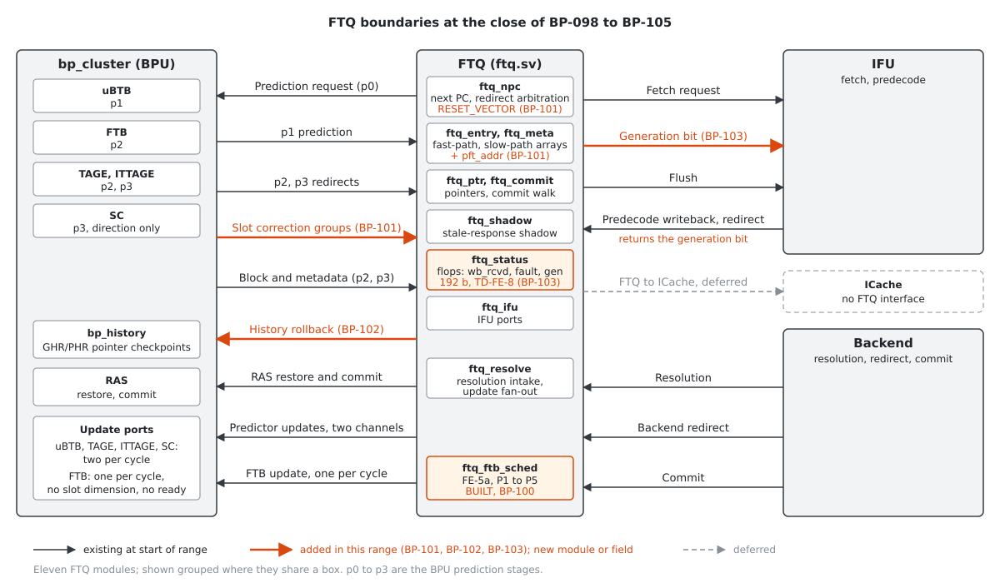
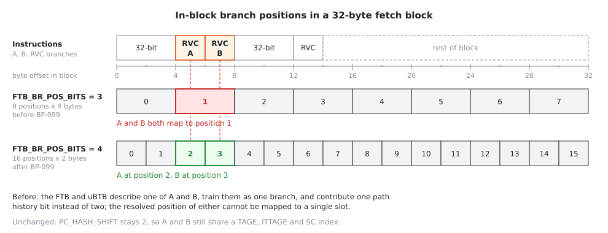

<!-- SPDX-License-Identifier: CC-BY-4.0                        -->
<!-- Copyright (c) 2026 Jeff Nye, uarchlabs.com                -->
<!-- SPDX-FileCopyrightText: 2026 Jeff Nye <jeff@uarchlabs.com> -->

```
TITLE:     "Specifying the Fetch Target Queue"
FILE:      BLOG_fetch_1_ftq_specification.md
AUTHOR:    Jeff Nye
DATE:      2026-09-24
STATUS:    REVIEW BEFORE POSTING
COPYRIGHT: "Copyright 2026 Jeff Nye"
```

<!--
---

::SERIES DESCRIPTION::
::BEGIN LINKS::
::END LINKS::
-->

# Specifying the Fetch Target Queue

## Abstract

The fetch target queue (FTQ) sits between the branch prediction unit (BPU)
and the instruction fetch unit (IFU) of the Pacino RVA23 front end. It holds
one entry per predicted fetch block, issues fetch requests, receives
corrections from the predictors and the backend, and sends each resolved
branch back to the predictors as training. At the start of this range the BPU
was built and verified, and the FTQ directory held only placeholder files.
In two interactive sessions, the implementation assistant (IA) wrote the FTQ
specification: its behavior, its entry formats, and its interfaces to the
IFU and the backend.

Writing down what the FTQ would have to drive found two defects in BPU RTL
that passed every test. The branch classification of the fetch target buffer
(FTB) never left the cluster, so any block the micro branch target buffer
(uBTB) missed trained no predictor. The cluster had no input by which a
backend mispredict could restore global and path history. Both were fixed
with new ports and tests that were shown to fail against the defect. Position
granularity was widened to two bytes so that each compressed (RVC) branch has
its own position, at a measured storage cost of 3.0 percent. The first FTQ
module, the FTB update scheduler, was built with the project's first
concurrent assertions; writing them exposed two properties in the
specification that no implementation could satisfy together.

The range closed two long-running items by decision rather than by new
design. The return address stack (RAS) response to a flush had been
specified since session 050 while its registry entry read open. A flush is
now defined as a redirect, which the cluster already implements, and six
deferred flush items closed. The range ends with the FTQ fully specified and
divided into eleven modules, one of them built.

## Where the range starts

The previous range [1] ended with `bp_cluster` verified at its boundary and
every unit test able to report a failure. The cluster testbench acted as the
FTQ. The FTQ itself existed as `ftq_bpu_interfaces.md`, which specifies the
boundary between the two, and as sections 4 to 6 of `fe_decisions.md`. The
IFU and backend sides were unwritten.

This range ran as two interactive sessions with the IA, on consecutive days,
recorded as IA-004 and IA-005 rather than as planning assistant (PA)
sessions. The IA reads the repository and the XiangShan reference sources [2]
on disk directly. The IA was granted a one-time waiver to write planning
documents, which the project otherwise reserves to the PA and me. The waiver
covered BP-098 to BP-105 and expired with BP-105.

Task numbers were allocated when each task file was written, not when the
work was done. BP-101 was done before BP-098 and BP-099. BP-100, BP-103,
BP-104 and BP-105 were written after the work, and each says that its prompt
section is a reconstruction. This post follows the order of the work.

The planning documents named here are in the repository [3] under
`planning/`, and the task files are under `prompts/`. Project identifiers
such as TD-FE-6 or FE-14 are listed with a description and their source
document in the Identifiers section near the end of the post.



*The FTQ's boundaries to the BPU, the IFU and the backend at the close of
the range. Edges and fields drawn in orange were added in this range.*

## The specification documents

The sessions produced four documents. `ftq_decisions.md` covers the FTQ's
behavior: its read ports, next-PC selection and redirect arbitration,
pointers and deallocation, the stale-response shadow, the FTB update
scheduler and the module decomposition. `ftq_entry_formats.md` defines the
two entry structures, the fast-path entry read on every fetch and the
slow-path metadata read only at resolution. `ftq_ifu_interfaces.md` and
`ftq_backend_interfaces.md` specify the two boundaries that had not been
written.

The FTQ entry had been described in three places and edited in lockstep.
Sections 4, 5 and 6 of `fe_decisions.md` moved into the new documents, and
`bp_cluster.md` now points to them. The moved section numbers are retired
rather than reused, so existing cross-references still resolve.

Two items were deferred, and the documents record that they are different
kinds. There is no FTQ-to-ICache interface. XiangShan drives the ICache from
five identical copies of the FTQ's fetch pointer and PC bundle, register
replication against fanout and wire delay; that is treated here as a
physical design problem. Instruction prefetch is also deferred, but prefetch
needs the FTQ to run ahead of fetch, and physical design cannot add that
later. `ftq_decisions.md` 6.1 lists what the deferral forecloses.

## What the FTQ would have to drive

### What the cluster boundary lacked

Writing the FTQ's behavior against the cluster's ports showed three things
the tree did not provide. BP-101 added them.

The FTQ selects a block's successor as the first taken slot's target, and
otherwise the block fall-through. That selection is repeated whenever a
redirect rewrites a slot. The fall-through arrives once, on
`bpu_pred_pft_p1`, and the entry had no field to hold it, so the selection as
specified could not be performed. `bp_ftq_entry_t` gained `pft_addr`, and the
entry grew from 182 to 222 bits.[F1]

The second gap was recorded as TD-FE-6. Each FTQ slot holds the branch type
and in-block position from the p1 uBTB prediction for the life of the entry.
The cluster formed the FTB's classification and positions at p2 and used them
internally, but no port carried them out. Update fan-out is keyed on branch
type, so a block the uBTB missed and the FTB hit read as containing no branch
at resolution and trained nothing. That is the case where training matters
most.

The task's hypothesis was that adding a branch type to `bp_redirect_t` would
not fix this. A redirect fires only when the p1 and p2 successors differ, and
the defining case, a not-taken conditional the uBTB missed, is one where they
agree. The correction had to be published on every prediction. BP-101 added
slot correction groups at p2 and p3 carrying `bp_ftq_slot_t` per slot, valid
whenever the FTB answers. The redirect keeps its own job, steering fetch. Most
of the group is wiring of existing internal nets, including FTB position
outputs that had been connected to the FTB instance and read nowhere. The p3
group changes only the direction, since the statistical corrector (SC)
corrects direction and not branch type.

Nothing in the tree named a reset PC, so the FTQ could not issue its first
request. `bp_defines_pkg` gained `RESET_VECTOR` at `40'h00_8000_0000`, the
RISC-V convention and the Spike boot target. The privileged specification
leaves the value to the implementation.

Group I of `tb_bp_cluster` adds 24 checks. The first is built on the defining
case: the uBTB misses, the FTB hits with a conditional, no redirect fires, and
the slot group is valid and reports a conditional at the FTB's position. With
the group's valid gated on the redirect, reproducing the defect, the run
reported one failure. A second mutation reverted the entry width to 182 bits,
and the struct-size check failed.

### The history rollback input

Writing `ftq_backend_interfaces.md` opened TD-FE-7. The cluster formed the
`bp_history` rollback only from its own p2 and p3 redirects. A backend
mispredict could restore the RAS through an existing input, but no port let
the FTQ restore the global and path history pointers. After a backend
mispredict, every history-indexed predictor would have indexed on history
from the squashed path. No functional test would show this, because the
predictions are hints and the backend corrects them.

The checkpoints already existed. `bp_history` holds a pointer pair per FTQ
entry, written at allocation, and already restores them and recomputes the
folds on a rollback. Only the trigger was missing. BP-102 added
`ftq_rollback_val` and `ftq_rollback_idx`, and the rollback mux gives the
FTQ's request priority over both of the cluster's own. A backend redirect is
architectural and outranks the speculative stage-ordered corrections rather
than joining their order.

The task settled a conflict between documents. `ftq_decisions.md` 3.2
specified that the FTQ present the two pointer values, while `fe_decisions.md`
and `ftq_backend_interfaces.md` specified an index and recorded the choice as
open. The checkpoint array inside `bp_history` and the checkpoint field of
the FTQ entry are written by the same allocation and are one to one against
the FTQ index, so the index selects the same pointer pair in 6 bits rather
than 13, with no change to `bp_history`.[F2] `ftq_decisions.md` 3.2 was
corrected, and the correction is called out in the document.

Group J adds 30 checks, starting with a rollback raised by the FTQ with no
p2 or p3 redirect present, which could not previously be constructed. Each
priority test is paired with the same construction minus the FTQ input, so
the two halves differ in one signal. Removing the FTQ term reproduced
TD-FE-7 with seven failures; inverting the priority gave three; reading the
wrong index gave eight. A fourth mutation removed a fixture that clears the
tables of the tagged geometric history length (TAGE) predictor, and the group
still passed. That fixture is not needed by today's tests and is kept because
the general reset does not clear those tables.

## Position granularity and the C extension

### One name, two quantities

`FTB_BR_POS_BITS` of 3 gives eight 4-byte positions in a 32-byte block. RVA23
mandates the C extension [4], so a branch can begin at any 2-byte boundary,
and two RVC branches in one aligned word shared a position. The FTB and uBTB
could describe only one of them and trained them as one branch, the pair
contributed one path history bit instead of two, and the backend's position
at resolution could not be mapped to a single slot. `ftq_ifu_interfaces.md`
recorded the gap and costed the fix.



*Two RVC branches in one aligned 4-byte word. With 4-byte positions they
share position 1; with 2-byte positions, after BP-099, each has its own.*

The fix was blocked by a parameter. `INST_OFFSET` was used by two groups of
modules for unrelated quantities. The FTB and uBTB used it as the byte size
of one position. TAGE, the indirect target TAGE predictor (ITTAGE) and the SC
used it as the number of low PC bits dropped before hashing. Widening the
position had to change the first and not the second, since changing the hash
shift rehashes every table. `tage_table.sv` also declared its own copy, set
to 2 and commented as 4-byte instructions, which would have ignored a change
to the package.

BP-098 replaced `INST_OFFSET` with `PC_HASH_SHIFT` and a derived
`POS_OFFSET_BITS`, retargeting 41 sites in 15 files and 9 in planning
documents, and deleted the local copies. Both resolved to 2, so the proof was
that every count in all 47 targets matched the run before the change.

### Two-byte positions

BP-099 set `FTB_BR_POS_BITS` to 4. `POS_OFFSET_BITS` rescaled from 2 to 1
with no edit, and no predictor hash moved. The hypothesis was that every
affected width is written in terms of the parameter, and all 18 lint targets
passed with no RTL change beyond the two derivations. Storage grew by 9,472
bits, 3.0 percent across the FTB, uBTB and FTQ, matching the estimate made
before the decision.

The testbenches carried 177 literal 3-bit positions, found by parsing
Verilator's width warnings and checked one line at a time. The cluster
history tests were rebased on derived expressions, computing each branch PC
from its position and each path bit from that PC, rather than on new
constants. The position sweep test now covers 256 pairs instead of 64, which
is the only count that moved.

BP-098 and BP-099 were kept separate so that each has a checkable claim: the
first by every count staying the same, the second by one count moving for a
stated reason. `PC_HASH_SHIFT` remains 2 and discards PC bit 1, so two RVC
instructions two bytes apart share a TAGE, ITTAGE and SC index. Whether a
shift of 1 predicts better cannot be measured in the repository today.

## The first FTQ module

The FTQ has one update channel per prediction slot, two today. Every
predictor accepts two updates per cycle except the FTB, whose update port
has no slot dimension and no ready. At eight-wide issue and 15 to 20 percent
branch density, 1.2 to 1.6 branches resolve per cycle and each writes the
FTB. The original rule, FE-5, guaranteed that no update is dropped, which
turned the FTB's one write per cycle into backpressure on resolution: a
training limit could stall the backend.

The fix taken was not more FTB ports. FE-5a permits dropping a low-value FTB
update, a confidence step for a branch that hit and was predicted correctly.
Allocations and mispredict corrections are never dropped. `ftq_decisions.md`
5.7 specifies the rule and five properties, and records a second write port
and banking as escalations that need measurement first.

BP-100 built `ftq_ftb_sched.sv` as a standalone module, since its inputs are
two resolution payloads and its output is the cluster's existing FTB update
port. It has one skid register, a one-bit value function and a registered
output. A new `ftb_upd_t` struct carries the fourteen payload fields as one
object. Higher value issues first and channel index breaks ties. When both
new updates are high-value and the skid is occupied, one channel is held
rather than dropped.

The five properties are the project's first concurrent assertions. Two of
them contradicted each other: P1 required the output one cycle after
acceptance, which needs a register, and P4 required it in the same cycle,
which needs a combinational path. No implementation satisfies both. The
registered form was built and P4 corrected in the specification. Verilator
also needs `--assert` to generate concurrent properties; without it they are
parsed and never evaluated, which is indistinguishable from passing.

The testbench runs 67 checks in five groups, including a case where a
high-value update on channel 1 issues before a low-value one on channel 0,
which a scheduler ranking by index alone would fail. Each property was then
broken by a separate mutation, and each failed the build. The P4 mutation was
chosen so that it did not also break P3, the property that the one-deep skid
never overflows, so each property is shown to fire independently. The
scheduler has no consumer yet.

## Entry status and the module decomposition

BP-103 settled the last three items blocking FTQ RTL: the per-entry fetch
status fields, the stale writeback problem that opened TD-FE-8, and the
module decomposition. The IFU interface had deferred three status fields,
request issued, writeback received and fault, until the allocation policy
was decided. That policy is now in `ftq_decisions.md` 5: entries are freed
by commit only.

The hypothesis was that these fields do not belong in the entry. The
writeback arrives at an arbitrary time relative to the fetch read, so a bit in
the fast-path SRAM would be a read-modify-write of an array already read
every cycle. The commit walk tests the bits across entries. A redirect
squashes every entry after an index and must clear their status in one cycle,
which in SRAM would be a walk that has to finish before those indices can be
reused. The fields are therefore flop vectors outside both SRAMs, and the
entry sizes did not change. Request issued was rejected, because `fetch_ptr`
already records which entries have been issued. Writeback received and fault
remain, joined by the generation bit described below: three bits per entry,
192 bits in all.

Specifying the clear rule for those bits opened TD-FE-8. A predecode
writeback in flight when its entry is squashed and the index reallocated
would set status on the new use of that index. The FTQ already solves the
same problem for the cluster with the stale-response shadow of
`ftq_decisions.md` 5.6. The response indices the cluster returns carry no
wrap bit, so a rewind can reallocate an index while a response for the
squashed use of it is still in flight. The shadow records, for each cluster
pipeline stage, whether that stage holds a live FTQ request and which entry
it names; a redirect clears the stages it squashes, and a response is
accepted only if its stage is live and its index matches. That works because
the cluster's latency is fixed by its stages. IFU latency is not bounded, so
the shadow cannot cover the IFU.

BP-103 closed it with one generation bit, which goes out with each request
and returns with each writeback, and toggles on each allocation. A
mismatched writeback is dropped. One bit is enough because the IFU flush
bounds stale writebacks to those already presented in the flush cycle. The
document records that condition, so that a change to the flush contract
prompts a review of the width.

`ftq_decisions.md` 7 divides the FTQ into eleven modules by one rule: each
piece of state has exactly one owner module, and others read it through a
port. The top, `ftq.sv`, holds no state and no logic. The eleven, as
decided at the close of this range:

| Module | Owns | Specified in |
|---|---|---|
| `ftq` | Structural top: instantiation and wiring only | ftq_decisions.md 7 |
| `ftq_ptr` | alloc_ptr, fetch_ptr | ftq_decisions.md 5.1, 5.2, 5.5 |
| `ftq_commit` | commit_ptr and the commit walk | ftq_decisions.md 5.3, 5.4 |
| `ftq_npc` | The next-PC register and the redirect arbitration that feeds it | ftq_decisions.md 4 |
| `ftq_entry` | The fast-path entry array | ftq_entry_formats.md 1, 2 |
| `ftq_meta` | The slow-path metadata array | ftq_entry_formats.md 3 |
| `ftq_status` | Per-entry status flops: writeback received, fault, generation | ftq_entry_formats.md 4 |
| `ftq_shadow` | The stale-response shadow | ftq_decisions.md 5.6 |
| `ftq_ifu` | IFU request, flush, writeback and predecode redirect ports | ftq_ifu_interfaces.md |
| `ftq_resolve` | Resolution intake and update fan-out | ftq_backend_interfaces.md 4 |
| `ftq_ftb_sched` | The FTB update scheduler; built in BP-100 | ftq_decisions.md 5.7 |

A later range added a twelfth, `ftq_upd_conv`, which forms the
per-predictor update payloads (BP-119).

Pointer state is split between `ftq_ptr` and `ftq_commit`, because the commit
pointer is the only one whose advance depends on the RAS commit port and on
redirect restores. Redirect arbitration is in `ftq_npc`, since the winning
redirect is the next-PC source.

## Flush

### A decision that already existed

The RAS response to a flush had been raised and answered across many
sessions. BP-104 found it specified in `ras_decisions.md` 4.4 since session
050: a flush restores the RAS pointers from the FTQ snapshot, as a
mispredict does. The IA checked the RTL against the documents. The
restore path is built and tested in `ras.sv` and `tb_ras.sv`. The same
module declares `ras_flush_val` and `ras_flush_snapshot`, which nothing
reads, and sites in seven documents described the behavior as undefined.

No design decision was made. RAS-3 was closed as a label correction, 4.4
was rewritten to state the decision first, and every other site now points
to it rather than restating it. A new subsection records why the question
kept returning, including that a declared port with no behavior is not
evidence of an open design question. The IA proposed removing the unused
ports, resolving the FTB half in the same task, and opening a debt item for
the lint suppression that hides unused ports. I declined all three, and the
task file records them as declined proposals.

### A flush is a redirect

The rest of the flush question remained under six identifiers: TD #96, G24,
IC-FTB-07, IC-SC-06, IC-SCT-03 and item E in `bp_arb_spec.md`. Flush ports
existed on three modules and were driven by nothing. Every deferral assumed
a flush protocol had to be written.

BP-105's hypothesis was that no flush event exists. The evidence is in the
XiangShan sources [2]: the common interface every predictor implements has no
flush port, and none of the predictor source files contains the word flush.
The BPU's internal flush signals clear its stage valids, so a predictor is
cleared by not being fired. The cluster already gates every predictor on its
stage valids and derives its redirects, so the mechanism was built and only
the decision was missing.

FE-14 records that a flush is a redirect. The six items closed citing it.
`ftb_cntrl.sv` gates its prediction outputs on a flush port that
`ftb_interfaces.md` said not to implement; the gate is harmless and never
driven, and the document was changed to match the tree. The unused redirect
cause `RC_RESERVED` became `RC_UNSPEC`, the redirect that names no
instruction, for reset and debug entry. The alternatives considered, and why
each was rejected, are in the task file.

The first sweep of the planning tree fixed six sites and was reported as
complete. A grep of the whole tree then found five more. A later audit found
seven further stale items unrelated to flush, six of them cases where one
document restated a fact owned by another.

## Experiment Summary

Every task in this range was run interactively: I worked each one with the
IA in a live session, and no task was handed to an unattended run from a
PA-written task file. The PA contribution section below gives the reason.
Status reads PASS for a task whose claim rests on simulation counts, and
COMPLETE for a specification or documentation task, which reran the bpu and
ftq units to show that no count moved. Rows are in the order the work was
done, as in the rest of the post.

| Experiment | Description | Status | Checks |
|---|---|---|---|
| BP-101 | pft_addr, TD-FE-6 slot groups, RESET_VECTOR | PASS | sim 28 to 29 (one pft_addr width check); sim_bp_cluster 973 to 997 (group I, 24); 2 mutations |
| BP-098 | INST_OFFSET split into PC_HASH_SHIFT and POS_OFFSET_BITS | PASS | 47/47, every count unchanged; 41 RTL and 9 planning sites |
| BP-099 | FTB_BR_POS_BITS 3 to 4 | PASS | 47/47; sim_bp_cluster 997 to 1765; 177 literals; +9,472 bits |
| BP-102 | TD-FE-7 history rollback input | PASS | sim_bp_cluster 1765 to 1795 (group J, 30); 4 mutations, 3 detected, 1 not detected (fixture not needed) |
| BP-100 | ftq_ftb_sched, first FTQ module and first concurrent assertions | PASS | sim_ftq_ftb_sched 67 checks, 0 failures; 5 properties, each mutated; bpu 47/47 unchanged |
| BP-103 | Entry status, TD-FE-8, eleven-module decomposition | COMPLETE | specification only; bpu and ftq rerun, unchanged |
| BP-104 | RAS-3 closed | COMPLETE | documentation only; bpu and ftq rerun, unchanged |
| BP-105 | FE-14, flush is a redirect; RC_UNSPEC | COMPLETE | documentation only; bpu and ftq rerun, unchanged |

## Design Process Notes

### The IA contribution

The IA wrote the four specification documents and made every change in the
range. It found both BPU defects by writing what the FTQ would have to drive,
not by running a test. It checked claims against the tree before acting on
them: the RAS restore path against the RTL, and the flush question against
the XiangShan sources, where the finding was that no predictor has a flush
port.

It proved each change the way its claim required. BP-098 is proven by
identical counts and BP-099 by one count moving for a stated reason. BP-101,
BP-102 and BP-100 each include a mutation that reproduces the defect or
breaks the property, and BP-102 reported the mutation that did not fail as a
result rather than as a defect in the test. It reported where it was wrong:
the first flush sweep, and a mutation run it first read as a hang that was a
command timeout expiring during compilation.

### The PA contribution

The planning assistant wrote no task file in this range. The waiver was
granted because its task specifications in the preceding sessions had
repeatedly needed rework. The IA's session handoffs are not in the PA's
reading set, so each ended with a section listing the items that needed PA
attention: FE-5a, the two deferrals, the task numbering, FE-14, the
`RC_UNSPEC` rename and the module decomposition, each for ratification.

### My contribution

I granted the waiver and limited it to this range. I declined the IA's three
proposals in BP-104 and set that task's scope: correct the label and record
why the question recurred. The framing of `RC_UNSPEC` as the unspecified
instruction is mine. I relaxed BP-102's three-file limit after its RTL and
run were complete, so the planning documents could be updated. I added a
section to CLAUDE.md on conduct in interactive sessions: check whether a
topic is closed before raising it, and avoid unnecessary jargon.

### The generalization

Six gaps in this range were found by specification rather than by
simulation: the missing fall-through field, the missing reset PC, the
unrouted FTB classification, the missing rollback input, the two
contradictory properties, and the stale IFU writeback. The unrouted
classification and the missing rollback input were in RTL that passed every
test, because no test can check an output a module does not have. Writing
down, port by port, what the next unit must drive and receive tested the
cluster's boundary in a way its own testbench could not.

The other result is about documents. Sites in seven documents restated the
RAS flush decision and had drifted from it; the flush sweep missed five sites
on its first pass; the later audit found six restatements out of date. In
this project a decision has one home, other documents point to it, and a
sweep of the tree is done with a search whose output is recorded.

## What comes next

At the close of the range the FTQ is specified and one of its eleven modules
is built. Nothing blocks the rest. The next range returns to PA-written tasks
under the standing rule that planning documents are read-only to the IA, and
builds the remaining ten modules.[F3]

Items that stay open: `PC_HASH_SHIFT` is unmeasured; G10, the TAGE and ITTAGE
metadata overload, and G25, the source of `ftb_fastpath_en`, are undecided;
`RC_UNSPEC` has no producer until there is a backend; and prefetch and the
FTQ-to-ICache interface remain deferred.

## Technical Debt Referenced

The table reports status as of the close of this range. Later experiments
outside the range have since changed the state of some items. TD #96 is
tracked in the Technical Debt table of `planning/PROJECT_STATUS.md`. The
TD-FE items are owned by `planning/arch/fe_decisions.md`, are collected for
the FTQ in `planning/arch/ftq_decisions.md` 6, and are summarized in the
PROJECT_STATUS session log for this range.

| # | Item | Status at close of range | Source |
|---|---|---|---|
| TD #96 | Flush behavior: define it, implement it, update all references. | CLOSED BP-105. A flush is a redirect, FE-14. The flush ports are redundant and retained; read ras_decisions.md 4.4.2 before re-raising. | PROJECT_STATUS.md, Technical Debt |
| TD-FE-1 | IFU interface unspecified. | CLOSED in full: ftq_ifu_interfaces.md, and the entry status fields in BP-103. | fe_decisions.md; ftq_decisions.md 6 |
| TD-FE-3 | pc and per-slot target at 40 bits. | Open. 39 suffice under C, 35 with block alignment. A width optimization.[F4] | fe_decisions.md; ftq_decisions.md 6 |
| TD-FE-4 | pred_src has no functional consumer. | Open. Diagnostic; populated only where the information is already available. | fe_decisions.md; ftq_decisions.md 6 |
| TD-FE-6 | FTB classification and positions reach no FTQ port. | CLOSED BP-101. Slot correction groups at p2 and p3, valid on every FTB answer. | fe_decisions.md; ftq_bpu_interfaces.md |
| TD-FE-7 | No history rollback trigger input on bp_cluster. | CLOSED BP-102. ftq_rollback_val and ftq_rollback_idx, priority over the cluster's own arms. | fe_decisions.md; ftq_backend_interfaces.md 8 |
| TD-FE-8 | Stale IFU writeback sets status on a reallocated index. | Opened and CLOSED BP-103. One generation bit toggled per allocation. | fe_decisions.md; ftq_entry_formats.md 4.4; ftq_ifu_interfaces.md 6.1 |

## Identifiers

The project tracks open questions, decisions and debt in registries spread
across the planning documents. This table lists every identifier used in
the post, with the document that owns it. Paths are relative to the
repository root.

| Identifier | Kind | Description | Source document |
|---|---|---|---|
| BP-nnn | Task file | One file per task; this range is BP-098 to BP-105, and BP-106 and BP-119 are later tasks cited here | prompts/BP-nnn.md |
| IA-004, IA-005 | Interactive session | The two IA sessions of this range, recorded in each task file's header | prompts/BP-098.md to prompts/BP-105.md |
| Session 050, session 072 | PA session | Planning sessions, cited for when a decision or correction was recorded | planning/PROJECT_STATUS.md, session log |
| TD #96 | Technical debt | Flush behavior. CLOSED BP-105 | planning/PROJECT_STATUS.md, Technical Debt |
| TD-FE-1 to TD-FE-8 | Front-end technical debt | See Technical Debt Referenced above | planning/arch/fe_decisions.md |
| FE-5 | Front-end decision | No prediction or update is dropped except as FE-5a permits | planning/arch/fe_decisions.md |
| FE-5a | Front-end decision | An FTB update may be dropped on collision, and only when it is low value | planning/arch/fe_decisions.md |
| FE-14 | Front-end decision | A flush is a redirect; the front end has no flush event | planning/arch/fe_decisions.md |
| G10 | BP cluster open TBD | TAGE and ITTAGE metadata overload scheme. Open | planning/PROJECT_STATUS.md, BP Cluster Open TBDs |
| G24 | BP cluster open TBD | FTB flush protocol, ftb_flush_px. CLOSED BP-105 | planning/PROJECT_STATUS.md, BP Cluster Open TBDs |
| G25 | BP cluster open TBD | Source of the FTB fast-path enable, ftb_fastpath_en. Open | planning/PROJECT_STATUS.md, BP Cluster Open TBDs |
| IC-FTB-07 | FTB interface item | Do not implement flush logic until specified. CLOSED BP-105 | planning/interfaces/ftb_interfaces.md |
| IC-SC-06 | SC interface item | SC flush port definitions (_px signals). CLOSED BP-105 | planning/interfaces/sc_interfaces.md |
| IC-SCT-03 | SC table interface item | SC table flush port definitions (_px signals). CLOSED BP-105 | planning/interfaces/sc_table_interfaces.md |
| bp_arb_spec.md item E | Arbiter open item | Prediction and update queue behavior on flush. CLOSED BP-105 | planning/arch/bp_arb_spec.md |
| RAS-3 | RAS open item | RAS recovery on flush. CLOSED BP-104 as a label correction | planning/arch/ras_decisions.md 4.4 |
| P1 to P5 | Scheduler property | The five FTB update scheduler properties; P4 corrected in BP-100 | planning/arch/ftq_decisions.md 5.7.4 |

## References

[1] Branch Prediction Cluster Simulation and Mutation-Based Verification
(BLOG_bpu_20), for the cluster boundary this range extends,
https://uarchlabs.github.io/blog/branch-prediction-cluster-simulation-and-mutation-based-verification/

[2] XiangShan, open-source high-performance RISC-V processor,
https://github.com/OpenXiangShan/XiangShan

[3] Pacino, https://github.com/uarchlabs/pacino. The planning documents and
task files cited in this post are in planning/ and prompts/.

[4] RISC-V Profiles, RVA23 Profile, https://github.com/riscv/riscv-profiles

## Footnotes

<!-- ticfinder_off -->
[F1] The next range found that `pft_addr` is written once at p1 and that
nothing can correct it when the FTB ends the block earlier than the uBTB did.
The fix was specified and not built at the close of that range.

[F2] BP-102 recorded the index as seven bits. A later correction (session
072) records that the index is `FTQ_IDX_BITS`, six bits; seven is
`FTQ_PTR_BITS`.

[F3] The planning-document rule is in CLAUDE.md's fixed constants and
applies from BP-106.

[F4] The TD-FE-3 resolution path shown here was subsequently changed in
later sessions.
<!-- ticfinder_on -->

---
<!-- ticfinder_off -->
*Jeff Nye is a microprocessor architect with 35 years of industry experience
spanning performance modeling, RTL implementation, and architecture for
high-performance out-of-order processors. He has contributed RTL to Pentium 4,
ARMv7, TI C6x and RISC-V designs, and recently served as sole architect and
full-stack implementer of the TAGE-SC-L + ITTAGE branch prediction cluster in
an 8-issue RVA23 RISC-V processor, from research through timing closure at
2.75 GHz. He holds more than 20 issued patents in processor design,
architecture, and hardware virtualization. He is the author of Pacino and the
uarchlabs methodology documented here.*

*Connect on [LinkedIn](https://www.linkedin.com/in/jeff-nye-21353926).*
<!-- ticfinder_on -->
