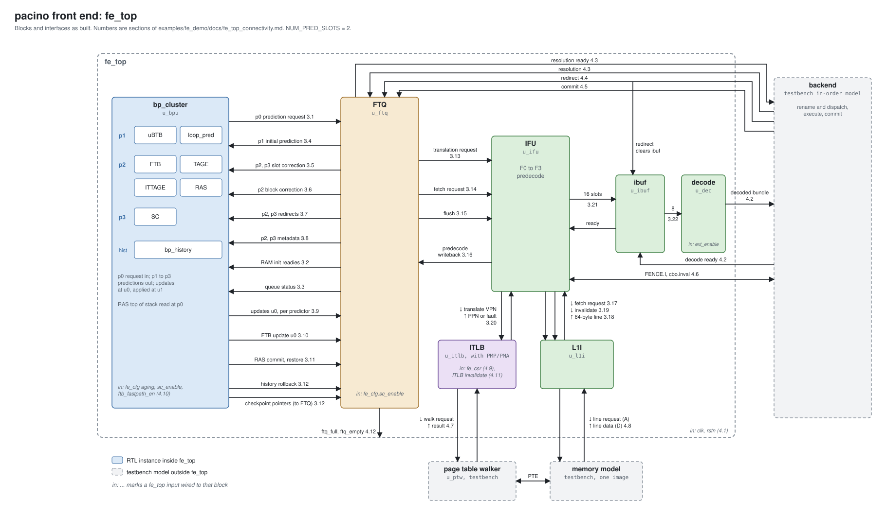
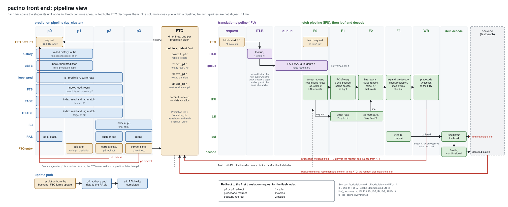

<!-- SPDX-License-Identifier: CC-BY-4.0                        -->
<!-- Copyright (c) 2026 Jeff Nye, uarchlabs.com                -->
<!-- SPDX-FileCopyrightText: 2026 Jeff Nye <jeff@uarchlabs.com> -->
# Frontend Overview

Pacino implements a 'decoupled
frontend' with a branch prediction cluster of 7 predictors feeding an
instruction fetch unit, an address translation stage and an instruction decoder
which can decode at least 8 instructions per cycle.

This page is an introduction to Pacino's frontend. The discussion walks
through the two diagrams below covering the operation of the frontend and
coordination between the components.

The design decisions which arrived at this implementation are found in the
planning documents `pacino/planning/arch`. These are linked at the end.

There are waveform views of the principal operations of the frontend.  Major
behaviors are described here: [frontend demonstration](#frontend-operation).

!!! note ""

    These pages aim to be readable by newer designers without being tedious
    for experienced ones; feedback on the level of detail is welcome. 

    Experienced designers may prefer to go directly to the specs and RTL. 

## A decoupled frontend

In baseline frontends branch prediction and instruction fetch operate in
lockstep. The predictor chooses the next address, the instruction cache
reads it, and the next prediction waits for the fetch to finish. 

Performance of this basic microarchitecture is improved by decoupling portions
of the frontend.  Pacino implements a decoupled frontend based on a fetch
target queue (FTQ).

The branch predictor produces a stream of predicted fetch addresses 
and writes these to the FTQ. The fetch unit (IFU) processes entries in the FTQ
in order as they appear. This weakens the interlock between prediction
and fetch/icache access. This organization was introduced by Reinman, 
Austin and Calder [1].

The FTQ serves another purpose: it provides a look ahead of addresses 
that fetch will need soon, telling the processor which instruction cache
lines to bring in. This mechanism is the basis for fetch-directed
prefetching [2]. Pacino's future prefetch mechanism will use this mechanism.

Because an FTQ entry can be corrected after it is written, the FTQ lets a fast,
simple predictor start fetch immediately while slower, more accurate predictors
perform their look ups. When the slower predictors agree with the fast
predictor, cycles of latency are saved [3].

Decoupled frontends of this kind are now standard in high-performance cores;
these can be found in public information on commercial designs [4]. The
XiangShan series of open source designs also implement decoupled frontends [5].

FTQ management logic uses the state in each entry to assist branch predictor
training and to restore processor state on mispredictions. Pacino uses a
redirect mechanism so that early start predictions can be corrected when the
slower more accurate predictor(s) disagree.  A redirect will find and discard
every younger entry and each associated in-flight fetch.

Prediction can run ahead only as far as the branch target buffer (BTB) can
identify branch locations. On a BTB miss, the branch is not identified, the
direction and target predictors are never consulted and the block is predicted
to fall through to a default, the ‘fall-through address’. If that branch is
taken, the predicted stream, and any prefetching driven by it, continues down
the fall-through path until predecode or branch resolution in the backend
detects the branch and redirects fetch. Much recent work addresses this limit
[6, 7].

## The two views

The Pacino frontend (FE) is one structural module, `fe_top`. There are seven
sub-modules:

| Blk    | Description                               |
|--------|-------------------------------------------|
| BPC    | branch prediction cluster                 |
| FTQ    | fetch target queue                        |
| IFU    | instruction fetch unit                    |
| ITLB   | instruction translation lookaside buffer |
| L1I    | level 1 instruction cache                 |
| IBUF   | instruction buffer                        |
| decode | instruction decoder                       |

There are two views of the FE.

The **block view** shows these units and the interfaces.  The annotations on the
signals refer to sections of the [connectivity inventory](https://github.com/uarchlabs/pacino/blob/main/examples/fe_demo/docs/fe_top_connectivity.md), which lists each signal.

The **pipeline view** shows the same units aligned to pipeline stages.

Both diagrams show a Pacino FE configured for dual prediction; the
demonstration's default build uses one slot.

Select either diagram to open it at full size. 

## Pacino’s three pipelines

The frontend is built as three pipelines that run independently:

1. The **prediction pipeline**, in the branch prediction cluster
   (`bp_cluster`), decides which code comes next.
2. The **translation pipeline**, in the instruction fetch unit (IFU) and the
   instruction TLB, turns each predicted address into a physical address.
3. The **fetch pipeline**, in the IFU and the level-one instruction cache
   (L1I), reads the bytes, finds the instructions in them and passes them on to
   the instruction buffer and decode.

In Pacino the branch prediction cluster writes predicted blocks into a 64-entry
FTQ, and the IFU takes them from the FTQ in order. 

The FTQ speculatively uses the prediction available in p1, formed by the
micro-BTB (uBTB) and the loop predictor (LP), to allocate the entry and begin
fetch.  If later predictions disagree, e.g. in p2 or p3 from TAGE or SC, the
FTQ entry is corrected and a redirect occurs. Redirects cancel any incorrect
pending fetches and start fetches from the corrected (redirected) address.

Pacino also decouples address translation: the instruction TLB works on the
FTQ through its own pointer, `xlate_ptr`, ahead of fetch, so a translation
can complete before fetch reaches the block.

This arrangement is the core of Pacino's decoupled frontend. Prediction can run
ahead of fetch while fetch is waiting, for example on a cache miss, so the
FTQ fills with the addresses fetch will need next. The pipeline view shows
this: its two halves are not aligned in time, because they are linked only
through the queue.

The FTQ tracks its entries with four pointers, oldest first: `commit_ptr`
(entries the backend has retired), `fetch_ptr` (the next entry to fetch),
`xlate_ptr` (the next entry to translate) and `alloc_ptr` (the next entry the
prediction pipeline will write).

## Prediction blocks and slots

In Pacino the unit of prediction is the **prediction block**: up to 32 bytes of
code that begin at any 2-byte address. A block ends at the first branch
predicted taken, and the next block begins at that branch's target. One FTQ
entry holds one prediction block.

A block can contain more than one branch. Each **prediction slot** describes
one of them, and the compile time parameter `NUM_PRED_SLOTS` sets how many
slots a block has. With two slots, the frontend can predict two branches in one
block, so a not-taken branch does not end the block early. When a block holds
more branches than it has slots, the block ends at the first branch it cannot
describe, and the next block starts with that branch.

The prediction block is not the same as the 64-byte cache line the IFU reads
from the L1I. The IFU reads a whole line and extracts the block from it.

## The prediction pipeline

Prediction takes up to four cycles, p0 to p3. Each stage has its own predictors,
and each later stage may correct the earlier answer.

| Stage | Operation | Predictors |
|---|---|---|
| p0 | The FTQ presents the block's start address. Table indices are formed from the address and the branch history. | RAS top-of-stack read |
| p1 | The **initial prediction** is formed. The FTQ allocates an entry and fetch can begin. | uBTB, loop predictor |
| p2 | The block's contents and the main direction and target predictions arrive. | FTB, TAGE, ITTAGE, RAS push or pop, loop predictor re-read |
| p3 | The statistical corrector gives the final direction. | SC |

The FTQ never waits for a predictor later than p1. A later stage that
disagrees with what the FTQ already holds sends a **redirect** instead, which
rewrites the entry and restarts fetch from the corrected address.

The seven predictors, and the module that keeps the branch history, are:

- **uBTB** (micro branch target buffer, 256 entries, 4-way). A small,
  combinational predictor that gives the first guess at p1.
- **Loop predictor.** Learns the trip count of regular loops so that the
  loop's exit is predicted correctly. It answers at p1 and again at p2.
- **FTB** (fetch target buffer, 2048 entries, 4-way). Records, for each block
  start address, where the block ends and the branches in it: their
  positions, types and targets. It is the authority on what a block contains.
- **TAGE.** The main direction predictor for conditional branches: a base
  table T0 and four tagged tables, T1 to T4, each of 2048 entries. The tagged
  tables are indexed by the address combined with 8, 13, 32 and 119 bits of
  branch history.
- **SC** (statistical corrector). Can reverse TAGE's direction at p3 when its
  own counters disagree strongly.
- **ITTAGE.** Predicts the targets of indirect jumps, built like TAGE but
  storing targets instead of directions.
- **RAS** (return address stack). Predicts return addresses. Calls push it and
  returns pop it.
- **History module** (`bp_history`). Keeps the global branch history (256 bits)
  that the history-indexed predictors use, and checkpoints it so that it can be
  restored after a misprediction.

At p2 the FTB will know the branch type. The type decides which predictor
supplies the target:

| Branch type | Target comes from |
|---|---|
| Return | RAS |
| Indirect jump | ITTAGE |
| Conditional branch | The FTB's target if taken, otherwise the next block |
| Direct jump | FTB |

For conditional branches without a trusted loop prediction, the later-stage
predictors are assumed to be more accurate. In order of precedence: SC,
TAGE, the FTB, then the uBTB. TAGE and the FTB outputs are valid at p2;
TAGE takes precedence over the FTB.

A trusted loop prediction outranks all of these. Once the loop predictor is
confident in a loop’s trip count, its p2 direction stands. In this case
the SC does not override it at p3.

## Redirects

Three places can redirect fetch:

1. The prediction pipeline at **p2** or **p3**, when a later predictor
   corrects the initial prediction.
2. **Predecode**, in the IFU, when the bytes fetched contradict the
   prediction, for example a branch where the prediction assumed none.
3. The **backend**, when a branch resolves differently from its prediction.

A redirect names one FTQ entry and one slot. A later stage wins over an earlier
stage for the same entry and slot. The younger blocks already in flight are
dropped from both IFU pipelines, and fetch restarts from the new address.

The time from a redirect to the first translation request at the new address
is short:

| Redirect source | Cycles to the new translation request |
|---|---|
| p2 or p3 prediction | 1 |
| Predecode | 2 |
| Backend | 2 |

A backend redirect also clears the IBUF. Prediction redirects do
not.

## Translation and fetch

The **translation pipeline** takes the entry at `xlate_ptr`. The ITLB (64
entries, includes PMP and PMA checks) translates the block's start
address in one cycle on a hit. A block that crosses a page boundary requires a
second lookup in the next cycle. A miss goes to the page table walker (PTW).
The resulting physical address with memory attributes or a fault waits in a
four-entry queue for fetch.

The **fetch pipeline** takes the entry at `fetch_ptr` and runs in four stages:

| Stage | What happens |
|---|---|
| F0 | Accept the request, read the translation, and send zero to two requests to the L1I. |
| F1 | Compute the address of every 2-byte position in the block while the cache access is in flight. |
| F2 | The cache line returns. Check for faults and select the 17 halfwords that hold the block.  (32 bytes, plus 2 for a 32-bit instruction that starts in the last halfword) |
| F3 | Expand compressed instructions, predecode, check the prediction, and write the instructions to the instruction buffer. |

After F3, a writeback stage reports what predecode found back to the FTQ.
This is where the frontend learns, from the bytes themselves, whether the
prediction described the block correctly.

The **L1I** is 64 KiB, 8-way set associative, with 64-byte lines, and returns
data two cycles after a request on a hit. 

## Instruction buffer and decode

The **instruction buffer** (IBUF, 64 entries) accepts up to 16 instructions per
cycle from F3 and releases up to 8 from its head. When it is empty, F3's writes
pass straight through to the read port.

**Decode** is eight instructions wide and combinational. It decodes the
RVA23 scalar and vector encodings into the internal format the backend
consumes.

## Branch Predictor Training

When the backend resolves a branch, it reports the outcome to the FTQ. The FTQ
reads the prediction-time metadata stored with the branch's FTQ entry.  This
metadata is generated and returned by each predictor with the prediction. The
FTQ forms an update for each involved predictor based on branch type:

| Branch type | Predictors updated |
|---|---|
| Conditional | uBTB, loop predictor, FTB, TAGE, SC |
| Indirect | uBTB, FTB, ITTAGE |
| Return | uBTB, FTB, RAS |
| Direct jump | uBTB, FTB |
| Call | uBTB, FTB, RAS; an indirect call also ITTAGE |

Updates are sent as soon as a branch resolves rather than at retire. TAGE, SC
and ITTAGE take updates through a queue in front of their tables, and an update
takes two stages, u0 and u1, with single cycle throughput.

A prediction can read a table entry before a pending update to it has been
written. That costs some prediction accuracy; in exchange, a prediction is
never delayed. The table arbiters always grant predictions first, and an update
writes only in a cycle with no prediction presented.

## The FE Boundary

Three groups of signals cross the `fe_top` boundary:

- **Backend.** Decoded instructions are sent to rename. Branch resolutions,
  redirects and commits come back to the FTQ, and `FENCE.I` and `cbo.inval`
  come from the commit stage to the IFU.
- **Translation.** The instruction TLB's path to the page table walker.
- **Memory.** The L1I’s port to the level-two cache.

Some control inputs come from units not yet built: the CSR state, the
predictor configuration and the TLB invalidate. The testbenches drive them,
and they are the “in:” labels in the block view. The dashed boxes are the
testbench models of the backend, the page table walker and memory.

## Frontend Operation

The various operations of the FE are demonstrated in 24 short programs. These
include a markdown write up, FST waves, Surfer configuration files and a make
based build environment.

You can find this information at [frontend
demonstration](https://github.com/uarchlabs/pacino/tree/main/examples/fe_demo).

## References

1. G. Reinman, T. M. Austin, B. Calder. "A Scalable Front-End
   Architecture for Fast Instruction Delivery." ISCA 1999.
2. G. Reinman, B. Calder, T. Austin. "Fetch Directed Instruction
   Prefetching." MICRO-32, 1999.
3. G. Reinman, B. Calder, T. Austin. "Optimizations Enabled by a
   Decoupled Front-End Architecture." IEEE Transactions on Computers,
   2001.
4. Y. Ishii, J. Lee, K. Nathella, D. Sunwoo. "Re-establishing
   Fetch-Directed Instruction Prefetching: An Industry Perspective."
   ISPASS 2021.
5. K. Wang et al. "XiangShan: An Open-Source Project for
   High-Performance RISC-V Processors Meeting Industrial-Grade
   Standards." Hot Chips 2024.
6. R. Kumar, B. Grot, V. Nagarajan. "Blasting Through the Front-End
   Bottleneck with Shotgun." ASPLOS 2018.
7. C. Pepi et al. "Skia: Exposing Shadow Branches." ASPLOS 2025.

## Further reading

- A. Seznec, S. Jourdan, P. Sainrat, P. Michaud. “Multiple-Block Ahead Branch
  Predictors.” ASPLOS VII, 1996, pp. 116–127. Predicts several blocks ahead, a
  precursor to running prediction ahead of fetch.

## Pacino Planning Documents

- [fe_decisions.md](https://github.com/uarchlabs/pacino/blob/main/planning/arch/fe_decisions.md). 
    - The frontend master planning document.

- [planning/arch](https://github.com/uarchlabs/pacino/tree/main/planning/arch). 
    - This holds all planning documents, including the units involved in the FE.

- [fe_top_connectivity.md](https://github.com/uarchlabs/pacino/blob/main/examples/fe_demo/docs/fe_top_connectivity.md)
    - Signal by signal inventory of the connectivity in the block view.

-  [blog](https://uarchlabs.github.io/blog/)
    - These articles cover the design and methodology.

- [IA task browser](../sessions.md) 
    - The task browser holds every implementation task in low level detail.

