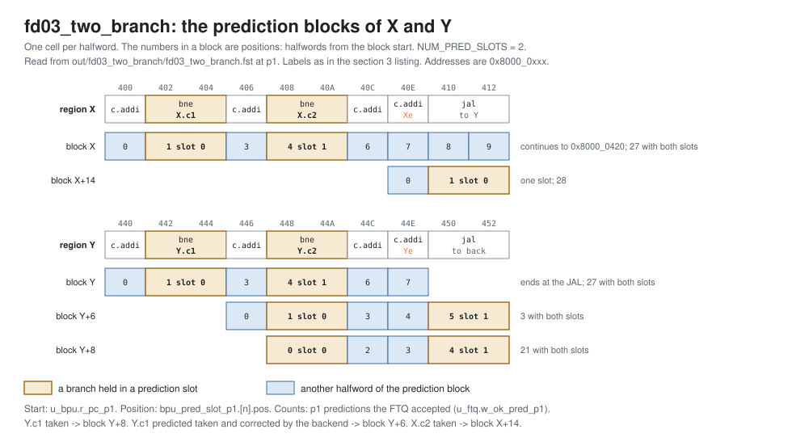

<!-- SPDX-License-Identifier: CC-BY-4.0                        -->
<!-- Copyright (c) 2026 Jeff Nye, uarchlabs.com                -->
<!-- SPDX-FileCopyrightText: 2026 Jeff Nye <jeff@uarchlabs.com> -->
# fd03_two_branch: Two Branches in One Block
```
 FILE:    fd03_two_branch.md
 SOURCE:  DOC-002, DOC-006, DOC-007
 STATUS:  WORKING
 UPDATED: 2026-10-19
 CONTACT: Jeff Nye
```

## 1. Introduction

`fd03_two_branch` (FD-3) runs a loop through two regions of code, X and Y. Each
region has two conditional branches, at offsets +2 and +8 from the first
instruction of the region, which places both branches within one 32-byte
prediction block.

After the first pass (event 5), an FTQ prediction request at X or at Y
(`ftq_pred_pc_p0`) hits an entry holding both branches in the uBTB and in the
FTB, so the p1 prediction (uBTB) and the p2 slot group (FTB) for that prediction
block have both prediction slots valid.

The FTQ accepts 78 p1 predictions and 74 p2 slot groups with both slots valid.
The result line in the log file reports both counts.

This scenario runs in the 2-prediction slot Pacino configuration,
NUM_PRED_SLOTS=2, and both prediction slots are used.

### 1.1 Files

`DEMO=$RVA_ROOT/examples/fe_demo`

  | File               | Path                                          |
  |--------------------|-----------------------------------------------|
  | This file          | $DEMO/docs/fd03_two_branch.md                 |
  | Program (stimulus) | $DEMO/programs/fd03_two_branch.svh            |
  | Surfer sucl        | $DEMO/waves/fd03_two_branch.sucl              |
  | Log                | $DEMO/out/fd03_two_branch/fd03_two_branch.log |
  | Waveform           | $DEMO/out/fd03_two_branch/fd03_two_branch.fst |
  | Waveform (online)  | [Link](https://app.surfer-project.org/?load_url=https%3A%2F%2Fuarchlabs.github.io%2Fpacino-waves%2Ffd03_two_branch.fst&startup_commands=run_command_file_from_url%20https%3A%2F%2Fuarchlabs.github.io%2Fpacino-waves%2Ffd03_two_branch.sucl) |
  | Block connectivity | [$DEMO/docs/fe_block.svg](fe_block.svg)       |
  | Pipeline view      | [$DEMO/docs/fe_pipe.svg](fe_pipe.svg)         |
  | Common description | [$DEMO/docs/demo_explainer.md](demo_explainer.md) |

---

## 2. Run the scenario

Run simulation:
```
make -C examples/fe_demo fd03_two_branch
```

View the waveform (runs simulation first if FST is not up to date):
```
make -C examples/fe_demo view S=fd03_two_branch
```

Console output:
```
-I: fd03_two_branch : PASS : cyc = 539
```

Log file output:
```
-I: fd03_two_branch: PASS, blocks with both slots valid at p1 78, at p2 74,
    events checked 15 of 15, cyc 539
```

The testbench monitor, `tb/fe_demo_mon.svh`, supplies the counts in the log
line:

- blocks with both slots valid at p1
    - `n_two_p1` in `tb/fe_demo_mon.svh`
    - p1 predictions the FTQ accepted with both slots valid
- blocks with both slots valid at p2
    - `n_two_p2` in `tb/fe_demo_mon.svh`
    - p2 slot groups the FTQ accepted with both slots valid

---

## 3. The program

The program is written by the task `prog_fd03` in
`programs/fd03_two_branch.svh`. The code consists of a short prologue, then a
24-pass loop through the regions X and Y, and a short epilogue.

Each pass goes from `top` to X, then to Y, then through `back` to the back edge
`BE`. The conditional branches are X.c1 at 0x8000_0402, X.c2 at 0x8000_0408,
Y.c1 at 0x8000_0442 and Y.c2 at 0x8000_0448.

The program runs in machine mode with translation off, so the addresses are
physical. The program starts at the reset vector, `RESET_VECTOR` = 0x8000_0000
(`bp_defines_pkg.sv`).

```
                                                              Position in block
Address      Label  Instruction          Purpose                X/Y  Y+6  Y+8
0x8000_0000         c.addi a0, 1         ; prologue
0x8000_0002         addi   t0, t0, 1     ; prologue
0x8000_0006         c.addi a0, 1         ; prologue

0x8000_0008  top:   c.addi a0, 1         ; filler
0x8000_000A         jal    x0, X         ; to X
0x8000_000E  back:  c.addi a0, 1         ; filler
0x8000_0010  BE:    bne    x6, x0, top   ; back edge

0x8000_0014         c.addi a0, 1         ; epilogue
0x8000_0016         addi   t0, t0, 1     ; epilogue
0x8000_001A         c.addi a0, 1         ; epilogue
0x8000_001C  hold:  jal    x0, hold      ; termination

0x8000_0400  X:     c.addi a0, 1         ; filler                 0
0x8000_0402  X.c1:  bne    x6, x0, X.c2  ; never taken            1
0x8000_0406         c.addi a0, 1         ; filler                 3
0x8000_0408  X.c2:  bne    x6, x0, Xe    ; always taken           4
0x8000_040C         c.addi a0, 1         ; skipped                6
0x8000_040E  Xe:    c.addi a0, 1         ; filler                 7
0x8000_0410         jal    x0, Y         ; to Y                  (8)

0x8000_0440  Y:     c.addi a0, 1         ; filler                 0
0x8000_0442  Y.c1:  bne    x6, x0, Y.c2  ; taken on odd passes    1
0x8000_0446         c.addi a0, 1         ; skipped if c1 taken    3    0
0x8000_0448  Y.c2:  bne    x6, x0, Ye    ; never taken            4    1    0
0x8000_044C         c.addi a0, 1         ; filler                 6    3    2
0x8000_044E  Ye:    c.addi a0, 1         ; filler                 7    4    3
0x8000_0450         jal    x0, back      ; to back               (8)   5    4
```

A position is the halfword offset of an instruction from the start of its
prediction block. The 32-bit instructions take two positions, so X.c1 covers 1
and 2. Y+6 and Y+8 are prediction blocks that start inside Y, and section 4.1
describes when they are fetched.

The JAL at position 8 is shown in parentheses because it is never in a slot of
the block at X or Y. At Y, both slots hold the conditional branches, so the FTB
ends the block at the JAL. At X, X.c2 is always taken, so the JAL does not
resolve from the block at X, and that block keeps its full 32 bytes. The JAL is
predicted from a later block, such as position 1 of the block at X+14 or
position 4 of the block at Y+8.

The `c.addi` and `addi` instructions do no useful work. Their purpose is to mix
16-bit and 32-bit instructions and to place the conditionals at positions 1 and
4.

The direction of each branch is chosen by the program writer class and resolved
by the modeled backend. The register operands play no part in the taken/not
taken state. The code is the same on every pass, and only the expected
instruction stream changes.

Y.c1 is taken on odd passes, 12 of 24. The back edge is taken on passes 0 to 22
and falls through on pass 23 (event 13).

---

## 4. Walkthrough

Cycle numbers below are events in [section 5](#5-events); each event is a
marker in the waveform.

### 4.1 Prediction slot assignment

In this configuration a prediction block has two prediction slots, and each
slot describes one branch.[^1] The FTB and the uBTB hold one entry per block
start address, with the branches of the block in position order, so slot 0
holds the earlier branch and slot 1 the later one.[^2]

Both conditional branches of X and of Y are on the execution path in every
pass. X.c1 is never taken, so execution reaches X.c2. Y.c1 either falls through
to the `c.addi` at Y+6 or jumps to Y+8, and Y.c2 is at Y+8 in both cases. After
the first pass, the entries for X and Y each hold both conditional branches, at
positions 1 and 4.

An entry holds at most two branches. The JAL in Y is not kept, so the block at Y
ends at the JAL, and the JAL is predicted from a later block.[^3] The JAL in X
does not resolve from the block at X, because X.c2 is always taken, and the
block at X keeps its full 32 bytes.

Two other prediction blocks start inside Y and also have both slots valid. Y+8
is the block fetched after Y.c1 is taken, with Y.c2 at position 0 and the JAL at
position 4. Its first p2 slot group with both slots valid is at cyc 138
(event 9). Y+6 is the block fetched after the backend corrects a Y.c1 that was
predicted taken, with Y.c2 at position 1 and the JAL at position 5. Its first
such group is at cyc 202 (event 11).

[](fd03_blocks.svg)

The FTQ accepts 78 p1 predictions with both slots valid: 27 at X, 27 at Y, 21 at
Y+8 and 3 at Y+6. It accepts 74 p2 slot groups with both slots valid, shown
below by block.

```
block        slot 0              slot 1              groups
X            pos 1 COND nt  TAGE pos 4 COND tk  TAGE  26
X            pos 1 COND tk  TAGE pos 4 COND tk  TAGE   1
Y            pos 1 COND nt  TAGE pos 4 COND nt  TAGE   5
Y            pos 1 COND nt  TAGE pos 4 COND tk  TAGE   1
Y            pos 1 COND tk  TAGE pos 4 COND nt  TAGE   7
Y            pos 1 COND tk  TAGE pos 4 COND tk  TAGE  13
Y+6          pos 1 COND nt  TAGE pos 5 JAL  tk  FTB    3
Y+8          pos 0 COND nt  TAGE pos 4 JAL  tk  FTB   15
Y+8          pos 0 COND tk  TAGE pos 4 JAL  tk  FTB    3
```

COND and JAL are the `br_type` values COND and DIRECT_UNC. TAGE and FTB are the
`pred_src` values PRED_TAGE and PRED_FTB. The abbreviations nt and tk are
`taken` 0 and 1. The directions are the p2 predictions, not the resolved
outcomes, so they include mispredictions such as Y.c2 predicted taken
(event 12).

[^1]: `NUM_PRED_SLOTS`: `rtl/core/frontend/bpu/rtl/bp_defines_pkg.sv:65`.
    `bp_ftq_slot_t`: `rtl/core/frontend/bpu/rtl/bp_structs_pkg.sv:405-417`.
[^2]: The updates that keep position order:
    `rtl/core/frontend/bpu/rtl/ftb_cntrl.sv:464-615` and
    `rtl/core/frontend/bpu/rtl/ubtb.sv:291-376`.
    `rtl/core/frontend/bpu/rtl/bp_cluster.sv:861-867` also swaps the p1 slots
    when slot 1's `pos` is below slot 0's; this does not fire for uBTB entries
    (comment at lines 853 to 860).
[^3]: The split at update, rule 4 of the comment at
    `rtl/core/frontend/bpu/rtl/ftb_cntrl.sv:464`.

### 4.2 Entry training in pass 0

No predictor entry exists at the start of the run, so the requests at X and Y in
pass 0 miss. The backend resolves X.c2 taken at cyc 39 (event 1), and fetch
restarts at 0x8000_040E. The FTB writes X.c1 at cyc 40 and X.c2 at cyc 41, so
the entry for X holds both branches (event 2). The entry for Y holds both at cyc
62 (event 3). At cyc 72 the JAL resolves from the block at Y. The entry already
holds two branches, so the FTB ends the block at the JAL, 0x8000_0450 (event 4).

### 4.3 First predictions with both slots valid

The FTQ accepts the first p1 prediction with both slots valid at cyc 83
(event 5), for the block at X. In group `bp_cluster_p1_ubtb`, `u_bpu.r_pc_p1` is
0x8000_0400, `u_bpu.r_ubtb_blk_p1.hit` is asserted, and `bpu_pred_slot_p1.[0]`
and `.[1]` are valid at `pos` 1 and 4. In group `ftq`, `u_ftq.w_ok_pred_p1` is
asserted.

The p2 slot group for the same block follows at cyc 84 (event 6). In group
`bp_cluster_p2_ftb`, `u_bpu.r_pc_p2` is 0x8000_0400, `u_bpu.w_ftb_valid_p2` is
asserted, and `bpu_slot_p2.[0]` and `.[1]` are valid conditional branches at
`pos` 1 and 4, with `pred_src` PRED_TAGE. In group `ftq`, `u_ftq.w_ok_slot_p2`
is asserted.

The first p2 slot group with both slots valid for the block at Y is at cyc 107
(event 8), with `u_bpu.r_pc_p2` at 0x8000_0440 and the same positions.

### 4.4 Direction training

Holding both branches does not make their directions correct. The first p2 group
for X predicts X.c1 taken (event 6), and the backend corrects it at cyc 94
(event 7). X's last backend misprediction is at cyc 133. Y takes longer because
Y.c1 alternates: its first misprediction is at cyc 147 (event 10) and the last
backend misprediction in the loop is at cyc 319 (event 12). None follows until
the back edge falls through (event 13). The backend reports 13 mispredictions in
the run, and the FTQ accepts 19 p2 redirects and 6 p3 redirects, all 6 from SC.

---

## 5. Events

| #  | cyc | Event                                                                                                           | Other                                   |
|----|-----|-----------------------------------------------------------------------------------------------------------------|-----------------------------------------|
| 0  | 0   | reset released (`tb.rstn`); the FTQ requests 0x8000_0000 the same cycle                                         | fast init                               |
| 1  | 39  | first backend misprediction: X.c2 taken; redirect to 0x8000_040E                                                | pass 0                                  |
| 2  | 41  | the FTB entry for X holds X.c1 and X.c2                                                                         | positions 1 and 4                       |
| 3  | 62  | the FTB entry for Y holds Y.c1 and Y.c2                                                                         | positions 1 and 4                       |
| 4  | 72  | the JAL resolves from Y: the FTB entry for Y ends at 0x8000_0450                                                | the split; pass 0 ends                  |
| 5  | 83  | first p1 prediction for X with both slots valid, accepted by the FTQ                                            | uBTB, X 0x8000_0400                     |
| 6  | 84  | first p2 group for X with both slots valid, accepted by the FTQ: X.c1 at position 1 and X.c2 at position 4      | FTB, X 0x8000_0400; predicts both taken |
| 7  | 94  | X.c1 predicted taken, a misprediction; redirect to 0x8000_0406                                                  | pass 1                                  |
| 8  | 107 | first p2 group for Y with both slots valid, accepted by the FTQ: Y.c1 at position 1 and Y.c2 at position 4      | FTB, Y 0x8000_0440                      |
| 9  | 138 | first p2 group for Y+8 with both slots valid, accepted by the FTQ: Y.c2 at position 0 and the JAL at position 4 | FTB, Y+8 0x8000_0448; slot 1 is the JAL |
| 10 | 147 | Y.c1 predicted taken, a misprediction; redirect to 0x8000_0446                                                  | pass 2                                  |
| 11 | 202 | first p2 group for Y+6 with both slots valid, accepted by the FTQ: Y.c2 at position 1 and the JAL at position 5 | FTB, Y+6 0x8000_0446; slot 1 is the JAL |
| 12 | 319 | last backend misprediction in the loop: Y.c2 predicted taken; redirect to 0x8000_044C                           | pass 10                                 |
| 13 | 529 | back edge falls through, a misprediction; redirect to 0x8000_0014                                               | pass 23                                 |
| 14 | 539 | the run ends; the last instruction retires                                                                      | a 100 cycle drain follows, to 639       |

---

## 6. Waveform

`make -C examples/fe_demo view S=fd03_two_branch` opens
`waves/fd03_two_branch.sucl` in Surfer, with a marker at each event above.
Signal paths below are under `tb.dut` unless they start with `tb.`.

| group              | signal                            | description                                       |
|--------------------|-----------------------------------|---------------------------------------------------|
| clock              | `tb.clk`                          | clock                                             |
|                    | `tb.rstn`                         | active low reset                                  |
|                    | `tb.cyc`                          | cycle number                                      |
| bp_cluster_p1_ubtb | `u_bpu.r_pc_p1`                   | p1 prediction block start address                 |
|                    | `bpu_pred_val_p1`                 | p1 prediction valid                               |
|                    | `bpu_pred_idx_p1`                 | FTQ index of the p1 prediction                    |
|                    | `u_bpu.r_ubtb_blk_p1.hit`         | uBTB hit at p1                                    |
|                    | `bpu_pred_pft_p1`                 | p1 prediction block end, next halfword after it   |
|                    | `bpu_pred_slot_p1.[0].slot_valid` | slot 0 holds a branch                             |
|                    | `bpu_pred_slot_p1.[0].br_type`    | slot 0 branch type                                |
|                    | `bpu_pred_slot_p1.[0].pos`        | slot 0 halfword position in the prediction block  |
|                    | `bpu_pred_slot_p1.[0].taken`      | slot 0 predicted direction                        |
|                    | `bpu_pred_slot_p1.[0].target`     | slot 0 predicted target                           |
|                    | `bpu_pred_slot_p1.[0].pred_src`   | slot 0 predictor that supplied the prediction     |
|                    | `bpu_pred_slot_p1.[1].slot_valid` | slot 1 holds a branch                             |
|                    | `bpu_pred_slot_p1.[1].br_type`    | slot 1 branch type                                |
|                    | `bpu_pred_slot_p1.[1].pos`        | slot 1 halfword position in the prediction block  |
|                    | `bpu_pred_slot_p1.[1].taken`      | slot 1 predicted direction                        |
|                    | `bpu_pred_slot_p1.[1].target`     | slot 1 predicted target                           |
|                    | `bpu_pred_slot_p1.[1].pred_src`   | slot 1 predictor that supplied the prediction     |
| bp_cluster_p2_ftb  | `u_bpu.r_pc_p2`                   | p2 prediction block start address                 |
|                    | `u_bpu.r_val_p2`                  | p2 valid                                          |
|                    | `bpu_slot_val_p2`                 | p2 group valid: p2 valid and an FTB hit           |
|                    | `bpu_slot_idx_p2`                 | FTQ index of the p2 group                         |
|                    | `u_bpu.w_ftb_valid_p2`            | FTB hit at p2                                     |
|                    | `bpu_slot_p2.[0].slot_valid`      | slot 0 holds a branch                             |
|                    | `bpu_slot_p2.[0].br_type`         | slot 0 branch type                                |
|                    | `bpu_slot_p2.[0].pos`             | slot 0 halfword position in the prediction block  |
|                    | `bpu_slot_p2.[0].taken`           | slot 0 predicted direction                        |
|                    | `bpu_slot_p2.[0].target`          | slot 0 predicted target                           |
|                    | `bpu_slot_p2.[0].pred_src`        | slot 0 predictor that supplied the prediction     |
|                    | `bpu_slot_p2.[1].slot_valid`      | slot 1 holds a branch                             |
|                    | `bpu_slot_p2.[1].br_type`         | slot 1 branch type                                |
|                    | `bpu_slot_p2.[1].pos`             | slot 1 halfword position in the prediction block  |
|                    | `bpu_slot_p2.[1].taken`           | slot 1 predicted direction                        |
|                    | `bpu_slot_p2.[1].target`          | slot 1 predicted target                           |
|                    | `bpu_slot_p2.[1].pred_src`        | slot 1 predictor that supplied the prediction     |
|                    | `bpu_redir_p2.[0].valid`          | p2 redirect from slot 0                           |
|                    | `bpu_redir_p2.[0].target_pc`      | p2 redirect target from slot 0                    |
|                    | `bpu_redir_p2.[1].valid`          | p2 redirect from slot 1                           |
|                    | `bpu_redir_p2.[1].target_pc`      | p2 redirect target from slot 1                    |
|                    | `bpu_redir_idx_p2`                | FTQ index of the p2 redirect                      |
| ftq                | `u_ftq.w_ok_pred_p1`              | the FTQ accepts the p1 prediction                 |
|                    | `u_ftq.w_ok_slot_p2`              | the FTQ accepts the p2 group                      |
|                    | `u_ftq.w_ok_slot_p3`              | the FTQ accepts the p3 group                      |
|                    | `u_ftq.w_ok_redir_p2`             | the FTQ accepts the p2 redirect                   |
|                    | `u_ftq.w_ok_redir_p3`             | the FTQ accepts the p3 redirect                   |
|                    | `u_ftq.w_redir_val`               | a redirect the FTQ takes                          |
|                    | `u_ftq.w_redir_idx`               | FTQ index of the redirect                         |
|                    | `u_ftq.w_commit_ptr`              | FTQ commit pointer                                |
|                    | `ftq_full`                        | FTQ full                                          |
|                    | `ftq_empty`                       | FTQ empty                                         |
| backend            | `tb.bkend_ftq_redir_val`          | backend redirect valid                            |
|                    | `tb.bkend_ftq_redir_pc`           | backend redirect PC                               |
|                    | `tb.bkend_ftq_redir_cause`        | backend redirect cause                            |
| ftb_update         | `ftb_upd_valid_u0`                | FTB update valid                                  |
|                    | `ftb_upd_pc_u0`                   | block start address of the FTB update             |
|                    | `ftb_upd_pos_u0`                  | halfword position of the branch in the FTB update |
|                    | `ftb_upd_is_br_u0`                | the FTB update is for a conditional               |
|                    | `ftb_upd_is_jmp_u0`               | the FTB update is for a jump                      |
|                    | `ftb_upd_hit_u0`                  | the FTB update hits an entry                      |
