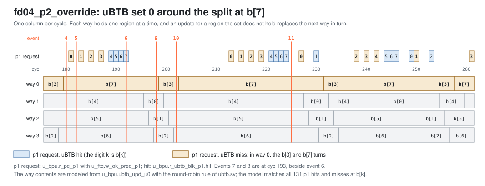

<!-- SPDX-License-Identifier: CC-BY-4.0                        -->
<!-- Copyright (c) 2026 Jeff Nye, uarchlabs.com                -->
<!-- SPDX-FileCopyrightText: 2026 Jeff Nye <jeff@uarchlabs.com> -->
# fd04_p2_override: p2 Override
```
 FILE:    fd04_p2_override.md
 SOURCE:  DOC-002, DOC-006, DOC-007
 STATUS:  WORKING
 UPDATED: 2026-10-19
 CONTACT: Jeff Nye
```

## 1. Introduction

`fd04_p2_override` (FD-4) runs a 16-pass loop through eight regions of code,
b[0] to b[7], chained by JALs. The start addresses of the regions map to one
uBTB set, which has four ways, and to eight different FTB sets. The FTB
therefore holds all eight prediction blocks, and the uBTB holds at most four at
a time.

When an FTQ prediction request at b[k] (`ftq_pred_pc_p0`) misses in the uBTB,
the p1 prediction falls through to the next 32-byte block. The FTB hits at p2
with the JAL, so the p2 successor differs from the p1 successor and the BPU
issues a p2 redirect.

The FTQ accepts 64 p2 redirects: 49 follow a uBTB miss and 15 follow a uBTB hit
at b[7], which section 4.1 describes. The result line in the log file reports
the total.

This scenario runs in the 1-prediction slot Pacino configuration,
NUM_PRED_SLOTS=1.

### 1.1 Files

`DEMO=$RVA_ROOT/examples/fe_demo`

  | File               | Path                                            |
  |--------------------|-------------------------------------------------|
  | This file          | $DEMO/docs/fd04_p2_override.md                  |
  | Program (stimulus) | $DEMO/programs/fd04_p2_override.svh             |
  | Surfer sucl        | $DEMO/waves/fd04_p2_override.sucl               |
  | Log                | $DEMO/out/fd04_p2_override/fd04_p2_override.log |
  | Waveform           | $DEMO/out/fd04_p2_override/fd04_p2_override.fst |
  | Waveform (online)  | [Link](https://app.surfer-project.org/?load_url=https%3A%2F%2Fuarchlabs.github.io%2Fpacino-waves%2Ffd04_p2_override.fst&startup_commands=run_command_file_from_url%20https%3A%2F%2Fuarchlabs.github.io%2Fpacino-waves%2Ffd04_p2_override.sucl) |
  | Block connectivity | [$DEMO/docs/fe_block.svg](fe_block.svg)         |
  | Pipeline view      | [$DEMO/docs/fe_pipe.svg](fe_pipe.svg)           |
  | Common description | [$DEMO/docs/demo_explainer.md](demo_explainer.md) |

---

## 2. Run the scenario

Run simulation:
```
make -C examples/fe_demo fd04_p2_override
```

View the waveform (runs simulation first if FST is not up to date):
```
make -C examples/fe_demo view S=fd04_p2_override
```

Console output:
```
-I: fd04_p2_override : PASS : cyc = 520
```

Log file output:
```
-I: fd04_p2_override: PASS, p2 redirects 64, events checked 14 of 14, cyc 520
```

The testbench monitor, `tb/fe_demo_mon.svh`, supplies the count in the log line:

- p2 redirects
    - `n_redir_p2` in `tb/fe_demo_mon.svh`
    - cycles in which the FTQ accepted a p2 redirect

---

## 3. The program

The program is written by the task `prog_fd04` in
`programs/fd04_p2_override.svh`. The code consists of a short prologue, then a
16-pass loop through the regions b[0] to b[7], and a short epilogue.

The regions are 0x800 apart, from b[0] at 0x8000_1000 to b[7] at 0x8000_4800.
Each of b[0] to b[6] ends in a JAL to the next region. b[7] holds a conditional
branch, at 0x8000_4802, and the JAL back to b[0], at 0x8000_4806.

The program runs in machine mode with translation off, the addresses are
physical. The program starts at the reset vector, `RESET_VECTOR` = 0x8000_0000
(`bp_defines_pkg.sv`).

```
                                                            Position in block
Address      Label   Instruction          Purpose              b[k]  b[7]+6
0x8000_0000          c.addi a0, 1         ; prologue
0x8000_0002          addi   t0, t0, 1     ; prologue
0x8000_0006          c.addi a0, 1         ; prologue
0x8000_0008          jal    x0, b[0]      ; to b[0]

0x8000_1000  b[0]:   c.addi a0, 1         ; filler                0
0x8000_1002          addi   t0, t0, 1     ; filler                1
0x8000_1006          jal    x0, b[1]      ; to b[1]               3

  b[1] 0x8000_1800, b[2] 0x8000_2000, b[3] 0x8000_2800,
  b[4] 0x8000_3000, b[5] 0x8000_3800: the same three instructions

0x8000_4000  b[6]:   c.addi a0, 1         ; filler                0
0x8000_4002          addi   t0, t0, 1     ; filler                1
0x8000_4006          jal    x0, b[7]      ; to b[7]               3

0x8000_4800  b[7]:   c.addi a0, 1         ; filler                0
0x8000_4802  b[7].c: bne    x6, x0, ex    ; taken on last pass    1
0x8000_4806  b[7].j: jal    x0, b[0]      ; to b[0]              (3)      0

0x8000_480A  ex:     c.addi a0, 1         ; epilogue
0x8000_480C          addi   t0, t0, 1     ; epilogue
0x8000_4810          c.addi a0, 1         ; epilogue
0x8000_4812  hold:   jal    x0, hold      ; termination
```

A position is the halfword offset of an instruction from the start of its
prediction block. The 32-bit instructions take two positions, so the `addi` at
0x8000_1002 covers 1 and 2.

The JAL at position 3 of the block at b[7] is shown in parentheses because that
position applies only before the split. With one prediction slot, an FTB entry
holds one branch, so the FTB ends the block at b[7] at the JAL, and the JAL is
at position 0 of a block of its own. Section 4.1 describes this.

The `c.addi` and `addi` instructions do no useful work. Their purpose is to mix
16-bit and 32-bit instructions and to place the branch at position 3 of each
region.

The direction of b[7].c is chosen by the program writer class and resolved by
the modeled backend. The register operands play no part in the taken/not taken
state. The code is the same on every pass, and only the expected instruction
stream changes.

b[7].c is not taken on passes 0 to 14, and the JAL returns to b[0]. b[7].c is
taken on pass 15, which exits the loop to `ex` (event 12), and the JAL does not
execute.

---

## 4. Walkthrough

Cycle numbers below are events in [section 5](#5-events); each event is a
marker in the waveform.

### 4.1 p2 redirects from uBTB capacity

The uBTB has 64 sets of four ways. Its set index is `pc[10:5]` XOR
(`pc[4:1]` << 2), and the FTB set index is `pc[13:5]` XOR (`pc[4:1]` << 5).[^1]
The start address of each region is a multiple of 0x800, so `pc[4:1]` and
`pc[10:5]` are 0. All eight regions map to uBTB set 0, and to eight different
FTB sets.

| Region | Start address | uBTB set | FTB set |
|--------|---------------|----------|---------|
| b[0]   | 0x8000_1000   | 0        | 0x080   |
| b[1]   | 0x8000_1800   | 0        | 0x0C0   |
| b[2]   | 0x8000_2000   | 0        | 0x100   |
| b[3]   | 0x8000_2800   | 0        | 0x140   |
| b[4]   | 0x8000_3000   | 0        | 0x180   |
| b[5]   | 0x8000_3800   | 0        | 0x1C0   |
| b[6]   | 0x8000_4000   | 0        | 0x000   |
| b[7]   | 0x8000_4800   | 0        | 0x040   |

An update that misses in the uBTB takes the way named by the set's round-robin
write pointer, so the set holds at most four prediction blocks.[^2] The block at
0x8000_0000, from the prologue's JAL, also maps to set 0 and holds way 0 until
b[3] replaces it at cyc 118. The first region replaced is b[0], at cyc 138
(event 3). Which four the set holds depends on the pointer and the order of the
updates, so the misses are uneven across the regions. Of the 130 updates to the
set in the run, 129 write a block it does not hold, and the other is the split
at cyc 192 (event 6).

The set around the split is shown below. Its contents are modeled from the uBTB
updates, and the model matches every p1 hit and miss at b[k] in the run.

[](fd04_ubtb_set0.svg)

A request that misses in the uBTB predicts no branch, and the end of its p1
prediction is the request PC plus 32.[^3] At p2 the FTB supplies the JAL, so for
b[k] the p2 successor is b[k+1] and the p1 successor is b[k] + 0x20. The BPU
issues a p2 redirect when the FTB hits and the two successors differ.[^4] The
FTQ accepts it and takes the redirect PC as its next p0 request.[^5]

The FTQ accepts 64 p2 redirects, shown below by region. The uBTB misses are
those of the p1 predictions the FTQ accepts.

```
region  target        uBTB at p1  uBTB misses  p2 redirects
b[0]    0x8000_1800   miss             4            3
b[1]    0x8000_2000   miss             4            3
b[2]    0x8000_2800   miss             4            3
b[3]    0x8000_3000   miss            16           15
b[4]    0x8000_3800   miss            14           13
b[5]    0x8000_4000   miss            13           12
b[7]    0x8000_4806   hit                          14
b[7]    0x8000_480A   hit                           1
```

Each region misses once in pass 0, when the FTB has no entry for it, and that
miss raises no redirect. Predecode corrects each JAL in pass 0, first at cyc 19
(event 1), and the FTB entries are allocated from cyc 59 (event 2) to cyc 180
(event 4). Every other miss raises a p2 redirect, which gives the 49 redirects
that follow a uBTB miss. b[6] and b[7] miss only in pass 0.

The 15 redirects at b[7] follow a uBTB hit. b[7] holds b[7].c at position 1 and
the JAL at position 3, and with one prediction slot an entry holds one branch.
When the JAL first resolves from the block at b[7], the entry is split: it keeps
b[7].c and ends the block at the JAL's PC, 0x8000_4806.[^6] The uBTB does this
at cyc 192 (event 6) and the FTB at cyc 193 (event 8).

The uBTB entry does not stay split. Round-robin replacement writes its way for
b[3] at cyc 198 (event 9). At cyc 202 (event 10) the update for b[7].c allocates
b[7] again, with the end of a new entry, b[7] + 0x20. b[3] and b[7] go on
replacing each other in that way in later passes. The JAL now resolves from the
block at 0x8000_4806, so no update from b[7] carries it, and each new uBTB entry
has the same end.

The uBTB therefore predicts b[7].c not taken with the end 0x8000_4820, past the
JAL, while the FTB's block ends at 0x8000_4806. The successors differ, so the
BPU redirects to the JAL's PC, first at cyc 225 (event 11) and 14 times in all.
The other redirect is at cyc 193 (event 7), before the split takes effect at p2:
the FTB block still ends at 0x8000_4820, and b[7].c is predicted taken at p2
against the uBTB's not taken, so the redirect is to 0x8000_480A.

The blocks at b[7] after the split are shown below.

[![fd04 the uBTB and the FTB at b[7]](fd04_blocks.svg)](fd04_blocks.svg)

[^1]: uBTB index: `rtl/core/frontend/bpu/rtl/ubtb.sv:135-140`. FTB index:
    `rtl/core/frontend/bpu/rtl/ftb_cntrl.sv:327-331`. `UBTB_WAYS`,
    `UBTB_IDX_BITS` and `FTB_IDX_BITS`:
    `rtl/core/frontend/bpu/rtl/bp_defines_pkg.sv:315`, `:322` and `:176`.
[^2]: `rtl/core/frontend/bpu/rtl/ubtb.sv:481`, `:554`.
[^3]: `rtl/core/frontend/bpu/rtl/bp_cluster.sv:876-878`.
[^4]: `rtl/core/frontend/bpu/rtl/bp_cluster.sv:1213-1217`.
[^5]: `rtl/core/frontend/ftq/rtl/ftq_shadow.sv:211-212`,
    `rtl/core/frontend/ftq/rtl/ftq_npc.sv:349-355`.
[^6]: The split at update: rule 4 of the comment at
    `rtl/core/frontend/bpu/rtl/ftb_cntrl.sv:464`, and
    `rtl/core/frontend/bpu/rtl/ubtb.sv:36-41`.

### 4.2 First p2 redirects

The FTQ accepts the first p2 redirect at cyc 182 (event 5), for the block at
b[0]. The p1 prediction for that block misses one cycle earlier, at cyc 181. In
group `bp_cluster_p1_ubtb`, `u_bpu.r_ubtb_blk_p1.hit` and
`bpu_pred_slot_p1.[0].slot_valid` are deasserted, and `bpu_pred_pft_p1` is
0x8000_1020, the request PC plus 32.

At cyc 182, in group `bp_cluster_p2_ftb`, `u_bpu.r_val_p2` and
`u_bpu.w_ftb_valid_p2` are asserted. `bpu_slot_p2.[0]` holds the JAL at `pos` 3,
with `br_type` DIRECT_UNC and `pred_src` PRED_FTB, and `bpu_redir_p2.[0].valid`
is asserted with `target_pc` 0x8000_1800. In group `ftq`, `u_ftq.w_ok_redir_p2`
and `u_ftq.w_redir_val` are asserted. In group `bp_cluster_p0`, `ftq_pred_pc_p0`
is 0x8000_1800 in the same cycle.

The first p2 redirect at b[7] is at cyc 193 (event 7), and its p1 prediction is
at cyc 192. `u_bpu.r_ubtb_blk_p1.hit` is asserted, slot 0 predicts b[7].c not
taken, and `bpu_pred_pft_p1` is 0x8000_4820. At cyc 193, `bpu_slot_p2.[0]` holds
b[7].c at `pos` 1 with `taken` asserted and `pred_src` PRED_TAGE, so `target_pc`
is 0x8000_480A.

The first p2 redirect to the JAL's PC is at cyc 225 (event 11), and its p1
prediction is at cyc 224, with the same uBTB hit and end. At cyc 225,
`bpu_slot_p2.[0]` holds b[7].c with `taken` deasserted, so `target_pc` is
0x8000_4806, the end of the FTB's block.

---

## 5. Events

| #  | cyc | Event                                                                                                | Other                             |
|----|-----|------------------------------------------------------------------------------------------------------|-----------------------------------|
| 0  | 0   | reset released (`tb.rstn`); the FTQ requests 0x8000_0000 the same cycle                              | fast init                         |
| 1  | 19  | first predecode redirect, to b[0]: the JAL at 0x8000_0008 has no predictor entry                     | pass 0                            |
| 2  | 59  | FTB entry for b[0] allocated with the JAL at position 3                                              | pass 0                            |
| 3  | 138 | uBTB update for b[4] replaces b[0]; the first region replaced                                        | set 0, way 1                      |
| 4  | 180 | FTB entry for b[7] allocated with b[7].c at position 1                                               | the last region of pass 0         |
| 5  | 182 | first p2 redirect, from b[0] to b[1] (0x8000_1800): the FTB successor differs from the p1 successor  | accepted by the FTQ               |
| 6  | 192 | the JAL resolves from b[7]: the uBTB entry for b[7] ends at 0x8000_4806                              | the split, uBTB                   |
| 7  | 193 | first p2 redirect to 0x8000_480A: b[7]'s conditional predicted taken at p2                           | from b[7]                         |
| 8  | 193 | the FTB entry for b[7] ends at 0x8000_4806                                                           | the split, `upd_split` 1          |
| 9  | 198 | uBTB update for b[3] replaces b[7]                                                                   | set 0, way 0                      |
| 10 | 202 | uBTB update for b[7] allocates it again, with the end b[7] + 0x20                                    | set 0, way 0                      |
| 11 | 225 | first p2 redirect to the jal, 0x8000_4806: the end of the FTB entry for b[7] after the split         | from b[7]                         |
| 12 | 511 | the chain exits: b[7]'s conditional taken on the last pass, a misprediction; redirect to 0x8000_480A | pass 15, backend                  |
| 13 | 520 | the run ends; the last instruction retires                                                           | a 100 cycle drain follows, to 620 |

---

## 6. Waveform

`make -C examples/fe_demo view S=fd04_p2_override` opens
`waves/fd04_p2_override.sucl` in Surfer, with a marker at each event above.
Signal paths below are under `tb.dut` unless they start with `tb.`.

| group              | signal                                | description                                        |
|--------------------|---------------------------------------|----------------------------------------------------|
| clock              | `tb.clk`                              | clock                                              |
|                    | `tb.rstn`                             | active low reset                                   |
|                    | `tb.cyc`                              | cycle number                                       |
| bp_cluster_p1_ubtb | `u_bpu.r_pc_p1`                       | p1 prediction block start address                  |
|                    | `bpu_pred_val_p1`                     | p1 prediction valid                                |
|                    | `bpu_pred_idx_p1`                     | FTQ index of the p1 prediction                     |
|                    | `u_bpu.r_ubtb_blk_p1.hit`             | uBTB hit at p1                                     |
|                    | `bpu_pred_pft_p1`                     | p1 prediction block end, next halfword after it    |
|                    | `bpu_pred_slot_p1.[0].slot_valid`     | slot 0 holds a branch                              |
|                    | `bpu_pred_slot_p1.[0].br_type`        | slot 0 branch type                                 |
|                    | `bpu_pred_slot_p1.[0].pos`            | slot 0 halfword position in the prediction block   |
|                    | `bpu_pred_slot_p1.[0].taken`          | slot 0 predicted direction                         |
|                    | `bpu_pred_slot_p1.[0].target`         | slot 0 predicted target                            |
|                    | `bpu_pred_slot_p1.[0].pred_src`       | slot 0 predictor that supplied the prediction      |
| bp_cluster_p2_ftb  | `u_bpu.r_pc_p2`                       | p2 prediction block start address                  |
|                    | `u_bpu.r_val_p2`                      | p2 valid                                           |
|                    | `bpu_slot_val_p2`                     | p2 group valid: p2 valid and an FTB hit            |
|                    | `bpu_slot_idx_p2`                     | FTQ index of the p2 group                          |
|                    | `u_bpu.w_ftb_valid_p2`                | FTB hit at p2                                      |
|                    | `bpu_slot_p2.[0].slot_valid`          | slot 0 holds a branch                              |
|                    | `bpu_slot_p2.[0].br_type`             | slot 0 branch type                                 |
|                    | `bpu_slot_p2.[0].pos`                 | slot 0 halfword position in the prediction block   |
|                    | `bpu_slot_p2.[0].taken`               | slot 0 predicted direction                         |
|                    | `bpu_slot_p2.[0].target`              | slot 0 predicted target                            |
|                    | `bpu_slot_p2.[0].pred_src`            | slot 0 predictor that supplied the prediction      |
|                    | `bpu_redir_p2.[0].valid`              | p2 redirect from slot 0                            |
|                    | `bpu_redir_p2.[0].target_pc`          | p2 redirect target from slot 0                     |
|                    | `bpu_redir_idx_p2`                    | FTQ index of the p2 redirect                       |
| ftq                | `u_ftq.w_ok_pred_p1`                  | the FTQ accepts the p1 prediction                  |
|                    | `u_ftq.w_ok_slot_p2`                  | the FTQ accepts the p2 group                       |
|                    | `u_ftq.w_ok_slot_p3`                  | the FTQ accepts the p3 group                       |
|                    | `u_ftq.w_ok_redir_p2`                 | the FTQ accepts the p2 redirect                    |
|                    | `u_ftq.w_ok_redir_p3`                 | the FTQ accepts the p3 redirect                    |
|                    | `u_ftq.w_redir_val`                   | a redirect the FTQ takes                           |
|                    | `u_ftq.w_redir_idx`                   | FTQ index of the redirect                          |
|                    | `u_ftq.w_commit_ptr`                  | FTQ commit pointer                                 |
|                    | `ftq_full`                            | FTQ full                                           |
|                    | `ftq_empty`                           | FTQ empty                                          |
| bp_cluster_p0      | `ftq_pred_val_p0`                     | p0 request valid                                   |
|                    | `ftq_pred_pc_p0`                      | p0 request PC                                      |
|                    | `ftq_pred_idx_p0`                     | p0 request FTQ index                               |
|                    | `u_ftq.u_npc.w_hold`                  | holds the p0 request                               |
| predecode          | `u_ftq.w_pd_redir_val`                | predecode redirect                                 |
|                    | `u_ftq.w_pd_redir_pc`                 | predecode redirect target                          |
| backend            | `tb.bkend_ftq_redir_val`              | backend redirect valid                             |
|                    | `tb.bkend_ftq_redir_pc`               | backend redirect PC                                |
|                    | `tb.bkend_ftq_redir_cause`            | backend redirect cause                             |
| ftb_update         | `ftb_upd_valid_u0`                    | FTB update valid                                   |
|                    | `ftb_upd_pc_u0`                       | block start address of the FTB update              |
|                    | `ftb_upd_pos_u0`                      | halfword position of the branch in the FTB update  |
|                    | `ftb_upd_is_br_u0`                    | the FTB update is for a conditional                |
|                    | `ftb_upd_is_jmp_u0`                   | the FTB update is for a jump                       |
|                    | `ftb_upd_hit_u0`                      | the FTB update hits an entry                       |
|                    | `u_bpu.u_ftb.u_ftb_cntrl.upd_split`   | the FTB update splits the entry                    |
|                    | `u_bpu.u_ftb.u_ftb_cntrl.upd_cut_pos` | position the split ends the entry at               |
| ubtb_update        | `u_bpu.ubtb_upd_u0.[0].valid`         | uBTB update valid                                  |
|                    | `u_bpu.ubtb_upd_u0.[0].pc`            | block start address of the uBTB update             |
|                    | `u_bpu.ubtb_upd_u0.[0].pos`           | halfword position of the branch in the uBTB update |
|                    | `u_bpu.ubtb_upd_u0.[0].is_br`         | the uBTB update is for a conditional               |
|                    | `u_bpu.ubtb_upd_u0.[0].is_jmp`        | the uBTB update is for a jump                      |
