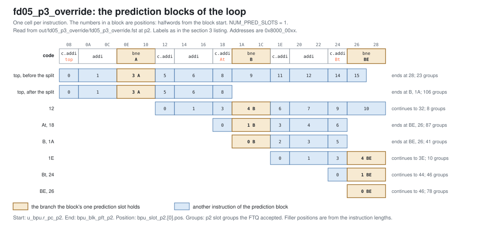
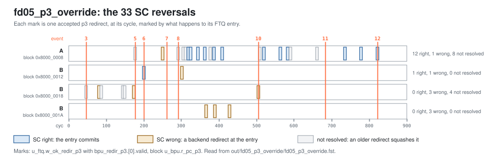

<!-- SPDX-License-Identifier: CC-BY-4.0                        -->
<!-- Copyright (c) 2026 Jeff Nye, uarchlabs.com                -->
<!-- SPDX-FileCopyrightText: 2026 Jeff Nye <jeff@uarchlabs.com> -->
# fd05_p3_override: p3 Override
```
 FILE:    fd05_p3_override.md
 SOURCE:  DOC-002, DOC-006, DOC-007
 STATUS:  WORKING
 UPDATED: 2026-10-19
 CONTACT: Jeff Nye
```

## 1. Introduction

`fd05_p3_override` (FD-5) runs a 96-pass loop around two conditional branches, A
and B, whose directions follow short periodic patterns: A is taken on odd
passes, and B on every third pass.

At p3 the statistical corrector (SC) can disagree with the direction TAGE
published at p2. When it does, the p3 successor differs from the p2 successor
and the BPU issues a p3 redirect, with the slot's `pred_src` set to PRED_SC.

The FTQ accepts 33 p3 redirects, between cyc 47 and cyc 822. All 33 are SC
reversals of a TAGE direction. The result line in the log file reports both
counts.

This scenario runs in the 1-prediction slot Pacino configuration,
NUM_PRED_SLOTS=1. FD-22 (`fd22_sc_slot1`) shows SC reversing the second slot of
a prediction block, in the 2-prediction slot configuration.

### 1.1 Files

`DEMO=$RVA_ROOT/examples/fe_demo`

  | File               | Path                                            |
  |--------------------|-------------------------------------------------|
  | This file          | $DEMO/docs/fd05_p3_override.md                  |
  | Program (stimulus) | $DEMO/programs/fd05_p3_override.svh             |
  | Surfer sucl        | $DEMO/waves/fd05_p3_override.sucl               |
  | Log                | $DEMO/out/fd05_p3_override/fd05_p3_override.log |
  | Waveform           | $DEMO/out/fd05_p3_override/fd05_p3_override.fst |
  | Waveform (online)  | [Link](https://app.surfer-project.org/?load_url=https%3A%2F%2Fuarchlabs.github.io%2Fpacino-waves%2Ffd05_p3_override.fst&startup_commands=run_command_file_from_url%20https%3A%2F%2Fuarchlabs.github.io%2Fpacino-waves%2Ffd05_p3_override.sucl) |
  | Block connectivity | [$DEMO/docs/fe_block.svg](fe_block.svg)         |
  | Pipeline view      | [$DEMO/docs/fe_pipe.svg](fe_pipe.svg)           |
  | Common description | [$DEMO/docs/demo_explainer.md](demo_explainer.md) |

---

## 2. Run the scenario

Run simulation:
```
make -C examples/fe_demo fd05_p3_override
```

View the waveform (runs simulation first if FST is not up to date):
```
make -C examples/fe_demo view S=fd05_p3_override
```

Console output:
```
-I: fd05_p3_override : PASS : cyc = 975
```

Log file output:
```
-I: fd05_p3_override: PASS, p3 redirects 33, SC reversals among them 33,
    events checked 15 of 15, cyc 975
```

The testbench monitor, `tb/fe_demo_mon.svh`, supplies the counts in the log
line:

- p3 redirects
    - `n_redir_p3` in `tb/fe_demo_mon.svh`
    - cycles in which the FTQ accepted a p3 redirect
- SC reversals among them
    - `n_redir_p3_sc` in `tb/fe_demo_mon.svh`
    - those p3 redirects whose redirecting slot has `pred_src` PRED_SC

---

## 3. The program

The program is written by the task `prog_fd05` in
`programs/fd05_p3_override.svh`. The code consists of a short prologue, then a
96-pass loop starting at `top`, and a short epilogue.

The loop holds three conditional branches. A at 0x8000_000E is taken on odd
passes, and skips to `At`. B at 0x8000_001A is taken on every third pass, and
skips to `Bt`. The back edge `BE` at 0x8000_0026 returns to `top`.

The program runs in machine mode with translation off, the addresses are
physical. The program starts at the reset vector, `RESET_VECTOR` = 0x8000_0000
(`bp_defines_pkg.sv`).

```
                                                               Position
Address      Label   Instruction          Purpose              from top
0x8000_0000          c.addi a0, 1         ; prologue
0x8000_0002          addi   t0, t0, 1     ; prologue
0x8000_0006          c.addi a0, 1         ; prologue

0x8000_0008  top:    c.addi a0, 1         ; filler                0
0x8000_000A          addi   t0, t0, 1     ; filler                1
0x8000_000E  A:      bne    x6, x0, At    ; taken on odd passes   3
0x8000_0012          c.addi a0, 1         ; skipped if A taken    5
0x8000_0014          addi   t0, t0, 1     ; skipped if A taken    6
0x8000_0018  At:     c.addi a0, 1         ; filler                8
0x8000_001A  B:      bne    x6, x0, Bt    ; every third pass      9
0x8000_001E          c.addi a0, 1         ; skipped if B taken   11
0x8000_0020          addi   t0, t0, 1     ; skipped if B taken   12
0x8000_0024  Bt:     c.addi a0, 1         ; filler               14
0x8000_0026  BE:     bne    x6, x0, top   ; back edge            15

0x8000_002A          c.addi a0, 1         ; epilogue
0x8000_002C          addi   t0, t0, 1     ; epilogue
0x8000_0030          c.addi a0, 1         ; epilogue
0x8000_0032  hold:   jal    x0, hold      ; termination
```

A position is the halfword offset of an instruction from the start of its
prediction block. The column gives positions from `top`, so A is at 3, B at 9
and `BE` at 15. The 32-bit instructions take two positions.

With one prediction slot, an FTB entry holds one branch, so the loop is
predicted as several blocks. Where a block starts depends on the path taken and
on which branches have been resolved. The accepted p2 slot groups, by block:

| Block start         | Reached by                     | Branch | Position | Block end                     | Groups |
|---------------------|--------------------------------|--------|----------|-------------------------------|--------|
| 0x8000_0008 (`top`) | The back edge taken            | A      | 3        | 0x8000_001A after the split   | 106    |
| 0x8000_0008 (`top`) | The back edge taken            | A      | 3        | 0x8000_0028 before the split  | 23     |
| 0x8000_0012         | A corrected to not taken       | B      | 4        | 0x8000_0032                   | 8      |
| 0x8000_0018 (`At`)  | A taken                        | B      | 1        | 0x8000_0026                   | 87     |
| 0x8000_001A (`B`)   | The block at `top` ending at B | B      | 0        | 0x8000_0026                   | 41     |
| 0x8000_001E         | B corrected to not taken       | `BE`   | 4        | 0x8000_003E                   | 10     |
| 0x8000_0024 (`Bt`)  | B taken                        | `BE`   | 1        | 0x8000_0044                   | 46     |
| 0x8000_0026 (`BE`)  | A block ending at `BE`         | `BE`   | 0        | 0x8000_0046                   | 78     |

The same blocks are shown below against the code.

[](fd05_blocks.svg)

The `c.addi` and `addi` instructions do no useful work. Their purpose is to mix
16-bit and 32-bit instructions and to separate the branches.

The direction of each branch is chosen by the program writer class and resolved
by the modeled backend. The register operands play no part in the taken/not
taken state. The code is the same on every pass, and only the expected
instruction stream changes.

A is taken on 48 of the 96 passes, and B on 32, on passes where the pass number
modulo 3 is 2. The back edge is taken on passes 0 to 94 and falls through on
pass 95 (event 13).

---

## 4. Walkthrough

Cycle numbers below are events in [section 5](#5-events); each event is a
marker in the waveform.

### 4.1 p3 redirects from SC reversals

SC responds at p3 when `w_sc_pred_rdy_p3` is asserted, SC is enabled, and the
response's `branch_id` matches the entry at p3.[^1] For a conditional branch
with an SC response, and no direction from the loop predictor at p2, the p3
direction is `sc_pred_tkn`. Otherwise the p3 direction stays the p2
direction.[^2]

The BPU compares the p3 successor with the p2 successor and issues a p3 redirect
when they differ.[^3] With one prediction slot, the successor changes only when
SC changes the direction, so every p3 redirect in this scenario is an SC
reversal, which is why the two counts in the result line agree. The p3 slot
records the reversal: `pred_src` becomes PRED_SC when `taken` differs from the
p2 direction.[^4] The FTQ accepts the redirect and takes its PC as the next p0
request, ahead of any p2 redirect.[^5]

The FTQ accepts 33 p3 redirects, shown below by block. In all 33 the reversed
direction came from TAGE, `pred_src` PRED_TAGE at p2. The last three columns
give what happens to the FTQ entry afterward: it commits, so SC was right; the
backend redirects at it, so SC was wrong; or a redirect at an older entry
squashes it first, so the branch is never resolved.

```
                             p3                       SC     SC     not
block        branch  pos     direction  target count  right  wrong  resolved
0x8000_0008  A       3       not taken  ..001A   17    11      0      6
0x8000_0008  A       3       not taken  ..0028    2     0      1      1
0x8000_0008  A       3       taken      ..0018    2     1      0      1
0x8000_0012  B       4       taken      ..0024    2     1      1      0
0x8000_0018  B       1       taken      ..0024    7     0      3      4
0x8000_001A  B       0       taken      ..0024    3     0      3      0
```

Of the 21 reversals that resolve, SC is right on 13 and wrong on 8. The two
branches differ: 12 of A's 13 are right, and 7 of B's 8 are wrong. Every
reversal of B is to taken, and B is taken on only one pass in three. The backend
first corrects a reversal at cyc 93 (event 4), and the first reversal that
commits is at cyc 201 (event 6). The last reversal of B is at cyc 505
(event 10). The backend reports 37 mispredictions in the run. The last one in
the loop is at cyc 684 (event 11), and reversals of A continue after it.

The reversals across the run are shown below.

[](fd05_reversals.svg)

A reversal of A to not taken redirects to the end of the block at `top`. That
end is `top` + 0x20, 0x8000_0028, until the FTB update for B at position 9
splits the entry at cyc 261 (event 7). The reversal at cyc 178 (event 5) is one
of the two before the split. From then on the end is B's PC, 0x8000_001A, first
at cyc 292 (event 8). The first p3 redirect is at cyc 47 (event 3) and the last
at cyc 822 (event 12). The entries for the blocks at 0x8000_0018 and 0x8000_001A
split the same way, ending at `BE`, at cyc 43 (event 2) and cyc 337 (event 9).

[^1]: `rtl/core/frontend/bpu/rtl/bp_cluster.sv:1296-1297`. `sc_enable` comes
    from `fe_cfg.sc_enable`: `rtl/core/frontend/fe_top/rtl/fe_top.sv:486`.
[^2]: `rtl/core/frontend/bpu/rtl/bp_cluster.sv:1301-1304`.
[^3]: `rtl/core/frontend/bpu/rtl/bp_cluster.sv:1307-1325`.
[^4]: `p3_slot_comb`: `rtl/core/frontend/bpu/rtl/bp_cluster.sv:1340-1352`.
[^5]: `rtl/core/frontend/ftq/rtl/ftq_shadow.sv:220-221`,
    `rtl/core/frontend/ftq/rtl/ftq_npc.sv:338-348`.

### 4.2 First reversals

The first SC reversal is at cyc 47 (event 3), of B in the block at 0x8000_0018.
One cycle earlier, at cyc 46, group `bp_cluster_p2` shows `bpu_slot_p2.[0]`
holding B at `pos` 1, with `taken` deasserted and `pred_src` PRED_TAGE. In group
`tage_p2`, `tage_pred_tkn` is deasserted at the same cycle.

At cyc 47, in group `sc_p3`, `u_bpu.w_sc_hit_p3.[0]` and `u_bpu.w_taken_p3.[0]`
are asserted, the opposite of the p2 direction. In group `bp_cluster_p3`,
`bpu_slot_p3.[0]` holds B with `taken` asserted and `pred_src` PRED_SC, and
`bpu_redir_p3.[0].valid` is asserted with `target_pc` 0x8000_0024, B's target.
In group `ftq`, `u_ftq.w_ok_redir_p3` and `u_ftq.w_redir_val` are asserted.

The reversal of A at cyc 178 (event 5) goes the other way. At cyc 177,
`bpu_slot_p2.[0]` holds A at `pos` 3 with `taken` asserted and `pred_src`
PRED_TAGE. At cyc 178, `u_bpu.w_taken_p3.[0]` is deasserted, `bpu_slot_p3.[0]`
has `taken` deasserted and `pred_src` PRED_SC, and `target_pc` is 0x8000_0028,
the end of the block at `top` before the split.

The same reversal at cyc 292 (event 8), after the split at cyc 261 (event 7),
has `target_pc` 0x8000_001A, B's PC.

---

## 5. Events

| #  | cyc | Event                                                                                               | Other                              |
|----|-----|-----------------------------------------------------------------------------------------------------|------------------------------------|
| 0  | 0   | reset released (`tb.rstn`); the FTQ requests 0x8000_0000 the same cycle                             | fast init                          |
| 1  | 22  | first backend misprediction: the back edge taken; redirect to 0x8000_0008                           | pass 0                             |
| 2  | 43  | FTB entry for 0x8000_0018 ends at 0x8000_0026: the split, at the back edge                          | `upd_split`, position 7            |
| 3  | 47  | first p3 redirect from an SC reversal: B reversed to taken; redirect to 0x8000_0024, its target     | slot 0, `pred_src` PRED_SC         |
| 4  | 93  | first reversal the backend corrects: B; redirect to 0x8000_001E                                     | reversed at cyc 81                 |
| 5  | 178 | A reversed to not taken before the split; redirect to 0x8000_0028, the end of the block at top then | slot 0, PRED_SC                    |
| 6  | 201 | first reversal that commits: B in the block at 0x8000_0012; redirect to 0x8000_0024                 | commits at cyc 218                 |
| 7  | 261 | the split: the FTB update for B at position 9 from top ends the entry for top at B's PC             | `upd_split`                        |
| 8  | 292 | A reversed to not taken after the split; redirect to 0x8000_001A, B's PC                            | slot 0, PRED_SC                    |
| 9  | 337 | FTB entry for 0x8000_001A ends at 0x8000_0026: the split, at the back edge                          | `upd_split`, position 6            |
| 10 | 505 | last reversal of B; redirect to 0x8000_0024                                                         | the 12th of B                      |
| 11 | 684 | last backend misprediction in the loop: B; redirect to 0x8000_0024                                  | the 36th of 37                     |
| 12 | 822 | last p3 redirect from an SC reversal                                                                | the 33rd                           |
| 13 | 965 | back edge falls through, a misprediction; redirect to 0x8000_002A                                   | pass 95, backend                   |
| 14 | 975 | the run ends; the last instruction retires                                                          | a 100 cycle drain follows, to 1075 |

---

## 6. Waveform

`make -C examples/fe_demo view S=fd05_p3_override` opens
`waves/fd05_p3_override.sucl` in Surfer, with a marker at each event above.
Signal paths below are under `tb.dut` unless they start with `tb.`.

| group         | signal                                                               | description                                       |
|---------------|----------------------------------------------------------------------|---------------------------------------------------|
| clock         | `tb.clk`                                                             | clock                                             |
|               | `tb.rstn`                                                            | active low reset                                  |
|               | `tb.cyc`                                                             | cycle number                                      |
| tage_p2       | `u_bpu.w_tage_pred_rdy_p2`                                           | TAGE response at p2                               |
|               | `u_bpu.u_tage.u_tage_cntrl.tage_pred_meta_p2.[0].tage_prm_comp`      | slot 0 provider table, 0 is T0                    |
|               | `u_bpu.u_tage.u_tage_cntrl.tage_pred_meta_p2.[0].tage_alt_comp`      | slot 0 alternate table, 0 is T0                   |
|               | `u_bpu.u_tage.u_tage_cntrl.tage_pred_meta_p2.[0].tage_using_primary` | slot 0 is 0 when the alternate provides           |
|               | `u_bpu.u_tage.u_tage_cntrl.tage_pred_meta_p2.[0].tage_prm_ctr`       | slot 0 provider CTR                               |
|               | `u_bpu.u_tage.u_tage_cntrl.tage_pred_meta_p2.[0].tage_pred_tkn`      | slot 0 TAGE direction                             |
| bp_cluster_p2 | `u_bpu.r_pc_p2`                                                      | p2 prediction block start address                 |
|               | `u_bpu.r_val_p2`                                                     | p2 valid                                          |
|               | `bpu_slot_val_p2`                                                    | p2 group valid: p2 valid and an FTB hit           |
|               | `bpu_slot_idx_p2`                                                    | FTQ index of the p2 group                         |
|               | `u_bpu.w_ftb_valid_p2`                                               | FTB hit at p2                                     |
|               | `bpu_slot_p2.[0].slot_valid`                                         | slot 0 holds a branch                             |
|               | `bpu_slot_p2.[0].br_type`                                            | slot 0 branch type                                |
|               | `bpu_slot_p2.[0].pos`                                                | slot 0 halfword position in the prediction block  |
|               | `bpu_slot_p2.[0].taken`                                              | slot 0 predicted direction                        |
|               | `bpu_slot_p2.[0].target`                                             | slot 0 predicted target                           |
|               | `bpu_slot_p2.[0].pred_src`                                           | slot 0 predictor that supplied the prediction     |
|               | `bpu_redir_p2.[0].valid`                                             | p2 redirect from slot 0                           |
|               | `bpu_redir_p2.[0].target_pc`                                         | p2 redirect target from slot 0                    |
|               | `bpu_redir_idx_p2`                                                   | FTQ index of the p2 redirect                      |
| sc_p3         | `u_bpu.w_sc_pred_rdy_p3`                                             | SC response at p3                                 |
|               | `u_bpu.w_sc_hit_p3.[0]`                                              | SC response for slot 0                            |
|               | `u_bpu.w_taken_p3.[0]`                                               | slot 0 direction at p3                            |
| bp_cluster_p3 | `u_bpu.r_pc_p3`                                                      | p3 prediction block start address                 |
|               | `u_bpu.r_val_p3`                                                     | p3 valid                                          |
|               | `bpu_slot_val_p3`                                                    | p3 group valid: p3 valid and an FTB answer        |
|               | `bpu_slot_idx_p3`                                                    | FTQ index of the p3 group                         |
|               | `bpu_slot_p3.[0].slot_valid`                                         | slot 0 holds a branch                             |
|               | `bpu_slot_p3.[0].br_type`                                            | slot 0 branch type                                |
|               | `bpu_slot_p3.[0].pos`                                                | slot 0 halfword position in the prediction block  |
|               | `bpu_slot_p3.[0].taken`                                              | slot 0 predicted direction                        |
|               | `bpu_slot_p3.[0].target`                                             | slot 0 predicted target                           |
|               | `bpu_slot_p3.[0].pred_src`                                           | slot 0 predictor that supplied the prediction     |
|               | `bpu_redir_p3.[0].valid`                                             | p3 redirect from slot 0                           |
|               | `bpu_redir_p3.[0].target_pc`                                         | p3 redirect target from slot 0                    |
|               | `bpu_redir_idx_p3`                                                   | FTQ index of the p3 redirect                      |
| ftq           | `u_ftq.w_ok_pred_p1`                                                 | the FTQ accepts the p1 prediction                 |
|               | `u_ftq.w_ok_slot_p2`                                                 | the FTQ accepts the p2 group                      |
|               | `u_ftq.w_ok_slot_p3`                                                 | the FTQ accepts the p3 group                      |
|               | `u_ftq.w_ok_redir_p2`                                                | the FTQ accepts the p2 redirect                   |
|               | `u_ftq.w_ok_redir_p3`                                                | the FTQ accepts the p3 redirect                   |
|               | `u_ftq.w_redir_val`                                                  | a redirect the FTQ takes                          |
|               | `u_ftq.w_redir_idx`                                                  | FTQ index of the redirect                         |
|               | `u_ftq.w_commit_ptr`                                                 | FTQ commit pointer                                |
|               | `ftq_full`                                                           | FTQ full                                          |
|               | `ftq_empty`                                                          | FTQ empty                                         |
| backend       | `tb.bkend_ftq_redir_val`                                             | backend redirect valid                            |
|               | `tb.bkend_ftq_redir_pc`                                              | backend redirect PC                               |
|               | `tb.bkend_ftq_redir_cause`                                           | backend redirect cause                            |
| ftb_update    | `ftb_upd_valid_u0`                                                   | FTB update valid                                  |
|               | `ftb_upd_pc_u0`                                                      | block start address of the FTB update             |
|               | `ftb_upd_pos_u0`                                                     | halfword position of the branch in the FTB update |
|               | `ftb_upd_is_br_u0`                                                   | the FTB update is for a conditional               |
|               | `ftb_upd_is_jmp_u0`                                                  | the FTB update is for a jump                      |
|               | `ftb_upd_hit_u0`                                                     | the FTB update hits an entry                      |
|               | `u_bpu.u_ftb.u_ftb_cntrl.upd_split`                                  | the FTB update splits the entry                   |
|               | `u_bpu.u_ftb.u_ftb_cntrl.upd_cut_pos`                                | position the split ends the entry at              |
