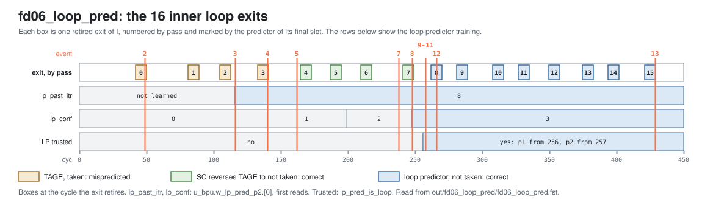

<!-- SPDX-License-Identifier: CC-BY-4.0                        -->
<!-- Copyright (c) 2026 Jeff Nye, uarchlabs.com                -->
<!-- SPDX-FileCopyrightText: 2026 Jeff Nye <jeff@uarchlabs.com> -->
# fd06_loop_pred: Loop Predictor
```
 FILE:    fd06_loop_pred.md
 SOURCE:  DOC-002, DOC-006, DOC-007
 STATUS:  WORKING
 UPDATED: 2026-10-19
 CONTACT: Jeff Nye
```

## 1. Introduction

`fd06_loop_pred` (FD-6) runs a 16-pass outer loop around an inner loop of 10
iterations. The inner loop's branch, I, is taken on the first 9 iterations and
not taken on the tenth, which exits the inner loop.

The loop predictor (LP) learns the inner loop's trip count, and its confidence
rises each time an exit arrives at the same count. At full confidence, the LP
supplies I's direction, including the not-taken exit, and the slot's `pred_src`
is PRED_LOOP.

The LP predicts the exits of the last 8 passes, 8 to 15, not taken. The result
line in the log file reports that count.

This scenario runs in the 1-prediction slot Pacino configuration,
NUM_PRED_SLOTS=1.

### 1.1 Files

`DEMO=$RVA_ROOT/examples/fe_demo`

  | File               | Path                                        |
  |--------------------|---------------------------------------------|
  | This file          | $DEMO/docs/fd06_loop_pred.md                |
  | Program (stimulus) | $DEMO/programs/fd06_loop_pred.svh           |
  | Surfer sucl        | $DEMO/waves/fd06_loop_pred.sucl             |
  | Log                | $DEMO/out/fd06_loop_pred/fd06_loop_pred.log |
  | Waveform           | $DEMO/out/fd06_loop_pred/fd06_loop_pred.fst |
  | Waveform (online)  | [Link](https://app.surfer-project.org/?load_url=https%3A%2F%2Fuarchlabs.github.io%2Fpacino-waves%2Ffd06_loop_pred.fst&startup_commands=run_command_file_from_url%20https%3A%2F%2Fuarchlabs.github.io%2Fpacino-waves%2Ffd06_loop_pred.sucl) |
  | Block connectivity | [$DEMO/docs/fe_block.svg](fe_block.svg)     |
  | Pipeline view      | [$DEMO/docs/fe_pipe.svg](fe_pipe.svg)       |
  | Common description | [$DEMO/docs/demo_explainer.md](demo_explainer.md) |

---

## 2. Run the scenario

Run simulation:
```
make -C examples/fe_demo fd06_loop_pred
```

View the waveform (runs simulation first if FST is not up to date):
```
make -C examples/fe_demo view S=fd06_loop_pred
```

Console output:
```
-I: fd06_loop_pred : PASS : cyc = 439
```

Log file output:
```
-I: fd06_loop_pred: PASS, loop exits predicted by the loop predictor 8,
    events checked 15 of 15, cyc 439
```

The testbench monitor, `tb/fe_demo_mon.svh`, supplies the count in the log line:

- loop exits predicted by the loop predictor
    - `n_lp_exit_ok` in `tb/fe_demo_mon.svh`
    - retired exits of a conditional branch whose final slot in the FTQ entry
      has `pred_src` PRED_LOOP and `taken` 0

---

## 3. The program

The program is written by the task `prog_fd06` in `programs/fd06_loop_pred.svh`.
The code consists of a short prologue, then a 16-pass outer loop starting at
`otop`, with a 10-iteration inner loop starting at `itop`, and a short epilogue.

The inner loop's branch I at 0x8000_0016 returns to `itop`. The outer loop's
branch O at 0x8000_0020 returns to `otop`.

The program runs in machine mode with translation off, so the addresses are
physical. The program starts at the reset vector, `RESET_VECTOR` = 0x8000_0000
(`bp_defines_pkg.sv`).

```
                                                              Position from
Address      Label   Instruction          Purpose              otop   itop
0x8000_0000          c.addi a0, 1         ; prologue
0x8000_0002          addi   t0, t0, 1     ; prologue
0x8000_0006          c.addi a0, 1         ; prologue

0x8000_0008  otop:   c.addi a0, 1         ; filler                0
0x8000_000A          addi   t0, t0, 1     ; filler                1
0x8000_000E  itop:   c.addi a0, 1         ; filler                3      0
0x8000_0010          addi   t0, t0, 1     ; filler                4      1
0x8000_0014          c.addi a0, 1         ; filler                6      3
0x8000_0016  I:      bne    x6, x0, itop  ; inner loop branch     7      4
0x8000_001A          c.addi a0, 1         ; filler                9      6
0x8000_001C          addi   t0, t0, 1     ; filler               10      7
0x8000_0020  O:      bne    x6, x0, otop  ; outer loop branch    12      9

0x8000_0024          c.addi a0, 1         ; epilogue
0x8000_0026          addi   t0, t0, 1     ; epilogue
0x8000_002A          c.addi a0, 1         ; epilogue
0x8000_002C  hold:   jal    x0, hold      ; termination
```

A position is the halfword offset of an instruction from the start of its
prediction block. The 32-bit instructions take two positions.

With one prediction slot, an FTB entry holds one branch, so the loops are
predicted as several blocks. The accepted p2 slot groups, by block:

| Block start          | Reached by                      | Branch | Position | Block end                    | Groups |
|----------------------|---------------------------------|--------|----------|------------------------------|--------|
| 0x8000_0008 (`otop`) | O taken                         | I      | 7        | 0x8000_0028                  | 15     |
| 0x8000_000E (`itop`) | I taken                         | I      | 4        | 0x8000_002E before the split | 55     |
| 0x8000_000E (`itop`) | I taken                         | I      | 4        | 0x8000_0020 after the split  | 105    |
| 0x8000_001A          | I corrected to not taken        | O      | 3        | 0x8000_003A                  | 3      |
| 0x8000_0020 (`O`)    | The block at `itop` ending at O | O      | 0        | 0x8000_0040                  | 10     |

The `c.addi` and `addi` instructions do no useful work. Their purpose is to mix
16-bit and 32-bit instructions and to separate the branches.

The direction of each branch is chosen by the program writer class and resolved
by the modeled backend. The register operands play no part in the taken/not
taken state. The code is the same on every pass, and only the expected
instruction stream changes.

I is taken 9 times and not taken once per pass, which gives 16 exits with the
same trip count. O is taken on passes 0 to 14 and falls through on pass 15
(event 13).

---

## 4. Walkthrough

Cycle numbers below are events in [section 5](#5-events); each event is a
marker in the waveform.

### 4.1 Predicting the inner exit

The loop predictor allocates an entry when an update misses on a taken backward
branch, so I's first taken resolution allocates one, at cyc 20.[^1] An exit at a
known count trains the entry. A count equal to the learned trip count,
`past_itr`, raises the confidence `cnf` by one, and any other count clears `cnf`
and learns the count. A taken resolution at or past the learned count clears
`cnf`.[^2]

The LP predicts only at full confidence, 3. It then predicts taken while the
speculative count is below the trip count, so the exit is predicted not
taken.[^3] At p1, a trusted LP overrides the direction of a slot the uBTB
supplied.[^4] At p2, it takes priority over TAGE.[^5] The slot carries
`pred_src` PRED_LOOP in both cases.

Each of the 16 exits retires with a final slot from one of three predictors, the
last group the FTQ accepted for its entry.

```
passes   final slot from   direction   result
0 to 3   TAGE              taken       mispredicted; the backend redirects
4 to 7   SC                not taken   correct
8 to 15  loop predictor    not taken   correct
```

The exits and the LP's training across the run are shown below.

[](fd06_exits.svg)

The exits of passes 0 to 3 are the backend redirects to 0x8000_001A, from cyc 49
(event 2) to cyc 140 (event 4). The LP is still training over this time:
`lp_past_itr` first reads 8 at cyc 116 (event 3), and `lp_conf` first reads 1 at
cyc 140 and 2 at cyc 199.

The learned count is 8, not 9 or 10, because the LP indexes its table by the
request PC, the start of the prediction block, and not by I's PC. The first
iteration of each pass predicts I in the block at `otop`, which has its own LP
entry. The other nine predict it in the block at `itop`, so that entry sees 8
taken branches and then the exit, at `lp_curs` 8.[^6]

In passes 4 to 7, TAGE still predicts I taken at the exit, and SC reverses it at
p3. The first reversal is at cyc 162 (event 5) and the last at cyc 238
(event 7). The first redirects to 0x8000_002E, the end of the block at `itop`.
The FTB update at cyc 173 (event 6) ends that entry at O's PC, so the other
three redirect to 0x8000_0020.

`lp_conf` reaches 3 at cyc 248 (event 8), and the LP supplies I's direction from
cyc 256 at p1 (event 9) and cyc 257 at p2 (event 10). It first predicts an exit
at cyc 259 (event 11), and the monitor counts the first such exit at retirement
at cyc 266 (event 12), in pass 8. Every exit from there on comes from the LP.

The backend reports 11 mispredictions in the run. Besides the four exits, three
are I taken, at cyc 21, 31 and 69, three are O taken, at cyc 59, 171 and 196,
and one is O falling through at cyc 429 (event 13).

[^1]: `u_alloc`: `rtl/core/frontend/bpu/rtl/loop_pred.sv:400`.
[^2]: `rtl/core/frontend/bpu/rtl/loop_pred.sv:404-423`.
[^3]: `lp_pred_is_loop` and `lp_pred_taken`:
    `rtl/core/frontend/bpu/rtl/loop_pred.sv:269-273`, and `:305-308` for the p2
    re-read. `LP_CONF_LEVEL`: `:82`.
[^4]: `rtl/core/frontend/bpu/rtl/bp_cluster.sv:805-810`.
[^5]: `w_lp_use_p2`: `rtl/core/frontend/bpu/rtl/bp_cluster.sv:1031-1036`, and
    `:1161-1162` for `pred_src`.
[^6]: The request PC: `rtl/core/frontend/bpu/rtl/bp_cluster.sv:1675`, and
    `rtl/core/frontend/bpu/rtl/loop_pred.sv:209-210` for the index and tag.

### 4.2 The loop predictor taking over

The waveform group `loop_pred_p1_p2` shows the LP's answers for the block at p1
and p2, not the table entry. The p2 answer describes I only in the cycles its
block is at p2, and reads 0 otherwise.

At cyc 116 (event 3), `u_bpu.w_lp_pred_p2.[0].lp_past_itr` first reads 8, while
`bpu_slot_p2.[0]` is still PRED_TAGE. At cyc 248 (event 8), `lp_conf` first
reads 3.

At cyc 256 (event 9), `u_bpu.w_lp_pred_p1.[0].lp_pred_is_loop` is asserted and
`bpu_pred_slot_p1.[0].pred_src` is PRED_LOOP, with `u_ftq.w_ok_pred_p1`
asserted. At cyc 257 (event 10), `u_bpu.w_lp_pred_p2.[0].lp_pred_is_loop` is
asserted and `bpu_slot_p2.[0].pred_src` is PRED_LOOP.

At cyc 259 (event 11), the speculative count `lp_curs` reads 8, equal to
`lp_past_itr`. `lp_pred_taken` is deasserted, and `bpu_slot_p2.[0]` holds I at
`pos` 4 with `taken` deasserted and `pred_src` PRED_LOOP.

---

## 5. Events

| #  | cyc | Event                                                                                       | Other                             |
|----|-----|---------------------------------------------------------------------------------------------|-----------------------------------|
| 0  | 0   | reset released (`tb.rstn`); the FTQ requests 0x8000_0000 the same cycle                     | fast init                         |
| 1  | 21  | first backend misprediction: I taken; redirect to 0x8000_000E                               | pass 0                            |
| 2  | 49  | first inner exit mispredicted; redirect to 0x8000_001A                                      | backend, pass 0                   |
| 3  | 116 | the loop predictor learns the trip count: `lp_past_itr` reads 8                             | `w_lp_pred_p2.[0]`                |
| 4  | 140 | last inner exit mispredicted; redirect to 0x8000_001A                                       | backend, pass 3                   |
| 5  | 162 | SC reverses an exit to not taken, in pass 4; redirect to 0x8000_002E                        | PRED_SC, the end of the block     |
| 6  | 173 | the FTB entry for itop ends at 0x8000_0020: the split, at O                                 | `upd_split`, position 9           |
| 7  | 238 | last SC reversal of an exit, in pass 7; redirect to 0x8000_0020                             | PRED_SC                           |
| 8  | 248 | confidence reaches 3 (`lp_conf`), the level at which the loop predictor is trusted          |                                   |
| 9  | 256 | first p1 slot from the loop predictor (`pred_src` PRED_LOOP), accepted by the FTQ           |                                   |
| 10 | 257 | the loop predictor first trusted at p2 (`lp_pred_is_loop`); the slot is PRED_LOOP           |                                   |
| 11 | 259 | first exit predicted not taken, by the loop predictor: I's slot at p2, PRED_LOOP, `taken` 0 | block 0x8000_000E                 |
| 12 | 266 | first retired exit predicted by the loop predictor                                          | pass 8, the first of 8            |
| 13 | 429 | outer loop falls through, a misprediction; redirect to 0x8000_0024                          | pass 15, backend                  |
| 14 | 439 | the run ends; the last instruction retires                                                  | a 100 cycle drain follows, to 539 |

---

## 6. Waveform

`make -C examples/fe_demo view S=fd06_loop_pred` opens
`waves/fd06_loop_pred.sucl` in Surfer, with a marker at each event above.
Signal paths below are under `tb.dut` unless they start with `tb.`.

| group            | signal                                   | description                                       |
|------------------|------------------------------------------|---------------------------------------------------|
| clock            | `tb.clk`                                 | clock                                             |
|                  | `tb.rstn`                                | active low reset                                  |
|                  | `tb.cyc`                                 | cycle number                                      |
| bp_cluster_p1    | `u_bpu.r_pc_p1`                          | p1 prediction block start address                 |
|                  | `bpu_pred_val_p1`                        | p1 prediction valid                               |
|                  | `bpu_pred_idx_p1`                        | FTQ index of the p1 prediction                    |
|                  | `u_bpu.r_ubtb_blk_p1.hit`                | uBTB hit at p1                                    |
|                  | `bpu_pred_pft_p1`                        | p1 prediction block end, next halfword after it   |
|                  | `bpu_pred_slot_p1.[0].slot_valid`        | slot 0 holds a branch                             |
|                  | `bpu_pred_slot_p1.[0].br_type`           | slot 0 branch type                                |
|                  | `bpu_pred_slot_p1.[0].pos`               | slot 0 halfword position in the prediction block  |
|                  | `bpu_pred_slot_p1.[0].taken`             | slot 0 predicted direction                        |
|                  | `bpu_pred_slot_p1.[0].target`            | slot 0 predicted target                           |
|                  | `bpu_pred_slot_p1.[0].pred_src`          | slot 0 predictor that supplied the prediction     |
| loop_pred_p1_p2  | `u_bpu.w_lp_pred_p1.[0].lp_hit`          | loop predictor hit at p1, slot 0                  |
|                  | `u_bpu.w_lp_pred_p1.[0].lp_pred_is_loop` | loop predictor trusted at p1, slot 0              |
|                  | `u_bpu.w_lp_pred_p1.[0].lp_pred_taken`   | loop predictor direction at p1, slot 0            |
|                  | `u_bpu.w_lp_pred_p2.[0].lp_hit`          | loop predictor hit at p2, slot 0                  |
|                  | `u_bpu.w_lp_pred_p2.[0].lp_pred_is_loop` | loop predictor trusted at p2, slot 0              |
|                  | `u_bpu.w_lp_pred_p2.[0].lp_pred_taken`   | loop predictor direction at p2, slot 0            |
|                  | `u_bpu.w_lp_pred_p2.[0].lp_conf`         | loop predictor confidence, slot 0                 |
|                  | `u_bpu.w_lp_pred_p2.[0].lp_past_itr`     | learned trip count, slot 0                        |
|                  | `u_bpu.w_lp_pred_p2.[0].lp_curs`         | speculative count, slot 0                         |
| bp_cluster_p2    | `u_bpu.r_pc_p2`                          | p2 prediction block start address                 |
|                  | `u_bpu.r_val_p2`                         | p2 valid                                          |
|                  | `bpu_slot_val_p2`                        | p2 group valid: p2 valid and an FTB hit           |
|                  | `bpu_slot_idx_p2`                        | FTQ index of the p2 group                         |
|                  | `u_bpu.w_ftb_valid_p2`                   | FTB hit at p2                                     |
|                  | `bpu_slot_p2.[0].slot_valid`             | slot 0 holds a branch                             |
|                  | `bpu_slot_p2.[0].br_type`                | slot 0 branch type                                |
|                  | `bpu_slot_p2.[0].pos`                    | slot 0 halfword position in the prediction block  |
|                  | `bpu_slot_p2.[0].taken`                  | slot 0 predicted direction                        |
|                  | `bpu_slot_p2.[0].target`                 | slot 0 predicted target                           |
|                  | `bpu_slot_p2.[0].pred_src`               | slot 0 predictor that supplied the prediction     |
|                  | `bpu_redir_p2.[0].valid`                 | p2 redirect from slot 0                           |
|                  | `bpu_redir_p2.[0].target_pc`             | p2 redirect target from slot 0                    |
|                  | `bpu_redir_idx_p2`                       | FTQ index of the p2 redirect                      |
| bp_cluster_p3    | `u_bpu.r_pc_p3`                          | p3 prediction block start address                 |
|                  | `u_bpu.r_val_p3`                         | p3 valid                                          |
|                  | `bpu_slot_val_p3`                        | p3 group valid: p3 valid and an FTB answer        |
|                  | `bpu_slot_idx_p3`                        | FTQ index of the p3 group                         |
|                  | `bpu_slot_p3.[0].slot_valid`             | slot 0 holds a branch                             |
|                  | `bpu_slot_p3.[0].br_type`                | slot 0 branch type                                |
|                  | `bpu_slot_p3.[0].pos`                    | slot 0 halfword position in the prediction block  |
|                  | `bpu_slot_p3.[0].taken`                  | slot 0 predicted direction                        |
|                  | `bpu_slot_p3.[0].target`                 | slot 0 predicted target                           |
|                  | `bpu_slot_p3.[0].pred_src`               | slot 0 predictor that supplied the prediction     |
|                  | `bpu_redir_p3.[0].valid`                 | p3 redirect from slot 0                           |
|                  | `bpu_redir_p3.[0].target_pc`             | p3 redirect target from slot 0                    |
|                  | `bpu_redir_idx_p3`                       | FTQ index of the p3 redirect                      |
| ftq              | `u_ftq.w_ok_pred_p1`                     | the FTQ accepts the p1 prediction                 |
|                  | `u_ftq.w_ok_slot_p2`                     | the FTQ accepts the p2 group                      |
|                  | `u_ftq.w_ok_slot_p3`                     | the FTQ accepts the p3 group                      |
|                  | `u_ftq.w_ok_redir_p2`                    | the FTQ accepts the p2 redirect                   |
|                  | `u_ftq.w_ok_redir_p3`                    | the FTQ accepts the p3 redirect                   |
|                  | `u_ftq.w_redir_val`                      | a redirect the FTQ takes                          |
|                  | `u_ftq.w_redir_idx`                      | FTQ index of the redirect                         |
|                  | `u_ftq.w_commit_ptr`                     | FTQ commit pointer                                |
|                  | `ftq_full`                               | FTQ full                                          |
|                  | `ftq_empty`                              | FTQ empty                                         |
| loop_pred_update | `u_bpu.w_lp_upd_val_p0`                  | loop predictor update valid, per slot             |
| decode           | `tb.dec_ibuf_rdy`                        | the backend model takes the bundle                |
|                  | `tb.pd_out.[0].valid`                    | lane 0 valid                                      |
|                  | `tb.pd_out.[0].start_pc`                 | lane 0 instruction address                        |
|                  | `tb.pd_out.[0].ftq_idx`                  | lane 0 FTQ index                                  |
|                  | `tb.pd_out.[0].pos`                      | lane 0 halfword position in the prediction block  |
|                  | `tb.pd_out.[0].instr`                    | lane 0 instruction, expanded if compressed        |
|                  | `tb.pd_out.[0].is_rvc`                   | lane 0 instruction is 16-bit                      |
|                  | `tb.pd_out.[0].fault_cause`              | lane 0 fetch fault cause                          |
|                  | `tb.pd_out.[0].fault_va`                 | lane 0 fetch fault virtual address                |
| backend          | `tb.bkend_ftq_redir_val`                 | backend redirect valid                            |
|                  | `tb.bkend_ftq_redir_pc`                  | backend redirect PC                               |
|                  | `tb.bkend_ftq_redir_cause`               | backend redirect cause                            |
| ftb_update       | `ftb_upd_valid_u0`                       | FTB update valid                                  |
|                  | `ftb_upd_pc_u0`                          | block start address of the FTB update             |
|                  | `ftb_upd_pos_u0`                         | halfword position of the branch in the FTB update |
|                  | `ftb_upd_is_br_u0`                       | the FTB update is for a conditional               |
|                  | `ftb_upd_is_jmp_u0`                      | the FTB update is for a jump                      |
|                  | `ftb_upd_hit_u0`                         | the FTB update hits an entry                      |
|                  | `u_bpu.u_ftb.u_ftb_cntrl.upd_split`      | the FTB update splits the entry                   |
|                  | `u_bpu.u_ftb.u_ftb_cntrl.upd_cut_pos`    | position the split ends the entry at              |
