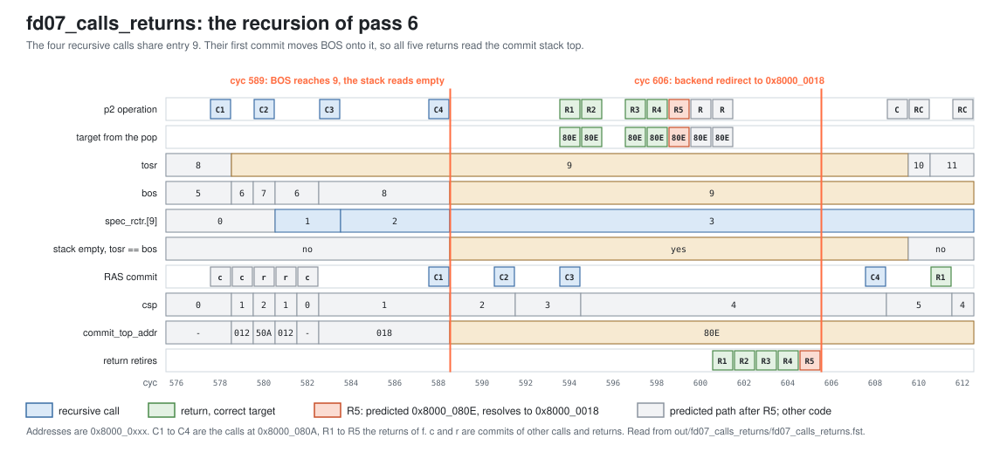

<!-- SPDX-License-Identifier: CC-BY-4.0                        -->
<!-- Copyright (c) 2026 Jeff Nye, uarchlabs.com                -->
<!-- SPDX-FileCopyrightText: 2026 Jeff Nye <jeff@uarchlabs.com> -->
# fd07_calls_returns: Calls and Returns
```
 FILE:    fd07_calls_returns.md
 SOURCE:  DOC-002, DOC-006, DOC-007
 STATUS:  WORKING
 UPDATED: 2026-10-19
 CONTACT: Jeff Nye
```

## 1. Introduction

`fd07_calls_returns` (FD-7) runs a loop of 8 passes. Each pass makes nested
calls, then a recursion four calls deep from one call site, then a coroutine
switch by two return-calls.

The return address stack (RAS) pushes a call's return address and pops it for a
return at p2, which supplies the return's target. A recursive call whose return
address matches the top of the stack increments that entry's count, `spec_rctr`,
instead of allocating an entry. A return-call pops and then pushes in one
operation.

The RAS supplies the target of 64 of the 80 retired returns and return-calls.
The result line in the log file reports that count, the p2 operations, and the
highest recursion count.

This scenario runs in the 1-prediction slot Pacino configuration,
NUM_PRED_SLOTS=1.

### 1.1 Files

`DEMO=$RVA_ROOT/examples/fe_demo`

  | File               | Path                                                |
  |--------------------|-----------------------------------------------------|
  | This file          | $DEMO/docs/fd07_calls_returns.md                    |
  | Program (stimulus) | $DEMO/programs/fd07_calls_returns.svh               |
  | Surfer sucl        | $DEMO/waves/fd07_calls_returns.sucl                 |
  | Log                | $DEMO/out/fd07_calls_returns/fd07_calls_returns.log |
  | Waveform           | $DEMO/out/fd07_calls_returns/fd07_calls_returns.fst |
  | Waveform (online)  | [Link](https://app.surfer-project.org/?load_url=https%3A%2F%2Fuarchlabs.github.io%2Fpacino-waves%2Ffd07_calls_returns.fst&startup_commands=run_command_file_from_url%20https%3A%2F%2Fuarchlabs.github.io%2Fpacino-waves%2Ffd07_calls_returns.sucl) |
  | Block connectivity | [$DEMO/docs/fe_block.svg](fe_block.svg)             |
  | Pipeline view      | [$DEMO/docs/fe_pipe.svg](fe_pipe.svg)               |
  | Common description | [$DEMO/docs/demo_explainer.md](demo_explainer.md)   |

---

## 2. Run the scenario

Run simulation:
```
make -C examples/fe_demo fd07_calls_returns
```

View the waveform (runs simulation first if FST is not up to date):
```
make -C examples/fe_demo view S=fd07_calls_returns
```

Console output:
```
-I: fd07_calls_returns : PASS : cyc = 694
```

Log file output:
```
-I: fd07_calls_returns: PASS, returns predicted by the RAS 64, p2 pushes 85,
    p2 pops 125, p2 return-calls 16, highest recursion count 4,
    events checked 18 of 18, cyc 694
```

The testbench monitor, `tb/fe_demo_mon.svh`, supplies the counts in the log
line:

- returns predicted by the RAS
    - `n_ras_ret_ok` in `tb/fe_demo_mon.svh`
    - retired RETURN or RETURN_CALL whose final slot in the FTQ entry has
      `pred_src` PRED_RAS, `taken` 1 and the correct target
- p2 pushes, p2 pops, p2 return-calls
    - `n_ras_push`, `n_ras_pop` and `n_rc_p2` in `tb/fe_demo_mon.svh`
    - operations presented to the RAS at p2, including those on predicted paths
      that are later redirected
- highest recursion count
    - `max_rctr` in `tb/fe_demo_mon.svh`
    - the highest `spec_rctr` of any entry in any cycle

---

## 3. The program

The program is written by the task `prog_fd07` in
`programs/fd07_calls_returns.svh`. The code consists of a short prologue, then a
loop of 8 passes starting at `top`, and a short epilogue.

Each pass calls f1, which calls f2. It then calls f, which calls itself four
times from the one call site at 0x8000_080A. It then calls B through x5, and B
and the main code switch by the return-calls B1 and A1. B returns through x5 at
B2, and the back edge at 0x8000_002A returns to `top`.

The program runs in machine mode with translation off, so the addresses are
physical. The program starts at the reset vector, `RESET_VECTOR` = 0x8000_0000
(`bp_defines_pkg.sv`).

```
Address      Label  Instruction             Purpose               Block  Pos
0x8000_0000         c.addi a0, 1            ; prologue
0x8000_0002         addi   t0, t0, 1        ; prologue
0x8000_0006         c.addi a0, 1            ; prologue

0x8000_0008  top:   c.addi a0, 1            ; filler              008    0
0x8000_000A         addi   t0, t0, 1        ; filler              008    1
0x8000_000E         jal    x1, f1           ; call                008    3
0x8000_0012         c.addi a0, 1            ; filler              012    0
0x8000_0014         jal    x1, f            ; call                012    1
0x8000_0018         c.addi a0, 1            ; filler              018    0
0x8000_001A  L:     jal    x5, B            ; call through x5     018    1
0x8000_001E         c.addi a0, 1            ; filler              01E    0
0x8000_0020         addi   t0, t0, 1        ; filler              01E    1
0x8000_0024  A1:    jalr   x5, 0(x1)        ; return-call         01E    3
0x8000_0028         c.addi a0, 1            ; filler              028    0
0x8000_002A         bne    x6, x0, top      ; back edge           028    1

0x8000_002E         c.addi a0, 1            ; epilogue
0x8000_0030         addi   t0, t0, 1        ; epilogue
0x8000_0034         c.addi a0, 1            ; epilogue
0x8000_0036  hold:  jal    x0, hold         ; termination

0x8000_0500  f1:    c.addi a0, 1            ; filler              500    0
0x8000_0502         addi   t0, t0, 1        ; filler              500    1
0x8000_0506         jal    x1, f2           ; nested call         500    3
0x8000_050A         c.addi a0, 1            ; filler              50A    0
0x8000_050C         ret                     ; return to main      50A    1

0x8000_0600  f2:    c.addi a0, 1            ; filler              600    0
0x8000_0602         addi   t0, t0, 1        ; filler              600    1
0x8000_0606         ret                     ; return to f1        600    3

0x8000_0800  f:     c.addi a0, 1            ; filler              800    0
0x8000_0802         addi   t0, t0, 1        ; filler              800    1
0x8000_0806         bne    x6, x0, f+16     ; taken at the bottom 800    3
0x8000_080A         jal    x1, f            ; recursive call      80A    0
0x8000_080E         c.addi a0, 1            ; after a return      80E    0
0x8000_0810         ret                     ; return from f       80E    1

0x8000_0A00  B:     c.addi a0, 1            ; filler              A00    0
0x8000_0A02         addi   t0, t0, 1        ; filler              A00    1
0x8000_0A06  B1:    jalr   x1, 0(x5)        ; return-call         A00    3
0x8000_0A0A         c.addi a0, 1            ; filler              A0A    0
0x8000_0A0C         addi   t0, t0, 1        ; filler              A0A    1
0x8000_0A10  B2:    jalr   x0, 0(x5)        ; return              A0A    3
```

Block is the low bits of the start address of the prediction block that holds
the instruction, and Pos is its halfword position from that start. With one
prediction slot, each block holds one branch. The `ret` at 0x8000_0810 is also
predicted in a block of its own at 0x8000_0810, position 0, when the branch at
0x8000_0806 is taken.

The `c.addi` and `addi` instructions do no useful work. Their purpose is to mix
16-bit and 32-bit instructions and to separate the branches.

The program writer types each branch from its link registers, x1 and x5. A
`jal` with a link register as rd is a DIRECT_CALL. A `jalr` with a link register
as rs1 and not as rd is a RETURN, and one with unequal link registers as rd and
rs1 is a RETURN_CALL. The directions and targets are chosen by the program
writer and resolved by the modeled backend, and the register operands play no
part in them.

Each pass retires 8 direct calls, 8 returns and 2 return-calls. The 8 returns
are f2's, f1's, 5 from f and B2. Over 8 passes that gives 80 retired returns and
return-calls, the total the monitor's count is out of.

---

## 4. Walkthrough

Cycle numbers below are events in [section 5](#5-events); each event is a
marker in the waveform.

### 4.1 Predicting the returns

The RAS holds two stacks. The speculative stack has 16 entries and changes at
p2, and it is empty when TOSR equals BOS. The commit stack has 32 entries,
changes as calls and returns retire, and holds one entry per call with no
count.[^1]

A slot of the p2 group goes to the RAS when it holds a branch of a valid block
and no earlier slot of the block is taken.[^2] A call pushes its fall-through
address. If that address equals the top entry's, the entry's `spec_rctr` is
incremented and the pointers do not move. Otherwise a new entry is allocated at
TOSW.[^3] A return pops: a non-zero count is decremented and TOSR holds, and a
count of 0 sends TOSR to the entry below.[^4] A RETURN_CALL pops and then
pushes.[^5] The pop supplies the slot's target with `pred_src` PRED_RAS at p2,
and a return slot from the uBTB takes the top of the stack at p1.[^6]

A commit moves BOS to the TOSR its block left.[^7] A pop of an empty speculative
stack reads the top of the commit stack and changes neither stack.[^8] A backend
redirect restores TOSR, TOSW and BOS from a snapshot and leaves the entries and
their counts as they are.[^9]

The monitor's count of 64 divides across the passes as follows.

```
pass     returns   from the RAS   not from the RAS
0        10        2              7 not yet in the FTB; f's last return
1        10        8              f1's return; f's last return
2 to 7   10 each   9 each         f's last return
```

In pass 0, no return reaches p2 before cyc 162 (event 7), and the backend
corrects each return the FTB does not hold yet. In pass 1, f1's return at cyc
248 finds both stacks empty, so it takes the FTB's target with `pred_src`
PRED_FTB.

F's last return is mispredicted in all 8 passes, for one reason. The recursive
call at 0x8000_080A pushes 0x8000_080E each time. The first allocates an entry
and the other three increment it, so the blocks of all four calls leave TOSR on
that entry. When the first of them commits, BOS moves to the entry, and the
speculative stack is empty.

Pass 6 shows the sequence. Entry 9 is allocated at cyc 578, and its count
reaches 3 at cyc 589. The first recursive call commits at cyc 588, which moves
BOS to 9. The returns reach p2 from cyc 594 with the stack empty, so each takes
the top of the commit stack, 0x8000_080E, and the count of entry 9 stays at 3.
The first four returns are correct. The fifth returns to main at 0x8000_0018,
but no return has committed yet, so the top still reads 0x8000_080E. The backend
corrects it at cyc 606. The figure below shows these cycles.

[](fd07_pass6.svg)

The redirect to 0x8000_0018 is at cyc 172 in pass 0 (event 9), at cyc 294, 361,
427, 494, 550 and 606 in passes 1 to 6, and at cyc 662 in pass 7 (event 15).

The other returns come from the speculative stack, where the calls are recent
enough that the stack is not empty. The first is f2's in pass 1 at cyc 246
(event 10), which pops 0x8000_050A with TOSR at 2 and BOS at 1.

The recursion count differs by pass.

```
pass   entry    highest count   count rises at cyc
0      1        4               131 to 137
1      4        4               267 to 273
2      11, 12   1               325, 341
3      3        3               392 to 400
4      10, 11   1               458, 474
5      2        3               525 to 533
6      9        3               581 to 589
7      0        3               637 to 645
```

Four recursive calls give a count of 3. The count of 4 in passes 0 and 1 comes
from a fifth call on a predicted path. At the bottom of the recursion the branch
at 0x8000_0806 is predicted not taken, so the path calls f again and the count
reaches 4 at cyc 137 (event 4). The backend redirects to 0x8000_0810 at cyc 139
(event 5). The redirect does not change the count, so entry 1 holds 4 until the
entry is reallocated at cyc 374 (event 14). Pass 3 also makes a fifth call, at
cyc 404, but the stack is empty by then, so that call allocates an entry and the
count stays at 3.

In passes 2 and 4, a p3 redirect sends the path to 0x8000_0810 after the second
recursive call, at cyc 327 and 460. A pop then decrements the count, the first
at cyc 330 (event 13), and the backend redirects to 0x8000_080A at cyc 335 and
468. The recursion continues in a new entry. The pops at cyc 330, 343, 463 and
476 are the only ones in the run that decrement a count.

The first return-calls at p2 are on a predicted path that is later redirected.
The p3 redirect at cyc 252 leads to B1 at cyc 256 (event 11), and the backend
redirect at cyc 261 removes it. The return-calls of the retired path first reach
p2 in pass 1. At cyc 298 (event 12), B1 pops 0x8000_001E and pushes 0x8000_0A0A.
At cyc 300, A1 pops 0x8000_0A0A and pushes 0x8000_0028. At cyc 302, B2 pops
0x8000_0028.

The backend reports 25 mispredictions in the run: 12 in pass 0, 3 in pass 1, 2
each in passes 2, 3 and 4, 1 each in passes 5 and 6, and 2 in pass 7. The single
redirects of passes 5 and 6 are f's last return. Pass 7 adds the back edge
falling through at cyc 683 (event 16).

[^1]: `rtl/core/frontend/bpu/rtl/ras.sv:14-21` for the stacks and `:127-129` for
    the commit stack's lack of a count. `RAS_SPEC_ENTRIES` and
    `RAS_COMMIT_ENTRIES`: `rtl/core/frontend/bpu/rtl/bp_defines_pkg.sv:555-556`.
[^2]: `w_ras_pred_val_p2`: `rtl/core/frontend/bpu/rtl/bp_cluster.sv:1090`.
[^3]: `st_push`: `rtl/core/frontend/bpu/rtl/ras.sv:413-421` for the count and
    `:439-446` for the allocation.
[^4]: `st_retract`: `rtl/core/frontend/bpu/rtl/ras.sv:334-350`.
[^5]: `rtl/core/frontend/bpu/rtl/ras.sv:672-713`.
[^6]: p2: `rtl/core/frontend/bpu/rtl/bp_cluster.sv:1164-1169`. p1: `:839-844`.
[^7]: `c_bos`: `rtl/core/frontend/bpu/rtl/ras.sv:766-767` and `:834-841`. A
    return whose block left the stack empty does not move BOS.
[^8]: `rtl/core/frontend/bpu/rtl/ras.sv:673-677`.
[^9]: `rtl/core/frontend/bpu/rtl/ras.sv:808-811`.

### 4.2 The stack operations in the waveform

The waveform group `ras` shows the pointers, the entries and the p2 operation.
`bpu_slot_p2.[0].target` is the address the pop supplies.

At cyc 128 (event 2), `u_bpu.w_ras_pred_val_p2.[0]` is asserted with
`u_bpu.w_br_type_p2.[0]` DIRECT_CALL and `u_bpu.r_pc_p2` at 0x8000_080A. By cyc
130, `u_ras.tosr` reads 1 and `u_ras.tosw` reads 2. `u_ras.spec_rctr.[1]` reads
1 at cyc 131 (event 3) and steps to 4 at cyc 137 (event 4), while `tosr` holds.

At cyc 162 (event 7), `tosr` and `bos` both read 1 and
`u_ras.p2_pre_empty.[0]` is asserted. `bpu_slot_p2.[0].target` is 0x8000_080E
with `pred_src` PRED_RAS, the value of `u_ras.commit_top_addr` in the
`ras_commit` group.

At cyc 246 (event 10), `tosr` reads 2 and `bos` reads 1, and `p2_pre_empty.[0]`
is deasserted. The target is 0x8000_050A, the value of
`u_ras.spec_ret_addr.[2]`.

At cyc 298 (event 12), `w_br_type_p2.[0]` is RETURN_CALL at `r_pc_p2`
0x8000_0A00, and `tosr` and `tosw` read 5 and 6. They read 6 and 7 at cyc 300,
so the pop and the push of the one operation show as one step.

From cyc 594 to cyc 601, in pass 6, `tosr` and `bos` both read 9,
`p2_pre_empty.[0]` is asserted on each pop, `spec_rctr.[9]` holds 3, and
`commit_top_addr` holds 0x8000_080E. The backend's redirect to 0x8000_0018 is at
cyc 606, in the `backend` group.

---

## 5. Events

| #  | cyc | Event                                                                                     | Other                             |
|----|-----|-------------------------------------------------------------------------------------------|-----------------------------------|
| 0  | 0   | reset released (`tb.rstn`); the FTQ requests 0x8000_0000 the same cycle                   | fast init                         |
| 1  | 40  | first RAS commit (`w_ras_commit_val`): a retired call reaches the commit stack            | pass 0                            |
| 2  | 128 | first RAS push at p2: a call presented to the RAS, allocating entry 1                     | block 0x8000_080A                 |
| 3  | 131 | entry 1's recursion count reads 1 (`spec_rctr.[1]`): the first compressed recursive call  |                                   |
| 4  | 137 | entry 1's count reaches 4, on the fifth call, one step every two cycles                   | a predicted path                  |
| 5  | 139 | the backend corrects the bottom branch; redirect to 0x8000_0810                           | the count stays at 4              |
| 6  | 161 | first p1 slot from the RAS (`pred_src` PRED_RAS), accepted by the FTQ                     | block 0x8000_080E                 |
| 7  | 162 | first return predicted from the RAS at p2: the speculative stack is empty                 | commit stack top                  |
| 8  | 168 | first retired return the RAS predicted                                                    | `n_ras_ret_ok`                    |
| 9  | 172 | last return of f mispredicted, in pass 0; redirect to 0x8000_0018                         | backend                           |
| 10 | 246 | first pop of the speculative stack: f2's return pops 0x8000_050A                          | pass 1                            |
| 11 | 256 | first RETURN_CALL at p2, presented to the RAS                                             | a predicted path                  |
| 12 | 298 | first RETURN_CALL on the retired path, in pass 1                                          | B1                                |
| 13 | 330 | first pop that decrements a recursion count: entry 11, 1 to 0                             | a predicted path, pass 2          |
| 14 | 374 | entry 1 is reallocated, for f1's call to f2; its count of 4 clears to 0                   | TOSW has wrapped                  |
| 15 | 662 | final return of f mispredicted, in pass 7; redirect to 0x8000_0018                        | backend                           |
| 16 | 683 | the back edge falls through, in pass 7; redirect to 0x8000_002E                           | backend                           |
| 17 | 694 | the run ends; the last instruction retires                                                | a 100 cycle drain follows, to 794 |

---

## 6. Waveform

`make -C examples/fe_demo view S=fd07_calls_returns` opens
`waves/fd07_calls_returns.sucl` in Surfer, with a marker at each event above.
Signal paths below are under `tb.dut` unless they start with `tb.`.

| group         | signal                            | description                                      |
|---------------|-----------------------------------|--------------------------------------------------|
| clock         | `tb.clk`                          | clock                                            |
|               | `tb.rstn`                         | active low reset                                 |
|               | `tb.cyc`                          | cycle number                                     |
| bp_cluster_p1 | `u_bpu.r_pc_p1`                   | p1 prediction block start address                |
|               | `bpu_pred_val_p1`                 | p1 prediction valid                              |
|               | `bpu_pred_idx_p1`                 | FTQ index of the p1 prediction                   |
|               | `u_bpu.r_ubtb_blk_p1.hit`         | uBTB hit at p1                                   |
|               | `bpu_pred_pft_p1`                 | p1 prediction block end, next halfword after it  |
|               | `bpu_pred_slot_p1.[0].slot_valid` | slot 0 holds a branch                            |
|               | `bpu_pred_slot_p1.[0].br_type`    | slot 0 branch type                               |
|               | `bpu_pred_slot_p1.[0].pos`        | slot 0 halfword position in the prediction block |
|               | `bpu_pred_slot_p1.[0].taken`      | slot 0 predicted direction                       |
|               | `bpu_pred_slot_p1.[0].target`     | slot 0 predicted target                          |
|               | `bpu_pred_slot_p1.[0].pred_src`   | slot 0 predictor that supplied the prediction    |
| ras           | `u_bpu.u_ras.tosr`                | RAS read pointer                                 |
|               | `u_bpu.u_ras.tosw`                | RAS write pointer                                |
|               | `u_bpu.u_ras.bos`                 | RAS bottom of stack                              |
|               | `u_bpu.u_ras.ras_rst_done`        | RAS reset done                                   |
|               | `u_bpu.w_ras_pred_val_p2.[0]`     | slot 0 presented to the RAS at p2                |
|               | `u_bpu.w_br_type_p2.[0]`          | slot 0 branch type at p2                         |
|               | `u_bpu.u_ras.spec_ret_addr.[0]`   | RAS entry 0 return address                       |
|               | `u_bpu.u_ras.spec_ret_addr.[1]`   | RAS entry 1 return address                       |
|               | `u_bpu.u_ras.spec_ret_addr.[2]`   | RAS entry 2 return address                       |
|               | `u_bpu.u_ras.spec_ret_addr.[3]`   | RAS entry 3 return address                       |
|               | `u_bpu.u_ras.spec_rctr.[0]`       | RAS entry 0 recursion count                      |
|               | `u_bpu.u_ras.spec_rctr.[1]`       | RAS entry 1 recursion count                      |
|               | `u_bpu.u_ras.spec_rctr.[2]`       | RAS entry 2 recursion count                      |
|               | `u_bpu.u_ras.spec_rctr.[3]`       | RAS entry 3 recursion count                      |
|               | `u_bpu.w_ras_pop_valid_p2.[0]`    | slot 0 pop has a valid address                   |
|               | `u_bpu.u_ras.p2_pre_empty.[0]`    | speculative stack empty before the p2 operation  |
|               | `u_bpu.u_ras.p2_pop_dec.[0]`      | the p2 pop decrements a recursion count          |
|               | `u_bpu.u_ras.spec_rctr.[4]`       | RAS entry 4 recursion count                      |
|               | `u_bpu.u_ras.spec_rctr.[5]`       | RAS entry 5 recursion count                      |
|               | `u_bpu.u_ras.spec_rctr.[6]`       | RAS entry 6 recursion count                      |
|               | `u_bpu.u_ras.spec_rctr.[7]`       | RAS entry 7 recursion count                      |
|               | `u_bpu.u_ras.spec_rctr.[8]`       | RAS entry 8 recursion count                      |
|               | `u_bpu.u_ras.spec_rctr.[9]`       | RAS entry 9 recursion count                      |
|               | `u_bpu.u_ras.spec_rctr.[10]`      | RAS entry 10 recursion count                     |
|               | `u_bpu.u_ras.spec_rctr.[11]`      | RAS entry 11 recursion count                     |
|               | `u_bpu.u_ras.spec_rctr.[12]`      | RAS entry 12 recursion count                     |
|               | `u_bpu.u_ras.spec_rctr.[13]`      | RAS entry 13 recursion count                     |
|               | `u_bpu.u_ras.spec_rctr.[14]`      | RAS entry 14 recursion count                     |
|               | `u_bpu.u_ras.spec_rctr.[15]`      | RAS entry 15 recursion count                     |
| bp_cluster_p2 | `u_bpu.r_pc_p2`                   | p2 prediction block start address                |
|               | `u_bpu.r_val_p2`                  | p2 valid                                         |
|               | `bpu_slot_val_p2`                 | p2 group valid: p2 valid and an FTB hit          |
|               | `bpu_slot_idx_p2`                 | FTQ index of the p2 group                        |
|               | `u_bpu.w_ftb_valid_p2`            | FTB hit at p2                                    |
|               | `bpu_slot_p2.[0].slot_valid`      | slot 0 holds a branch                            |
|               | `bpu_slot_p2.[0].br_type`         | slot 0 branch type                               |
|               | `bpu_slot_p2.[0].pos`             | slot 0 halfword position in the prediction block |
|               | `bpu_slot_p2.[0].taken`           | slot 0 predicted direction                       |
|               | `bpu_slot_p2.[0].target`          | slot 0 predicted target                          |
|               | `bpu_slot_p2.[0].pred_src`        | slot 0 predictor that supplied the prediction    |
|               | `bpu_redir_p2.[0].valid`          | p2 redirect from slot 0                          |
|               | `bpu_redir_p2.[0].target_pc`      | p2 redirect target from slot 0                   |
|               | `bpu_redir_idx_p2`                | FTQ index of the p2 redirect                     |
| ftq           | `u_ftq.w_ok_pred_p1`              | the FTQ accepts the p1 prediction                |
|               | `u_ftq.w_ok_slot_p2`              | the FTQ accepts the p2 group                     |
|               | `u_ftq.w_ok_slot_p3`              | the FTQ accepts the p3 group                     |
|               | `u_ftq.w_ok_redir_p2`             | the FTQ accepts the p2 redirect                  |
|               | `u_ftq.w_ok_redir_p3`             | the FTQ accepts the p3 redirect                  |
|               | `u_ftq.w_redir_val`               | a redirect the FTQ takes                         |
|               | `u_ftq.w_redir_idx`               | FTQ index of the redirect                        |
|               | `u_ftq.w_commit_ptr`              | FTQ commit pointer                               |
|               | `ftq_full`                        | FTQ full                                         |
|               | `ftq_empty`                       | FTQ empty                                        |
| backend       | `tb.bkend_ftq_redir_val`          | backend redirect valid                           |
|               | `tb.bkend_ftq_redir_pc`           | backend redirect PC                              |
|               | `tb.bkend_ftq_redir_cause`        | backend redirect cause                           |
| ras_commit    | `ras_commit_val`                  | RAS commit valid                                 |
|               | `ras_commit_br_type`              | branch type of the RAS commit                    |
|               | `ras_commit_ret_addr`             | return address of the RAS commit                 |
|               | `u_bpu.u_ras.csp`                 | commit stack pointer                             |
|               | `u_bpu.u_ras.commit_top_valid`    | commit stack top valid                           |
|               | `u_bpu.u_ras.commit_top_addr`     | commit stack top address                         |
