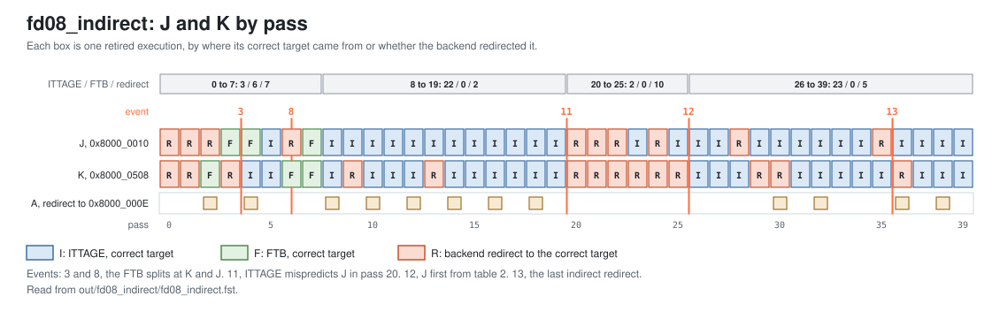

<!-- SPDX-License-Identifier: CC-BY-4.0                        -->
<!-- Copyright (c) 2026 Jeff Nye, uarchlabs.com                -->
<!-- SPDX-FileCopyrightText: 2026 Jeff Nye <jeff@uarchlabs.com> -->
# fd08_indirect: Indirect Jump
```
 FILE:    fd08_indirect.md
 SOURCE:  DOC-002, DOC-006, DOC-007
 STATUS:  WORKING
 UPDATED: 2026-10-19
 CONTACT: Jeff Nye
```

## 1. Introduction

`fd08_indirect` (FD-8) runs a loop of 40 passes. Each pass runs an indirect
jump, J, and an indirect call, K, whose targets alternate from pass to pass.
Each follows a conditional, A and C, whose direction alternates with it, so the
global history differs between odd and even passes.

An FTB entry holds one target for its jump, so it cannot follow a target that
changes every pass. ITTAGE learns each target under its history and supplies it
at p2, and the slot's `pred_src` is PRED_ITTAGE.

ITTAGE supplies the correct target of 50 of the 80 retired executions of J and
K. The result line in the log file reports that count.

This scenario runs in the 1-prediction slot Pacino configuration,
NUM_PRED_SLOTS=1.

### 1.1 Files

`DEMO=$RVA_ROOT/examples/fe_demo`

  | File               | Path                                      |
  |--------------------|-------------------------------------------|
  | This file          | $DEMO/docs/fd08_indirect.md               |
  | Program (stimulus) | $DEMO/programs/fd08_indirect.svh          |
  | Surfer sucl        | $DEMO/waves/fd08_indirect.sucl            |
  | Log                | $DEMO/out/fd08_indirect/fd08_indirect.log |
  | Waveform           | $DEMO/out/fd08_indirect/fd08_indirect.fst |
  | Waveform (online)  | [Link](https://app.surfer-project.org/?load_url=https%3A%2F%2Fuarchlabs.github.io%2Fpacino-waves%2Ffd08_indirect.fst&startup_commands=run_command_file_from_url%20https%3A%2F%2Fuarchlabs.github.io%2Fpacino-waves%2Ffd08_indirect.sucl) |
  | Block connectivity | [$DEMO/docs/fe_block.svg](fe_block.svg)   |
  | Pipeline view      | [$DEMO/docs/fe_pipe.svg](fe_pipe.svg)     |
  | Common description | [$DEMO/docs/demo_explainer.md](demo_explainer.md) |

---

## 2. Run the scenario

Run simulation:
```
make -C examples/fe_demo fd08_indirect
```

View the waveform (runs simulation first if FST is not up to date):
```
make -C examples/fe_demo view S=fd08_indirect
```

Console output:
```
-I: fd08_indirect : PASS : cyc = 1147
```

Log file output:
```
-I: fd08_indirect: PASS, indirect targets predicted by ITTAGE 50,
    events checked 16 of 16, cyc 1147
```

The testbench monitor, `tb/fe_demo_mon.svh`, supplies the count in the log line:

- indirect targets predicted by ITTAGE
    - `n_itt_ok` in `tb/fe_demo_mon.svh`
    - retired INDIRECT_NONRET or INDIRECT_CALL whose final slot in the FTQ entry
      has `pred_src` PRED_ITTAGE, `taken` 1 and the correct target

---

## 3. The program

The program is written by the task `prog_fd08` in `programs/fd08_indirect.svh`.
The code consists of a short prologue, then a loop of 40 passes starting at
`top`, and a short epilogue.

The conditional A at 0x8000_000A is taken on odd passes and skips one
instruction. The jump J at 0x8000_0010 goes to `ta` on odd passes and `tb` on
even passes, and both lead to `jn`. The conditional C at 0x8000_0502 is taken on
even passes. The call K at 0x8000_0508 goes to `fa` on odd passes and `fb` on
even passes. The branch X at 0x8000_050E is taken only on the last pass, and
exits the loop.

The program runs in machine mode with translation off, the addresses are
physical. The program starts at the reset vector, `RESET_VECTOR` = 0x8000_0000
(`bp_defines_pkg.sv`).

```
Address      Label  Instruction             Purpose
0x8000_0000         c.addi a0, 1            ; prologue
0x8000_0002         addi   t0, t0, 1        ; prologue
0x8000_0006         c.addi a0, 1            ; prologue

0x8000_0008  top:   c.addi a0, 1            ; filler
0x8000_000A  A:     bne    x6, x0, 0x010    ; taken on odd passes
0x8000_000E         c.addi a0, 1            ; even passes only
0x8000_0010  J:     jalr   x0, 0(x7)        ; indirect jump, to ta or tb

0x8000_0400  ta:    c.addi a0, 1            ; odd passes
0x8000_0402         addi   t0, t0, 1        ; odd passes
0x8000_0406         jal    x0, jn           ; odd passes

0x8000_0480  tb:    c.addi a0, 1            ; even passes
0x8000_0482         jal    x0, jn           ; even passes

0x8000_0500  jn:    c.addi a0, 1            ; filler
0x8000_0502  C:     bne    x6, x0, 0x508    ; taken on even passes
0x8000_0506         c.addi a0, 1            ; odd passes only
0x8000_0508  K:     jalr   x1, 0(x28)       ; indirect call, to fa or fb
0x8000_050C         c.addi a0, 1            ; after the return
0x8000_050E  X:     bne    x6, x0, 0x516    ; taken on the last pass
0x8000_0512         jal    x0, top          ; back edge

0x8000_0516         c.addi a0, 1            ; epilogue
0x8000_0518         addi   t0, t0, 1        ; epilogue
0x8000_051C         c.addi a0, 1            ; epilogue
0x8000_051E  hold:  jal    x0, hold         ; termination

0x8000_0600  fa:    c.addi a0, 1            ; odd passes
0x8000_0602         addi   t0, t0, 1        ; odd passes
0x8000_0606         ret                     ; odd passes

0x8000_0680  fb:    c.addi a0, 1            ; even passes
0x8000_0682         ret                     ; even passes
```

J is an INDIRECT_NONRET because neither register is a link register, and K is an
INDIRECT_CALL because rd is x1. The `ret` in `fa` and `fb` is a RETURN,
predicted by the RAS.

With one prediction slot, an FTB entry holds one branch, so the path to J and K
is predicted as several blocks. The accepted p2 slot groups, by block:

| Block start | Reached by                                | Branch | Position | Block end                    | Groups |
|-------------|-------------------------------------------|--------|----------|------------------------------|--------|
| 0x8000_0008 | `top`                                     | A      | 1        | 0x8000_0028 before the split | 6      |
| 0x8000_0008 | `top`                                     | A      | 1        | 0x8000_0010 after the split  | 51     |
| 0x8000_000E | a backend redirect, A not taken           | J      | 1        | 0x8000_0014                  | 11     |
| 0x8000_0010 | A taken, or the block at 0x8000_0008 ends | J      | 0        | 0x8000_0014                  | 59     |
| 0x8000_0500 | `jn`                                      | C      | 1        | 0x8000_0520 before the split | 5      |
| 0x8000_0500 | `jn`                                      | C      | 1        | 0x8000_0508 after the split  | 66     |
| 0x8000_0506 | a backend redirect, C not taken           | K      | 1        | 0x8000_050C                  | 6      |
| 0x8000_0508 | C taken, or the block at 0x8000_0500 ends | K      | 0        | 0x8000_050C                  | 63     |

The `c.addi` and `addi` instructions do no useful work. Their purpose is to mix
16-bit and 32-bit instructions and to separate the branches.

The directions and targets are chosen by the program writer and resolved by the
modeled backend, and the register operands play no part in them. The `jalr`
encodings are the same on every pass, and x7 and x28 are never read. The code is
the same on every pass, and only the expected instruction stream changes.

J and K each retire 40 times, 20 times to each of their two targets, which gives
the 80 retired executions in the count.

---

## 4. Walkthrough

Cycle numbers below are events in [section 5](#5-events); each event is a
marker in the waveform.

### 4.1 Predicting the indirect targets

An FTB entry holds one jump target, written when the jump resolves.[^1] ITTAGE
reads its tables with the request PC, the start of the prediction block, and the
folded global history.[^2] On a tagged hit at p2, the slot takes the ITTAGE
target and `pred_src` PRED_ITTAGE. Without a hit it takes the FTB target and
PRED_FTB.[^3] A misprediction writes the provider's target when its counter is
0, and allocates in a higher table when a candidate exists.[^4]

Each of the 80 executions retires in one of three ways.

```
passes     ITTAGE, correct   FTB, correct   backend redirect
0 to 7     3                 6              7
8 to 19    22                0              2
20 to 25   2                 0              10
26 to 39   23                0              5
total      50                6              24
```

The figure below shows each execution by pass.

[](fd08_passes.svg)

In passes 0 to 7, the entries are being built. The first allocation is for K at
cyc 60 (event 2). The first tagged hit and the first target of K from ITTAGE are
at cyc 260 (events 4 and 5), and the first target of J from ITTAGE is at cyc 267
(event 6). The monitor counts the first at retirement at cyc 267 (event 7). The
6 correct targets from the FTB are the executions where the target the entry
holds matches the pass.

The FTB splits the blocks at 0x8000_0500 and 0x8000_0008 at cyc 229 and cyc 298
(events 3 and 8), so that they end at K and J. From then on, a correct
prediction of A or C leads to the block starting at J or K on both odd and even
passes, and that block's FTB entry holds one target. A conditional predicted
taken and resolved not taken instead redirects to 0x8000_000E or 0x8000_0506, a
different block with its own ITTAGE entries.

In passes 8 to 19, J is correct in every pass. A is predicted taken in the even
passes, and the backend redirects to 0x8000_000E at cyc 345, 392, 445, 492, 530
and 568. J is then predicted in the block at 0x8000_000E, whose entry holds
`tb`. In odd passes it is predicted in the block at 0x8000_0010, whose entry
holds `ta`.

K has the two redirects of these passes. In pass 9, table 1 answers `fb` on an
odd pass, and the backend redirects to `fa`. The update allocates in table 2 at
cyc 378 (event 9). Pass 13 also redirects to `fa` and allocates in table 3 at
cyc 478, and K's target first comes from table 3 at cyc 517. ITTAGE also
corrects the p1 prediction from cyc 398 (event 10), the first of 30 p2 redirects
on an indirect slot.

In pass 20, A is predicted correctly on an even pass for the first time since
pass 6, so J is predicted in the block at 0x8000_0010. Table 1 answers `ta`
there, and the backend redirects to `tb` at cyc 607 (event 11). J is redirected
4 times and K 6 times in passes 20 to 25, while new entries are allocated in
tables 1 to 3. J first takes `tb` from table 2 in that block at cyc 780
(event 12), in pass 26.

From pass 26 to pass 39, ITTAGE supplies 23 of the 28 targets. The last indirect
redirect is K in pass 36, at cyc 1056 (event 13). The loop exits in pass 39 at
cyc 1137 (event 14).

[^1]: `jmp_new.tgt`: `rtl/core/frontend/bpu/rtl/ftb_cntrl.sv:553-554`.
[^2]: The request PC: `rtl/core/frontend/bpu/rtl/bp_cluster.sv:1668`. The
    history: `rtl/core/frontend/bpu/rtl/ittage.sv:54`.
[^3]: `it_hit`, `it_tgt`: `rtl/core/frontend/bpu/rtl/bp_cluster.sv:1148-1153`,
    and `:1171-1174` for the slot.
[^4]: `rtl/core/frontend/bpu/rtl/ittage_cntrl.sv:803-822` for the target and
    `:832-854` for the allocation.

### 4.2 The ITTAGE answers in the waveform

The waveform group `ittage_p2` shows ITTAGE's answer for the block at p2, with
`u_bpu.w_ftb_jmp_target_p2`, the FTB's target, beside it. `ittage_prm_tgt` and
`ittage_alt_tgt` hold VA[40:1], so each reads half of the target address.

At cyc 260 (events 4 and 5), `ittage_hit` is asserted with `ittage_prm_comp` 1.
`bpu_slot_p2.[0]` holds K at `pos` 0 with `target` 0x8000_0680 and `pred_src`
PRED_ITTAGE. `w_ftb_jmp_target_p2` reads the same address.

At cyc 398 (event 10), `bpu_slot_p2.[0].target` is 0x8000_0680 from ITTAGE and
`w_ftb_jmp_target_p2` is 0x8000_0600. `bpu_redir_p2.[0].valid` is asserted with
`target_pc` 0x8000_0680, and `u_ftq.w_ok_redir_p2` is asserted.

At cyc 607 (event 11), the `backend` group shows the redirect to 0x8000_0480.
The `ittage_update` group shows `indir_mispredict` asserted, `resolved_target`
holding VA[40:1] of that address, and `ittage_alc_comp` 2.

At cyc 780 (event 12), `u_bpu.r_pc_p2` is 0x8000_0010, `ittage_prm_comp` is 2
and `ittage_using_primary` is asserted. The slot's `target` is 0x8000_0480, and
`w_ftb_jmp_target_p2` is 0x8000_0400.

---

## 5. Events

| #  | cyc  | Event                                                                                                 | Other                             |
|----|------|-------------------------------------------------------------------------------------------------------|-----------------------------------|
| 0  | 0    | reset released (`tb.rstn`); the FTQ requests 0x8000_0000 the same cycle                               | fast init                         |
| 1  | 19   | first misprediction of J; redirect to tb, 0x8000_0480                                                 | pass 0, backend                   |
| 2  | 60   | first ITTAGE allocation: K's update, for fb                                                           | table 1                           |
| 3  | 229  | the FTB entry for 0x8000_0500 ends at K: the split                                                    | `upd_split`, position 4           |
| 4  | 260  | first ITTAGE tagged hit at p2 (`ittage_hit`)                                                          | slot 0                            |
| 5  | 260  | first target of K from ITTAGE: the call's slot at p2 has `pred_src` PRED_ITTAGE                       | accepted by the FTQ               |
| 6  | 267  | first target of J from ITTAGE: the jump's slot at p2 has `pred_src` PRED_ITTAGE                       | accepted by the FTQ               |
| 7  | 267  | first retired indirect ITTAGE predicted                                                               | `n_itt_ok`                        |
| 8  | 298  | the FTB entry for 0x8000_0008 ends at J: the split                                                    | `upd_split`, position 4           |
| 9  | 378  | first allocation above table 1: K's update, for fa                                                    | table 2                           |
| 10 | 398  | first p2 redirect from an ITTAGE target: K to fb                                                      | accepted by the FTQ               |
| 11 | 607  | ITTAGE mispredicts J in pass 20; redirect to tb, 0x8000_0480                                          | backend                           |
| 12 | 780  | J first takes a target from table 2: tb, in the block at 0x8000_0010                                  | pass 26                           |
| 13 | 1056 | last indirect mispredicted: K in pass 36; redirect to fb, 0x8000_0680                                 | backend                           |
| 14 | 1137 | the loop exits: its last conditional taken on the last pass, a misprediction; redirect to 0x8000_0516 | pass 39, backend                  |
| 15 | 1147 | the run ends                                                                                          | a 100 cycle drain, to 1247        |

---

## 6. Waveform

`make -C examples/fe_demo view S=fd08_indirect` opens
`waves/fd08_indirect.sucl` in Surfer, with a marker at each event above.
Signal paths below are under `tb.dut` unless they start with `tb.`.

| group         | signal                                                 | description                                       |
|---------------|--------------------------------------------------------|---------------------------------------------------|
| clock         | `tb.clk`                                               | clock                                             |
|               | `tb.rstn`                                              | active low reset                                  |
|               | `tb.cyc`                                               | cycle number                                      |
| bp_cluster_p1 | `u_bpu.r_pc_p1`                                        | p1 prediction block start address                 |
|               | `bpu_pred_val_p1`                                      | p1 prediction valid                               |
|               | `bpu_pred_idx_p1`                                      | FTQ index of the p1 prediction                    |
|               | `u_bpu.r_ubtb_blk_p1.hit`                              | uBTB hit at p1                                    |
|               | `bpu_pred_pft_p1`                                      | p1 prediction block end, next halfword after it   |
|               | `bpu_pred_slot_p1.[0].slot_valid`                      | slot 0 holds a branch                             |
|               | `bpu_pred_slot_p1.[0].br_type`                         | slot 0 branch type                                |
|               | `bpu_pred_slot_p1.[0].pos`                             | slot 0 halfword position in the prediction block  |
|               | `bpu_pred_slot_p1.[0].taken`                           | slot 0 predicted direction                        |
|               | `bpu_pred_slot_p1.[0].target`                          | slot 0 predicted target                           |
|               | `bpu_pred_slot_p1.[0].pred_src`                        | slot 0 predictor that supplied the prediction     |
| ittage_p2     | `u_bpu.w_ittage_pred_rdy_p2`                           | ITTAGE response at p2                             |
|               | `u_bpu.w_ittage_pred_meta_p2.[0].ittage_hit`           | slot 0 ITTAGE primary table hit                   |
|               | `u_bpu.w_ittage_pred_meta_p2.[0].ittage_prm_comp`      | slot 0 ITTAGE primary table                       |
|               | `u_bpu.w_ittage_pred_meta_p2.[0].ittage_prm_tgt`       | slot 0 ITTAGE primary target, VA[40:1]            |
|               | `u_bpu.w_ittage_pred_meta_p2.[0].ittage_using_primary` | slot 0 ITTAGE answer is from the primary table    |
|               | `u_bpu.w_ittage_pred_meta_p2.[0].ittage_alt_comp`      | slot 0 ITTAGE alternate table                     |
|               | `u_bpu.w_ittage_pred_meta_p2.[0].ittage_alt_tgt`       | slot 0 ITTAGE alternate target, VA[40:1]          |
|               | `u_bpu.w_ftb_jmp_target_p2`                            | the FTB's jump target at p2                       |
| bp_cluster_p2 | `u_bpu.r_pc_p2`                                        | p2 prediction block start address                 |
|               | `u_bpu.r_val_p2`                                       | p2 valid                                          |
|               | `bpu_slot_val_p2`                                      | p2 group valid: p2 valid and an FTB hit           |
|               | `bpu_slot_idx_p2`                                      | FTQ index of the p2 group                         |
|               | `u_bpu.w_ftb_valid_p2`                                 | FTB hit at p2                                     |
|               | `bpu_slot_p2.[0].slot_valid`                           | slot 0 holds a branch                             |
|               | `bpu_slot_p2.[0].br_type`                              | slot 0 branch type                                |
|               | `bpu_slot_p2.[0].pos`                                  | slot 0 halfword position in the prediction block  |
|               | `bpu_slot_p2.[0].taken`                                | slot 0 predicted direction                        |
|               | `bpu_slot_p2.[0].target`                               | slot 0 predicted target                           |
|               | `bpu_slot_p2.[0].pred_src`                             | slot 0 predictor that supplied the prediction     |
|               | `bpu_redir_p2.[0].valid`                               | p2 redirect from slot 0                           |
|               | `bpu_redir_p2.[0].target_pc`                           | p2 redirect target from slot 0                    |
|               | `bpu_redir_idx_p2`                                     | FTQ index of the p2 redirect                      |
| ftq           | `u_ftq.w_ok_pred_p1`                                   | the FTQ accepts the p1 prediction                 |
|               | `u_ftq.w_ok_slot_p2`                                   | the FTQ accepts the p2 group                      |
|               | `u_ftq.w_ok_slot_p3`                                   | the FTQ accepts the p3 group                      |
|               | `u_ftq.w_ok_redir_p2`                                  | the FTQ accepts the p2 redirect                   |
|               | `u_ftq.w_ok_redir_p3`                                  | the FTQ accepts the p3 redirect                   |
|               | `u_ftq.w_redir_val`                                    | a redirect the FTQ takes                          |
|               | `u_ftq.w_redir_idx`                                    | FTQ index of the redirect                         |
|               | `u_ftq.w_commit_ptr`                                   | FTQ commit pointer                                |
|               | `ftq_full`                                             | FTQ full                                          |
|               | `ftq_empty`                                            | FTQ empty                                         |
| backend       | `tb.bkend_ftq_redir_val`                               | backend redirect valid                            |
|               | `tb.bkend_ftq_redir_pc`                                | backend redirect PC                               |
|               | `tb.bkend_ftq_redir_cause`                             | backend redirect cause                            |
| ittage_update | `u_bpu.w_ittage_upd_val_u0`                            | ITTAGE update valid, per slot                     |
|               | `u_bpu.ittage_upd_inp_u0.[0].indir_mispredict`         | the update is for a misprediction                 |
|               | `u_bpu.ittage_upd_inp_u0.[0].resolved_target`          | the resolved target, VA[40:1]                     |
|               | `u_bpu.ittage_upd_inp_u0.[0].ittage_pred_meta.ittage_alc_comp` | the table to allocate in                  |
| ftb_update    | `ftb_upd_valid_u0`                                     | FTB update valid                                  |
|               | `ftb_upd_pc_u0`                                        | block start address of the FTB update             |
|               | `ftb_upd_pos_u0`                                       | halfword position of the branch in the FTB update |
|               | `ftb_upd_is_br_u0`                                     | the FTB update is for a conditional               |
|               | `ftb_upd_is_jmp_u0`                                    | the FTB update is for a jump                      |
|               | `ftb_upd_hit_u0`                                       | the FTB update hits an entry                      |
|               | `u_bpu.u_ftb.u_ftb_cntrl.upd_split`                    | the FTB update splits the entry                   |
|               | `u_bpu.u_ftb.u_ftb_cntrl.upd_cut_pos`                  | position the split ends the entry at              |
