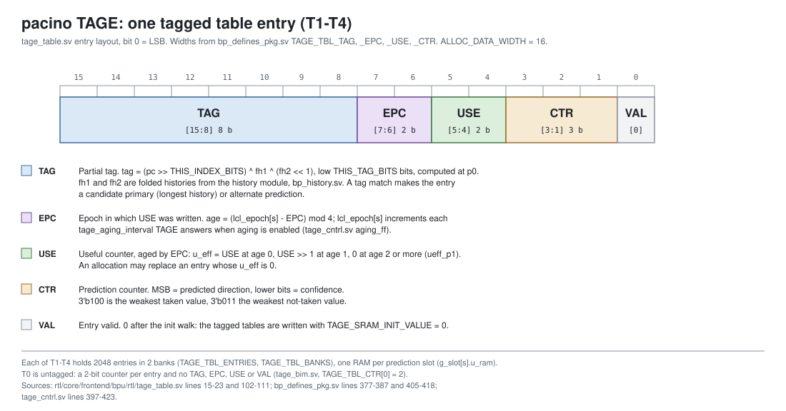
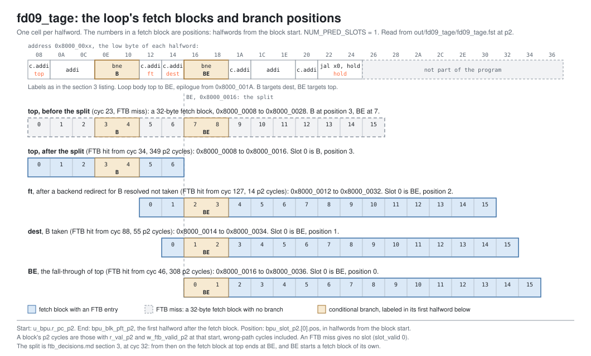

<!-- SPDX-License-Identifier: CC-BY-4.0                        -->
<!-- Copyright (c) 2026 Jeff Nye, uarchlabs.com                -->
<!-- SPDX-FileCopyrightText: 2026 Jeff Nye <jeff@uarchlabs.com> -->
# fd09_tage: TAGE Provider, Allocation and use_alt_on_na
```
 FILE:    fd09_tage.md
 SOURCE:  DOC-001, DOC-002, DOC-003, session-080, DOC-006, DOC-007
 STATUS:  WORKING
 UPDATED: 2026-10-31
 CONTACT: Jeff Nye
```

## 1. Introduction

Scenario fd09_tage (FD09) shows three behaviors of the Pacino TAGE
predictor in response to fetch target queue (FTQ) prediction requests at
pipestage p0 and FTQ updates at pipestage u0:

1. a prediction supplied by a tagged table
2. the allocation of a new tagged entry after a misprediction
3. the use_alt_on_na[^uaon] mechanism handing a prediction from a weak
   tagged entry to the base table T0.

FD09 runs a loop whose body contains a conditional branch with a random
direction. The random direction is chosen by the program writer class and
resolved by the modeled backend. With the random direction the predictor
cannot learn the branch behavior and therefore mispredicts often. These
mispredictions result in allocations and eventually trigger the
use_alt_on_na (UAON) counter. Eventually the UAON counter causes the
prediction to use the base table T0 as the prediction source.

Branch predictors and decoupled frontend designs are well-researched. Some
of the seminal papers include [[1]](#ref1) [[2]](#ref2) [[3]](#ref3)
[[4]](#ref4).

Pacino terminology labels the prediction operation stages as p0/p1/etc and
the branch predictor update operation stages u0/u1/etc.

This scenario runs in the 1-prediction slot Pacino configuration,
NUM_PRED_SLOTS=1, to reduce the volume of signal data.

### 1.1 Files

`DEMO=$RVA_ROOT/examples/fe_demo`

  | File               | Path                                          |
  |--------------------|-----------------------------------------------|
  | This file          | $DEMO/docs/fd09_tage.md                       |
  | Program (stimulus) | $DEMO/programs/fd09_tage.svh                  |
  | Surfer sucl        | $DEMO/waves/fd09_tage.sucl                    |
  | Log                | $DEMO/out/fd09_tage/fd09_tage.log             |
  | Waveform           | $DEMO/out/fd09_tage/fd09_tage.fst             |
  | Waveform (online)  | [Link](https://app.surfer-project.org/?load_url=https%3A%2F%2Fuarchlabs.github.io%2Fpacino-waves%2Ffd09_tage.fst&startup_commands=run_command_file_from_url%20https%3A%2F%2Fuarchlabs.github.io%2Fpacino-waves%2Ffd09_tage.sucl) |
  | Block connectivity | [$DEMO/docs/fe_block.svg](fe_block.svg)       |
  | Pipeline view      | [$DEMO/docs/fe_pipe.svg](fe_pipe.svg)         |
  | Common description | [$DEMO/docs/demo_explainer.md](demo_explainer.md) |

---

## 2. Run the scenario

Run simulation:
```
make -C examples/fe_demo fd09_tage
```

View the waveform (runs simulation first if FST is not up to date):
```
make -C examples/fe_demo view S=fd09_tage
```

Console output:
```
-I: fd09_tage : PASS : cyc = 1364
```

Log file output:
```
-I: fd09_tage: PASS, tagged-provider predictions 188, allocations 59,
    T0 by use_alt_on_na 22, events checked 15 of 15, cyc 1364
```

The testbench monitor, `tb/fe_demo_mon.svh`, supplies the counts in the log
line:

- tagged-provider predictions
    - `n_tage_prov` in `tb/fe_demo_mon.svh`
    - TAGE predictions at p2 whose provider is a tagged table
- allocations
    - `n_tage_alc` in `tb/fe_demo_mon.svh`
    - newly allocated tagged table entries written to the TAGE tables
- T0 by use_alt_on_na
    - `n_t0_uaon` in `tb/fe_demo_mon.svh`
    - TAGE predictions at p2 that come from T0 because use_alt_on_na
      replaced the weak tagged provider.

---

## 3. The program

The program is written by the task `prog_fd09` in `programs/fd09_tage.svh`. The
code consists of a short prologue, then a 256 iteration loop, and a short
epilogue.

The loop body holds two conditional branches. The bne branch at 0x8000_000E
has a randomized direction. The bne branch at 0x8000_0016 returns to label
`top`. This is the loop's back edge, labeled `BE` in the listing below.

The program runs in machine mode with translation off, the addresses are
physical. The program starts at the reset vector, `RESET_VECTOR` =
0x8000_0000 (`bp_defines_pkg.sv`), and the loop's first instruction, top, is
at 0x8000_0008.

```
                                                         Position in fetch block
Address      Label  Instruction          Purpose         top   ft  dest   BE
0x8000_0000         c.addi a0, 1         ; prologue
0x8000_0002         addi   t0, t0, 1     ; prologue
0x8000_0006         c.addi a0, 1         ; prologue

0x8000_0008  top:   c.addi a0, 1         ; loop body       0
0x8000_000A         addi   t0, t0, 1     ; loop body       1
0x8000_000E  B:     bne    x6, x0, dest  ; random          3
0x8000_0012  ft:    c.addi a0, 1         ; B not taken     5    0
0x8000_0014  dest:  c.addi a0, 1         ; loop body       6    1     0
0x8000_0016  BE:    bne    x6, x0, top   ; back edge      (7)   2     1    0

0x8000_001A         c.addi a0, 1         ; epilogue
0x8000_001C         addi   t0, t0, 1     ; epilogue
0x8000_0020         c.addi a0, 1         ; epilogue
0x8000_0022  hold:  jal    x0, hold      ; termination
```

A position is the halfword offset of an instruction from the start of its
fetch block. The 32-bit instructions take two positions, so the `addi` at
0x8000_000A covers 1 and 2. The block at `top` ends at `BE` once the FTB has
split its entry (section 4.2), so `BE` is at position 7 only before the
split. After it, `BE` is in a fetch block of its own: position 0 at `BE`, 1
at `dest` (B taken) and 2 at `ft` (B resolved not taken). The figure in
section 4.2 shows the fetch blocks.

The `c.addi` and `addi` instructions do no useful work. Their purpose is to
mix 16-bit and 32-bit instructions and to keep both branches away from the
start of the fetch block at `top`: `B` is at position 3 of that block and
`BE` at position 7.

Since B's direction is randomized the predictor cannot predict its
direction. Therefore the `bne` at `B` mispredicts often. The mispredictions
cause TAGE table entry allocations and train the use_alt_on_na counter.

The direction of each occurrence of `B` is chosen by the program writer
class and resolved by the modeled backend. The register operands play no
part in the taken/not taken state.

`B` is taken on roughly 1 in 8 iterations, 33 of 256 in the simulation. From
0, the first taken iterations are 9, 16, 19, 22, 30 and 31. RISC-V has no
branch delay slots: when `B` is taken, the `c.addi` at 0x8000_0012 is
skipped.

The back edge is taken on iterations 0 to 254 and falls through on iteration
255. Its pattern is regular, and the predictors learn it.

---

## 4. Walkthrough

Cycle numbers below are events in [section 5](#5-events); each event is a
marker in the waveform.

### 4.1 TAGE structure

Pacino's TAGE implementation uses 5 tables, T0-T4. T0 is the base predictor
which is untagged. T1 to T4 are tagged and use direction history in their
access address generation and entry matching. The tagged tables use
increasing number of history bits (length), 8, 13, 32 and 119, respectively.

T0 holds a 2-bit counter per entry and always produces a prediction.

A tagged table produces a prediction only when its tag matches. Each tagged
entry holds a 3-bit prediction counter, CTR, which encodes a predicted
direction in its MSB and a confidence value in the lower bits.

The format for entries in tables T1 to T4 is shown below. All four use the
same 8-bit tag.[^tagwidth]

[](tage_entry.svg)

For the tagged table two predictions are possible, a 'primary' and an
'alternative' prediction. The table with the longest history that matches
the tag produces the primary prediction, the next longest matching table
is the alternative prediction or T0 when no other tagged table matches.

A prediction moves through four stages, p0 to p3. The FTQ presents the request
at p0, TAGE reads its tables at p1 and delivers its prediction at p2. TAGE's
first p2 response is at cyc 2. In all the scenarios the statistical corrector
(SC) is enabled. SC takes the TAGE p2 output and uses one cycle to deliver its
prediction at p3. If the SC
prediction is different from the TAGE prediction, the SC prediction is used
and the BPU issues a p3 redirect. The FTQ accepts 36 p3 redirects in FD09
(`tb.n_redir_p3`), and SC decided all of them. The monitor reads TAGE's own
prediction and update signals, so SC changes none of the counts below.

### 4.2 Fetch block layout and update suppression in this run

Each fetch block has NUM_PRED_SLOTS prediction slots. A slot holds one
conditional branch of the block, and TAGE predicts, updates and keeps its
use_alt_on_na counter separately for each slot. With NUM_PRED_SLOTS = 1
every fetch block has one slot, slot 0, and the per-slot TAGE signals below
are indexed [0].

With one slot an FTB entry holds one branch. When the back edge first
resolves in the fetch block at top, the FTB splits the entry for top: it
keeps B and ends that fetch block at the back edge's address, 0x8000_0016
(the split at update, `planning/arch/ftb_decisions.md` section 3, at cyc
32). From then on the block at top ends there, and the back edge is the
first branch of the next fetch block, which starts at 0x8000_0016 and has
its own FTB entry (allocated at cyc 43 and first predicted at cyc 46). After
B is taken, fetch continues at 0x8000_0014; after a backend redirect for B
not taken, at 0x8000_0012. The back edge is then the first branch of that
block. Either way the back edge is in slot 0 of a fetch block of its own, at
position 0, 1 or 2, and is predicted and trained with its own metadata. TAGE
indexes its tables with the block's start address, so B's entries and the
back edge's are separate. Both are in slot 0, so both train the one
use_alt_on_na counter.

The loop's fetch blocks, read from the waveform, are shown below.

[](fd09_blocks.svg)

The back edge's first two resolutions, at cyc 21 and 32, came before the
split took effect. Each was in a fetch block whose one slot held another
branch, so its TAGE update was suppressed (`rsv_plc_occ`,
`rtl/core/frontend/ftq/rtl/ftq_resolve.sv` lines 46 to 57 and 443). TAGE
takes 254 updates for the back edge, one for each of its other resolutions,
and 256 for B.

### 4.3 Allocation

TAGE trains on its own prediction, whatever direction the front end
finally used. When a conditional branch resolves, the FTQ's update
conversion compares the TAGE direction carried with the branch with
the resolved direction, and marks a TAGE misprediction when they
differ. On a TAGE misprediction, when the provider is not T4, TAGE
writes a new entry for the branch in a table with a longer history
than the provider's. The table was chosen when the branch was
predicted: the first longer-history table whose entry at the branch's
index has an aged useful counter[^aging] of 0. The new entry holds the
branch's tag and starts at CTR 3'b100, the weakest taken value.

T0's entries start at 2'b10, weakly taken, so until T0 has learned B,
TAGE predicts B taken. The first allocation is at cyc 20, for B on
iteration 0: B was not taken and T0 had predicted it taken. The
allocation comes from TAGE's misprediction alone; the backend's first
misprediction, at cyc 21, is the back edge's.

Over the run TAGE mispredicted B on 58 of the 256 iterations: on 31
of the 33 iterations on which B was taken, and on 27 of the 223 on
which it was not. Each of the 58 wrote an allocation. TAGE mispredicted
the back edge once, when it fell through on iteration 255 (cyc 1355), and
that wrote the 59th allocation. The allocations by table:

```
             T1   T2   T3   T4   total
B            11   12   28    7      58
back edge     1    0    0    0       1
```

The first taken B is on iteration 9. In the waveform, the backend
resolves it at cyc 72: `tb.bkend_ftq_redir_val` is 1 and
`tb.bkend_ftq_redir_pc` is 0x8000_0014, B's target, because the front
end fetched the fall-through. The allocation write is the next cycle,
cyc 73, in the `tage_update` group:

- `tb.dut.u_bpu.u_tage.u_tage_cntrl.trx_type` is 1 and
  `tb.dut.u_bpu.u_tage.u_tage_cntrl.tage_upd_val_u0` is 1: the TAGE
  tables take an update this cycle. `trx_type` is an encoded
  field, 0 for a prediction cycle and 1 for an update cycle: it is the
  arbiter's grant (`tage_arb.sv` line 76), an input of `tage_cntrl.sv`
  (line 58), and the encoding is stated at
  `rtl/core/frontend/bpu/rtl/bp_structs_pkg.sv` line 314;
- `tb.dut.u_ftq.u_upd_conv.lp_upd_p0.[0].pc` is 0x8000_000E, B's
  address (the TAGE update input has no address; the update
  conversion forms every predictor's update from one record, and the
  loop predictor's copy carries it);
- `tb.dut.u_bpu.u_tage.u_tage_cntrl.tage_upd_inp_u0.[0].cond_mispredict`
  is 1 and `.resolved_taken` is 1; `.tage_pred_meta.tage_prm_comp` is
  0, so T0 was the provider;
- `tb.dut.u_bpu.u_tage.u_tage_cntrl.u_alc_wr.[0]` is 1 and
  `tb.dut.u_bpu.u_tage.u_tage_cntrl.u_alc_comp.[0]` is 1:
  the new entry is written into T1.

RTL: the TAGE misprediction is `cond_mispredict`, set in
`rtl/core/frontend/ftq/rtl/ftq_upd_conv.sv` line 218. The candidate
table is chosen at p1 in `pred_logic`,
`rtl/core/frontend/bpu/rtl/tage_cntrl.sv` lines 574 to 585. The
allocation is formed by `alc_upd_comb` in `tage_cntrl.sv` line 853,
signal `u_alc_wr`. T0's starting value is `TAGE_T0_SRAM_INIT_VALUE`,
`rtl/core/frontend/bpu/rtl/bp_defines_pkg.sv` line 418.

### 4.4 Training the use_alt_on_na counter

TAGE keeps a 4-bit counter, `uaon`, for each prediction slot. With one slot
there is one counter, `tb.dut.u_bpu.u_tage.u_tage_cntrl.uaon.[0]`. It
measures whether, when the provider's CTR is weak, the alternate has been
more accurate than the provider. The rules are in
`planning/arch/tage_cntrl_uaon_update_rules.md`: on an update whose
prediction was weak, the counter increments when the provider was wrong and
the alternate right, and decrements when the provider was right and the
alternate wrong. It starts at 0.

`uaon` is updated only when both the provider and the alternate are
tagged tables. When the alternate is T0, `uaon` is unchanged. The
counter is therefore trained on predictions where two tagged tables
matched. B and the back edge both update slot 0, so both could train
the one counter; in this run only B's updates do. The back edge's
predictions come from T0 until its single allocation on the last
iteration, so none of its updates has a tagged provider.

The first prediction from a tagged table is at cyc 115. The history
leading up to B is random, so the entries allocated for B are later
matched under histories they were not trained on. Those
entries are still weak, at CTR 3'b011 or 3'b100, and some predict
taken for a branch taken only one time in eight. The table counts the
updates that had a tagged provider, a tagged alternate and a weak
prediction, by the provider and alternate tables and by what the
update did to `uaon`. It increments when the provider was wrong and
the alternate right, decrements when the provider was right and the
alternate wrong, and is unchanged when the two predicted the same
direction.

```
             T2 over T1   T3 over T2   increment   decrement   unchanged
B                    16            6          13           0           9
back edge             0            0           0           0           0
```
The update inputs are in the `tage_update` group:
`tage_upd_inp_u0.[0].tage_pred_meta.tage_prm_comp`, `.tage_alt_comp`,
`.tage_pred_weak`, `.tage_prm_tkn` and `.tage_alt_tkn` under
`tb.dut.u_bpu.u_tage.u_tage_cntrl`.

In the waveform, `uaon.[0]` first reads 1 at cyc 225, the cycle of
B's update with provider T2, predicting taken, and alternate T1,
predicting not taken, weak; B was not taken, so the provider was wrong
and the alternate right. No update decrements it. It reaches 8 at cyc
441 and its highest value, 13, at cyc 1031, below the counter's
maximum of 15.

RTL: the update is `uaon_upd_ff` in `tage_cntrl.sv` line 380, and the
condition that both tables are tagged is at lines 383 and 384
(`u_prm_tagged` and `u_alt_tagged`, defined at lines 670 and 671).

### 4.5 T0 provides through use_alt_on_na

When `uaon` reaches 8, its top bit is set. From then on, a prediction
whose provider is a tagged table with a weak CTR uses the alternate
instead of the provider. When no second tagged table matched, the
alternate is T0, and the prediction comes from T0.

The counter that allows T0 to provide is trained only on predictions
where the alternate was a tagged table, as section 4.4 describes. It
then governs predictions where the alternate is T0. This follows the
update rule in tage_cntrl_uaon_update_rules.md.

In the waveform, the first prediction from T0 through use_alt_on_na
is at cyc 460, in slot 0, for the fetch block at top. In the `tage_p2`
group,
`tb.dut.u_bpu.u_tage.u_tage_cntrl.tage_pred_meta_p2.[0].tage_prm_comp`
is 1 (T1 matched B) and `.tage_prm_ctr` is 3'b100, weak;
`.tage_using_primary` is 0 and `.tage_alt_comp` is 0, so the
prediction is T0's, not taken. All 22 such predictions in the run
have T1 as the provider, and all are TAGE answers for the block at
top. The monitor counts TAGE answers whether or not the FTQ accepts
the group, so a count can include an answer for a block on a wrong
path.

RTL: the selection is in `pred_logic` in `tage_cntrl.sv`: the trigger,
a tagged provider with a weak CTR, at lines 529 to 533, and the choice
of the alternate when the trigger is set and `uaon[s][3]` is 1 at line
539. The result is registered into `tage_pred_meta_p2` by
`meta_p2_ff` at line 364.

---

## 5. Events

| #  | cyc  | Event                                                                                             | Other                                      |
|----|------|---------------------------------------------------------------------------------------------------|--------------------------------------------|
| 0  | 0    | reset released (`tb.rstn`); the FTQ requests 0x8000_0000 the same cycle                           | readies already high, fast init[^fastinit] |
| 1  | 2    | first TAGE response at p2: `r_val_p2` and `w_tage_pred_rdy_p2`                                    | unused: FTB miss                           |
| 2  | 20   | first allocation write, B not taken, predicted taken by T0                                        | table T1, slot 0, iteration 0              |
| 3  | 21   | first backend misprediction, back edge; redirect to 0x8000_0008                                   | iteration 0                                |
| 4  | 32   | the back edge resolved from top: the FTB entry for top ends at 0x8000_0016                        | the split                                  |
| 5  | 34   | first FTB hit at p2, the block at 0x8000_0008: TAGE's direction first used, B predicted not taken | slot 0 B, `pred_src` PRED_TAGE             |
| 6  | 46   | first p2 group at 0x8000_0016: the back edge in slot 0, predicted taken by TAGE                   | slot 0                                     |
| 7  | 72   | first taken B resolved, a misprediction; redirect to 0x8000_0014                                  | iteration 9                                |
| 8  | 73   | its allocation write                                                                              | table T1, slot 0                           |
| 9  | 115  | first prediction from a tagged table                                                              | table T1, slot 0                           |
| 10 | 225  | `uaon` first increments, 0 to 1                                                                   | provider T2, alternate T1                  |
| 11 | 441  | `uaon` reaches 8                                                                                  | slot 0                                     |
| 12 | 460  | first prediction from T0, by use_alt_on_na                                                        | provider T1, slot 0                        |
| 13 | 1355 | back edge falls through, a misprediction; redirect to 0x8000_001A                                 | iteration 255                              |
| 14 | 1364 | the run ends                                                                                      |                                            |

---

## 6. Waveform

`make -C examples/fe_demo view S=fd09_tage` opens `waves/fd09_tage.sucl` in
Surfer, with a marker at each event above. Signal paths below are under
`tb.dut` unless they start with `tb.`.

- group `clock`
    - `tb.clk` - clock
    - `tb.rstn` - active low reset
    - `tb.cyc` - cycle number
- group `bp_cluster_p0`
    - `ftq_pred_val_p0` - p0 request valid
    - `ftq_pred_pc_p0` - p0 request PC
    - `ftq_pred_idx_p0` - p0 request FTQ index
    - `u_ftq.u_npc.w_hold` - holds the p0 request: the FTQ or a predictor
      queue full, an FTB update, a fault hold, or a predictor not ready
      (`ftq_npc.sv` line 306)
- group `tage_p2`, signals under `u_bpu.u_tage.u_tage_cntrl` except the
  first
    - `u_bpu.w_tage_pred_rdy_p2` - TAGE response at p2
    - `tage_pred_meta_p2.[0].tage_prm_comp` - provider table, 0 is T0
    - `tage_pred_meta_p2.[0].tage_alt_comp` - alternate table, 0 is T0
    - `tage_pred_meta_p2.[0].tage_using_primary` - 0 when the alternate
      provides
    - `tage_pred_meta_p2.[0].tage_prm_ctr` - provider CTR
    - `tage_pred_meta_p2.[0].tage_pred_tkn` - TAGE direction
- group `bp_cluster_p2`
    - `u_bpu.r_val_p2` - p2 valid
    - `u_bpu.r_pc_p2` - p2 fetch block start
    - `bpu_blk_pft_p2` - p2 fetch block end, the first halfword after it
    - `bpu_slot_val_p2` - slot valid mask
    - `bpu_slot_idx_p2` - FTQ index of the p2 group
    - `u_bpu.w_ftb_valid_p2` - FTB hit at p2
    - `bpu_slot_p2.[0].slot_valid` - slot 0 holds a branch
    - `bpu_slot_p2.[0].br_type` - branch type
    - `bpu_slot_p2.[0].pos` - halfword position in the fetch block
    - `bpu_slot_p2.[0].taken` - predicted direction
    - `bpu_slot_p2.[0].target` - predicted target
    - `bpu_slot_p2.[0].pred_src` - predictor that supplied the direction
    - `bpu_redir_p2.[0].valid` - p2 redirect
    - `bpu_redir_p2.[0].target_pc` - p2 redirect target
    - `bpu_redir_idx_p2` - FTQ index of the p2 redirect
- group `backend`
    - `tb.bkend_ftq_redir_val` - backend redirect
    - `tb.bkend_ftq_redir_pc` - backend redirect PC
    - `tb.bkend_ftq_redir_cause` - backend redirect cause
- group `ftq_upd_conv`
    - `u_ftq.u_upd_conv.lp_upd_p0.[0].pc` - address of the branch being
      updated
- group `tage_update`, signals under `u_bpu.u_tage.u_tage_cntrl`
    - `trx_type` - 0 prediction cycle, 1 update cycle
    - `tage_upd_val_u0` - TAGE update valid
    - `tage_upd_inp_u0.[0].cond_mispredict` - TAGE misprediction
    - `tage_upd_inp_u0.[0].resolved_taken` - resolved direction
    - `tage_upd_inp_u0.[0].tage_pred_meta.tage_prm_comp` - provider table
    - `tage_upd_inp_u0.[0].tage_pred_meta.tage_alt_comp` - alternate table
    - `tage_upd_inp_u0.[0].tage_pred_meta.tage_pred_weak` - weak prediction
    - `tage_upd_inp_u0.[0].tage_pred_meta.tage_prm_tkn` - provider direction
    - `tage_upd_inp_u0.[0].tage_pred_meta.tage_alt_tkn` - alternate
      direction
    - `u_alc_wr.[0]` - allocation write
    - `u_alc_comp.[0]` - allocation table
    - `uaon.[0]` - use_alt_on_na counter

---

## References

<a id="ref1"></a>[1] Seznec, André, and Pierre Michaud. "A case for
(partially) tagged geometric history length branch prediction." The Journal
of Instruction-Level Parallelism 8 (2006): 23.

<a id="ref2"></a>[2] Seznec, André. "Tage-sc-l branch predictors."
JILP-Championship Branch Prediction. 2014.

<a id="ref3"></a>[3] Reinman, Glenn, Todd Austin, and Brad Calder. "A scalable
front-end architecture for fast instruction delivery." ACM SIGARCH Computer
Architecture News 27.2 (1999): 234-245.

<a id="ref4"></a>[4] Reinman, Glenn, Brad Calder, and Todd Austin. "Fetch
directed instruction prefetching." MICRO-32. Proceedings of the 32nd Annual
ACM/IEEE International Symposium on Microarchitecture. IEEE, 1999.

[^uaon]: use_alt_on_na: use the alternate prediction table when the provider
    entry is newly allocated [[1]](#ref1). Pacino treats a provider entry with
    a weak CTR as newly allocated (section 4.5).

[^aging]: The useful counter USE is aged by the entry's epoch field EPC (see
    the entry format in section 4.1). Aging is disabled in every scenario:
    CSR 0x7C0 bit 2, `tage_enable_aging`, resets to 0 and no scenario sets
    it, so the epoch stays 0 and the aged useful counter equals USE.

[^fastinit]: FD09 runs with fast initialization, as every scenario but FD-1
    does: a SystemVerilog `initial` block seeds each predictor table at time
    0 and each predictor ties its ready to 1 (`tage.sv` line 333, the same
    in `ittage.sv` and `sc.sv`), so the table walks of FD-1 do not run. With
    the readies already 1, `ftq_pred_val_p0` is 1 while `tb.rstn` is still
    low; the request is captured on the first cycle after reset. The
    [common description](demo_explainer.md#fast-init) describes fast
    initialization.

[^tagwidth]: The Pacino TAGE design uses a consistent tag width for tables
    T1-T4, as in Seznec and Michaud's TAGE paper [[1]](#ref1). Other designs
    have used variable-width tag fields [[2]](#ref2). During performance
    analysis the benefits of variable-width tag fields will be evaluated.
