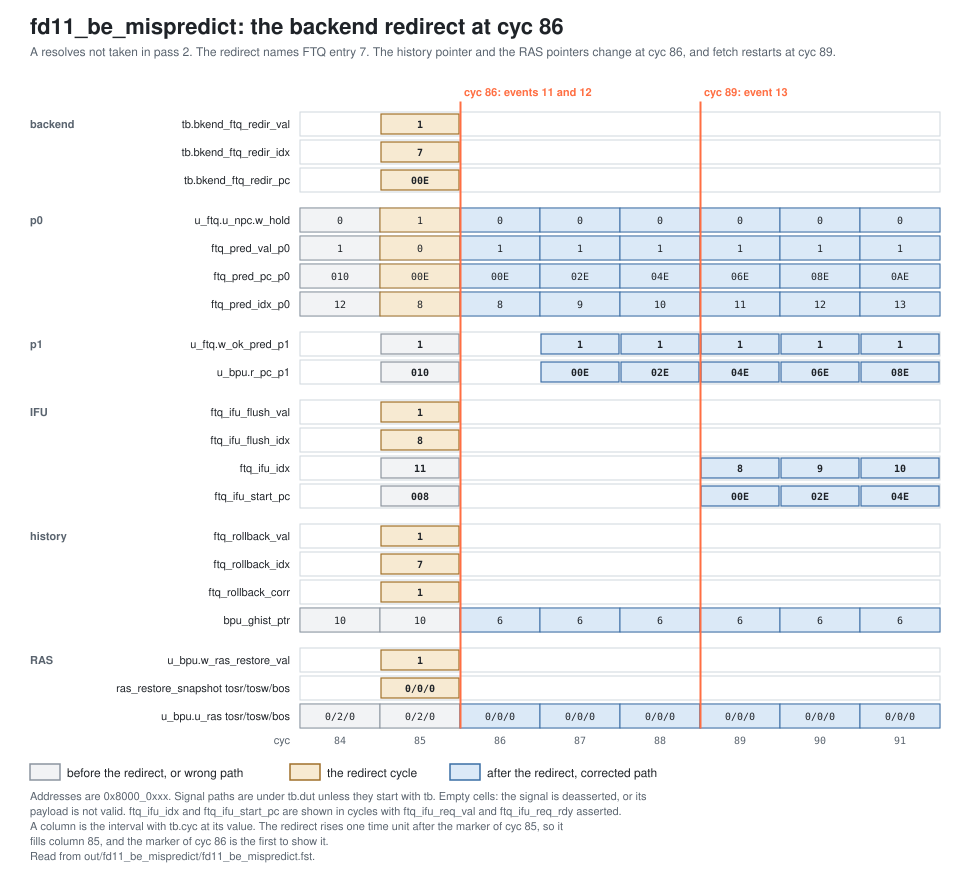

<!-- SPDX-License-Identifier: CC-BY-4.0                        -->
<!-- Copyright (c) 2026 Jeff Nye, uarchlabs.com                -->
<!-- SPDX-FileCopyrightText: 2026 Jeff Nye <jeff@uarchlabs.com> -->
# fd11_be_mispredict: Backend Mispredict
```
 FILE:    fd11_be_mispredict.md
 SOURCE:  DOC-002, DOC-006, DOC-007
 STATUS:  WORKING
 UPDATED: 2026-10-19
 CONTACT: Jeff Nye
```

## 1. Introduction

`fd11_be_mispredict` (FD-11) runs a conditional with a pseudo-random outcome,
then a call and its return, in a loop of 32 passes.

The conditional's outcome has no pattern for the predictors to learn, so the
backend often resolves it against the prediction and redirects. In the redirect
cycle, the FTQ squashes the younger entries and flushes the IFU, the history
rolls back and takes the corrected outcome, and the RAS restores its pointers
from the entry's snapshot. Fetch then restarts at the corrected PC.

The backend raises 21 mispredict redirects in the run, and the first fetch after
each one starts at the redirect PC. The result line in the log file reports
those counts.

This scenario runs in the 1-prediction slot Pacino configuration,
NUM_PRED_SLOTS=1.

### 1.1 Files

`DEMO=$RVA_ROOT/examples/fe_demo`

  | File               | Path                                                |
  |--------------------|-----------------------------------------------------|
  | This file          | $DEMO/docs/fd11_be_mispredict.md                    |
  | Program (stimulus) | $DEMO/programs/fd11_be_mispredict.svh               |
  | Surfer sucl        | $DEMO/waves/fd11_be_mispredict.sucl                 |
  | Log                | $DEMO/out/fd11_be_mispredict/fd11_be_mispredict.log |
  | Waveform           | $DEMO/out/fd11_be_mispredict/fd11_be_mispredict.fst |
  | Waveform (online)  | [Link](https://app.surfer-project.org/?load_url=https%3A%2F%2Fuarchlabs.github.io%2Fpacino-waves%2Ffd11_be_mispredict.fst&startup_commands=run_command_file_from_url%20https%3A%2F%2Fuarchlabs.github.io%2Fpacino-waves%2Ffd11_be_mispredict.sucl) |
  | Block connectivity | [$DEMO/docs/fe_block.svg](fe_block.svg)             |
  | Pipeline view      | [$DEMO/docs/fe_pipe.svg](fe_pipe.svg)               |
  | Common description | [$DEMO/docs/demo_explainer.md](demo_explainer.md)   |

---

## 2. Run the scenario

Run simulation:
```
make -C examples/fe_demo fd11_be_mispredict
```

View the waveform (runs simulation first if FST is not up to date):
```
make -C examples/fe_demo view S=fd11_be_mispredict
```

Console output:
```
-I: fd11_be_mispredict : PASS : cyc = 480
```

Log file output:
```
-I: fd11_be_mispredict: PASS, backend mispredict redirects 21,
    fetches at the redirect address 21, history rollbacks 82, RAS restores 82,
    events checked 18 of 18, cyc 480
```

The testbench monitor (`examples/fe_demo/tb/fe_demo_mon.svh`) supplies the
counts in the log line:

- backend mispredict redirects
    - `n_be_misp`
    - cycles with `tb.bkend_ftq_redir_val` asserted and
      `tb.bkend_ftq_redir_cause` RC_MISPREDICT
- fetches at the redirect address
    - `n_be_fix`
    - redirects whose first following fetch, with `ftq_ifu_req_val` and
      `ftq_ifu_req_rdy` asserted and no flush, has `ftq_ifu_start_pc` equal to
      the redirect PC
- history rollbacks
    - `n_rollback`
    - cycles with `ftq_rollback_val` asserted, for a redirect from any source
- RAS restores
    - `n_ras_rest`
    - cycles with `ras_restore_val` asserted, the same net as `ftq_rollback_val`

---

## 3. The program

The program is written by the task `prog_fd11` in
`programs/fd11_be_mispredict.svh`. The code consists of a short prologue, then a
loop of 32 passes starting at `top`, and a short epilogue.

Each pass runs the conditional `A`, then a call to `fn` from 0x8000_0010, and
the return to 0x8000_0014. The back edge at 0x8000_0016 returns to `top`. The
back edge is taken on passes 0 to 30.

The program runs in machine mode with translation off, so the addresses are
physical. The program starts at the reset vector, `RESET_VECTOR` = 0x8000_0000
(`bp_defines_pkg.sv`).

```
                                                         Position from
Address      Label  Instruction           Purpose        0x000 0x008 0x00E 0x010
0x8000_0000         c.addi a0, 1          ; prologue     0
0x8000_0002         addi   t0, t0, 1      ; prologue     1
0x8000_0006         c.addi a0, 1          ; prologue     3
0x8000_0008  top:   c.addi a0, 1          ; filler       4     0
0x8000_000A  A:     bne    x6, x0, 0x010  ; conditional  5     1
0x8000_000E         c.addi a0, 1          ; skipped by A 7     3     0
0x8000_0010         jal    x1, fn         ; call         8     4     1     0

                                                         Position from 0x014
0x8000_0014         c.addi a0, 1          ; return point 0
0x8000_0016  E:     bne    x6, x0, top    ; back edge    1
0x8000_001A         c.addi a0, 1          ; epilogue     3
0x8000_001C         addi   t0, t0, 1      ; epilogue     4
0x8000_0020         c.addi a0, 1          ; epilogue     6
0x8000_0022  hold:  jal    x0, hold       ; termination  7

                                                         Position from 0x400
0x8000_0400  fn:    c.addi a0, 1          ; filler       0
0x8000_0402         addi   t0, t0, 1      ; filler       1
0x8000_0406         ret                   ; return       3
```

A position is the halfword offset of an instruction from the start of its
prediction block. The 32-bit instructions take two positions. The four position
columns at the top are the block starts that hold these instructions in the
run.

The `c.addi` and `addi` instructions do no useful work. Their purpose is to mix
16-bit and 32-bit instructions and to separate the branches.

The direction of `A` is one bit per pass from the program writer's 16-bit
Galois LFSR, with taps 0xB400 and seed 0xACE1 (`lfsr_bit` in
`rtl/core/frontend/fe_top/tb/models/fe_tb_writer.svh`). From pass 0 to pass 31
the bits are:

```
1000 0111 0010 0011 0100 0110 1101 1100
```

A bit of 1 is taken, which skips the `c.addi` at 0x8000_000E. A is taken on 15
passes and not taken on 17. The direction is resolved by the modeled backend,
and the register operands play no part in it. The code is the same on every
pass, and only the expected instruction stream changes.

---

## 4. Walkthrough

Cycle numbers below are events in [section 5](#5-events); each event is a
marker in the waveform. A signal the testbench drives, such as
`tb.bkend_ftq_redir_val`, changes one time unit after the clock edge, so a
backend redirect reads at the marker of the next cycle.

### 4.1 The backend redirect

The backend model retires the bundle against the expected instruction stream.
When the instruction after a control transfer is not the expected one, it raises
`tb.bkend_ftq_redir_val` with cause RC_MISPREDICT, the FTQ index and position of
the transfer, the resolved direction and the correct PC.[^1]

In the FTQ's p0 arbiter a backend redirect outranks every other redirect,
without comparison.[^2] In the redirect cycle:

- `ftq_pred_pc_p0` is the redirect PC, and `ftq_pred_idx_p0` is the entry after
  the named one. The younger entries are squashed.
- `ftq_ifu_flush_val` is asserted, naming that same entry.[^3]
- `ftq_rollback_val` is asserted, with `ftq_rollback_corr`.[^4]
- `ras_restore_val` is asserted, with the named entry's RAS snapshot.[^5]

The run has 21 backend redirects, and all have cause RC_MISPREDICT and
`tb.bkend_ftq_redir_self` deasserted.

```
                                        History     RAS TOSR/TOSW/BOS   First
cyc  pass  Branch     idx  pos  Target  pointer     before    after     fetch
20   0     A, cold    0    5    0x010   0 -> 1      0/0/0     0/0/0     +3
49   0     return     2    3    0x014   1 -> 2      0/0/0     0/0/0     +4
60   0     back edge  3    1    0x008   2 -> 3      0/0/0     0/0/0     +3
86   2     A          7    1    0x00E   10 -> 6     0/2/0     0/0/0     +3
125  5     A          19   1    0x010   23 -> 17    4/5/2     1/3/1     +4
141  6     A          23   1    0x010   27 -> 21    1/6/1     1/4/1     +5
163  8     A          31   1    0x00E   32 -> 29    4/7/4     3/6/3     +4
180  9     A          35   1    0x00E   40 -> 33    6/9/6     5/7/5     +4
196  10    A          39   1    0x010   43 -> 37    5/10/5    5/8/5     +5
214  11    A          43   1    0x00E   48 -> 41    8/11/8    7/9/7     +4
231  12    A          47   1    0x00E   52 -> 45    9/12/9    7/10/7    +4
248  13    A          51   1    0x00E   56 -> 49    10/13/10  7/11/7    +4
298  18    A          7    1    0x00E   75 -> 69    1/2/15    13/0/13   +4
315  19    A          11   1    0x00E   80 -> 73    0/3/0     13/1/13   +4
332  20    A          15   1    0x00E   84 -> 77    1/4/1     13/2/13   +4
348  21    A          19   1    0x010   87 -> 81    13/5/13   13/3/13   +5
370  23    A          27   1    0x00E   92 -> 89    3/6/3     2/5/2     +4
386  24    A          31   1    0x010   99 -> 93    4/8/4     4/6/4     +5
418  27    A          43   1    0x010   109 -> 105  7/10/7    6/9/6     +5
439  29    A          51   1    0x010   116 -> 113  9/12/9    8/11/8    +5
471  31    back edge  62   1    0x01A   129 -> 124  12/15/12  11/14/11  +3
```

`idx` is the FTQ index the redirect names and `pos` the position of the branch.
The history pointer and RAS columns give the values at the marker before `cyc`
and at `cyc`. The first fetch column is the number of cycles from `cyc` to the
first fetch.

All 21 first fetches start at the redirect PC. The p0 request is held in every
redirect cycle by the FTB update scheduler, so `ftq_pred_val_p0` is deasserted
while `ftq_pred_pc_p0` shows the redirect PC.[^6] The request becomes valid 1 or
2 cycles after `cyc`, and the first fetch is 3 to 5 cycles after `cyc`.

### 4.2 The branches the backend redirects

A's first redirect is at cyc 20 (event 2), at position 5 of the block at
0x8000_0000, before any predictor holds it. Fetch restarts at 0x8000_0010 at cyc
23 (event 3). The return and the back edge are first redirected at cyc 49 (event
5) and cyc 60 (event 7), and fetch restarts at 0x8000_0014 at cyc 53 (event 6).

A is redirected in 18 of the 32 passes, 8 times to 0x8000_0010 and 10 times to
0x8000_000E. No backend redirect names A in passes 1, 3, 4, 7, 14, 15, 16, 17,
22, 25, 26, 28, 30 and 31. The first redirect of A not taken is at cyc 86 in
pass 2 (event 12), and fetch restarts at 0x8000_000E at cyc 89 (event 13).

The FTB update at cyc 82 (event 10) records the call at position 4 of the block
at `top`. A already holds the entry's one slot, so the FTB splits the entry at
the call, with `upd_cut_pos` 4, and the block at `top` now ends at 0x8000_0010.
From then on, both predicted directions of A continue at the block at
0x8000_0010. A predicted taken ends the fetch at A, and A predicted not taken
also fetches the `c.addi` at 0x8000_000E. The block at 0x8000_000E is used only
after a backend redirect to it.

The back edge is not redirected again until it falls through in pass 31, at cyc
471 (event 15), and fetch restarts at 0x8000_001A at cyc 474 (event 16). The
return is not redirected again at all.

### 4.3 The other redirects

The 82 rollbacks in the log line are the redirects the FTQ takes from all
sources, up to cyc 480.

```
Source      Count   Target    Branch
backend     21                section 4.1
predecode   3       0x400     the call
p3          2       0x010     A
p2          56      0x014     the return
```

The predecode redirects are for the call, once in each block start that holds
it. These are position 0 of the block at 0x8000_0010 at cyc 29 (event 4),
position 4 of the block at 0x8000_0008 at cyc 69, and position 1 of the block at
0x8000_000E at cyc 95. A predecode redirect is also asserted at cyc 19 and cyc
59, so the marker of cyc 19 shows the rollback of event 1 with the predecode
redirect's values. The backend redirect rises one time unit later in both cycles
and wins.

The p3 redirects are at cyc 76 (event 9) and cyc 83, and both take A to
0x8000_0010. The p2 redirects start at cyc 72 (event 8). A uBTB return slot is
taken at p1 only when the stack read at p1 is valid.[^7] On 57 of the 61 p1
slots accepted for the block at 0x8000_0400 it is not valid, so the slot is not
taken and p2 redirects to 0x8000_0014.

### 4.4 The history rollback

bp_history moves the pointer back to the first bit of the entry the rollback
names, writes the corrected outcome bits, advances past them, and records the
corrected bundle in that entry's checkpoint.[^8] Each backend redirect in this
run writes one bit, the resolved direction of the branch.

In the first three redirects the pointer moves forward by the one corrected bit,
because no younger entry has advanced it. The rollback at cyc 86 is the first to
move it back. The speculative stream has advanced `bpu_ghist_ptr`
to 10, and rolling back to FTQ index 7 leaves it at 6 at cyc 86.

The backend model checks the corrected bit in the cycle after a redirect of a
conditional: the history bit before the pointer must equal the resolved
direction.[^9] Its counters `tb.n_hist_ok` and `tb.n_hist_bad` end at 20 and 0,
for 18 redirects of A and 2 of the back edge. The return's redirect is not
checked.

### 4.5 The RAS restore

The restore is pointer-only. TOSR, TOSW and BOS load from the entry's snapshot,
and the stack data is not cleared.[^10]

`ras_restore_val` is asserted for all 82 redirects, and bp_cluster drops the
restore when the redirect is the block's own p2 or p3 redirect.[^11] That leaves
24 restores that reach the RAS, from the 21 backend redirects and the 3
predecode redirects.

The first restore to move a pointer is at cyc 86 (event 11), where TOSW goes
from 2 to 0. The first to move BOS is at cyc 125 (event 14), where TOSR, TOSW
and BOS go from 4/5/2 to 1/3/1. In all 17 redirects of A after cyc 19, TOSW
moves back. The pointers wrap at 16 entries, as the rows from cyc 298 show.
After pass 0, the backend redirects no return.

[^1]: `rtl/core/frontend/fe_top/tb/models/fe_tb_backend.svh:182` and `:231`.
    RC_MISPREDICT: `rtl/core/frontend/bpu/rtl/bp_structs_pkg.sv:126`.
[^2]: `rtl/core/frontend/ftq/rtl/ftq_npc.sv:317-328`.
[^3]: `rtl/core/frontend/ftq/rtl/ftq_ifu.sv:352`.
[^4]: `rollback_val`: `rtl/core/frontend/ftq/rtl/ftq_npc.sv:399`.
    `rollback_corr`: `:415-416`.
[^5]: `rtl/core/frontend/ftq/rtl/ftq.sv:518`. The snapshot read:
    `rtl/core/frontend/ftq/rtl/ftq_entry.sv:175-178`.
[^6]: `w_hold`: `rtl/core/frontend/ftq/rtl/ftq_npc.sv:306-309`. `h3_ftb_upd`:
    `rtl/core/frontend/ftq/rtl/ftq.sv:493`.
[^7]: `rtl/core/frontend/bpu/rtl/bp_cluster.sv:832` and `:839-844`.
[^8]: `rtl/core/frontend/bpu/rtl/bp_history.sv:359-375`.
[^9]: `n_hist_ok` and `n_hist_bad`:
    `rtl/core/frontend/fe_top/tb/models/fe_tb_backend.svh:417-424`.
[^10]: `rtl/core/frontend/bpu/rtl/ras.sv:808-811` and `:834-835`.
[^11]: `w_ras_restore_val`: `rtl/core/frontend/bpu/rtl/bp_cluster.sv:1396-1402`.

### 4.6 The redirect in the waveform

The redirect at cyc 86 shows each part. The waveform group `backend` shows the
redirect, `bp_cluster_p0` the p0 request, `ftq_ifu` the flush and the restart,
and `bp_history_ras` the rollback and the restore.

At cyc 85, `bpu_ghist_ptr` is 10 and `u_bpu.u_ras.tosw` is 2.

At cyc 86 (events 11 and 12), `tb.bkend_ftq_redir_val` is asserted with
`tb.bkend_ftq_redir_idx` 7, `tb.bkend_ftq_redir_pos` 1, `tb.bkend_ftq_redir_pc`
0x8000_000E and `tb.bkend_ftq_redir_taken` 0. `ftq_pred_pc_p0` is 0x8000_000E
and `ftq_pred_idx_p0` is 8, while `u_ftq.u_npc.w_hold` holds the request.
`ftq_ifu_flush_val` is asserted with `ftq_ifu_flush_idx` 8. `ftq_rollback_val`
and `ftq_rollback_corr` are asserted with `ftq_rollback_idx` 7. `bpu_ghist_ptr`
is 6 and `u_bpu.u_ras.tosw` is 0, because these registers load at the clock edge
at this marker. One time unit later the redirect falls, and `ftq_pred_val_p0` is
asserted with `ftq_pred_pc_p0` 0x8000_000E.

At cyc 89 (event 13), `ftq_ifu_req_val` and `ftq_ifu_req_rdy` are asserted with
`ftq_ifu_idx` 8 and `ftq_ifu_start_pc` 0x8000_000E.

The figure below shows these cycles.

[](fd11_redirect.svg)

---

## 5. Events

| #  | cyc | Event                                                                                                     | Other                         |
|----|-----|-----------------------------------------------------------------------------------------------------------|-------------------------------|
| 0  | 0   | reset released (`tb.rstn`); the FTQ requests 0x8000_0000 the same cycle                                   | fast init                     |
| 1  | 19  | first history rollback (`ftq_rollback_val`), with its RAS restore (`ras_restore_val`)                     | predecode, then the backend   |
| 2  | 20  | first misprediction of A taken; redirect to 0x8000_0010                                                   | pass 0, backend               |
| 3  | 23  | fetch restarts at 0x8000_0010: the FTQ presents a block from the redirect address to the IFU              | `ftq_ifu_start_pc`            |
| 4  | 29  | first predecode redirect: the call, in the block at 0x8000_0010, to 0x8000_0400                           | not the backend               |
| 5  | 49  | the return mispredicted; redirect to 0x8000_0014                                                          | pass 0, backend               |
| 6  | 53  | fetch restarts at 0x8000_0014                                                                             | `ftq_ifu_start_pc`            |
| 7  | 60  | the back edge mispredicted, cold; redirect to 0x8000_0008                                                 | pass 0, backend               |
| 8  | 72  | first p2 redirect: the return, to 0x8000_0014                                                             | the first of 56               |
| 9  | 76  | first p3 redirect: A, to 0x8000_0010                                                                      | the first of 2                |
| 10 | 82  | the FTB splits the block at top at the call, position 4; the block then ends at 0x8000_0010               | `upd_split`, `upd_cut_pos` 4  |
| 11 | 86  | first RAS restore moving TOSW: from 2 to 0                                                                | `u_bpu.w_ras_restore_val`     |
| 12 | 86  | first misprediction of A not taken; redirect to 0x8000_000E                                               | pass 2, backend               |
| 13 | 89  | fetch restarts at 0x8000_000E                                                                             | `ftq_ifu_start_pc`            |
| 14 | 125 | first RAS restore moving BOS: from 2 to 1                                                                 | pass 5, `w_ras_restore_val`   |
| 15 | 471 | the loop exits: the back edge falls through, a misprediction; redirect to 0x8000_001A                     | pass 31, backend              |
| 16 | 474 | fetch restarts at 0x8000_001A                                                                             | `ftq_ifu_start_pc`            |
| 17 | 480 | the run ends                                                                                              |                               |

---

## 6. Waveform

`make -C examples/fe_demo view S=fd11_be_mispredict` opens
`waves/fd11_be_mispredict.sucl` in Surfer, with a marker at each event above.
Signal paths below are under `tb.dut` unless they start with `tb.`.

| group          | signal                              | description                                       |
|----------------|-------------------------------------|---------------------------------------------------|
| clock          | `tb.clk`                            | clock                                             |
|                | `tb.rstn`                           | active low reset                                  |
|                | `tb.cyc`                            | cycle number                                      |
| backend        | `tb.bkend_ftq_redir_val`            | backend redirect                                  |
|                | `tb.bkend_ftq_redir_idx`            | FTQ index of the backend redirect                 |
|                | `tb.bkend_ftq_redir_pc`             | backend redirect PC                               |
|                | `tb.bkend_ftq_redir_cause`          | backend redirect cause                            |
|                | `tb.bkend_ftq_redir_self`           | self flag of the backend redirect                 |
|                | `tb.bkend_ftq_rsv_val`              | resolution from the backend, per slot             |
|                | `tb.bkend_ftq_commit_val`           | commit watermark valid                            |
|                | `tb.bkend_ftq_commit_idx`           | commit watermark FTQ index                        |
|                | `tb.bkend_ftq_redir_pos`            | halfword position of the redirected transfer      |
|                | `tb.bkend_ftq_redir_taken`          | resolved direction of the redirected transfer     |
| ftq            | `u_ftq.w_ok_pred_p1`                | the FTQ accepts the p1 prediction                 |
|                | `u_ftq.w_ok_slot_p2`                | the FTQ accepts the p2 group                      |
|                | `u_ftq.w_ok_slot_p3`                | the FTQ accepts the p3 group                      |
|                | `u_ftq.w_ok_redir_p2`               | the FTQ accepts the p2 redirect                   |
|                | `u_ftq.w_ok_redir_p3`               | the FTQ accepts the p3 redirect                   |
|                | `u_ftq.w_redir_val`                 | a redirect the FTQ takes                          |
|                | `u_ftq.w_redir_idx`                 | FTQ index of the redirect                         |
|                | `u_ftq.w_commit_ptr`                | FTQ commit pointer                                |
|                | `ftq_full`                          | FTQ full                                          |
|                | `ftq_empty`                         | FTQ empty                                         |
| ftq_ifu        | `ftq_ifu_req_val`                   | FTQ presents a block to the IFU                   |
|                | `ftq_ifu_req_rdy`                   | the IFU takes the block                           |
|                | `ftq_ifu_idx`                       | FTQ index of the block                            |
|                | `ftq_ifu_start_pc`                  | block start address                               |
|                | `ftq_ifu_next_pc`                   | address after the block                           |
|                | `ftq_ifu_taken_val`                 | the block holds a predicted-taken transfer        |
|                | `ftq_ifu_taken_pos`                 | halfword position of the predicted-taken transfer |
|                | `ftq_ifu_flush_val`                 | flush of the blocks younger than the named entry  |
|                | `ftq_ifu_flush_idx`                 | FTQ index the flush names                         |
|                | `ftq_ifu_commit_ptr`                | FTQ commit pointer as the IFU sees it             |
| bp_cluster_p0  | `ftq_pred_val_p0`                   | p0 request valid                                  |
|                | `ftq_pred_pc_p0`                    | p0 request PC                                     |
|                | `ftq_pred_idx_p0`                   | p0 request FTQ index                              |
|                | `u_ftq.u_npc.w_hold`                | holds the p0 request                              |
|                | `u_ftq.u_npc.h3_ftb_upd`            | the FTB update scheduler holds the p0 request     |
| bp_history_ras | `ftq_rollback_val`                  | history rollback                                  |
|                | `ftq_rollback_idx`                  | FTQ index of the rollback                         |
|                | `ftq_rollback_corr`                 | the rollback writes corrected outcome bits        |
|                | `bpu_ghist_ptr`                     | global history pointer                            |
|                | `ras_restore_val`                   | RAS restore from the FTQ                          |
|                | `ras_restore_snapshot.tosr`         | restored RAS read pointer                         |
|                | `ras_restore_snapshot.tosw`         | restored RAS write pointer                        |
|                | `ras_restore_snapshot.bos`          | restored RAS bottom of stack                      |
|                | `u_bpu.w_ras_restore_val`           | the restore bp_cluster passes to the RAS          |
|                | `u_bpu.u_ras.tosr`                  | RAS read pointer                                  |
|                | `u_bpu.u_ras.tosw`                  | RAS write pointer                                 |
|                | `u_bpu.u_ras.bos`                   | RAS bottom of stack                               |
| predecode      | `u_ftq.w_pd_redir_val`              | predecode redirect                                |
|                | `u_ftq.w_pd_redir_pc`               | predecode redirect target                         |
| bp_cluster_p1  | `u_bpu.r_pc_p1`                     | p1 prediction block start address                 |
|                | `bpu_pred_val_p1`                   | p1 prediction valid                               |
|                | `bpu_pred_idx_p1`                   | FTQ index of the p1 prediction                    |
|                | `u_bpu.r_ubtb_blk_p1.hit`           | uBTB hit at p1                                    |
|                | `bpu_pred_pft_p1`                   | p1 prediction block end, next halfword after it   |
|                | `bpu_pred_slot_p1.[0].slot_valid`   | slot 0 holds a branch                             |
|                | `bpu_pred_slot_p1.[0].br_type`      | slot 0 branch type                                |
|                | `bpu_pred_slot_p1.[0].pos`          | slot 0 halfword position in the prediction block  |
|                | `bpu_pred_slot_p1.[0].taken`        | slot 0 predicted direction                        |
|                | `bpu_pred_slot_p1.[0].target`       | slot 0 predicted target                           |
|                | `bpu_pred_slot_p1.[0].pred_src`     | slot 0 predictor that supplied the prediction     |
| bp_cluster_p2  | `u_bpu.r_pc_p2`                     | p2 prediction block start address                 |
|                | `u_bpu.r_val_p2`                    | p2 valid                                          |
|                | `bpu_slot_val_p2`                   | p2 group valid: p2 valid and an FTB hit           |
|                | `bpu_slot_idx_p2`                   | FTQ index of the p2 group                         |
|                | `u_bpu.w_ftb_valid_p2`              | FTB hit at p2                                     |
|                | `bpu_slot_p2.[0].slot_valid`        | slot 0 holds a branch                             |
|                | `bpu_slot_p2.[0].br_type`           | slot 0 branch type                                |
|                | `bpu_slot_p2.[0].pos`               | slot 0 halfword position in the prediction block  |
|                | `bpu_slot_p2.[0].taken`             | slot 0 predicted direction                        |
|                | `bpu_slot_p2.[0].target`            | slot 0 predicted target                           |
|                | `bpu_slot_p2.[0].pred_src`          | slot 0 predictor that supplied the prediction     |
|                | `bpu_redir_p2.[0].valid`            | p2 redirect from slot 0                           |
|                | `bpu_redir_p2.[0].target_pc`        | p2 redirect target from slot 0                    |
|                | `bpu_redir_idx_p2`                  | FTQ index of the p2 redirect                      |
| bp_cluster_p3  | `u_bpu.r_pc_p3`                     | p3 prediction block start address                 |
|                | `u_bpu.r_val_p3`                    | p3 valid                                          |
|                | `bpu_slot_val_p3`                   | p3 group valid: p3 valid and an FTB answer        |
|                | `bpu_slot_idx_p3`                   | FTQ index of the p3 group                         |
|                | `bpu_slot_p3.[0].slot_valid`        | slot 0 holds a branch                             |
|                | `bpu_slot_p3.[0].br_type`           | slot 0 branch type                                |
|                | `bpu_slot_p3.[0].pos`               | slot 0 halfword position in the prediction block  |
|                | `bpu_slot_p3.[0].taken`             | slot 0 predicted direction                        |
|                | `bpu_slot_p3.[0].target`            | slot 0 predicted target                           |
|                | `bpu_slot_p3.[0].pred_src`          | slot 0 predictor that supplied the prediction     |
|                | `bpu_redir_p3.[0].valid`            | p3 redirect from slot 0                           |
|                | `bpu_redir_p3.[0].target_pc`        | p3 redirect target from slot 0                    |
|                | `bpu_redir_idx_p3`                  | FTQ index of the p3 redirect                      |
| ftb_update     | `ftb_upd_valid_u0`                  | FTB update valid                                  |
|                | `ftb_upd_pc_u0`                     | block start address of the FTB update             |
|                | `ftb_upd_pos_u0`                    | halfword position of the branch in the FTB update |
|                | `ftb_upd_is_br_u0`                  | the FTB update is for a conditional               |
|                | `ftb_upd_is_jmp_u0`                 | the FTB update is for a jump                      |
|                | `ftb_upd_hit_u0`                    | the FTB update hits an entry                      |
|                | `u_bpu.u_ftb.u_ftb_cntrl.upd_split` | the FTB update splits the entry                   |
|                | `u_bpu.u_ftb.u_ftb_cntrl.upd_cut_pos` | position the split ends the entry at            |
