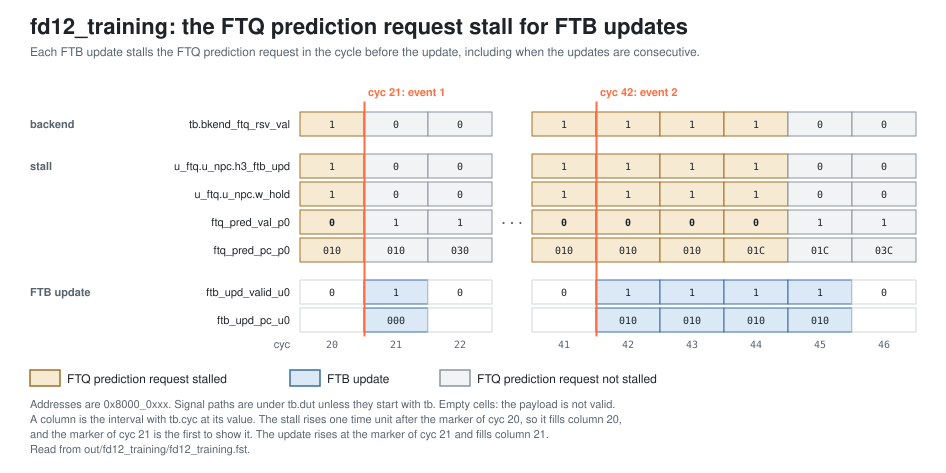
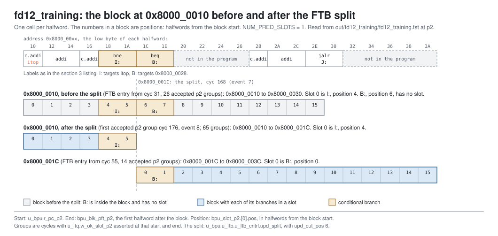

<!-- SPDX-License-Identifier: CC-BY-4.0                        -->
<!-- Copyright (c) 2026 Jeff Nye, uarchlabs.com                -->
<!-- SPDX-FileCopyrightText: 2026 Jeff Nye <jeff@uarchlabs.com> -->
# fd12_training: Predictor Training
```
 FILE:    fd12_training.md
 SOURCE:  DOC-002, DOC-006, DOC-007
 STATUS:  WORKING
 UPDATED: 2026-11-03
 CONTACT: Jeff Nye
```

## 1. Introduction

`fd12_training` (FD-12) shows resolved branches initiaing update requests
routed to the respective predictor based on branch type. It also illustrates
the operation of the single ported FTB.

The scenario runs an outer loop of 14 iterations, containing an inner loop
of 6 iterations. The outer loop includes:

    1. an always-taken conditional
    2. an indirect jump
    3. an indirect call and its return.

The inner loop includes a backwards branch executing the stated 6 iterations.

This code then results in all predictors receiving illustrative updates.

Each executed branch is resolved by the backend, converted by `ftq_upd_conv`
into per-predictor updates, and presented to the cluster.

An FTB update is a read-modify-write and occupies the single FTB read port for
one cycle. Prediction lookups use the same port at p1. To avoid the conflict,
the FTQ stalls its prediction request in the cycle before each FTB update.

The result line in the log file reports the update count for each predictor and
the number of FTQ prediction request stall cycles.

This scenario runs in the 1-prediction slot Pacino configuration,
NUM_PRED_SLOTS=1.

### 1.1 Files

`DEMO=$RVA_ROOT/examples/fe_demo`

  | File               | Path                                      |
  |--------------------|-------------------------------------------|
  | This file          | $DEMO/docs/fd12_training.md               |
  | Program (stimulus) | $DEMO/programs/fd12_training.svh          |
  | Surfer sucl        | $DEMO/waves/fd12_training.sucl            |
  | Log                | $DEMO/out/fd12_training/fd12_training.log |
  | Waveform           | $DEMO/out/fd12_training/fd12_training.fst |
  | Waveform (online)  | [Link](https://app.surfer-project.org/?load_url=https%3A%2F%2Fuarchlabs.github.io%2Fpacino-waves%2Ffd12_training.fst&startup_commands=run_command_file_from_url%20https%3A%2F%2Fuarchlabs.github.io%2Fpacino-waves%2Ffd12_training.sucl) |
  | Block connectivity | [$DEMO/docs/fe_block.svg](fe_block.svg)   |
  | Pipeline view      | [$DEMO/docs/fe_pipe.svg](fe_pipe.svg)     |
  | Common description | [$DEMO/docs/demo_explainer.md](demo_explainer.md) |

---

## 2. Run the scenario

Run simulation:
```
make -C examples/fe_demo fd12_training
```

View the waveform (runs simulation first if FST is not up to date):
```
make -C examples/fe_demo view S=fd12_training
```

Console output:
```
-I: fd12_training : PASS : cyc = 454
```

Log file output:
```
-I: fd12_training: PASS, update cycles uBTB 154, loop predictor 111, FTB 154,
    TAGE 111, SC 111, ITTAGE 28, RAS commit 28, p0 holds for an FTB update 154,
    events checked 10 of 10, cyc 454
```

The testbench monitor, `tb/fe_demo_mon.svh`, supplies the counts in the log
line. A count is the number of cycles in which the signal is asserted, while
the expected instruction stream has not fully retired.

| Item                   | Counter      | Signal |
|-----------------------|--------------|--------------|
| uBTB                       | `n_upd_ubtb` | `u_bpu.w_ubtb_upd_u0[s].valid` |
| loop predictor             | `n_upd_lp`   | `u_bpu.w_lp_upd_val_p0` |
| FTB                        | `n_upd_ftb`  | `u_bpu.w_ftb_upd_val_u0` |
| TAGE                       | `n_upd_tage` | `u_bpu.w_tage_upd_val_u0` |
| SC                         | `n_upd_sc`   | `u_bpu.w_sc_upd_val_u0` |
| ITTAGE                     | `n_upd_itt`  | `u_bpu.w_ittage_upd_val_u0` |
| RAS commit                 | `n_upd_ras`  | `u_bpu.w_ras_commit_val` |
| p0 holds for an FTB update | `n_ftb_bub`  | `u_ftq.u_npc.h3_ftb_upd` |

---

## 3. The program

The program is written by the task `prog_fd12` in `programs/fd12_training.svh`.
The code consists of an arbitrary prologue, then the outer loop of 14 passes
starting at `otop`, and a short epilogue. The inner loop of 6 passes starts at
`itop`.

Each outer pass runs the inner loop, then the always-taken beq (B:), the
indirect jump (J:), the indirect call (K:) to `fn` and its return, then the
outer loop branch (O:) returning to `otop`. 

The inner loop branch (I:) and the outer loop branch (O:) are taken on every
execution except the last iterations.

The beq (B:) operand selection, x0 and x0, results in the branch always being
taken.  This is configured to illustrate conditional branch training behavior.

The program runs in machine mode with translation off, the addresses are
physical. The program starts at the reset vector, `RESET_VECTOR` = 0x8000_0000
(`bp_defines_pkg.sv`).

```
Address      Label  Instruction             Purpose
0x8000_0000         c.addi a0, 1            ; prologue
0x8000_0002         addi   t0, t0, 1        ; prologue
0x8000_0006         c.addi a0, 1            ; prologue
0x8000_0008         c.addi a0, 1            ; prologue

0x8000_000A  otop:  c.addi a0, 1            ; outer body
0x8000_000C         addi   t0, t0, 1        ; outer body

0x8000_0010  itop:  c.addi a0, 1            ; inner body
0x8000_0012         addi   t0, t0, 1        ; inner body
0x8000_0016         c.addi a0, 1            ; inner body
0x8000_0018  I:     bne    x6, x0, itop     ; inner loop branch
0x8000_001C  B:     beq    x0, x0, 0x028    ; always taken

0x8000_0028         c.addi a0, 1            ; filler
0x8000_002A         addi   t0, t0, 1        ; filler
0x8000_002E  J:     jalr   x0, 0(x7)        ; indirect jump, to 0x06E

0x8000_006E         c.addi a0, 1            ; filler
0x8000_0070         addi   t0, t0, 1        ; filler
0x8000_0074  K:     jalr   x1, 0(x28)       ; indirect call, to fn
0x8000_0078         c.addi a0, 1            ; after the return
0x8000_007A  O:     bne    x6, x0, otop     ; outer loop branch

0x8000_007E         c.addi a0, 1            ; epilogue
0x8000_0080         addi   t0, t0, 1        ; epilogue
0x8000_0084         c.addi a0, 1            ; epilogue
0x8000_0086  hold:  jal    x0, hold         ; termination

0x8000_0800  fn:    c.addi a0, 1            ; function body
0x8000_0802         addi   t0, t0, 1        ; function body
0x8000_0806         ret                     ; return to 0x8000_0078
```

The indirect jump (J:) is an INDIRECT_NONRET because neither register is a link
register, and the indirect call (K:) is an INDIRECT_CALL because rd is x1. The
`ret` in `fn` is a RETURN.

With one prediction slot, an FTB entry holds one branch, so the path is
predicted as several blocks. The accepted p2 slot groups, by block:

| Block start | Reached by                      | Branch                 | Position | Block end                    | Groups |
|-------------|---------------------------------|------------------------|----------|------------------------------|--------|
| 0x8000_000A | the outer loop branch taken     | inner loop branch (I:) | 7        | 0x8000_002A                  | 13     |
| 0x8000_0010 | `itop`                          | inner loop branch (I:) | 4        | 0x8000_0030 before the split | 26     |
| 0x8000_0010 | `itop`                          | inner loop branch (I:) | 4        | 0x8000_001C after the split  | 65     |
| 0x8000_001C | the inner loop branch not taken | always-taken beq (B:)  | 0        | 0x8000_003C                  | 14     |
| 0x8000_0028 | the beq taken                   | indirect jump (J:)     | 3        | 0x8000_0032                  | 13     |
| 0x8000_006E | the indirect jump               | indirect call (K:)     | 3        | 0x8000_0078                  | 13     |
| 0x8000_0800 | the indirect call               | `ret`                  | 4        | 0x8000_080C                  | 13     |
| 0x8000_0078 | the return                      | outer loop branch (O:) | 1        | 0x8000_0098                  | 13     |

The `c.addi` and `addi` instructions do no useful work. Their purpose is to mix
16-bit and 32-bit instructions and to separate the branches.

The directions and targets are chosen by the program writer and resolved by the
modeled backend, and the register operands play no part in them. x7 and x28 are
never read.

---

## 4. Walkthrough

The walkthrough follows branch resolutions from the backend model to the
predictor updates.

Section 4.1 describes update generation and qualification by branch type.
Section 4.2 shows the FTB update/FTQ stall conditions. Section 4.3 describes the
one resolution in the run that does not train the loop predictor, TAGE and SC,
and the FTB entry split that accompanies it.

Cycle numbers below are events in [section 5](#5-events); each event is a
marker in the waveform. A signal the testbench drives, such as
`tb.bkend_ftq_rsv_val`, changes one time unit after the clock edge, as does
logic combinational from it, so the waveform first shows the new value at the
marker of the next cycle.

The waveform group `bp_cluster_update` contains the update valids after the
`bp_cluster` qualification, `ftb_update` the FTB update, and `bp_cluster_p0` the
p0 request and its stall.

### 4.1 Predictor update generation and branch type qualification

Module `ftq_upd_conv` generates the update inputs for the predictors, with the
exceptions of FTB and RAS. A slot's update valids are asserted only when every
predictor that the slot trains can accept the update.[^1]

`bp_cluster` decodes the branch type of each update from its uBTB update input
and qualifies the per-predictor valids as follows:[^2]

```
Predictor        Trained on
uBTB             all branch types except NO_BRANCH
loop predictor   COND
TAGE, SC         COND; each also qualified by its queue ready, SC by sc_enable
ITTAGE           INDIRECT_NONRET, INDIRECT_CALL
FTB              conditional or jump, on the dedicated ftb_upd_* channel
RAS commit       DIRECT_CALL, INDIRECT_CALL, RETURN, RETURN_CALL
```

The first resolution is that of the inner loop branch (I:), at position 12 of
the block at 0x8000_0000, at cyc 21 (event 1). This COND resolution produces the
first uBTB, FTB, loop predictor, TAGE and SC updates. The indirect jump (J:)
produces the first ITTAGE update at cyc 66 (event 3). The indirect call (K:)
produces the first RAS commit at cyc 78 (event 4), one cycle after its
resolution at cyc 77. The first RETURN commit follows at cyc 98 (event 5).

At cyc 21 (event 1), `tb.bkend_ftq_rsv_val` is asserted.
`u_bpu.w_ubtb_upd_u0.[0].valid` is asserted with `.pc` 0x8000_0000 and `.pos`
12. `u_ftq.u_upd_conv.lp_upd_p0.[0].pc` is 0x8000_0018, the address of the inner
loop branch (I:). `u_bpu.w_lp_upd_val_p0`, `u_bpu.w_tage_upd_val_u0` and
`u_bpu.w_sc_upd_val_u0` are asserted. `ftb_upd_valid_u0` is asserted with
`ftb_upd_pc_u0` 0x8000_0000, `ftb_upd_pos_u0` 12, `ftb_upd_is_br_u0` 1 and
`ftb_upd_hit_u0` 0.

At cyc 66 (event 3), `u_bpu.w_ittage_upd_val_u0` is asserted and
`lp_upd_p0.[0].pc` is 0x8000_002E, the address of the indirect jump (J:).
`ftb_upd_is_jmp_u0` is 1.

At cyc 78 (event 4), `u_bpu.w_ras_commit_val` is asserted with
`ras_commit_br_type` INDIRECT_CALL and `ras_commit_ret_addr` 0x8000_0078.

At cyc 98 (event 5), `u_bpu.w_ras_commit_val` is asserted with
`ras_commit_br_type` RETURN.

The run contains 15 backend redirects:

```
cyc  pass  Branch                                  Block  pos  Target
21   0     inner loop branch (I:)                  0x000  12   0x010
31   0     inner loop branch (I:)                  0x010  4    0x010
45   0     inner loop branch (I:), falls through   0x010  4    0x01C
55   0     always-taken beq (B:)                   0x01C  0    0x028
66   0     indirect jump (J:)                      0x028  3    0x06E
77   0     indirect call (K:)                      0x06E  3    0x800
97   0     the return                              0x800  4    0x078
108  0     outer loop branch (O:)                  0x078  1    0x00A
118  1     inner loop branch (I:)                  0x00A  7    0x010
133  1     inner loop branch (I:), falls through   0x010  4    0x01C
152  2     inner loop branch (I:)                  0x010  4    0x010
166  2     always-taken beq (B:)                   0x010  6    0x028
197  3     inner loop branch (I:), falls through   0x010  4    0x01C
244  5     inner loop branch (I:)                  0x010  4    0x010
444  13    outer loop branch (O:), falls through   0x078  1    0x07E
```

### 4.2 p0 request stall for FTB updates

The FTB has a single read port. When `ftq_ftb_sched` will issue an FTB update in
the next cycle, a p0 request in the current cycle would reach its FTB read at p1
in that cycle, so `ftq_npc` stalls the request.[^3] Each FTB update stalls the
p0 request for one cycle, 154 cycles in the run. The first stall is for the FTB
update at cyc 21 (event 1).

At cyc 21 (event 1), `u_ftq.u_npc.h3_ftb_upd` and `u_ftq.u_npc.w_hold` are
asserted, and `ftq_pred_val_p0` is deasserted with `ftq_pred_pc_p0` 0x8000_0010.
These signals transition one time unit after the marker of cyc 20. One time unit
after the marker of cyc 21, the stall ends and `ftq_pred_val_p0` asserts with
the same PC. `ftb_upd_valid_u0` remains asserted until the marker of cyc 22. The
stall therefore occupies the clock cycle preceding the FTB update.

FTB updates can occur in consecutive cycles, each with its own stall. The first
such sequence is four updates of the inner loop branch (I:), from cyc 42
(event 2) to cyc 45. `u_ftq.u_npc.h3_ftb_upd` remains asserted and
`ftq_pred_val_p0` remains deasserted from one time unit after the marker of cyc
41 until one time unit after the marker of cyc 45, so no prediction request is
presented in those four cycles.

The figure below shows these cycles.

[](fd12_stall.svg)

### 4.3 Suppressed training for a resolution placed in an occupied slot

In pass 2, the block at 0x8000_0010 contains both the inner loop branch (I:) at
position 4 and the always-taken beq (B:) at position 6, and the FTB entry's
single slot holds the inner loop branch. The backend redirects to 0x8000_0028 at
cyc 166 (event 6), and the beq resolves at cyc 168 (event 7). The FTQ places the
resolution in the occupied slot, whose prediction metadata describes the inner
loop branch, and suppresses the loop predictor, TAGE and SC updates.[^4] The
uBTB and FTB updates are still generated, and the FTB update splits the entry so
that the block thereafter ends at 0x8000_001C. The FTQ accepts the first p2
group with the new block end at cyc 176 (event 8). This is the only such
placement in the run, so the loop predictor, TAGE and SC counts are 111, not
112.

The figure below shows the block before and after the split.

[](fd12_blocks.svg)

At cyc 166 (event 6), `tb.bkend_ftq_redir_val` is asserted with
`tb.bkend_ftq_redir_pc` 0x8000_0028, `tb.bkend_ftq_redir_pos` 6 and
`tb.bkend_ftq_redir_taken` 1.

At cyc 168 (event 7), `u_ftq.u_resolve.rsv_plc_occ` is asserted.
`u_bpu.w_ubtb_upd_u0.[0].valid` is asserted with `.pc` 0x8000_0010 and `.pos` 6,
and `lp_upd_p0.[0].pc` is 0x8000_001C. `w_lp_upd_val_p0`, `w_tage_upd_val_u0`
and `w_sc_upd_val_u0` are deasserted. `ftb_upd_valid_u0` is asserted with
`ftb_upd_pos_u0` 6, `ftb_upd_hit_u0` 1, `u_bpu.u_ftb.u_ftb_cntrl.upd_split` 1
and `u_bpu.u_ftb.u_ftb_cntrl.upd_cut_pos` 6.

At cyc 176 (event 8), `u_ftq.w_ok_slot_p2` is asserted with `u_bpu.r_pc_p2`
0x8000_0010 and `bpu_blk_pft_p2` 0x8000_001C. `bpu_slot_p2.[0].pos` is 4.

[^1]: `upd_acc`: `rtl/core/frontend/ftq/rtl/ftq_upd_conv.sv:136-138` and
    `:171`. The handshake: `:29-37`.
[^2]: `upd_br_type`: `rtl/core/frontend/bpu/rtl/bp_cluster.sv:1739-1746`. The
    types: `planning/arch/fe_decisions.md` section 7.2. The gates, in the same
    file: uBTB `:1752-1753`, loop predictor `:1678-1679`, TAGE, ITTAGE and SC
    `:1798-1807`, FTB `:1643-1644`, RAS commit `:1649-1653`.
[^3]: `issue_next`: `rtl/core/frontend/ftq/rtl/ftq_ftb_sched.sv:327`, wired to
    `h3_ftb_upd` at `rtl/core/frontend/ftq/rtl/ftq.sv:493`. `w_hold`:
    `rtl/core/frontend/ftq/rtl/ftq_npc.sv:306-309`. The rationale: `:132-137`.
[^4]: `rsv_plc_occ`: `rtl/core/frontend/ftq/rtl/ftq_resolve.sv:443`, described
    at `:46-57`. The updates it gates: `:551-564`.

---

## 5. Events

| # | cyc | Event                                                                                                                                                                     | Other                                    |
|---|-----|---------------------------------------------------------------------------------------------------------------------------------------------------------------------------|------------------------------------------|
| 0 | 0   | reset released (`tb.rstn`); the FTQ requests 0x8000_0000 the same cycle                                                                                                   | fast init                                |
| 1 | 21  | first resolution from the backend (`bkend_ftq_rsv_val`): the inner loop branch (I:), with the first uBTB, FTB, loop predictor, TAGE and SC updates and the first p0 stall | pass 0, `h3_ftb_upd`                     |
| 2 | 42  | first consecutive FTB updates (`ftb_upd_valid_u0`): the inner loop branch (I:), through cyc 45, each with its own stall                                                   | pass 0, `h3_ftb_upd`                     |
| 3 | 66  | first ITTAGE update: the indirect jump (J:)                                                                                                                               | pass 0                                   |
| 4 | 78  | first RAS commit (`w_ras_commit_val`): the indirect call (K:)                                                                                                             | pass 0                                   |
| 5 | 98  | first RETURN commit (`w_ras_commit_val`): the return from `fn`                                                                                                            | pass 0                                   |
| 6 | 166 | backend misprediction of the always-taken beq (B:) in the block at 0x8000_0010; redirect to 0x8000_0028                                                                   | pass 2, backend                          |
| 7 | 168 | resolution of the always-taken beq (B:) placed in an occupied slot (`rsv_plc_occ`): loop predictor, TAGE and SC updates suppressed; FTB entry split                       | pass 2, sole occurrence; `upd_cut_pos` 6 |
| 8 | 176 | first accepted p2 group for the block at 0x8000_0010 with block end 0x8000_001C                                                                                           | `u_ftq.w_ok_slot_p2`                     |
| 9 | 454 | the run ends                                                                                                                                                              |                                          |

---

## 6. Waveform

`make -C examples/fe_demo view S=fd12_training` opens
`waves/fd12_training.sucl` in Surfer, with a marker at each event above.
Signal paths below are under `tb.dut` unless they start with `tb.`.

| group             | signal                                | description                                       |
|-------------------|---------------------------------------|---------------------------------------------------|
| clock             | `tb.clk`                              | clock                                             |
|                   | `tb.rstn`                             | active low reset                                  |
|                   | `tb.cyc`                              | cycle number                                      |
| backend           | `tb.bkend_ftq_redir_val`              | backend redirect                                  |
|                   | `tb.bkend_ftq_redir_idx`              | FTQ index of the backend redirect                 |
|                   | `tb.bkend_ftq_redir_pc`               | backend redirect PC                               |
|                   | `tb.bkend_ftq_redir_cause`            | backend redirect cause                            |
|                   | `tb.bkend_ftq_redir_self`             | self flag of the backend redirect                 |
|                   | `tb.bkend_ftq_redir_pos`              | halfword position of the redirected transfer      |
|                   | `tb.bkend_ftq_redir_taken`            | resolved direction of the redirected transfer     |
|                   | `tb.bkend_ftq_rsv_val`                | resolution from the backend, per slot             |
|                   | `tb.ftq_bkend_rsv_rdy`                | the FTQ takes the resolution, per slot            |
|                   | `tb.bkend_ftq_commit_val`             | commit watermark valid                            |
|                   | `tb.bkend_ftq_commit_idx`             | commit watermark FTQ index                        |
| ftq_resolve       | `u_ftq.u_resolve.rsv_plc_occ`         | a resolution placed in an occupied slot           |
|                   | `u_ftq.u_upd_conv.lp_upd_p0.[0].pc`   | address of the transfer being updated             |
| bp_cluster_update | `u_bpu.w_ubtb_upd_u0.[0].valid`       | uBTB update valid, slot 0                         |
|                   | `u_bpu.w_ubtb_upd_u0.[0].pc`          | block start address of the uBTB update            |
|                   | `u_bpu.w_ubtb_upd_u0.[0].pos`         | halfword position in the uBTB update              |
|                   | `u_bpu.w_lp_upd_val_p0`               | loop predictor update valid, per slot             |
|                   | `u_bpu.w_tage_upd_val_u0`             | TAGE update valid, per slot                       |
|                   | `u_bpu.w_sc_upd_val_u0`               | SC update valid, per slot                         |
|                   | `u_bpu.w_ittage_upd_val_u0`           | ITTAGE update valid, per slot                     |
|                   | `bpu_tage_upd_rdy`                    | TAGE takes the update, per slot                   |
|                   | `u_bpu.w_ras_commit_val`              | RAS commit valid at the cluster                   |
|                   | `ras_commit_br_type`                  | branch type of the RAS commit                     |
|                   | `ras_commit_ret_addr`                 | return address of the RAS commit                  |
| ftb_update        | `ftb_upd_valid_u0`                    | FTB update valid                                  |
|                   | `ftb_upd_pc_u0`                       | block start address of the FTB update             |
|                   | `ftb_upd_pos_u0`                      | halfword position of the branch in the FTB update |
|                   | `ftb_upd_is_br_u0`                    | the FTB update is for a conditional               |
|                   | `ftb_upd_taken_u0`                    | resolved direction of the FTB update              |
|                   | `ftb_upd_is_jmp_u0`                   | the FTB update is for a jump                      |
|                   | `ftb_upd_hit_u0`                      | the FTB update hits an entry                      |
|                   | `u_bpu.u_ftb.u_ftb_cntrl.upd_split`   | the FTB update splits the entry                   |
|                   | `u_bpu.u_ftb.u_ftb_cntrl.upd_cut_pos` | position the split ends the entry at              |
| bp_cluster_p0     | `ftq_pred_val_p0`                     | p0 request valid                                  |
|                   | `ftq_pred_pc_p0`                      | p0 request PC                                     |
|                   | `ftq_pred_idx_p0`                     | p0 request FTQ index                              |
|                   | `u_ftq.u_npc.w_hold`                  | stalls the p0 request                             |
|                   | `u_ftq.u_npc.h3_ftb_upd`              | the FTB update scheduler stalls the p0 request    |
| bp_cluster_p2     | `u_bpu.r_pc_p2`                       | p2 prediction block start address                 |
|                   | `u_bpu.r_val_p2`                      | p2 valid                                          |
|                   | `bpu_slot_val_p2`                     | p2 group valid: p2 valid and an FTB hit           |
|                   | `bpu_blk_pft_p2`                      | p2 prediction block end, next halfword after it   |
|                   | `bpu_slot_p2.[0].slot_valid`          | slot 0 holds a branch                             |
|                   | `bpu_slot_p2.[0].br_type`             | slot 0 branch type                                |
|                   | `bpu_slot_p2.[0].pos`                 | slot 0 halfword position in the prediction block  |
|                   | `u_ftq.w_ok_slot_p2`                  | the FTQ accepts the p2 group                      |
