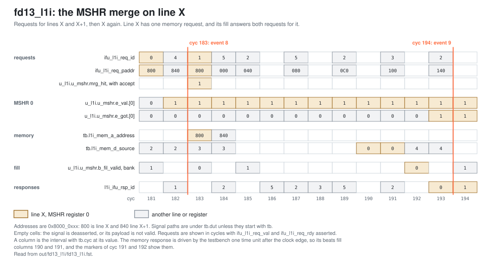

<!-- SPDX-License-Identifier: CC-BY-4.0                        -->
<!-- Copyright (c) 2026 Jeff Nye, uarchlabs.com                -->
<!-- SPDX-FileCopyrightText: 2026 Jeff Nye <jeff@uarchlabs.com> -->
# fd13_l1i: L1I Hit, Miss and MSHR Merge
```
 FILE:    fd13_l1i.md
 SOURCE:  DOC-002, DOC-006, DOC-007
 STATUS:  WORKING
 UPDATED: 2026-11-03
 CONTACT: Jeff Nye
```

## 1. Introduction

`fd13_l1i` (FD-13) shows the three L1I outcomes for a fetch request: 

1. a 2-cycle hit returning a full line
2. a miss with an MSHR fill
3. a second request merged onto a miss already in flight.

The program runs a loop of 8 iterations within one 64-byte cache line, which
produces the hits. After the initial line fill, the loop's fetch requests hit
in the L1I.

The program then calls a function whose entry is in the upper half of a line X,
three times. These calls train the predictors.

A FENCE.I then invalidates all L1I lines, while leaving the predictor state
intact. The program makes a fourth call to the function.

The prediction block at the call target requires lines X and X+1, so the IFU
requests both.  The predicted successor block then requests line X while its
miss is outstanding, and the MSHR merges this request onto the register already
fetching the line.

The result line in the log file reports the hits, misses and merges.

This scenario runs in the 1-prediction slot Pacino configuration,
NUM_PRED_SLOTS=1.

### 1.1 Files

`DEMO=$RVA_ROOT/examples/fe_demo`

  | File               | Path                            |
  |--------------------|---------------------------------|
  | This file          | $DEMO/docs/fd13_l1i.md          |
  | Program (stimulus) | $DEMO/programs/fd13_l1i.svh     |
  | Surfer sucl        | $DEMO/waves/fd13_l1i.sucl       |
  | Log                | $DEMO/out/fd13_l1i/fd13_l1i.log |
  | Waveform           | $DEMO/out/fd13_l1i/fd13_l1i.fst |
  | Waveform (online)  | [Link](https://app.surfer-project.org/?load_url=https%3A%2F%2Fuarchlabs.github.io%2Fpacino-waves%2Ffd13_l1i.fst&startup_commands=run_command_file_from_url%20https%3A%2F%2Fuarchlabs.github.io%2Fpacino-waves%2Ffd13_l1i.sucl) |
  | Block connectivity | [$DEMO/docs/fe_block.svg](fe_block.svg) |
  | Pipeline view      | [$DEMO/docs/fe_pipe.svg](fe_pipe.svg)   |
  | Common description | [$DEMO/docs/demo_explainer.md](demo_explainer.md) |

---

## 2. Run the scenario

Run simulation:
```
make -C examples/fe_demo fd13_l1i
```

View the waveform (runs simulation first if FST is not up to date):
```
make -C examples/fe_demo view S=fd13_l1i
```

Console output:
```
-I: fd13_l1i : PASS : cyc = 214
```

Log file output:
```
-I: fd13_l1i: PASS, L1I hits 48, L1I misses 29, merges 1,
    events checked 11 of 11, cyc 214
```

The testbench monitor, `tb/fe_demo_mon.svh`, supplies the counts in the log
line, while the expected instruction stream has not fully retired. Hits and
misses are bank lookups: a block that needs two lines counts two lookups, a
merged request counts none, and wrong-path requests are counted.

| Item       | Counter       | Counted                                        |
|------------|---------------|------------------------------------------------|
| L1I hits   | `n_l1i_hit`   | `u_l1i.b_rsp_valid[b]`, summed over the banks  |
| L1I misses | `n_l1i_miss`  | `u_l1i.b_mis_valid[b]`, summed over the banks  |
| merges     | `n_l1i_merge` | `u_l1i.u_mshr.accept` and `u_l1i.u_mshr.mrg_hit` |

---

## 3. The program

The program is written by the task `prog_fd13` in `programs/fd13_l1i.svh`. The
code consists of a short prologue, a loop of 8 passes starting at `top`, four
calls to `X30`, and a short epilogue. X is the line at 0x8000_0800 and X+1 the
line at 0x8000_0840.

Each call goes to `X30`, in the upper half of line X. The jump at `X30` + 2
(J:) goes back to the start of line X, and the return (R:) goes back to the
instruction after the call. A FENCE.I and 24 filler instructions precede the
fourth call.

The program runs in machine mode with translation off, so the addresses are
physical. The program starts at the reset vector, `RESET_VECTOR` = 0x8000_0000
(`bp_defines_pkg.sv`).

```
Address      Label  Instruction             Purpose
0x8000_0000         c.addi a0, 1            ; prologue
0x8000_0002         addi   t0, t0, 1        ; prologue

0x8000_0006  top:   c.addi a0, 1            ; loop body
0x8000_0008         addi   t0, t0, 1        ; loop body
0x8000_000C         c.addi a0, 1            ; loop body
0x8000_000E         c.addi a0, 1            ; loop body
0x8000_0010         addi   t0, t0, 1        ; loop body
0x8000_0014         c.addi a0, 1            ; loop body
0x8000_0016  L:     bne    x6, x0, top      ; loop branch, 8 passes

0x8000_001A  C1:    jal    x1, X30          ; first call
0x8000_001E         c.addi a0, 1            ; after the return
0x8000_0020  C2:    jal    x1, X30          ; second call
0x8000_0024         c.addi a0, 1            ; after the return
0x8000_0026  C3:    jal    x1, X30          ; third call
0x8000_002A         c.addi a0, 1            ; after the return

0x8000_002C         fence.i                 ; every L1I line invalid
0x8000_0030         c.addi, addi, ...       ; 24 fillers, to 0x8000_006F
0x8000_0070  C4:    jal    x1, X30          ; fourth call
0x8000_0074         c.addi a0, 1            ; after the return

0x8000_0076         c.addi a0, 1            ; epilogue
0x8000_0078         addi   t0, t0, 1        ; epilogue
0x8000_007C         c.addi a0, 1            ; epilogue
0x8000_007E  hold:  jal    x0, hold         ; termination

0x8000_0800  X:     c.addi a0, 1            ; start of line X
0x8000_0802         addi   t0, t0, 1        ; filler
0x8000_0806  R:     ret                     ; return

0x8000_0830  X30:   c.addi a0, 1            ; upper half of line X
0x8000_0832  J:     jal    x0, X            ; back to the start of line X
```

The loop, from 0x8000_0006 to 0x8000_001A, stays within the line at 0x8000_0000.
A block that starts in the upper half of a line requires that line and the next,
so the block at `X30` requests lines X and X+1.

The FENCE.I invalidates every L1I line, and the predictors keep what the first
three calls trained. The front end fetches ahead of the backend, so the fetch
continues past the FENCE.I before the restart. The 24 fillers, one 64-byte line,
keep that fetch from requesting line X before the fourth call.

With one prediction slot, an FTB entry holds one branch. The accepted p2 slot
groups, by block:

| Block start | Reached by      | Branch | Position | Block end   | Groups |
|-------------|-----------------|--------|----------|-------------|--------|
| 0x8000_0006 | `top`           | L:     | 8        | 0x8000_0026 | 10     |
| 0x8000_0830 | a call          | J:     | 1        | 0x8000_0836 | 4      |
| 0x8000_0800 | J:              | R:     | 3        | 0x8000_080A | 4      |

The `c.addi` and `addi` instructions do no useful work. Their purpose is to mix
16-bit and 32-bit instructions and to separate the branches.

The directions and targets are chosen by the program writer and resolved by the
modeled backend, and the register operands play no part in them.

---

## 4. Walkthrough

The walkthrough follows requests from the IFU through the L1I. Section 4.1
describes a hit, section 4.2 a miss and its fill, and section 4.3 the merge.

Cycle numbers below are events in [section 5](#5-events); each event is a
marker in the waveform. A signal the testbench drives, such as
`tb.l1i_mem_d_valid`, changes one time unit after the clock edge, so the
waveform first shows the new value at the marker of the next cycle.

The waveform group `ifu_l1i` contains the requests and responses, and `l1i` the
bank results, the MSHR registers and the memory port.

### 4.1 L1I hit

The L1I read latency is 2 cycles. A hit produces the response from the bank's
compare stage, carrying the full 64-byte line on `l1i_ifu_rsp_data`.[^1] The
first hit after the cold fills complete is in the loop, at cyc 35 (event 4).

At cyc 35 (event 4), `ifu_l1i_req_val` and `ifu_l1i_req_rdy` are asserted with
`ifu_l1i_req_id` 0 and `ifu_l1i_req_paddr` 0x8000_0000. At cyc 36,
`u_l1i.b_rsp_valid.[0]` is asserted. At cyc 37, `l1i_ifu_rsp_val` is asserted
with `l1i_ifu_rsp_id` 0.

The first hit in the run is earlier, at cyc 26 (event 3), while cold fills are
still in progress.

### 4.2 L1I miss and fill

A miss is reported in the same compare stage, for the MSHR register allocated
when the request was accepted, and the line is fetched through the memory
port.[^2] The first miss is the line at 0x8000_0000.

At cyc 4, the request is accepted with `ifu_l1i_req_id` 0. At cyc 5 (event 1),
`u_l1i.b_mis_valid.[0]` and `u_l1i.u_mshr.e_val.[0]` are asserted. At cyc 6
(event 2), `tb.l1i_mem_a_valid` is asserted with `tb.l1i_mem_a_address`
0x8000_0000 and `tb.l1i_mem_a_source` 0. The memory response beats are at cyc 14
and 15, with `tb.l1i_mem_d_source` 0. At cyc 15, `u_l1i.u_mshr.b_fil_valid.[0]`
writes the line into the array. At cyc 16, `u_l1i.u_mshr.e_got.[0]` and
`l1i_ifu_rsp_val` are asserted with `l1i_ifu_rsp_id` 0.

### 4.3 MSHR merge

After the FENCE.I, the block at `X30` requests lines X and X+1, then the
predicted block at X requests line X again. The IFU reuses a line only when the
block's first line equals the line of the previous request.[^3] The previous
request is X+1, so the block at X issues its own request. A block on the same
line as the previous request never merges, because the IFU reuses that line.

The MSHR finds a valid register for line X whose data has not arrived, and sets
`mrg_hit`. A merged request does not look up the arrays.[^4] Line X therefore
has one memory request, and its fill answers both requests.

At cyc 176 (event 7), the fourth call is found at F3: `u_ftq.w_pd_redir_val` is
asserted with `u_ftq.w_pd_redir_pc` 0x8000_0830.

At cyc 181, `ifu_l1i_req_id` 0 requests 0x8000_0800. At cyc 182, id 4 requests
0x8000_0840. At cyc 183 (event 8), id 1 requests 0x8000_0800, with
`u_l1i.u_mshr.accept` and `u_l1i.u_mshr.mrg_hit` asserted.
`u_l1i.u_mshr.e_val.[0]` is asserted and `u_l1i.u_mshr.e_got.[0]` is deasserted.
`tb.l1i_mem_a_valid` is asserted with address 0x8000_0800 and source 0, the only
memory request for line X after the FENCE.I.

The memory response beats with source 0 are at cyc 191 and 192. At cyc 192,
`u_l1i.u_mshr.b_fil_valid.[0]` writes the line. At cyc 193, `l1i_ifu_rsp_val` is
asserted with `l1i_ifu_rsp_id` 0, and at cyc 194 (event 9) with
`l1i_ifu_rsp_id` 1, the merged request. Line X+1 is answered at cyc 198, with
`l1i_ifu_rsp_id` 4.

The figure below shows these cycles.

[](fd13_merge.svg)

`mrg_hit` is the MSHR's match of the presented request, so it is also asserted
in cycles with no request taken. The merge count therefore also requires
`u_l1i.u_mshr.accept`.

[^1]: `L1iReadLatency`: `rtl/core/frontend/icache/rtl/l1i_pkg.sv:122`.
    `c_hit`, `rsp_valid`: `rtl/core/frontend/icache/rtl/l1i_ctrl.sv:229` and
    `:255`.
[^2]: `c_miss`, `mis_valid`: `rtl/core/frontend/icache/rtl/l1i_ctrl.sv:230` and
    `:238`.
[^3]: `w_reuse0`: `rtl/core/frontend/ifu/rtl/ifu_fetch.sv:289-290`.
[^4]: `e_val && !e_got`: `rtl/core/frontend/icache/rtl/l1i_mshr.sv:232-233`.
    `mrg_hit`: `:256`. `b_req_valid`: `:309-310`.

---

## 5. Events

| #  | cyc | Event                                                                                       | Other                              |
|----|-----|---------------------------------------------------------------------------------------------|------------------------------------|
| 0  | 0   | reset released (`tb.rstn`); the FTQ requests 0x8000_0000 the same cycle                     | fast init                          |
| 1  | 5   | first L1I miss (`b_mis_valid`), the cold line 0x8000_0000                                   | bank 0                             |
| 2  | 6   | first memory request (`tb.l1i_mem_a_valid`), line 0x8000_0000                               | source 0                           |
| 3  | 26  | first L1I hit (`b_rsp_valid`)                                                               | bank 0                             |
| 4  | 35  | the 2-cycle hit: a request for line 0x8000_0000 in the loop, answered at cyc 37             | `ifu_l1i_req_id` 0                 |
| 5  | 151 | the invalidate is done (`l1i_ifu_inv_done`): the FENCE.I has made every line invalid        | FENCE.I at 0x8000_002C             |
| 6  | 154 | the restart after the FENCE.I: a backend redirect to 0x8000_0030, the next instruction      | backend                            |
| 7  | 176 | the fourth call found at F3 after the restart; predecode redirect to 0x8000_0830            | the last such redirect             |
| 8  | 183 | the merge: the predicted block at X requests line X while its miss is in flight (`mrg_hit`) | the only merge; `ifu_l1i_req_id` 1 |
| 9  | 194 | the merged request answered (`l1i_ifu_rsp_id` 1), by the fill of line X                     | one memory request for X           |
| 10 | 214 | the run ends                                                                                |                                    |

---

## 6. Waveform

`make -C examples/fe_demo view S=fd13_l1i` opens
`waves/fd13_l1i.sucl` in Surfer, with a marker at each event above.
Signal paths below are under `tb.dut` unless they start with `tb.`.

| group     | signal                         | description                                       |
|-----------|--------------------------------|---------------------------------------------------|
| clock     | `tb.clk`                       | clock                                             |
|           | `tb.rstn`                      | active low reset                                  |
|           | `tb.cyc`                       | cycle number                                      |
| backend   | `tb.bkend_ftq_redir_val`       | backend redirect                                  |
|           | `tb.bkend_ftq_redir_pc`        | backend redirect PC                               |
| predecode | `u_ftq.w_pd_redir_val`         | predecode redirect                                |
|           | `u_ftq.w_pd_redir_pc`          | predecode redirect target                         |
| ftq_ifu   | `ftq_ifu_req_val`              | FTQ presents a block to the IFU                   |
|           | `ftq_ifu_req_rdy`              | the IFU takes the block                           |
|           | `ftq_ifu_idx`                  | FTQ index of the block                            |
|           | `ftq_ifu_start_pc`             | block start address                               |
|           | `ftq_ifu_next_pc`              | address after the block                           |
|           | `ftq_ifu_taken_val`            | the block holds a predicted-taken transfer        |
|           | `ftq_ifu_taken_pos`            | halfword position of the predicted-taken transfer |
|           | `ftq_ifu_flush_val`            | flush of the blocks younger than the named entry  |
|           | `ftq_ifu_flush_idx`            | FTQ index the flush names                         |
|           | `ftq_ifu_commit_ptr`           | FTQ commit pointer as the IFU sees it             |
| ifu_l1i   | `ifu_l1i_req_val`              | IFU request to the L1I                            |
|           | `ifu_l1i_req_rdy`              | the L1I takes the request                         |
|           | `ifu_l1i_req_id`               | request id                                        |
|           | `ifu_l1i_req_paddr`            | physical address of the requested line            |
|           | `ifu_l1i_req_uncached`         | the request is uncached                           |
|           | `l1i_ifu_rsp_val`              | L1I response                                      |
|           | `l1i_ifu_rsp_id`               | id of the request answered                        |
|           | `l1i_ifu_inv_done`             | the invalidate is done                            |
| l1i       | `u_l1i.b_rsp_valid.[0]`        | L1I hit response, bank 0                          |
|           | `u_l1i.b_rsp_valid.[1]`        | L1I hit response, bank 1                          |
|           | `u_l1i.b_mis_valid.[0]`        | L1I miss, bank 0                                  |
|           | `u_l1i.b_mis_valid.[1]`        | L1I miss, bank 1                                  |
|           | `u_l1i.u_mshr.accept`          | the MSHR accepts the presented request            |
|           | `u_l1i.u_mshr.mrg_hit`         | the presented request matches a fill in flight    |
|           | `u_l1i.u_mshr.e_val.[0]`       | MSHR register 0 valid                             |
|           | `u_l1i.u_mshr.e_val.[1]`       | MSHR register 1 valid                             |
|           | `u_l1i.u_mshr.e_val.[2]`       | MSHR register 2 valid                             |
|           | `u_l1i.u_mshr.e_val.[3]`       | MSHR register 3 valid                             |
|           | `u_l1i.u_mshr.e_got.[0]`       | MSHR register 0 data arrived                      |
|           | `u_l1i.u_mshr.e_got.[1]`       | MSHR register 1 data arrived                      |
|           | `u_l1i.u_mshr.e_got.[2]`       | MSHR register 2 data arrived                      |
|           | `u_l1i.u_mshr.e_got.[3]`       | MSHR register 3 data arrived                      |
|           | `tb.l1i_mem_a_valid`           | L1I request to memory                             |
|           | `tb.l1i_mem_a_address`         | address of the memory request                     |
|           | `tb.l1i_mem_a_source`          | source id of the memory request                   |
|           | `tb.l1i_mem_d_valid`           | memory response beat                              |
|           | `tb.l1i_mem_d_source`          | source id of the memory response                  |
|           | `u_l1i.u_mshr.b_fil_valid.[0]` | fill written into the array, bank 0               |
|           | `u_l1i.u_mshr.b_fil_valid.[1]` | fill written into the array, bank 1               |
