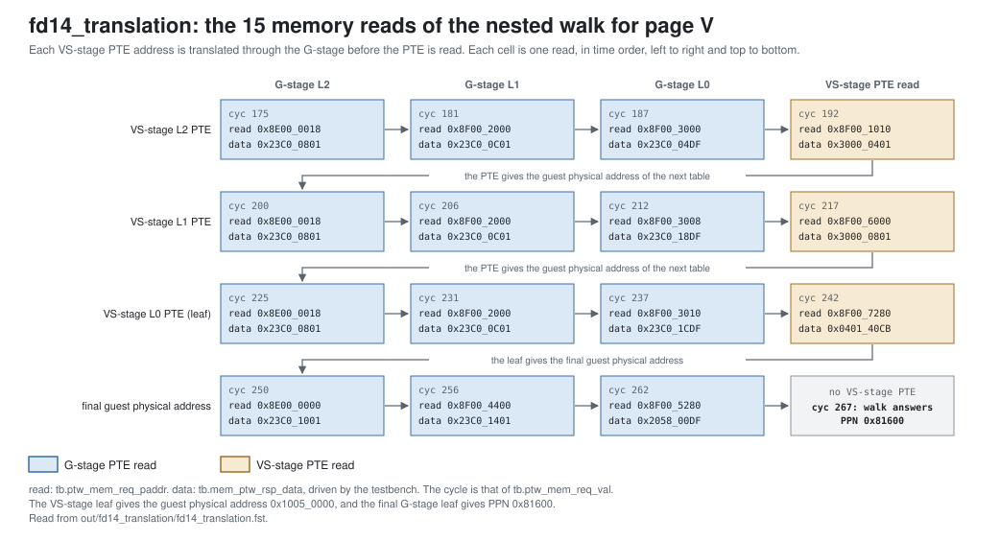

<!-- SPDX-License-Identifier: CC-BY-4.0                        -->
<!-- Copyright (c) 2026 Jeff Nye, uarchlabs.com                -->
<!-- SPDX-FileCopyrightText: 2026 Jeff Nye <jeff@uarchlabs.com> -->
# fd14_translation: Sv39 Walk, Sv39x4 Nested Walk and Svadu CAS
```
 FILE:    fd14_translation.md
 SOURCE:  DOC-002, DOC-006, DOC-007
 STATUS:  WORKING
 UPDATED: 2026-11-03
 CONTACT: Jeff Nye
```

## 1. Introduction

`fd14_translation` (FD-14) demonstrates instruction address translation:

1. an ITLB miss and an Sv39 page table walk
2. a Svadu A-bit update by compare-and-swap
3. a nested Sv39x4 walk, which translates through the VS-stage and the G-stage

The program first executes in supervisor mode under single-stage Sv39
translation[^sv39], with hardware update of the PTE accessed (A) bit enabled.
The leaf PTE of its code page has the A bit clear, so the page table walk sets
the bit by compare-and-swap.

An ecall then transfers execution to a guest under two-stage translation, and
fetches in the guest walk both stages. Section 4 defines the RISC-V terms.

The result line in the log file reports the walks by kind, the G-stage PTE
evaluations and the compare-and-swaps.

This scenario runs in the 1-prediction slot Pacino configuration,
NUM_PRED_SLOTS=1.

### 1.1 Files

`DEMO=$RVA_ROOT/examples/fe_demo`

  | File               | Path                                            |
  |--------------------|-------------------------------------------------|
  | This file          | $DEMO/docs/fd14_translation.md                  |
  | Program (stimulus) | $DEMO/programs/fd14_translation.svh             |
  | Surfer sucl        | $DEMO/waves/fd14_translation.sucl               |
  | Log                | $DEMO/out/fd14_translation/fd14_translation.log |
  | Waveform           | $DEMO/out/fd14_translation/fd14_translation.fst |
  | Waveform (online)  | [Link](https://app.surfer-project.org/?load_url=https%3A%2F%2Fuarchlabs.github.io%2Fpacino-waves%2Ffd14_translation.fst&startup_commands=run_command_file_from_url%20https%3A%2F%2Fuarchlabs.github.io%2Fpacino-waves%2Ffd14_translation.sucl) |
  | Block connectivity | [$DEMO/docs/fe_block.svg](fe_block.svg)         |
  | Pipeline view      | [$DEMO/docs/fe_pipe.svg](fe_pipe.svg)           |
  | Common description | [$DEMO/docs/demo_explainer.md](demo_explainer.md) |

---

## 2. Run the scenario

Run simulation:
```
make -C examples/fe_demo fd14_translation
```

View the waveform (runs simulation first if FST is not up to date):
```
make -C examples/fe_demo view S=fd14_translation
```

Console output:
```
-I: fd14_translation : PASS : cyc = 285
```

Log file output:
```
-I: fd14_translation: PASS, single-stage walks 2, two-stage walks 2,
    G-stage page table entry evaluations 21, compare-and-swaps 1,
    events checked 13 of 13, cyc 285
```

The testbench monitor, `tb/fe_demo_mon.svh`, supplies the counts in the log
line, while the expected instruction stream has not fully retired. Walks are
walker requests taken, and wrong-path walks are counted. The G-stage evaluations
are one per PTE evaluated: 21 = 9 + 12, over the two walks with V=1.

| Item                                | Counter    | Counted                                                       |
|-------------------------------------|------------|---------------------------------------------------------------|
| single-stage walks                  | `n_walk_s` | `itlb_l2t_req_val`, `itlb_l2t_req_rdy` and not `itlb_l2t_v`   |
| two-stage walks                     | `n_walk_g` | `itlb_l2t_req_val`, `itlb_l2t_req_rdy` and `itlb_l2t_v`       |
| G-stage page table entry evaluations | `n_g_eval` | cycles with `u_ptw.r_st` S_G_EVAL                             |
| compare-and-swaps                   | `n_cas`    | `ptw_mem_req_val`, `ptw_mem_req_rdy` and `ptw_mem_req_op`     |

---

## 3. The program

The program is written by the task `prog_fd14` in
`programs/fd14_translation.svh`. The code consists of a short prologue at the
reset vector, a body on page C ending in an ecall, and a body on page V.

The program executes in S-mode under satp Sv39 with ASID 1 and root
0x8F00_0000, with menvcfg.ADUE set. Page V is reached in VS-mode, under vsatp
Sv39 with ASID 1 and hgatp Sv39x4 with VMID 3 and root 0x8E00_0000.

| Page  | Virtual address | Guest physical address | Physical address | Leaf PTE      |
|-------|-----------------|------------------------|------------------|---------------|
| reset | 0x8000_0000     |                        | 0x8000_0000      | flags 0xCB    |
| C     | 0x8001_0000     |                        | 0x8100_0000      | flags 0x8B, A clear |
| V     | 0x8005_0000     | 0x1005_0000            | 0x8160_0000      | VS-stage flags 0xCB |

```
Address      Label  Instruction             Purpose
0x8000_0000         c.addi a0, 1            ; prologue
0x8000_0002         addi   t0, t0, 1        ; prologue
0x8000_0006         c.addi a0, 1            ; prologue
0x8000_0008         jal    x0, C            ; to page C

0x8001_0000  C:     c.addi a0, 1            ; filler
0x8001_0002         addi   t0, t0, 1        ; filler
0x8001_0006         c.addi a0, 1            ; filler
0x8001_0008         c.addi a0, 1            ; filler
0x8001_000A         addi   t0, t0, 1        ; filler
0x8001_000E         c.addi a0, 1            ; filler
0x8001_0010         c.addi a0, 1            ; filler
0x8001_0012         addi   t0, t0, 1        ; filler
0x8001_0016         ecall                   ; to VS-mode at V

0x8005_0000  V:     c.addi a0, 1            ; filler
0x8005_0002         addi   t0, t0, 1        ; filler
0x8005_0006         c.addi a0, 1            ; filler
0x8005_0008         c.addi a0, 1            ; filler
0x8005_000A         addi   t0, t0, 1        ; filler
0x8005_000E         c.addi a0, 1            ; filler
0x8005_0010         c.addi a0, 1            ; filler
0x8005_0012         addi   t0, t0, 1        ; filler
0x8005_0016  hold:  jal    x0, hold         ; termination
```

The change of privilege is applied by the testbench. When the ecall retires, the
testbench sets V=1, privilege S, vsatp and hgatp, in place of the trap to M-mode
and the return to VS-mode that software would execute.[^1] The backend's trap
redirect then fetches V.

The `c.addi` and `addi` instructions do no useful work. Their purpose is to mix
16-bit and 32-bit instructions and to separate the control transfers.

The run has no accepted p2 slot groups, because no block repeats and the FTB
therefore never hits.

---

## 4. Walkthrough

The walkthrough follows the translation of each code page. Section 4.1 describes
an ITLB miss and a single-stage walk, section 4.2 the Svadu A-bit update, and
section 4.3 the nested walk.

The RISC-V terms used below are as follows. Sv39 is the 3-level page table
format with 39-bit virtual addresses, rooted at the CSR satp. Under the
hypervisor extension, V=1 selects guest execution: VS-mode is the guest's
supervisor mode, the VS-stage is the guest's translation, under the CSR vsatp,
and the G-stage is the hypervisor's second-level translation, under the CSR
hgatp. Sv39x4 is the G-stage format for Sv39 guests, with 41-bit guest physical
addresses and a 16 KiB root table. Svadu is the extension under which hardware
updates a PTE's accessed (A) and dirty (D) bits. menvcfg.ADUE enables it for
single-stage and G-stage translation. Without it, a clear A bit raises a page
fault for software to handle (Svade).

Cycle numbers below are events in [section 5](#5-events); each event is a marker
in the waveform. A signal the testbench drives, such as `tb.mem_ptw_rsp_val`,
changes one time unit after the clock edge, so the waveform first shows the new
value at the marker of the next cycle.

The waveform group `itlb` contains the IFU lookups, `walker` the ITLB requests,
`tb.u_ptw.r_st` and the responses, and `walker_mem` the walker's memory port.

### 4.1 ITLB miss and single-stage walk

The first fetch misses the ITLB at cyc 3 (event 1), and the ITLB requests a walk
with V=0 at cyc 4 (event 2). The walker reads three PTEs from the root
0x8F00_0000, and the ITLB then answers the lookup with a hit.

At cyc 3 (event 1), `itlb_ifu_rsp_val` is asserted with `itlb_ifu_status` 1 for
`ifu_itlb_vpn` 0x80000. At cyc 4 (event 2), `tb.itlb_l2t_req_val` and
`tb.itlb_l2t_req_rdy` are asserted with `tb.itlb_l2t_vpn` 0x80000 and
`tb.itlb_l2t_v` 0. `tb.ptw_mem_req_paddr` is 0x8F00_0010 at cyc 7, 0x8F00_8000
at cyc 13 and 0x8F00_9000 at cyc 19. At cyc 25, `tb.l2t_itlb_rsp_val` is
asserted with `tb.l2t_itlb_status` 0 and `tb.l2t_itlb_ppn` 0x80000. At cyc 26,
`itlb_ifu_status` is 0 with `itlb_ifu_ppn` 0x80000.

### 4.2 Svadu A-bit update

The walk for page C starts at cyc 46 (event 3). The leaf PTE of page C is valid
and permitted, with A clear. With ADUE set, the walker's leaf evaluation
requests an update instead of raising a page fault.[^2] In a single-stage walk,
the update issues one compare-and-swap, at cyc 67 (event 4), whose compare value
is the PTE read and whose swap value is the PTE with A set.[^3] The walk answers
at cyc 73 (event 5).

At cyc 46 (event 3), the walk starts with `tb.itlb_l2t_vpn` 0x80010 and
`tb.itlb_l2t_v` 0. At cyc 61, the walker reads the leaf at 0x8F00_9080. At cyc
67 (event 4), `tb.ptw_mem_req_op` is 1, with `tb.ptw_mem_req_paddr` 0x8F00_9080,
`tb.ptw_mem_req_cmp` 0x2040_008B and `tb.ptw_mem_req_swap` 0x2040_00CB. The two
values differ in bit 6, the A bit. At cyc 73 (event 5), `tb.l2t_itlb_rsp_val` is
asserted with `tb.l2t_itlb_status` 0 and `tb.l2t_itlb_ppn` 0x81000.

### 4.3 Nested walk

With V=1 and hgatp not Bare, the walker enables the G-stage.[^4] Every VS-stage
PTE address is a guest physical address, translated through the G-stage before
the PTE is read, and the final guest physical address is translated the same
way.

The walk for page V, which starts at cyc 170 (event 9), therefore makes 15
memory reads: three VS-stage PTEs, each preceded by a 3-level G-stage
translation of its address, and a 3-level G-stage translation of the final guest
physical address. The VS-stage leaf is read at cyc 246 (event 10), and the walk
answers at cyc 267 (event 11). The figure below shows the reads.

[](fd14_nested_walk.svg)

The run has two walks with V=1. The first, at cyc 91 (event 6), is on the wrong
path. The fetch has continued past the ecall, and when the ecall retires, a
younger fetch on page C is translated with V=1. The backend's trap redirect at
cyc 92 (event 7) flushes the block. Page C is not mapped in the VS-stage, so
that walk ends with a fault at cyc 168 (event 8) that nothing delivers.[^5] This
walk occupies the walker until then, so the walk for page V starts at cyc 170
(event 9). The first walk has 9 G-stage evaluations and the second has 12.

At cyc 91 (event 6), `tb.itlb_l2t_req_val` and `tb.itlb_l2t_req_rdy` are
asserted with `tb.itlb_l2t_vpn` 0x80010 and `tb.itlb_l2t_v` 1. At cyc 92
(event 7), `tb.bkend_ftq_redir_val` is asserted with `tb.bkend_ftq_redir_pc`
0x8005_0000. At cyc 168 (event 8), `tb.l2t_itlb_rsp_val` is asserted with
`tb.l2t_itlb_status` 1 and `tb.l2t_itlb_cause` 12.

At cyc 170 (event 9), the walk for page V starts with `tb.itlb_l2t_vpn` 0x80050
and `tb.itlb_l2t_v` 1, and `tb.u_ptw.r_g_on` is 1. At cyc 246 (event 10),
`tb.mem_ptw_rsp_val` is asserted with `tb.mem_ptw_rsp_data` 0x0401_40CB: the
VS-stage leaf, giving the guest physical address 0x1005_0000. At cyc 267
(event 11), `tb.l2t_itlb_rsp_val` is asserted with `tb.l2t_itlb_status` 0 and
`tb.l2t_itlb_ppn` 0x81600.

[^sv39]: Sv39 is RISC-V's page-based virtual memory scheme with 39-bit virtual
    addresses. The fields of a virtual address are as shown:

    | Bits  | Field  | Use                                 |
    |-------|--------|-------------------------------------|
    | 38:30 | VPN[2] | index into the top-level page table |
    | 29:21 | VPN[1] | index into the second-level table   |
    | 20:12 | VPN[0] | index into the third-level table    |
    | 11:0  | offset | byte within the 4 KiB page          |

    Each table holds 512 entries of 8 bytes. A walk reads up to three PTEs,
    starting from the root held in the CSR `satp`, and the final PTE gives the
    physical page number. A PTE can also be a leaf at a higher level, giving a
    2 MiB or 1 GiB superpage.

[^1]: `ecall_to_vs`: `examples/fe_demo/tb/fe_demo_lib.svh:151-154`.
    `be_trap_hook`: `examples/fe_demo/tb/fe_demo_mon.svh:336-345`.
[^2]: `ws_upd`: `rtl/mmu/ptw/rtl/ptw.sv:535-537`. `r_s_adue`, which is menvcfg's
    for V=0: `:754-756`.
[^3]: `S_S_UPD`: `rtl/mmu/ptw/rtl/ptw.sv:940-955`.
[^4]: `r_g_on`: `rtl/mmu/ptw/rtl/ptw.sv:752`. The walker states: `:289-301`.
[^5]: `ST_FAULT`: `rtl/mmu/ptw/rtl/ptw.sv:226`.

---

## 5. Events

| #  | cyc | Event                                                                                  | Other                 |
|----|-----|----------------------------------------------------------------------------------------|-----------------------|
| 0  | 0   | reset released (`tb.rstn`); the FTQ requests 0x8000_0000 the same cycle                | S-mode, Sv39          |
| 1  | 3   | first ITLB miss (`itlb_ifu_status` 1): VPN 0x80000, the reset page                     | lookup at cyc 2       |
| 2  | 4   | first walk: VPN 0x80000, the reset page, single-stage (`itlb_l2t_v` 0)                 | three PTE reads       |
| 3  | 46  | walk for C: VPN 0x80010, single-stage                                                  | leaf with A clear     |
| 4  | 67  | the CAS: the walker sets the A bit of C's leaf (`ptw_mem_req_op` 1)                    | paddr 0x8F00_9080     |
| 5  | 73  | the walk for C answers PPN 0x81000                                                     | status 0, hit         |
| 6  | 91  | first nested walk: VPN 0x80010 with `itlb_l2t_v` 1, for a fetch younger than the ecall | wrong path            |
| 7  | 92  | the ecall's trap redirect to V, 0x8005_0000                                            | backend               |
| 8  | 168 | the nested walk for C ends with a fault, cause 12; nothing delivers it                 | status 1              |
| 9  | 170 | walk for V: VPN 0x80050, nested                                                        | 15 memory reads       |
| 10 | 246 | the VS-stage leaf for V read (`mem_ptw_rsp_data`): guest physical address 0x1005_0000  | G-stage translation next |
| 11 | 267 | the walk for V answers PPN 0x81600                                                     | status 0, hit         |
| 12 | 285 | the run ends                                                                           |                       |

---

## 6. Waveform

`make -C examples/fe_demo view S=fd14_translation` opens
`waves/fd14_translation.sucl` in Surfer, with a marker at each event above.
Signal paths below are under `tb.dut` unless they start with `tb.`.

| group      | signal                    | description                                           |
|------------|---------------------------|-------------------------------------------------------|
| clock      | `tb.clk`                  | clock                                                 |
|            | `tb.rstn`                 | active low reset                                      |
|            | `tb.cyc`                  | cycle number                                          |
| backend    | `tb.bkend_ftq_redir_val`  | backend redirect                                      |
|            | `tb.bkend_ftq_redir_pc`   | backend redirect PC                                   |
| ifu_xlate  | `u_ifu.u_xlate.xq_val`    | translation queue head valid                          |
|            | `u_ifu.u_xlate.xq_pop`    | translation queue pop                                 |
|            | `u_ifu.u_xlate.xq_idx`    | FTQ index of the queue entry                          |
|            | `u_ifu.u_xlate.xq_pc`     | block start address of the queue entry                |
|            | `u_ifu.u_xlate.xq_cross`  | the block crosses a page                              |
|            | `u_ifu.u_xlate.xq_ppn0`   | physical page number of the first page                |
|            | `u_ifu.u_xlate.xq_ppn1`   | physical page number of the second page               |
|            | `u_ifu.u_xlate.xq_fault0` | the first page faulted                                |
|            | `u_ifu.u_xlate.xq_fault1` | the second page faulted                               |
|            | `u_ifu.u_xlate.xq_uc`     | the page is uncached                                  |
| itlb       | `ifu_itlb_req_val`        | IFU lookup in the ITLB                                |
|            | `ifu_itlb_req_rdy`        | the ITLB takes the lookup                             |
|            | `ifu_itlb_vpn`            | virtual page number of the lookup                     |
|            | `itlb_ifu_rsp_val`        | ITLB response                                         |
|            | `itlb_ifu_status`         | ITLB status: 0 hit, 1 miss, 2 fault, 3 reserved       |
|            | `itlb_ifu_ppn`            | physical page number of the response                  |
|            | `itlb_ifu_cause`          | fault cause: 1 access, 12 page, 20 guest-page         |
| walker     | `tb.itlb_l2t_req_val`     | ITLB request to the walker                            |
|            | `tb.itlb_l2t_req_rdy`     | the walker takes the request                          |
|            | `tb.itlb_l2t_vpn`         | virtual page number of the walk                       |
|            | `tb.itlb_l2t_v`           | the walk is for V=1, two-stage when hgatp is not Bare |
|            | `tb.itlb_l2t_priv`        | privilege of the walk: 0 U, 1 S                       |
|            | `tb.u_ptw.r_st`           | walker state                                          |
|            | `tb.u_ptw.r_g_on`         | G-stage enabled for the walk                          |
|            | `tb.l2t_itlb_rsp_val`     | walker response                                       |
|            | `tb.l2t_itlb_status`      | walker status: 0 hit, 1 fault, 2 retry, 3 reserved    |
|            | `tb.l2t_itlb_ppn`         | physical page number of the walk                      |
|            | `tb.l2t_itlb_cause`       | fault cause: 1 access, 12 page, 20 guest-page         |
| walker_mem | `tb.ptw_mem_req_val`      | walker memory request                                 |
|            | `tb.ptw_mem_req_rdy`      | memory takes the request                              |
|            | `tb.ptw_mem_req_op`       | 1 for a compare-and-swap                              |
|            | `tb.ptw_mem_req_paddr`    | physical address of the request                       |
|            | `tb.ptw_mem_req_cmp`      | compare value of a compare-and-swap                   |
|            | `tb.ptw_mem_req_swap`     | swap value of a compare-and-swap                      |
|            | `tb.mem_ptw_rsp_val`      | memory response to the walker                         |
|            | `tb.mem_ptw_rsp_data`     | data of the response                                  |
