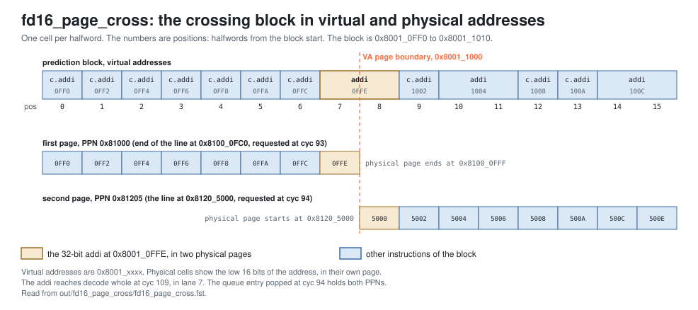

<!-- SPDX-License-Identifier: CC-BY-4.0                        -->
<!-- Copyright (c) 2026 Jeff Nye, uarchlabs.com                -->
<!-- SPDX-FileCopyrightText: 2026 Jeff Nye <jeff@uarchlabs.com> -->
# fd16_page_cross: A Prediction Block Crossing a Page
```
 FILE:    fd16_page_cross.md
 SOURCE:  DOC-002, DOC-006, DOC-007
 STATUS:  WORKING
 UPDATED: 2026-11-03
 CONTACT: Jeff Nye
```

## 1. Introduction

`fd16_page_cross` (FD-16) demonstrates a prediction block that crosses a 4 KiB
page boundary:

1. the block is translated twice, once for each page
2. the IFU requests one L1I line from each of two non-adjacent physical pages
3. a 32-bit instruction straddling the boundary reaches decode whole

The program jumps to an address 16 bytes before the end of a page whose virtual
successor is mapped to a non-adjacent physical page. The prediction block that
starts there covers both pages.

The result line in the log file reports the number of blocks translated twice.

This scenario runs in the 1-prediction slot Pacino configuration,
NUM_PRED_SLOTS=1.

### 1.1 Files

`DEMO=$RVA_ROOT/examples/fe_demo`

  | File               | Path                                          |
  |--------------------|-----------------------------------------------|
  | This file          | $DEMO/docs/fd16_page_cross.md                 |
  | Program (stimulus) | $DEMO/programs/fd16_page_cross.svh            |
  | Surfer sucl        | $DEMO/waves/fd16_page_cross.sucl              |
  | Log                | $DEMO/out/fd16_page_cross/fd16_page_cross.log |
  | Waveform           | $DEMO/out/fd16_page_cross/fd16_page_cross.fst |
  | Waveform (online)  | [Link](https://app.surfer-project.org/?load_url=https%3A%2F%2Fuarchlabs.github.io%2Fpacino-waves%2Ffd16_page_cross.fst&startup_commands=run_command_file_from_url%20https%3A%2F%2Fuarchlabs.github.io%2Fpacino-waves%2Ffd16_page_cross.sucl) |
  | Block connectivity | [$DEMO/docs/fe_block.svg](fe_block.svg)       |
  | Pipeline view      | [$DEMO/docs/fe_pipe.svg](fe_pipe.svg)         |
  | Common description | [$DEMO/docs/demo_explainer.md](demo_explainer.md) |

---

## 2. Run the scenario

Run simulation:
```
make -C examples/fe_demo fd16_page_cross
```

View the waveform (runs simulation first if FST is not up to date):
```
make -C examples/fe_demo view S=fd16_page_cross
```

Console output:
```
-I: fd16_page_cross : PASS : cyc = 112
```

Log file output:
```
-I: fd16_page_cross: PASS, blocks translated twice 1, events checked 8 of 8,
    cyc 112
```

The testbench monitor, `tb/fe_demo_mon.svh`, supplies the count in the log line,
while the expected instruction stream has not fully retired. The program has one
crossing block, with PPNs 0x81000 and 0x81205.

| Item                   | Counter      | Counted                                                                                    |
|------------------------|--------------|--------------------------------------------------------------------------------------------|
| blocks translated twice | `n_xq_cross` | `u_ifu.u_xlate.xq_val`, `xq_pop` and `xq_cross`, with `xq_ppn0` not equal to `xq_ppn1`     |

---

## 3. The program

The program is written by the task `prog_fd16` in
`programs/fd16_page_cross.svh`.

The code consists of a short prologue at the reset vector, a jump to 16 bytes
before the end of page B, seven 16-bit instructions, a 32-bit instruction that
straddles the page boundary, and a short epilogue.

The program runs in S-mode under satp Sv39. The two pages of the crossing block
are adjacent in virtual addresses but not in physical addresses.

| Page   | Virtual address | Physical address |
|--------|-----------------|------------------|
| reset  | 0x8000_0000     | 0x8000_0000      |
| B      | 0x8001_0000     | 0x8100_0000      |
| B+1    | 0x8001_1000     | 0x8120_5000      |

```
Address      Label  Instruction             Purpose
0x8000_0000         c.addi a0, 1            ; prologue
0x8000_0002         addi   t0, t0, 1        ; prologue
0x8000_0006         c.addi a0, 1            ; prologue
0x8000_0008         jal    x0, S            ; to the crossing block

0x8001_0FF0  S:     c.addi a0, 1            ; 16 bytes before the page end
0x8001_0FF2         c.addi a0, 1            ; filler
0x8001_0FF4         c.addi a0, 1            ; filler
0x8001_0FF6         c.addi a0, 1            ; filler
0x8001_0FF8         c.addi a0, 1            ; filler
0x8001_0FFA         c.addi a0, 1            ; filler
0x8001_0FFC         c.addi a0, 1            ; filler
0x8001_0FFE  X:     addi   t0, t0, 1        ; straddles the page boundary

0x8001_1002         c.addi a0, 1            ; epilogue
0x8001_1004         addi   t0, t0, 1        ; epilogue
0x8001_1008         c.addi a0, 1            ; epilogue
0x8001_100A         c.addi a0, 1            ; epilogue
0x8001_100C         addi   t0, t0, 1        ; epilogue
0x8001_1010         c.addi a0, 1            ; epilogue
0x8001_1012         c.addi a0, 1            ; epilogue
0x8001_1014         addi   t0, t0, 1        ; epilogue
0x8001_1018  hold:  jal    x0, hold         ; termination
```

The two halfwords of the instruction at X are in different physical pages, at
0x8100_0FFE and 0x8120_5000.

The `c.addi` and `addi` instructions do no useful work, other than the
instruction at X. Their purpose is to mix 16-bit and 32-bit instructions and to
place X on the page boundary.

The run has no accepted p2 slot groups, because no block repeats and the FTB
therefore never hits.

---

## 4. Walkthrough

The walkthrough follows the crossing block. Section 4.1 describes its two
translations, section 4.2 its two line requests, and section 4.3 the instruction
that straddles the boundary.
[fd14_translation](fd14_translation.md#4-walkthrough) section 4 defines the
RISC-V translation terms.

Cycle numbers below are events in [section 5](#5-events); each event is a marker
in the waveform.

The waveform group `ifu_xlate` contains the translation queue, `itlb` the
lookups, `ifu_l1i` the line requests, and `decode` lanes 0 and 7 at decode.

The figure below shows the block's layout.

[](fd16_blocks.svg)

### 4.1 Two translations

`ifu_xlate` marks a block as crossing when its start address has a page offset
of at least 0xFE0, 32 bytes from the end of the page, and then requires two
lookups.[^1] The block at 0x8001_0FF0 has page offset 0xFF0. Both lookups miss
the ITLB, so each page is walked, from cyc 46 (event 1) and cyc 70 (event 2).
The queue entry holds both results.

At cyc 46 (event 1), `tb.itlb_l2t_req_val` and `tb.itlb_l2t_req_rdy` are
asserted with `tb.itlb_l2t_vpn` 0x80010, and the walk answers `tb.l2t_itlb_ppn`
0x81000 at cyc 67. At cyc 70 (event 2), `tb.itlb_l2t_vpn` is 0x80011, and the
walk answers `tb.l2t_itlb_ppn` 0x81205 at cyc 91.

At cyc 94 (event 4), `u_ifu.u_xlate.xq_val` and `u_ifu.u_xlate.xq_pop` are
asserted with `u_ifu.u_xlate.xq_pc` 0x8001_0FF0, `u_ifu.u_xlate.xq_cross` 1,
`u_ifu.u_xlate.xq_ppn0` 0x81000 and `u_ifu.u_xlate.xq_ppn1` 0x81205.

### 4.2 Two line requests

A block that starts in the upper half of a line requires a second line. For a
crossing block, that line is the first line of the second page.[^2]

At cyc 93 (event 3), `ifu_l1i_req_val` and `ifu_l1i_req_rdy` are asserted with
`ifu_l1i_req_paddr` 0x8100_0FC0. At cyc 94 (event 4), `ifu_l1i_req_paddr` is
0x8120_5000.

### 4.3 The straddling instruction

The instruction at X has its first halfword in the first line and its second
halfword in the second line. Both lines miss in the L1I, so it cannot be
assembled until the second line returns, at cyc 107 (event 5). Decode receives
it whole at cyc 109 (event 6), as the last of the eight instructions of that
bundle.

At cyc 105, `l1i_ifu_rsp_val` is asserted with `l1i_ifu_rsp_id` 0, the first
line. At cyc 107 (event 5), `l1i_ifu_rsp_val` is asserted with `l1i_ifu_rsp_id`
1, the second line.

At cyc 109 (event 6), `tb.pd_out.[7].valid` is asserted with
`tb.pd_out.[7].start_pc` 0x8001_0FFE, `tb.pd_out.[7].pos` 7,
`tb.pd_out.[7].instr` 0x0012_8293 and `tb.pd_out.[7].is_rvc` 0. At cyc 110,
`tb.pd_out.[0].start_pc` is 0x8001_1002, the next instruction.

[^1]: `CROSS_FROM`: `rtl/core/frontend/ifu/rtl/ifu_xlate.sv:144`.
    `w_new_cross`: `:281`. `r_need`: `:407`. The queue entry: `:306-308`.
[^2]: `w_line1`: `rtl/core/frontend/ifu/rtl/ifu_fetch.sv:283-284`.

---

## 5. Events

| # | cyc | Event                                                                                                                                                    | Other             |
|---|-----|----------------------------------------------------------------------------------------------------------------------------------------------------------|-------------------|
| 0 | 0   | reset released (`tb.rstn`); the FTQ requests 0x8000_0000 the same cycle                                                                                  | S-mode, Sv39      |
| 1 | 46  | walk for VPN 0x80010, the first page of the crossing block                                                                                               | answers at cyc 67 |
| 2 | 70  | walk for VPN 0x80011, the second page                                                                                                                    | answers at cyc 91 |
| 3 | 93  | L1I request for 0x8100_0FC0, the line of the block's start                                                                                               | first page        |
| 4 | 94  | the translation queue entry of the block at 0x8001_0FF0 popped with two translations: `xq_cross` 1, PPN 0x81000 and 0x81205; L1I request for 0x8120_5000 | second page       |
| 5 | 107 | the second line returns (`l1i_ifu_rsp_id` 1), from 0x8120_5000                                                                                           | first at cyc 105  |
| 6 | 109 | the straddling instruction reaches decode: lane 7 at 0x8001_0FFE, a whole 32-bit addi                                                                    | `tb.pd_out.[7]`   |
| 7 | 112 | the run ends                                                                                                                                             |                   |

---

## 6. Waveform

`make -C examples/fe_demo view S=fd16_page_cross` opens
`waves/fd16_page_cross.sucl` in Surfer, with a marker at each event above.
Signal paths below are under `tb.dut` unless they start with `tb.`.

| group     | signal                      | description                                       |
|-----------|-----------------------------|---------------------------------------------------|
| clock     | `tb.clk`                    | clock                                             |
|           | `tb.rstn`                   | active low reset                                  |
|           | `tb.cyc`                    | cycle number                                      |
| ftq_ifu   | `ftq_ifu_req_val`           | FTQ presents a block to the IFU                   |
|           | `ftq_ifu_req_rdy`           | the IFU takes the block                           |
|           | `ftq_ifu_idx`               | FTQ index of the block                            |
|           | `ftq_ifu_start_pc`          | block start address                               |
|           | `ftq_ifu_next_pc`           | address after the block                           |
|           | `ftq_ifu_taken_val`         | the block holds a predicted-taken transfer        |
|           | `ftq_ifu_taken_pos`         | halfword position of the predicted-taken transfer |
|           | `ftq_ifu_flush_val`         | flush of the blocks younger than the named entry  |
|           | `ftq_ifu_flush_idx`         | FTQ index the flush names                         |
|           | `ftq_ifu_commit_ptr`        | FTQ commit pointer as the IFU sees it             |
| ifu_xlate | `u_ifu.u_xlate.xq_val`      | translation queue head valid                      |
|           | `u_ifu.u_xlate.xq_pop`      | translation queue pop                             |
|           | `u_ifu.u_xlate.xq_idx`      | FTQ index of the queue entry                      |
|           | `u_ifu.u_xlate.xq_pc`       | block start address of the queue entry            |
|           | `u_ifu.u_xlate.xq_cross`    | the block crosses a page                          |
|           | `u_ifu.u_xlate.xq_ppn0`     | physical page number of the first page            |
|           | `u_ifu.u_xlate.xq_ppn1`     | physical page number of the second page           |
|           | `u_ifu.u_xlate.xq_fault0`   | fault of the first page                           |
|           | `u_ifu.u_xlate.xq_fault1`   | fault of the second page                          |
|           | `u_ifu.u_xlate.xq_uc`       | the page is uncached                              |
| itlb      | `ifu_itlb_req_val`          | IFU lookup in the ITLB                            |
|           | `ifu_itlb_req_rdy`          | the ITLB takes the lookup                         |
|           | `ifu_itlb_vpn`              | virtual page number of the lookup                 |
|           | `itlb_ifu_rsp_val`          | ITLB response                                     |
|           | `itlb_ifu_status`           | ITLB status: 0 hit, 1 miss, 2 fault, 3 reserved   |
|           | `itlb_ifu_ppn`              | physical page number of the response              |
|           | `itlb_ifu_cause`            | fault cause: 1 access, 12 page, 20 guest-page     |
| ifu_l1i   | `ifu_l1i_req_val`           | IFU request to the L1I                            |
|           | `ifu_l1i_req_rdy`           | the L1I takes the request                         |
|           | `ifu_l1i_req_id`            | request id                                        |
|           | `ifu_l1i_req_paddr`         | physical address of the requested line            |
|           | `ifu_l1i_req_uncached`      | the request is uncached                           |
|           | `l1i_ifu_rsp_val`           | L1I response                                      |
|           | `l1i_ifu_rsp_id`            | id of the request answered                        |
| decode    | `tb.dec_ibuf_rdy`           | the backend model takes the bundle                |
|           | `tb.pd_out.[0].valid`       | lane 0 valid                                      |
|           | `tb.pd_out.[0].start_pc`    | lane 0 instruction address                        |
|           | `tb.pd_out.[0].ftq_idx`     | lane 0 FTQ index                                  |
|           | `tb.pd_out.[0].pos`         | lane 0 halfword position in the fetch block       |
|           | `tb.pd_out.[0].instr`       | lane 0 instruction, expanded if compressed        |
|           | `tb.pd_out.[0].is_rvc`      | lane 0 instruction is 16-bit                      |
|           | `tb.pd_out.[0].fault_cause` | lane 0 fetch fault cause                          |
|           | `tb.pd_out.[0].fault_va`    | lane 0 fetch fault virtual address                |
|           | `tb.pd_out.[7].valid`       | lane 7 valid                                      |
|           | `tb.pd_out.[7].start_pc`    | lane 7 instruction address                        |
|           | `tb.pd_out.[7].pos`         | lane 7 halfword position in the fetch block       |
|           | `tb.pd_out.[7].instr`       | lane 7 instruction, expanded if compressed        |
|           | `tb.pd_out.[7].is_rvc`      | lane 7 instruction is 16-bit                      |
