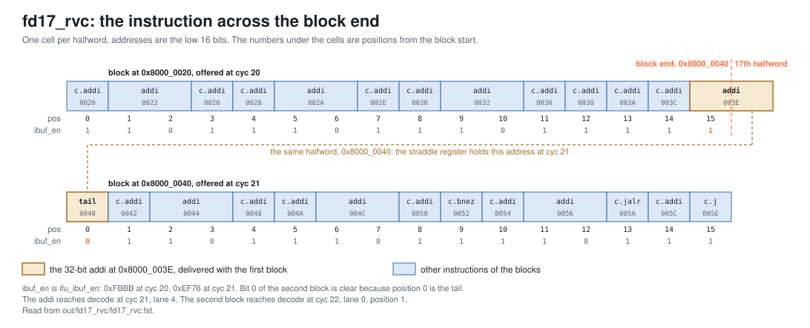

<!-- SPDX-License-Identifier: CC-BY-4.0                        -->
<!-- Copyright (c) 2026 Jeff Nye, uarchlabs.com                -->
<!-- SPDX-FileCopyrightText: 2026 Jeff Nye <jeff@uarchlabs.com> -->
# fd17_rvc: Compressed and Unaligned Code
```
 FILE:    fd17_rvc.md
 SOURCE:  DOC-002, DOC-006, DOC-007
 STATUS:  WORKING
 UPDATED: 2026-11-04
 CONTACT: Jeff Nye
```

## 1. Introduction

`fd17_rvc` (FD-17) demonstrates compressed and non-aligned code:

1. a 32-bit instruction at the last halfword of a block reaches decode whole
2. the next block starts on the tail of that instruction
3. compressed control transfers reach decode expanded, and the blocks they start
   are not 32-byte aligned

The program runs mixed 16-bit and 32-bit instructions into the straddling
instruction, then eight passes of a loop of compressed control transfers.

The result line in the log file reports the number of straddling instructions
delivered whole and the number of 16-bit instructions.

This scenario runs in the 1-prediction slot Pacino configuration,
NUM_PRED_SLOTS=1.

### 1.1 Files

`DEMO=$RVA_ROOT/examples/fe_demo`

  | File               | Path                                          |
  |--------------------|-----------------------------------------------|
  | This file          | $DEMO/docs/fd17_rvc.md                        |
  | Program (stimulus) | $DEMO/programs/fd17_rvc.svh                   |
  | Surfer sucl        | $DEMO/waves/fd17_rvc.sucl                     |
  | Log                | $DEMO/out/fd17_rvc/fd17_rvc.log               |
  | Waveform           | $DEMO/out/fd17_rvc/fd17_rvc.fst               |
  | Waveform (online)  | [Link](https://app.surfer-project.org/?load_url=https%3A%2F%2Fuarchlabs.github.io%2Fpacino-waves%2Ffd17_rvc.fst&startup_commands=run_command_file_from_url%20https%3A%2F%2Fuarchlabs.github.io%2Fpacino-waves%2Ffd17_rvc.sucl) |
  | Block connectivity | [$DEMO/docs/fe_block.svg](fe_block.svg)       |
  | Pipeline view      | [$DEMO/docs/fe_pipe.svg](fe_pipe.svg)         |
  | Common description | [$DEMO/docs/demo_explainer.md](demo_explainer.md) |

---

## 2. Run the scenario

Run simulation:
```
make -C examples/fe_demo fd17_rvc
```

View the waveform (runs simulation first if FST is not up to date):
```
make -C examples/fe_demo view S=fd17_rvc
```

Console output:
```
-I: fd17_rvc : PASS : cyc = 198
```

Log file output:
```
-I: fd17_rvc: PASS, straddling 32-bit instructions delivered whole 1,
    16-bit instructions 98, events checked 9 of 9, cyc 198
```

The testbench monitor, `tb/fe_demo_mon.svh`, supplies the counts in the log line
as each expected instruction retires. The program has one straddling
instruction. Of the 16-bit instructions, 22 are outside the loop and 76 are in
it: nine on each of the eight passes, and one more on each even pass.

| Item                                     | Counter      | Counted                                                                                     |
|------------------------------------------|--------------|---------------------------------------------------------------------------------------------|
| straddling 32-bit instructions delivered | `n_straddle` | no fault, `is_rvc` 0, `pos` 15, and `instr` equal to the expected encoding, at retirement   |
| 16-bit instructions                      | `n_rvc`      | no fault, `is_rvc` 1, at retirement                                                         |

---

## 3. The program

The program is written by the task `prog_fd17` in `programs/fd17_rvc.svh`.

The code consists of mixed 16-bit and 32-bit instructions that place a 32-bit
instruction at the last halfword of the block at 0x8000_0020, a loop of eight
passes, a function called from the loop, and a short epilogue.

The program runs in M-mode with bare addressing.

```
Address      Label  Instruction             Purpose
0x8000_0000         c.addi a0, 1            ; mixed code
0x8000_0002         addi   t0, t0, 1        ; mixed code
0x8000_0006         c.addi a0, 1            ; mixed code
0x8000_0008         c.addi a0, 1            ; mixed code
0x8000_000A         addi   t0, t0, 1        ; mixed code
0x8000_000E         c.addi a0, 1            ; mixed code
0x8000_0010         c.addi a0, 1            ; mixed code
0x8000_0012         addi   t0, t0, 1        ; mixed code
0x8000_0016         c.addi a0, 1            ; mixed code
0x8000_0018         c.addi a0, 1            ; mixed code
0x8000_001A         addi   t0, t0, 1        ; mixed code
0x8000_001E         c.addi a0, 1            ; mixed code
0x8000_0020         c.addi a0, 1            ; mixed code
0x8000_0022         addi   t0, t0, 1        ; mixed code
0x8000_0026         c.addi a0, 1            ; mixed code
0x8000_0028         c.addi a0, 1            ; mixed code
0x8000_002A         addi   t0, t0, 1        ; mixed code
0x8000_002E         c.addi a0, 1            ; mixed code
0x8000_0030         c.addi a0, 1            ; mixed code
0x8000_0032         addi   t0, t0, 1        ; mixed code
0x8000_0036         c.addi a0, 1            ; filler
0x8000_0038         c.addi a0, 1            ; filler
0x8000_003A         c.addi a0, 1            ; filler
0x8000_003C         c.addi a0, 1            ; filler
0x8000_003E  X:     addi   t0, t0, 1        ; straddles the block end

0x8000_0042         c.addi a0, 1            ; mixed code
0x8000_0044         addi   t0, t0, 1        ; mixed code
0x8000_0048         c.addi a0, 1            ; mixed code
0x8000_004A         c.addi a0, 1            ; mixed code
0x8000_004C         addi   t0, t0, 1        ; mixed code

0x8000_0050  top:   c.addi a0, 1            ; loop start
0x8000_0052         c.bnez x8, T            ; taken on odd passes
0x8000_0054         c.addi a0, 1            ; reached on even passes
0x8000_0056  T:     addi   t0, t0, 1        ; filler
0x8000_005A         c.jalr x1               ; call to fn
0x8000_005C  R:     c.addi a0, 1            ; return address
0x8000_005E         c.j    U                ; to U
0x8000_0066  U:     c.addi a0, 1            ; filler
0x8000_0068         c.beqz x8, top          ; taken on passes 0 to 6

0x8000_006A         c.addi a0, 1            ; epilogue
0x8000_006C         addi   t0, t0, 1        ; epilogue
0x8000_0070         c.addi a0, 1            ; epilogue
0x8000_0072  hold:  jal    x0, hold         ; termination

0x8000_0400  fn:    c.addi a0, 1            ; function body
0x8000_0402         addi   t0, t0, 1        ; function body
0x8000_0406         c.jr   x1               ; return to R
```

The `c.addi` and `addi` instructions do no useful work, other than the
instruction at X. Their purpose is to mix 16-bit and 32-bit instructions and to
place X and the control transfers.

The directions and targets are chosen by the program writer and resolved by the
modeled backend, and the register operands play no part in them. x8 is never
read.

---

## 4. Walkthrough

The walkthrough follows the three behaviors of the introduction. Section 4.1
describes the straddling instruction, section 4.2 the expansion of the
compressed control transfers, and section 4.3 the blocks those transfers start.

Cycle numbers below are events in [section 5](#5-events); each event is a marker
in the waveform.

The waveform group `ftq_ifu` contains the blocks, `ifu_f3` the predecode
writeback, `ifu_f3_straddle` the straddle register, `ibuf` the offers to the
instruction buffer, `backend` the backend redirects, and `decode` the lanes at
decode.

The figure below shows the two blocks around the block end.

[](fd17_blocks.svg)

### 4.1 The straddling instruction

The IFU selects 17 halfwords from the block offset, so a 32-bit instruction that
starts at position 15 of a 32-byte block completes inside that block.[^1] The
block at 0x8000_0020 starts in the upper half of its line, so it also uses the
next line, which holds the second halfword of X.[^2]

That block ends by falling through, and its last instruction starts 2 bytes
before the end of the block. The straddle register therefore records the next
block's start address, and the next block begins after the tail.[^3]

At cyc 20, `ifu_ibuf_en` is 0xFBBB, with bit 15 set for X. At cyc 21, it is
0xEF76 for the block at 0x8000_0040, with bit 0 clear for the tail.

At cyc 21 (event 1), `tb.pd_out.[4].valid` is asserted with
`tb.pd_out.[4].start_pc` 0x8000_003E, `tb.pd_out.[4].pos` 15,
`tb.pd_out.[4].instr` 0x0012_8293 and `tb.pd_out.[4].is_rvc` 0.
`u_ifu.u_f3.r_strad_val` is asserted with `u_ifu.u_f3.r_strad_pc` 0x8000_0040.

At cyc 22 (event 2), `tb.pd_out.[0].start_pc` is 0x8000_0042 and
`tb.pd_out.[0].pos` is 1, with `tb.pd_out.[0].ftq_idx` 2, the next block.

### 4.2 Compressed control transfers

Each compressed control transfer reaches decode as its 32-bit expansion, with
`is_rvc` 1.

| Instruction | cyc | Lane | Address     | `instr`     | Expansion            |
|-------------|-----|------|-------------|-------------|----------------------|
| c.jalr x1   | 23  | 1    | 0x8000_005A | 0x0000_80E7 | jalr x1, 0(x1)       |
| c.jr x1     | 95  | 2    | 0x8000_0406 | 0x0000_8067 | jalr x0, 0(x1)       |
| c.j U       | 96  | 1    | 0x8000_005E | 0x0080_006F | jal x0, +8           |
| c.beqz x8   | 97  | 1    | 0x8000_0068 | 0xFE04_04E3 | beq x8, x0, -24      |
| c.bnez x8   | 98  | 1    | 0x8000_0052 | 0x0004_1263 | bne x8, x0, +4       |

### 4.3 Non-aligned block starts

A taken transfer starts the next block at its target, so the loop's blocks start
at 0x8000_0050, 0x8000_0056, 0x8000_005C, 0x8000_0066 and 0x8000_0054. Positions
are counted from the block start.

The first pass has no predictions, so each transfer is corrected by a redirect.

The c.jalr is resolved by the backend: `tb.bkend_ftq_redir_val` is asserted with
`tb.bkend_ftq_redir_pc` 0x8000_0400 at cyc 25. At cyc 28 (event 3),
`ftq_ifu_start_pc` is 0x8000_0400. The predecode redirect to 0x8000_0066 at
cyc 22 is for the c.j, which follows the c.jalr, and is on the wrong path.

The c.jr is also resolved by the backend, with `tb.bkend_ftq_redir_pc`
0x8000_005C at cyc 45. At cyc 48 (event 4), `ftq_ifu_start_pc` is 0x8000_005C,
the first block with a non-aligned start, and `ftq_ifu_next_pc` is 0x8000_007C.
At cyc 53, `tb.pd_out.[0].start_pc` is 0x8000_005C with `tb.pd_out.[0].pos` 0.

The c.j is corrected by predecode: `u_ftq.w_pd_redir_val` is asserted at cyc 54.
At cyc 57 (event 5), `ftq_ifu_start_pc` is 0x8000_0066.

The c.beqz is resolved by the backend, with `tb.bkend_ftq_redir_pc` 0x8000_0050
at cyc 65. At cyc 69 (event 6), `ftq_ifu_start_pc` is 0x8000_0050.

Compressed transfers are predicted in later passes. At cyc 90 (event 7),
`ftq_ifu_start_pc` is 0x8000_0400 and `ftq_ifu_next_pc` is 0x8000_005C, with
`ftq_ifu_taken_val` asserted and `ftq_ifu_taken_pos` 3, the position of the
c.jr.

[^1]: IFU-8: `rtl/core/frontend/ifu/rtl/ifu_fetch.sv:445-448`.
[^2]: `w_two`: `rtl/core/frontend/ifu/rtl/ifu_fetch.sv:281`.
[^3]: `w_strad_set`: `rtl/core/frontend/ifu/rtl/ifu_f3.sv:375`. `first_tail`:
    `:250`. The straddle register is described at `:64`.

---

## 5. Events

| # | cyc | Event                                                                                                                                   | Other                      |
|---|-----|-----------------------------------------------------------------------------------------------------------------------------------------|----------------------------|
| 0 | 0   | reset released (`tb.rstn`); the FTQ requests 0x8000_0000 the same cycle                                                                 | fast init                  |
| 1 | 21  | the straddling instruction reaches decode: lane 4, the 32-bit addi at 0x8000_003E, position 15; the straddle register holds 0x8000_0040 | `r_strad_val`              |
| 2 | 22  | the next bundle starts on its tail: lane 0 at 0x8000_0042, position 1                                                                   |                            |
| 3 | 28  | first fetch of fn, 0x8000_0400, after the c.jalr                                                                                        | redirect at cyc 25         |
| 4 | 48  | first block with a non-aligned start, 0x8000_005C, after the c.jr                                                                       | redirect at cyc 45         |
| 5 | 57  | block at 0x8000_0066, after the c.j                                                                                                     | predecode redirect, cyc 54 |
| 6 | 69  | block at 0x8000_0050, after the c.beqz                                                                                                  | redirect at cyc 65         |
| 7 | 90  | first predicted-taken compressed transfer: the c.jr, position 3 of the block at 0x8000_0400                                             | target 0x8000_005C         |
| 8 | 198 | the run ends                                                                                                                            |                            |

---

## 6. Waveform

`make -C examples/fe_demo view S=fd17_rvc` opens
`waves/fd17_rvc.sucl` in Surfer, with a marker at each event above.
Signal paths below are under `tb.dut` unless they start with `tb.`.

| group           | signal                      | description                                       |
|-----------------|-----------------------------|---------------------------------------------------|
| clock           | `tb.clk`                    | clock                                             |
|                 | `tb.rstn`                   | active low reset                                  |
|                 | `tb.cyc`                    | cycle number                                      |
| ftq_ifu         | `ftq_ifu_req_val`           | FTQ presents a block to the IFU                   |
|                 | `ftq_ifu_req_rdy`           | the IFU takes the block                           |
|                 | `ftq_ifu_idx`               | FTQ index of the block                            |
|                 | `ftq_ifu_start_pc`          | block start address                               |
|                 | `ftq_ifu_next_pc`           | address after the block                           |
|                 | `ftq_ifu_taken_val`         | the block holds a predicted-taken transfer        |
|                 | `ftq_ifu_taken_pos`         | halfword position of the predicted-taken transfer |
|                 | `ftq_ifu_flush_val`         | flush of the blocks younger than the named entry  |
|                 | `ftq_ifu_flush_idx`         | FTQ index the flush names                         |
|                 | `ftq_ifu_commit_ptr`        | FTQ commit pointer as the IFU sees it             |
| ifu_f3          | `ifu_ftq_pdwb_val`          | predecode writeback to the FTQ                    |
|                 | `ifu_ftq_pdwb_idx`          | FTQ index of the writeback                        |
|                 | `ifu_ftq_cfi_val`           | the writeback reports a control transfer          |
|                 | `ifu_ftq_cfi_pos`           | halfword position of the control transfer         |
|                 | `ifu_ftq_mis_val`           | the writeback reports a mispredict position       |
|                 | `ifu_ftq_mis_pos`           | the mispredict position                           |
|                 | `ifu_ftq_target`            | the corrected target                              |
|                 | `u_ftq.w_pd_redir_val`      | predecode redirect                                |
| ifu_f3_straddle | `u_ifu.u_f3.r_strad_val`    | straddle register valid                           |
|                 | `u_ifu.u_f3.r_strad_pc`     | address of the held tail                          |
|                 | `u_ifu.u_f3.r_strad_idx`    | FTQ index of the straddle register                |
| ibuf            | `ifu_ibuf_val`              | the IFU offers a block to the instruction buffer  |
|                 | `ifu_ibuf_en`               | per-position mask of the instructions offered     |
|                 | `ibuf_ifu_rdy`              | the instruction buffer takes the block            |
| backend         | `tb.bkend_ftq_redir_val`    | backend redirect                                  |
|                 | `tb.bkend_ftq_redir_pc`     | redirect target                                   |
| decode          | `tb.dec_ibuf_rdy`           | the backend model takes the bundle                |
|                 | `tb.pd_out.[0].valid`       | lane 0 valid                                      |
|                 | `tb.pd_out.[0].start_pc`    | lane 0 instruction address                        |
|                 | `tb.pd_out.[0].ftq_idx`     | lane 0 FTQ index                                  |
|                 | `tb.pd_out.[0].pos`         | lane 0 halfword position in the fetch block       |
|                 | `tb.pd_out.[0].instr`       | lane 0 instruction, expanded if compressed        |
|                 | `tb.pd_out.[0].is_rvc`      | lane 0 instruction is 16-bit                      |
|                 | `tb.pd_out.[0].fault_cause` | lane 0 fetch fault cause                          |
|                 | `tb.pd_out.[0].fault_va`    | lane 0 fetch fault virtual address                |
|                 | `tb.pd_out.[1].valid`       | lane 1 valid                                      |
|                 | `tb.pd_out.[1].start_pc`    | lane 1 instruction address                        |
|                 | `tb.pd_out.[1].instr`       | lane 1 instruction, expanded if compressed        |
|                 | `tb.pd_out.[1].is_rvc`      | lane 1 instruction is 16-bit                      |
|                 | `tb.pd_out.[2].valid`       | lane 2 valid                                      |
|                 | `tb.pd_out.[2].start_pc`    | lane 2 instruction address                        |
|                 | `tb.pd_out.[2].instr`       | lane 2 instruction, expanded if compressed        |
|                 | `tb.pd_out.[2].is_rvc`      | lane 2 instruction is 16-bit                      |
|                 | `tb.pd_out.[3].is_rvc`      | lane 3 instruction is 16-bit                      |
|                 | `tb.pd_out.[4].valid`       | lane 4 valid                                      |
|                 | `tb.pd_out.[4].start_pc`    | lane 4 instruction address                        |
|                 | `tb.pd_out.[4].pos`         | lane 4 halfword position in the fetch block       |
|                 | `tb.pd_out.[4].instr`       | lane 4 instruction, expanded if compressed        |
|                 | `tb.pd_out.[4].is_rvc`      | lane 4 instruction is 16-bit                      |
|                 | `tb.pd_out.[5].is_rvc`      | lane 5 instruction is 16-bit                      |
|                 | `tb.pd_out.[6].is_rvc`      | lane 6 instruction is 16-bit                      |
|                 | `tb.pd_out.[7].is_rvc`      | lane 7 instruction is 16-bit                      |
