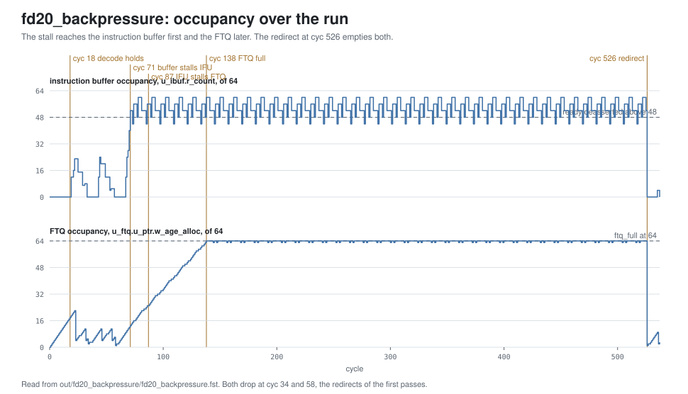

<!-- SPDX-License-Identifier: CC-BY-4.0                        -->
<!-- Copyright (c) 2026 Jeff Nye, uarchlabs.com                -->
<!-- SPDX-FileCopyrightText: 2026 Jeff Nye <jeff@uarchlabs.com> -->
# fd20_backpressure: Backpressure
```
 FILE:    fd20_backpressure.md
 SOURCE:  DOC-002, DOC-006, DOC-007
 STATUS:  WORKING
 UPDATED: 2026-11-04
 CONTACT: Jeff Nye
```

## 1. Introduction

`fd20_backpressure` (FD-20) demonstrates a stall propagating from decode back to
the p0 request. Decode holds its bundle, the instruction buffer fills and stalls
the IFU, the IFU stalls the FTQ, the FTQ fills, and the FTQ withholds the p0
request.

The program runs a 40-pass loop with the backend taking decode's output one
cycle in four.

The result line in the log file reports the stall cycles at each point.

This scenario runs in the 1-prediction slot Pacino configuration,
NUM_PRED_SLOTS=1.

### 1.1 Files

`DEMO=$RVA_ROOT/examples/fe_demo`

  | File               | Path                                              |
  |--------------------|---------------------------------------------------|
  | This file          | $DEMO/docs/fd20_backpressure.md                   |
  | Program (stimulus) | $DEMO/programs/fd20_backpressure.svh              |
  | Surfer sucl        | $DEMO/waves/fd20_backpressure.sucl                |
  | Log                | $DEMO/out/fd20_backpressure/fd20_backpressure.log |
  | Waveform           | $DEMO/out/fd20_backpressure/fd20_backpressure.fst |
  | Waveform (online)  | [Link](https://app.surfer-project.org/?load_url=https%3A%2F%2Fuarchlabs.github.io%2Fpacino-waves%2Ffd20_backpressure.fst&startup_commands=run_command_file_from_url%20https%3A%2F%2Fuarchlabs.github.io%2Fpacino-waves%2Ffd20_backpressure.sucl) |
  | Block connectivity | [$DEMO/docs/fe_block.svg](fe_block.svg)           |
  | Pipeline view      | [$DEMO/docs/fe_pipe.svg](fe_pipe.svg)             |
  | Common description | [$DEMO/docs/demo_explainer.md](demo_explainer.md) |

---

## 2. Run the scenario

Run simulation:
```
make -C examples/fe_demo fd20_backpressure
```

View the waveform (runs simulation first if FST is not up to date):
```
make -C examples/fe_demo view S=fd20_backpressure
```

Console output:
```
-I: fd20_backpressure : PASS : cyc = 537
```

Log file output:
```
-I: fd20_backpressure: PASS, stall cycles with the instruction buffer full 378,
    FTQ full 324, decode held 368, no p0 request 331, events checked 8 of 8,
    cyc 537
```

The testbench monitor, `tb/fe_demo_mon.svh`, supplies the counts in the log
line. They are counts of cycles, not of stall events. `n_p0_held` counts every
hold of the p0 request, so it includes FTB update holds as well as `ftq_full`.

| Item                        | Counter       | Counted                                        |
|-----------------------------|---------------|------------------------------------------------|
| instruction buffer full     | `n_ibuf_full` | `ifu_ibuf_val` with `ibuf_ifu_rdy` low         |
| FTQ full                    | `n_ftq_full`  | `ftq_full`                                     |
| decode held                 | `n_dec_stall` | `tb.pd_out.[0].valid` with `tb.dec_ibuf_rdy` low |
| no p0 request               | `n_p0_held`   | `ftq_pred_val_p0` low                          |

---

## 3. The program

The program is written by the task `prog_fd20` in
`programs/fd20_backpressure.svh`.

The code consists of a short prologue, a loop of 23 mixed instructions and a
back edge that runs for 40 passes, and a short epilogue.

The program runs in M-mode with bare addressing.

```
Address      Label  Instruction             Purpose
0x8000_0000         c.addi a0, 1            ; prologue
0x8000_0002         addi   t0, t0, 1        ; prologue
0x8000_0006         c.addi a0, 1            ; prologue

0x8000_0008  top:   mixed code              ; 23 instructions, to 0x8000_0045
0x8000_0046         bne    x6, x0, top      ; taken on passes 0 to 38

0x8000_004A         c.addi a0, 1            ; epilogue
0x8000_004C         addi   t0, t0, 1        ; epilogue
0x8000_0050         c.addi a0, 1            ; epilogue
0x8000_0052  hold:  jal    x0, hold         ; termination
```

The `c.addi` and `addi` instructions do no useful work. Their purpose is to mix
16-bit and 32-bit instructions and to fill the loop.

The direction of the back edge is chosen by the program writer and resolved by
the modeled backend, and the register operands play no part in it. x6 is never
read.

The modeled backend takes decode's output one cycle in four, set by `be_rdy_pat`
in the program.

---

## 4. Walkthrough

The walkthrough follows the stall from decode back to the p0 request, one
section for each point. Section 4.5 describes the recovery.

Cycle numbers below are events in [section 5](#5-events); each event is a marker
in the waveform.

The waveform group `decode` contains the bundle, `ibuf` the instruction buffer,
`ftq_ifu` the blocks and the line buffer, `ftq` the FTQ occupancy, and
`bp_cluster_p0` the p0 request and its holds.

The figure below shows the occupancy of the instruction buffer and the FTQ.

[](fd20_occupancy.svg)

### 4.1 Decode

`tb.dec_ibuf_rdy` is high one cycle in four: at cyc 17, 21, 25 and so on. At
cyc 18 (event 1), `tb.pd_out.[0].valid` is asserted with `tb.dec_ibuf_rdy` low,
the first bundle held.

### 4.2 The instruction buffer

The instruction buffer takes a block only at 48 entries or fewer, out of 64.[^1]
It takes more than decode removes: a block here offers 12 instructions, and
decode takes 8 in one cycle of four. At cyc 73, `u_ibuf.w_n_pres` and
`u_ibuf.w_n_pop` are 8.

`u_ibuf.r_count` is 40 at cyc 70, with `ibuf_ifu_rdy` asserted. At cyc 71
(event 2), it is 52, with `ifu_ibuf_val` asserted and `ibuf_ifu_rdy` low.

### 4.3 The IFU

F3 holds its block while `ibuf_ifu_rdy` is low.[^2] Blocks then stop leaving the
IFU, and the 16 slots of its line buffer fill.

At cyc 86, `ftq_ifu_req_rdy` is asserted. At cyc 87 (event 3), `ftq_ifu_req_val`
is asserted with `ftq_ifu_req_rdy` low and `ftq_ifu_flush_val` clear, and
`u_ifu.u_lbuf.w_slot_ok` is 0: no slot is free for the next line.[^3] The
earlier low cycles of `ftq_ifu_req_rdy`, at cyc 22, 31, 45 and 54, are flush
cycles.

### 4.4 The FTQ and the p0 request

The FTQ keeps allocating while the IFU takes fewer blocks, so its occupancy
rises until it reaches 64 entries.[^4] `ftq_full` then holds the p0 request.[^5]

At cyc 138 (event 4), `u_ftq.u_ptr.w_age_alloc` is 64 and `ftq_full` is
asserted, with `ftq_pred_val_p0` low and `u_ftq.u_npc.h2_ftq_full` asserted.
`u_ftq.w_commit_ptr` and `ftq_pred_idx_p0` are both 16.

From then on, each commit allows one request. At cyc 144 (event 5),
`u_ftq.w_commit_ptr` is 17, `ftq_full` is clear and `ftq_pred_val_p0` is
asserted. At cyc 145, `ftq_full` is asserted again.

The FTB update hold also withholds the p0 request.[^6] At cyc 82, 94 and 106,
before the FTQ is full, `u_ftq.u_npc.h3_ftb_upd` is asserted with
`ftq_pred_val_p0` low and `ftq_full` clear.

### 4.5 Recovery

The back edge of the last pass falls through, and the backend redirects to the
epilogue. At cyc 526 (event 6), `tb.bkend_ftq_redir_val` is asserted with
`tb.bkend_ftq_redir_pc` 0x8000_004A. The redirect clears the stall: `ftq_full`
is clear, `u_ibuf.r_count` is 0 and `u_ftq.u_ptr.w_age_alloc` is 1.

[^1]: `ibuf_ifu_rdy`: `rtl/core/frontend/ibuf/rtl/ibuf.sv:114`.
[^2]: `rtl/core/frontend/ifu/rtl/ifu_f3.sv:56-57`.
[^3]: `ftq_ifu_req_rdy`: `rtl/core/frontend/ifu/rtl/ifu_fetch.sv:348`.
    `w_slot_ok`, `alloc_ok`: `rtl/core/frontend/ifu/rtl/ifu_lbuf.sv:172-179`.
[^4]: `ftq_full`: `rtl/core/frontend/ftq/rtl/ftq_ptr.sv:247`.
[^5]: `w_hold`: `rtl/core/frontend/ftq/rtl/ftq_npc.sv:306-309`.
    `ftq_pred_val_p0`: `:377`.
[^6]: `h3_ftb_upd`: `rtl/core/frontend/ftq/rtl/ftq_npc.sv:306-309`.

---

## 5. Events

| # | cyc | Event                                                                                              | Other                 |
|---|-----|----------------------------------------------------------------------------------------------------|-----------------------|
| 0 | 0   | reset released (`tb.rstn`); the FTQ requests 0x8000_0000 the same cycle                            | fast init             |
| 1 | 18  | decode first holds a bundle: `pd_out.[0].valid` with `dec_ibuf_rdy` low                            | decode stall          |
| 2 | 71  | the instruction buffer first deasserts ready: `ifu_ibuf_val` with `ibuf_ifu_rdy` low, `r_count` 52 | buffer full           |
| 3 | 87  | the IFU first deasserts ready: `ftq_ifu_req_val` with `ftq_ifu_req_rdy` low, no flush              | no line buffer slot   |
| 4 | 138 | the FTQ first full (`ftq_full`); the p0 request is withheld                                        | FTQ full              |
| 5 | 144 | a commit clears `ftq_full`, and p0 issues one request                                              | full again at cyc 145 |
| 6 | 526 | back edge falls through, a misprediction; redirect to 0x8000_004A                                  | pass 39, backend      |
| 7 | 537 | the run ends                                                                                       |                       |

---

## 6. Waveform

`make -C examples/fe_demo view S=fd20_backpressure` opens
`waves/fd20_backpressure.sucl` in Surfer, with a marker at each event above.
Signal paths below are under `tb.dut` unless they start with `tb.`.

| group         | signal                      | description                                       |
|---------------|-----------------------------|---------------------------------------------------|
| clock         | `tb.clk`                    | clock                                             |
|               | `tb.rstn`                   | active low reset                                  |
|               | `tb.cyc`                    | cycle number                                      |
| bp_cluster_p0 | `ftq_pred_val_p0`           | p0 request valid                                  |
|               | `ftq_pred_pc_p0`            | p0 request PC                                     |
|               | `ftq_pred_idx_p0`           | p0 request FTQ index                              |
|               | `u_ftq.u_npc.w_hold`        | holds the p0 request                              |
|               | `u_ftq.u_npc.h2_ftq_full`   | the hold from a full FTQ                          |
|               | `u_ftq.u_npc.h3_ftb_upd`    | the hold from an FTB update                       |
| ftq           | `u_ftq.w_commit_ptr`        | FTQ commit pointer                                |
|               | `u_ftq.u_ptr.w_age_alloc`   | FTQ occupancy                                     |
|               | `ftq_full`                  | FTQ full                                          |
|               | `ftq_empty`                 | FTQ empty                                         |
|               | `ftq_pred_idx_p0`           | p0 request FTQ index                              |
|               | `ftq_ifu_idx`               | FTQ index of the block                            |
| ftq_ifu       | `ftq_ifu_req_val`           | FTQ presents a block to the IFU                   |
|               | `ftq_ifu_req_rdy`           | the IFU takes the block                           |
|               | `ftq_ifu_idx`               | FTQ index of the block                            |
|               | `ftq_ifu_start_pc`          | block start address                               |
|               | `ftq_ifu_next_pc`           | address after the block                           |
|               | `ftq_ifu_taken_val`         | the block holds a predicted-taken transfer        |
|               | `ftq_ifu_taken_pos`         | halfword position of the predicted-taken transfer |
|               | `ftq_ifu_flush_val`         | flush of the blocks younger than the named entry  |
|               | `ftq_ifu_flush_idx`         | FTQ index the flush names                         |
|               | `ftq_ifu_commit_ptr`        | FTQ commit pointer as the IFU sees it             |
|               | `u_ifu.u_lbuf.w_slot_ok`    | the IFU line buffer has a free slot               |
| ibuf          | `ifu_ibuf_val`              | the IFU offers a block to the instruction buffer  |
|               | `ifu_ibuf_en`               | per-position mask of the instructions offered     |
|               | `ibuf_ifu_rdy`              | the instruction buffer takes the block            |
|               | `u_ibuf.r_count`            | instruction buffer occupancy                      |
|               | `u_ibuf.w_n_pres`           | slots presented to decode                         |
|               | `u_ibuf.w_n_pop`            | slots taken by decode                             |
| decode        | `tb.dec_ibuf_rdy`           | the backend model takes the bundle                |
|               | `tb.pd_out.[0].valid`       | lane 0 valid                                      |
|               | `tb.pd_out.[0].start_pc`    | lane 0 instruction address                        |
|               | `tb.pd_out.[0].ftq_idx`     | lane 0 FTQ index                                  |
|               | `tb.pd_out.[0].pos`         | lane 0 halfword position in the fetch block       |
|               | `tb.pd_out.[0].instr`       | lane 0 instruction, expanded if compressed        |
|               | `tb.pd_out.[0].is_rvc`      | lane 0 instruction is 16-bit                      |
|               | `tb.pd_out.[0].fault_cause` | lane 0 fetch fault cause                          |
|               | `tb.pd_out.[0].fault_va`    | lane 0 fetch fault virtual address                |
