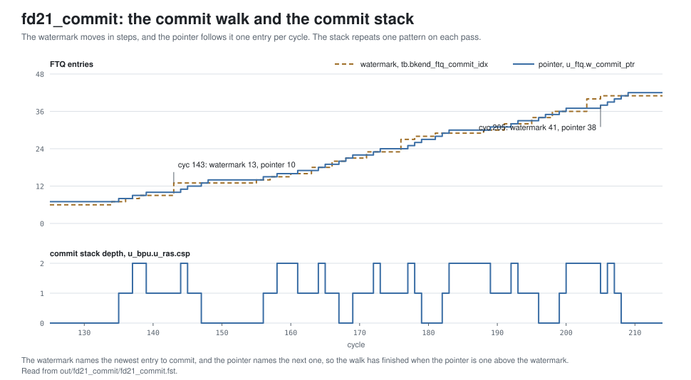

<!-- SPDX-License-Identifier: CC-BY-4.0                        -->
<!-- Copyright (c) 2026 Jeff Nye, uarchlabs.com                -->
<!-- SPDX-FileCopyrightText: 2026 Jeff Nye <jeff@uarchlabs.com> -->
# fd21_commit: Commit
```
 FILE:    fd21_commit.md
 SOURCE:  DOC-002, DOC-006, DOC-007
 STATUS:  WORKING
 UPDATED: 2026-11-04
 CONTACT: Jeff Nye
```

## 1. Introduction

`fd21_commit` (FD-21) demonstrates commit in the FTQ and the RAS. The backend's
retirement watermark moves the FTQ commit pointer one entry per cycle, and each
committed entry that ends in a call or a return pushes or pops the RAS commit
stack.

The program runs six passes of a main function that calls f, with f calling g
and then h.

The result line in the log file reports the cycles in which the commit pointer
moved and the cycles in which the RAS commit stack changed.

This scenario runs in the 1-prediction slot Pacino configuration,
NUM_PRED_SLOTS=1.

### 1.1 Files

`DEMO=$RVA_ROOT/examples/fe_demo`

  | File               | Path                                  |
  |--------------------|---------------------------------------|
  | This file          | $DEMO/docs/fd21_commit.md             |
  | Program (stimulus) | $DEMO/programs/fd21_commit.svh        |
  | Surfer sucl        | $DEMO/waves/fd21_commit.sucl          |
  | Log                | $DEMO/out/fd21_commit/fd21_commit.log |
  | Waveform           | $DEMO/out/fd21_commit/fd21_commit.fst |
  | Waveform (online)  | [Link](https://app.surfer-project.org/?load_url=https%3A%2F%2Fuarchlabs.github.io%2Fpacino-waves%2Ffd21_commit.fst&startup_commands=run_command_file_from_url%20https%3A%2F%2Fuarchlabs.github.io%2Fpacino-waves%2Ffd21_commit.sucl) |
  | Block connectivity | [$DEMO/docs/fe_block.svg](fe_block.svg) |
  | Pipeline view      | [$DEMO/docs/fe_pipe.svg](fe_pipe.svg) |
  | Common description | [$DEMO/docs/demo_explainer.md](demo_explainer.md) |

---

## 2. Run the scenario

Run simulation:
```
make -C examples/fe_demo fd21_commit
```

View the waveform (runs simulation first if FST is not up to date):
```
make -C examples/fe_demo view S=fd21_commit
```

Console output:
```
-I: fd21_commit : PASS : cyc = 214
```

Log file output:
```
-I: fd21_commit: PASS, cycles the commit pointer moved 42,
    cycles the RAS commit stack changed 36, events checked 10 of 10, cyc 214
```

The testbench monitor, `tb/fe_demo_mon.svh`, supplies the counts in the log
line. They are counts of cycles.

| Item                         | Counter        | Counted                                                                        |
|------------------------------|----------------|--------------------------------------------------------------------------------|
| the commit pointer moved     | `n_commit_adv` | `u_ftq.w_commit_ptr` differs from the cycle before                             |
| the RAS commit stack changed | `n_csp_chg`    | `u_bpu.u_ras.csp` or `u_bpu.u_ras.commit_top_addr` differs from the cycle before |

---

## 3. The program

The program is written by the task `prog_fd21` in `programs/fd21_commit.svh`.

The code consists of a short prologue, a loop in which main calls f and f calls
g and then h, and a short epilogue.

The program runs in M-mode with bare addressing.

```
Address      Label  Instruction             Purpose
0x8000_0000         c.addi a0, 1            ; prologue
0x8000_0002         addi   t0, t0, 1        ; prologue
0x8000_0006         c.addi a0, 1            ; prologue

0x8000_0008  top:   c.addi a0, 1            ; ten, to 0x8000_001A
0x8000_001C         jal    x1, f            ; main calls f
0x8000_0020         c.addi a0, 1            ; return address
0x8000_0022         bne    x6, x0, top      ; taken on passes 0 to 4

0x8000_0026         c.addi a0, 1            ; epilogue
0x8000_0028         addi   t0, t0, 1        ; epilogue
0x8000_002C         c.addi a0, 1            ; epilogue
0x8000_002E  hold:  jal    x0, hold         ; termination

0x8000_0800  f:     c.addi a0, 1            ; function body
0x8000_0802         addi   t0, t0, 1        ; function body
0x8000_0806         c.addi a0, 1            ; function body
0x8000_0808         c.addi a0, 1            ; ten, to 0x8000_081A
0x8000_081C         jal    x1, g            ; f calls g
0x8000_0820         c.addi a0, 1            ; return address, 14, to 0x083A
0x8000_083C         jal    x1, h            ; f calls h
0x8000_0840         c.addi a0, 1            ; return address
0x8000_0842         ret                     ; f returns to main

0x8000_0A00  g:     c.addi a0, 1            ; function body
0x8000_0A02         addi   t0, t0, 1        ; function body
0x8000_0A06         ret                     ; g returns to f

0x8000_0C00  h:     c.addi a0, 1            ; function body
0x8000_0C02         addi   t0, t0, 1        ; function body
0x8000_0C06         ret                     ; h returns to f
```

Each pass makes three calls and three returns, and the deepest point is two
return addresses.

The `c.addi` and `addi` instructions do no useful work. Their purpose is to mix
16-bit and 32-bit instructions and to separate the control transfers.

The direction of the back edge is chosen by the program writer and resolved by
the modeled backend, and the register operands play no part in it. x6 is never
read.

---

## 4. Walkthrough

The walkthrough follows a commit from the backend to the RAS. Section 4.1
describes the watermark, section 4.2 the commit walk, section 4.3 the RAS commit
stack, and section 4.4 the speculative stack.

Cycle numbers below are events in [section 5](#5-events); each event is a marker
in the waveform.

The waveform group `backend` contains the watermark, `ftq` the commit pointer
and the walk, `ras_commit` the commit stack, and `ras` the speculative stack.

### 4.1 The watermark

The backend reports the newest FTQ entry whose instructions have all retired.
That is known only when the first instruction of the next entry retires.[^1]

The block at 0x8000_0800, entry 1, reaches decode at cyc 37. At cyc 40
(event 1), `tb.bkend_ftq_commit_val` is asserted with `tb.bkend_ftq_commit_idx`
0.

### 4.2 The commit walk

The FTQ frees the entries up to the watermark, one per cycle, because the RAS
commit port takes one operation per cycle.[^2]

At cyc 205 to 208 (event 8), `u_ftq.w_commit_step_val` is asserted with
`u_ftq.w_commit_ptr` 38, 39, 40 and 41, toward `tb.bkend_ftq_commit_idx` 41. The
pointer is 42 at cyc 209.

A restore suspends the walk.[^3] At cyc 145, `u_ftq.u_commit.w_walk_stop` is
asserted with `ftq_ifu_flush_val`, and `u_ftq.w_commit_step_val` is clear for
that cycle.

The figure below shows the watermark, the commit pointer and the commit stack
from cyc 125. The watermark moves in steps, and the pointer follows it one entry
per cycle. `u_bpu.u_ras.csp` repeats 1, 2, 1, 2, 1, 0 on each pass.

[](fd21_commit_walk.svg)

### 4.3 The RAS commit stack

A committing entry that ends in a taken call or return raises
`ras_commit_val`.[^4] A call pushes `ras_commit_ret_addr`, and a return pops. A
return does not use `ras_commit_ret_addr`.[^5] `u_bpu.u_ras.commit_top_addr` is
the entry below `u_bpu.u_ras.csp`.

| cyc | Event | `ras_commit_br_type` | `u_bpu.u_ras.csp` | `u_bpu.u_ras.commit_top_addr` |
|-----|-------|----------------------|-------------------|-------------------------------|
| 40  | 1     | DIRECT_CALL          | 0                 |                               |
| 41  | 2     |                      | 1                 | 0x8000_0020                   |
| 61  |       | DIRECT_CALL          | 1                 | 0x8000_0020                   |
| 62  | 3     | RETURN               | 2                 | 0x8000_0820                   |
| 63  | 4     |                      | 1                 | 0x8000_0020                   |

The walk at cyc 205 to 208 commits a call and two returns. `u_bpu.u_ras.csp` is
1 at cyc 205, 2 at cyc 206, 1 at cyc 207 and 0 at cyc 208.

The run has 36 RAS commits, 18 calls and 18 returns.

### 4.4 The speculative stack

The speculative pointers move ahead of the commit stack. `u_bpu.u_ras.tosr` and
`u_bpu.u_ras.tosw` stay at 0 until cyc 124, and the first predicted-taken block
follows at cyc 125.

At cyc 124 (event 5), `u_bpu.u_ras.tosw` is 2 and `u_bpu.u_ras.csp` is 0. The
next call commits at cyc 134 (event 6), and `u_bpu.u_ras.csp` is 1 at cyc 135.

[^1]: `track_entry`:
    `rtl/core/frontend/fe_top/tb/models/fe_tb_backend.svh:70-93`. Driven at
    `:458-459`.
[^2]: `rtl/core/frontend/ftq/rtl/ftq_commit.sv:26-31`. `commit_step_val`:
    `:235`. `commit_ptr`: `:252`.
[^3]: `w_walk_stop`: `rtl/core/frontend/ftq/rtl/ftq_commit.sv:231-235`.
[^4]: `rtl/core/frontend/ftq/rtl/ftq_entry.sv:275-285`.
[^5]: `c_pop`, `c_push`, `c_nxt`: `rtl/core/frontend/bpu/rtl/ras.sv:749-759`.
    Registered at `:844-848`. `commit_top_addr`: `:185-187`.

---

## 5. Events

| # | cyc | Event                                                                           | Other                      |
|---|-----|---------------------------------------------------------------------------------|----------------------------|
| 0 | 0   | reset released (`tb.rstn`); the FTQ requests 0x8000_0000 the same cycle         | fast init                  |
| 1 | 40  | first commit: watermark 0, the pointer steps, and the RAS commits the call to f | return address 0x8000_0020 |
| 2 | 41  | the commit stack reaches depth 1 (`u_ras.csp`), top 0x8000_0020                 | main                       |
| 3 | 62  | the commit stack reaches depth 2, and the first return commits                  | top 0x8000_0820            |
| 4 | 63  | the return has popped: depth 1, top 0x8000_0020                                 |                            |
| 5 | 124 | the speculative stack first moves: `tosw` 2, with `csp` 0                       | ahead of commit            |
| 6 | 134 | the next call commits                                                           | `csp` 1 at cyc 135         |
| 7 | 204 | back edge falls through, a misprediction; redirect to 0x8000_0026               | pass 5, backend            |
| 8 | 205 | the walk commits four entries in four consecutive cycles, to watermark 41       | cyc 205 to 208             |
| 9 | 214 | the run ends                                                                    |                            |

---

## 6. Waveform

`make -C examples/fe_demo view S=fd21_commit` opens
`waves/fd21_commit.sucl` in Surfer, with a marker at each event above.
Signal paths below are under `tb.dut` unless they start with `tb.`.

| group      | signal                          | description                           |
|------------|---------------------------------|---------------------------------------|
| clock      | `tb.clk`                        | clock                                 |
|            | `tb.rstn`                       | active low reset                      |
|            | `tb.cyc`                        | cycle number                          |
| backend    | `tb.bkend_ftq_redir_val`        | backend redirect                      |
|            | `tb.bkend_ftq_redir_idx`        | FTQ index of the backend redirect     |
|            | `tb.bkend_ftq_redir_pc`         | backend redirect PC                   |
|            | `tb.bkend_ftq_redir_cause`      | backend redirect cause                |
|            | `tb.bkend_ftq_redir_self`       | self flag of the backend redirect     |
|            | `tb.bkend_ftq_rsv_val`          | resolution from the backend, per slot |
|            | `tb.bkend_ftq_commit_val`       | commit watermark valid                |
|            | `tb.bkend_ftq_commit_idx`       | commit watermark FTQ index            |
| ftq        | `u_ftq.w_commit_ptr`            | FTQ commit pointer                    |
|            | `u_ftq.w_commit_step_val`       | the commit walk frees an entry        |
|            | `u_ftq.u_commit.w_walk_stop`    | a restore suspends the commit walk    |
|            | `ftq_ifu_flush_val`             | flush of the blocks younger than the named entry |
|            | `ftq_full`                      | FTQ full                              |
|            | `ftq_empty`                     | FTQ empty                             |
|            | `ftq_pred_idx_p0`               | p0 request FTQ index                  |
|            | `ftq_ifu_idx`                   | FTQ index of the block                |
| ras_commit | `ras_commit_val`                | RAS commit valid                      |
|            | `ras_commit_br_type`            | branch type of the RAS commit         |
|            | `ras_commit_ret_addr`           | return address pushed by a call       |
|            | `u_bpu.u_ras.csp`               | commit stack pointer                  |
|            | `u_bpu.u_ras.commit_top_valid`  | commit stack top valid                |
|            | `u_bpu.u_ras.commit_top_addr`   | commit stack top address              |
| ras        | `u_bpu.u_ras.tosr`              | RAS read pointer                      |
|            | `u_bpu.u_ras.tosw`              | RAS write pointer                     |
|            | `u_bpu.u_ras.bos`               | RAS bottom of stack                   |
|            | `u_bpu.u_ras.ras_rst_done`      | RAS reset done                        |
|            | `u_bpu.w_ras_pred_val_p2.[0]`   | slot 0 presented to the RAS at p2     |
|            | `u_bpu.w_br_type_p2.[0]`        | slot 0 branch type at p2              |
|            | `u_bpu.u_ras.spec_ret_addr.[0]` | RAS entry 0 return address            |
|            | `u_bpu.u_ras.spec_ret_addr.[1]` | RAS entry 1 return address            |
|            | `u_bpu.u_ras.spec_ret_addr.[2]` | RAS entry 2 return address            |
|            | `u_bpu.u_ras.spec_ret_addr.[3]` | RAS entry 3 return address            |
|            | `u_bpu.u_ras.spec_rctr.[0]`     | RAS entry 0 recursion count           |
|            | `u_bpu.u_ras.spec_rctr.[1]`     | RAS entry 1 recursion count           |
|            | `u_bpu.u_ras.spec_rctr.[2]`     | RAS entry 2 recursion count           |
|            | `u_bpu.u_ras.spec_rctr.[3]`     | RAS entry 3 recursion count           |
