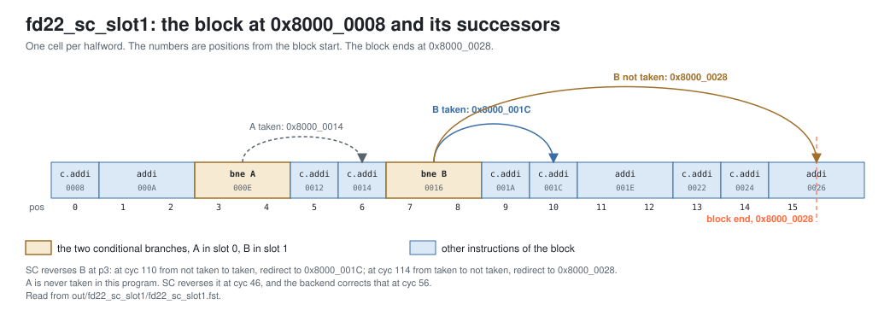

<!-- SPDX-License-Identifier: CC-BY-4.0                        -->
<!-- Copyright (c) 2026 Jeff Nye, uarchlabs.com                -->
<!-- SPDX-FileCopyrightText: 2026 Jeff Nye <jeff@uarchlabs.com> -->
# fd22_sc_slot1: SC Reversing Slot 1
```
 FILE:    fd22_sc_slot1.md
 SOURCE:  DOC-006, DOC-007
 STATUS:  WORKING
 UPDATED: 2026-11-04
 CONTACT: Jeff Nye
```

## 1. Introduction

`fd22_sc_slot1` (FD-22) demonstrates the statistical corrector (SC) reversing
the second of two conditional branches in one prediction block. TAGE predicts
both branches at p2, one in each prediction slot. At p3, SC reverses the
direction of the branch in slot 1, and the cluster redirects the request stream.
[fd05_p3_override](fd05_p3_override.md) shows the same reversal in slot 0.

The program runs a 48-pass loop whose first block holds two conditional
branches: A, never taken, and B, taken on odd passes.

The result line in the log file reports the p3 redirects from each slot that SC
reversed.

This scenario runs in the 2-prediction slot Pacino configuration,
NUM_PRED_SLOTS=2.

### 1.1 Files

`DEMO=$RVA_ROOT/examples/fe_demo`

  | File               | Path                                      |
  |--------------------|-------------------------------------------|
  | This file          | $DEMO/docs/fd22_sc_slot1.md               |
  | Program (stimulus) | $DEMO/programs/fd22_sc_slot1.svh          |
  | Surfer sucl        | $DEMO/waves/fd22_sc_slot1.sucl            |
  | Log                | $DEMO/out/fd22_sc_slot1/fd22_sc_slot1.log |
  | Waveform           | $DEMO/out/fd22_sc_slot1/fd22_sc_slot1.fst |
  | Waveform (online)  | [Link](https://app.surfer-project.org/?load_url=https%3A%2F%2Fuarchlabs.github.io%2Fpacino-waves%2Ffd22_sc_slot1.fst&startup_commands=run_command_file_from_url%20https%3A%2F%2Fuarchlabs.github.io%2Fpacino-waves%2Ffd22_sc_slot1.sucl) |
  | Block connectivity | [$DEMO/docs/fe_block.svg](fe_block.svg)   |
  | Pipeline view      | [$DEMO/docs/fe_pipe.svg](fe_pipe.svg)     |
  | Common description | [$DEMO/docs/demo_explainer.md](demo_explainer.md) |

---

## 2. Run the scenario

Run simulation:
```
make -C examples/fe_demo fd22_sc_slot1
```

View the waveform (runs simulation first if FST is not up to date):
```
make -C examples/fe_demo view S=fd22_sc_slot1
```

Console output:
```
-I: fd22_sc_slot1 : PASS : cyc = 368
```

Log file output:
```
-I: fd22_sc_slot1: PASS,
    p3 redirects from slot 1 reversed by SC behind a TAGE slot 0 8,
    from slot 0 reversed by SC 1, events checked 11 of 11, cyc 368
```

The testbench monitor, `tb/fe_demo_mon.svh`, supplies the counts in the log
line. It counts a p3 redirect that the FTQ accepted, `u_ftq.w_ok_redir_p3`, for
the block at p3.

| Item                   | Counter   | Counted                                                                                                             |
|------------------------|-----------|---------------------------------------------------------------------------------------------------------------------|
| from slot 1, SC, behind TAGE | `n_sc_s1` | slot 1 raises the redirect, slot 1 is a conditional with `pred_src` PRED_SC, and slot 0 is a conditional with `pred_src` PRED_TAGE |
| from slot 0, SC        | `n_sc_s0` | slot 0 raises the redirect, with `pred_src` PRED_SC                                                                 |

---

## 3. The program

The program is written by the task `prog_fd22` in `programs/fd22_sc_slot1.svh`.

The code consists of a short prologue, a loop of 48 passes, and a short
epilogue. The first block of the loop holds two conditional branches: A, never
taken, and B, taken on the odd passes.

The program runs in M-mode with bare addressing.

```
Address      Label  Instruction              Purpose
0x8000_0000         c.addi a0, 1             ; prologue
0x8000_0002         addi   t0, t0, 1         ; prologue
0x8000_0006         c.addi a0, 1             ; prologue

0x8000_0008  top:   c.addi a0, 1             ; filler
0x8000_000A         addi   t0, t0, 1         ; filler
0x8000_000E  A:     bne    x6, x0, 0x8000_0014 ; never taken
0x8000_0012         c.addi a0, 1             ; always executed
0x8000_0014         c.addi a0, 1             ; filler
0x8000_0016  B:     bne    x6, x0, 0x8000_001C ; taken on odd passes
0x8000_001A         c.addi a0, 1             ; executed when B is not taken
0x8000_001C         c.addi a0, 1             ; target of B
0x8000_001E         addi   t0, t0, 1         ; filler
0x8000_0022         c.addi a0, 1             ; filler
0x8000_0024         c.addi a0, 1             ; filler
0x8000_0026         addi   t0, t0, 1         ; filler
0x8000_002A         c.addi a0, 1             ; filler
0x8000_002C         bne    x6, x0, top       ; back edge

0x8000_0030         c.addi a0, 1             ; epilogue
0x8000_0032         addi   t0, t0, 1         ; epilogue
0x8000_0036         c.addi a0, 1             ; epilogue
0x8000_0038  hold:  jal    x0, hold          ; termination
```

In the block at top, A is at halfword position 3 and B at position 7. The filler
after B moves the back edge into the next block, so the block at top holds
exactly the two conditional branches. The target of B lies inside the block, so
the successor of the block differs between B taken and B not taken.

The `c.addi` and `addi` instructions do no useful work. Their purpose is to mix
16-bit and 32-bit instructions and to place the branches.

The directions and targets are chosen by the program writer and resolved by the
modeled backend, and the register operands play no part in them. x6 is never
read.

---

## 4. Walkthrough

The walkthrough follows the block at top. Section 4.1 describes the two branches
at p2, section 4.2 the SC response at p3, and section 4.3 the reversals in the
run.

Cycle numbers below are events in [section 5](#5-events); each event is a marker
in the waveform.

The waveform group `tage_p2` contains the TAGE response, `bp_cluster_p2` the p2
group, `sc_p3` the SC response, `bp_cluster_p3` the p3 group and redirects,
`ftq` the accepted groups, and `backend` the backend redirects.

The figure below shows the block and its two successors.

[](fd22_blocks.svg)

### 4.1 Two conditional branches in one prediction block

The FTB records up to `NUM_PRED_SLOTS` branches for a block start address, each
with its position.[^1] In the 2-prediction slot configuration, the block at top
has A in slot 0 and B in slot 1. For each conditional branch, the direction
comes from TAGE when TAGE answers for the block, and the `pred_src` of the slot
is then PRED_TAGE.[^2]

At cyc 45 (event 2), `u_bpu.r_pc_p2` is 0x8000_0008, `bpu_slot_p2.[0].pos` is 3
and `bpu_slot_p2.[1].pos` is 7. Both slots have `br_type` COND and `pred_src`
PRED_TAGE. A is predicted not taken and B taken.

### 4.2 SC answers at p3 for each slot

SC answers one cycle after TAGE, at p3, separately for each slot. For a
conditional branch with an SC response and no loop predictor direction, the p3
direction is that of SC.[^3] When it differs from the p2 direction, the p3 slot
records `pred_src` PRED_SC.[^4]

The successors at p3 are chained from the highest slot down. The successor of
slot 1 is the target of B when B is taken and the fall-through of the block when
it is not. The successor of slot 0 is the target of A, or the successor of
slot 1. A slot redirects when it is reachable and its p3 successor differs from
its p2 successor.[^5] Because A is not taken, slot 1 is reachable, and a
reversal of B changes both successors: slot 1 and slot 0 raise the redirect
together, to the same address. The FTQ accepts it, and the next request starts
there.[^6]

The first redirect from slot 1 is at cyc 110 (event 5). At cyc 109,
`u_bpu.u_tage.u_tage_cntrl.tage_pred_meta_p2.[1].tage_prm_comp` is 0 (T0 is the
provider) with `tage_pred_tkn` 0, so slot 1 is predicted not taken. At cyc 110,
`u_bpu.w_sc_hit_p3.[1]` is 1 and `u_bpu.w_taken_p3.[1]` is 1: SC predicts B
taken. `bpu_slot_p3.[1].pred_src` is PRED_SC. `bpu_redir_p3.[1].valid` and
`bpu_redir_p3.[0].valid` are both 1, with `target_pc` 0x8000_001C, the target of
B.

At cyc 114 (event 6), the reversal goes the other way. At cyc 113, the TAGE
provider for slot 1 is T1 with CTR 3'b100, weakly taken (`tage_prm_comp` 1,
`tage_prm_ctr` 3'b100). SC predicts not taken, and the redirect is to
0x8000_0028, the fall-through of the block.

### 4.3 The reversals in the run

The run has 9 p3 redirects, all for the block at top:

| cyc                                  | Event | Slot | p2 direction | p3 direction | Target      |
|--------------------------------------|-------|------|--------------|--------------|-------------|
| 46                                   | 3     | 0    | not taken    | taken        | 0x8000_0014 |
| 110                                  | 5     | 1    | not taken    | taken        | 0x8000_001C |
| 114                                  | 6     | 1    | taken        | not taken    | 0x8000_0028 |
| 130, 136                             |       | 1    | taken        | not taken    | 0x8000_0028 |
| 280                                  | 8     | 1    | taken        | not taken    | 0x8000_0028 |
| 303, 326, 349                        |       | 1    | taken        | not taken    | 0x8000_0028 |

At cyc 46, SC reverses A, which is never taken, and the backend corrects it:
`tb.bkend_ftq_redir_pc` is 0x8000_0012 at cyc 56 (event 4).

The last backend redirect for B is at cyc 204 (event 7), with
`tb.bkend_ftq_redir_pc` 0x8000_001A. SC reverses B four more times, at cyc 280
(event 8), 303, 326 and 349. Each replaces a wrong TAGE direction with the
correct one, so no backend redirect follows. The next `tb.bkend_ftq_redir_val`
is at cyc 358 (event 9), when the back edge falls through.

[^1]: `p2_class_comb`: `rtl/core/frontend/bpu/rtl/bp_cluster.sv:1010-1046`.
[^2]: `w_taken_p2`: `rtl/core/frontend/bpu/rtl/bp_cluster.sv:1032-1036`.
    `w_pred_src_p2`: `:1161-1162`.
[^3]: `w_sc_hit_p3`: `rtl/core/frontend/bpu/rtl/bp_cluster.sv:1296-1297`.
    `w_taken_p3`: `:1301-1304`.
[^4]: `p3_slot_comb`: `rtl/core/frontend/bpu/rtl/bp_cluster.sv:1340-1352`.
[^5]: `w_succ_p3`, `w_redir_p3`:
    `rtl/core/frontend/bpu/rtl/bp_cluster.sv:1307-1325`.
[^6]: `ok_redir_p3`: `rtl/core/frontend/ftq/rtl/ftq_shadow.sv:220-221`. The next
    request: `rtl/core/frontend/ftq/rtl/ftq_npc.sv:338`.

---

## 5. Events

| #  | cyc | Event                                                                              | Other                       |
|----|-----|------------------------------------------------------------------------------------|-----------------------------|
| 0  | 0   | reset released (`tb.rstn`); the FTQ requests 0x8000_0000 the same cycle            | fast init                   |
| 1  | 22  | first backend misprediction, the back edge; redirect to 0x8000_0008                | pass 0                      |
| 2  | 45  | first p2 group for the block at top with both slots: A and B, `pred_src` PRED_TAGE | A slot 0, B slot 1          |
| 3  | 46  | first p3 redirect: SC reverses A in slot 0                                         | to 0x8000_0014              |
| 4  | 56  | A mispredicted; redirect to 0x8000_0012                                            | backend                     |
| 5  | 110 | first p3 redirect from slot 1: SC reverses B from not taken to taken               | to 0x8000_001C              |
| 6  | 114 | SC corrects TAGE's taken for B, provider T1                                        | to 0x8000_0028              |
| 7  | 204 | last backend misprediction of B; redirect to 0x8000_001A                           | backend                     |
| 8  | 280 | first SC correction of B after the last backend misprediction of B                 | no backend redirect follows |
| 9  | 358 | back edge falls through, a misprediction; redirect to 0x8000_0030                  | pass 47                     |
| 10 | 368 | the run ends                                                                       |                             |

---

## 6. Waveform

`make -C examples/fe_demo view S=fd22_sc_slot1` opens
`waves/fd22_sc_slot1.sucl` in Surfer, with a marker at each event above.
Signal paths below are under `tb.dut` unless they start with `tb.`.

| group         | signal                                                               | description                                  |
|---------------|----------------------------------------------------------------------|----------------------------------------------|
| clock         | `tb.clk`                                                             | clock                                        |
|               | `tb.rstn`                                                            | active low reset                             |
|               | `tb.cyc`                                                             | cycle number                                 |
| tage_p2       | `u_bpu.w_tage_pred_rdy_p2`                                           | TAGE response at p2                          |
|               | `u_bpu.u_tage.u_tage_cntrl.tage_pred_meta_p2.[0].tage_prm_comp`      | slot 0 provider table, 0 is T0               |
|               | `u_bpu.u_tage.u_tage_cntrl.tage_pred_meta_p2.[0].tage_alt_comp`      | slot 0 alternate table, 0 is T0              |
|               | `u_bpu.u_tage.u_tage_cntrl.tage_pred_meta_p2.[0].tage_using_primary` | slot 0 is 0 when the alternate provides      |
|               | `u_bpu.u_tage.u_tage_cntrl.tage_pred_meta_p2.[0].tage_prm_ctr`       | slot 0 provider CTR                          |
|               | `u_bpu.u_tage.u_tage_cntrl.tage_pred_meta_p2.[0].tage_pred_tkn`      | slot 0 TAGE direction                        |
|               | `u_bpu.u_tage.u_tage_cntrl.tage_pred_meta_p2.[1].tage_prm_comp`      | slot 1 provider table, 0 is T0               |
|               | `u_bpu.u_tage.u_tage_cntrl.tage_pred_meta_p2.[1].tage_alt_comp`      | slot 1 alternate table, 0 is T0              |
|               | `u_bpu.u_tage.u_tage_cntrl.tage_pred_meta_p2.[1].tage_using_primary` | slot 1 is 0 when the alternate provides      |
|               | `u_bpu.u_tage.u_tage_cntrl.tage_pred_meta_p2.[1].tage_prm_ctr`       | slot 1 provider CTR                          |
|               | `u_bpu.u_tage.u_tage_cntrl.tage_pred_meta_p2.[1].tage_pred_tkn`      | slot 1 TAGE direction                        |
| bp_cluster_p2 | `u_bpu.r_val_p2`                                                     | p2 valid                                     |
|               | `u_bpu.r_pc_p2`                                                      | block start address at p2                    |
|               | `bpu_slot_val_p2`                                                    | slot valid mask                              |
|               | `bpu_slot_idx_p2`                                                    | FTQ index of the p2 group                    |
|               | `u_bpu.w_ftb_valid_p2`                                               | FTB hit at p2                                |
|               | `bpu_slot_p2.[0].slot_valid`                                         | slot 0 holds a branch                        |
|               | `bpu_slot_p2.[0].br_type`                                            | slot 0 branch type                           |
|               | `bpu_slot_p2.[0].pos`                                                | slot 0 halfword position in the fetch block  |
|               | `bpu_slot_p2.[0].taken`                                              | slot 0 predicted direction                   |
|               | `bpu_slot_p2.[0].target`                                             | slot 0 predicted target                      |
|               | `bpu_slot_p2.[0].pred_src`                                           | slot 0 predictor that supplied the direction |
|               | `bpu_slot_p2.[1].slot_valid`                                         | slot 1 holds a branch                        |
|               | `bpu_slot_p2.[1].br_type`                                            | slot 1 branch type                           |
|               | `bpu_slot_p2.[1].pos`                                                | slot 1 halfword position in the fetch block  |
|               | `bpu_slot_p2.[1].taken`                                              | slot 1 predicted direction                   |
|               | `bpu_slot_p2.[1].target`                                             | slot 1 predicted target                      |
|               | `bpu_slot_p2.[1].pred_src`                                           | slot 1 predictor that supplied the direction |
|               | `bpu_redir_p2.[0].valid`                                             | p2 redirect from slot 0                      |
|               | `bpu_redir_p2.[0].target_pc`                                         | p2 redirect target from slot 0               |
|               | `bpu_redir_p2.[1].valid`                                             | p2 redirect from slot 1                      |
|               | `bpu_redir_p2.[1].target_pc`                                         | p2 redirect target from slot 1               |
|               | `bpu_redir_idx_p2`                                                   | FTQ index of the p2 redirect                 |
| sc_p3         | `u_bpu.w_sc_pred_rdy_p3`                                             | SC response at p3                            |
|               | `u_bpu.w_sc_hit_p3.[0]`                                              | SC response for slot 0                       |
|               | `u_bpu.w_sc_hit_p3.[1]`                                              | SC response for slot 1                       |
|               | `u_bpu.w_taken_p3.[0]`                                               | slot 0 direction at p3                       |
|               | `u_bpu.w_taken_p3.[1]`                                               | slot 1 direction at p3                       |
| bp_cluster_p3 | `u_bpu.r_val_p3`                                                     | p3 valid                                     |
|               | `u_bpu.r_pc_p3`                                                      | block start address at p3                    |
|               | `bpu_slot_val_p3`                                                    | slot valid mask                              |
|               | `bpu_slot_idx_p3`                                                    | FTQ index of the p3 group                    |
|               | `bpu_slot_p3.[0].slot_valid`                                         | slot 0 holds a branch                        |
|               | `bpu_slot_p3.[0].br_type`                                            | slot 0 branch type                           |
|               | `bpu_slot_p3.[0].pos`                                                | slot 0 halfword position in the fetch block  |
|               | `bpu_slot_p3.[0].taken`                                              | slot 0 predicted direction                   |
|               | `bpu_slot_p3.[0].target`                                             | slot 0 predicted target                      |
|               | `bpu_slot_p3.[0].pred_src`                                           | slot 0 predictor that supplied the direction |
|               | `bpu_slot_p3.[1].slot_valid`                                         | slot 1 holds a branch                        |
|               | `bpu_slot_p3.[1].br_type`                                            | slot 1 branch type                           |
|               | `bpu_slot_p3.[1].pos`                                                | slot 1 halfword position in the fetch block  |
|               | `bpu_slot_p3.[1].taken`                                              | slot 1 predicted direction                   |
|               | `bpu_slot_p3.[1].target`                                             | slot 1 predicted target                      |
|               | `bpu_slot_p3.[1].pred_src`                                           | slot 1 predictor that supplied the direction |
|               | `bpu_redir_p3.[0].valid`                                             | p3 redirect from slot 0                      |
|               | `bpu_redir_p3.[0].target_pc`                                         | p3 redirect target from slot 0               |
|               | `bpu_redir_p3.[1].valid`                                             | p3 redirect from slot 1                      |
|               | `bpu_redir_p3.[1].target_pc`                                         | p3 redirect target from slot 1               |
|               | `bpu_redir_idx_p3`                                                   | FTQ index of the p3 redirect                 |
| ftq           | `u_ftq.w_ok_pred_p1`                                                 | the FTQ accepts the p1 prediction            |
|               | `u_ftq.w_ok_slot_p2`                                                 | the FTQ accepts the p2 group                 |
|               | `u_ftq.w_ok_slot_p3`                                                 | the FTQ accepts the p3 group                 |
|               | `u_ftq.w_ok_redir_p2`                                                | the FTQ accepts the p2 redirect              |
|               | `u_ftq.w_ok_redir_p3`                                                | the FTQ accepts the p3 redirect              |
|               | `u_ftq.w_redir_val`                                                  | a redirect the FTQ takes                     |
|               | `u_ftq.w_redir_idx`                                                  | FTQ index of the redirect                    |
|               | `u_ftq.w_commit_ptr`                                                 | FTQ commit pointer                           |
|               | `ftq_full`                                                           | FTQ full                                     |
|               | `ftq_empty`                                                          | FTQ empty                                    |
| backend       | `tb.bkend_ftq_redir_val`                                             | backend redirect                             |
|               | `tb.bkend_ftq_redir_pc`                                              | backend redirect PC                          |
