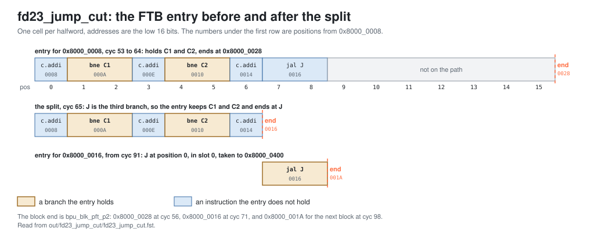

<!-- SPDX-License-Identifier: CC-BY-4.0                        -->
<!-- Copyright (c) 2026 Jeff Nye, uarchlabs.com                -->
<!-- SPDX-FileCopyrightText: 2026 Jeff Nye <jeff@uarchlabs.com> -->
# fd23_jump_cut: A Jump Behind Two Conditionals
```
 FILE:    fd23_jump_cut.md
 SOURCE:  DOC-006, DOC-007
 STATUS:  WORKING
 UPDATED: 2026-11-04
 CONTACT: Jeff Nye
```

## 1. Introduction

`fd23_jump_cut` (FD-23) demonstrates a prediction block with two conditional
branches followed by a jump. With two prediction slots, an FTB entry holds at
most two branches, so when the jump resolves, the FTB splits the entry: it keeps
the two conditional branches and ends the block at the address of the jump. The
next block starts at the jump and predicts it in slot 0.

The program runs a 24-pass loop whose first block holds two never-taken
conditional branches, C1 and C2, followed by a jump, J.

The result line in the log file reports the blocks the FTB ends at the jump, the
jumps predicted in slot 0 of the next block, and the blocks cut by the cluster.

This scenario runs in the 2-prediction slot Pacino configuration,
NUM_PRED_SLOTS=2.

### 1.1 Files

`DEMO=$RVA_ROOT/examples/fe_demo`

  | File               | Path                                      |
  |--------------------|-------------------------------------------|
  | This file          | $DEMO/docs/fd23_jump_cut.md               |
  | Program (stimulus) | $DEMO/programs/fd23_jump_cut.svh          |
  | Surfer sucl        | $DEMO/waves/fd23_jump_cut.sucl            |
  | Log                | $DEMO/out/fd23_jump_cut/fd23_jump_cut.log |
  | Waveform           | $DEMO/out/fd23_jump_cut/fd23_jump_cut.fst |
  | Waveform (online)  | [Link](https://app.surfer-project.org/?load_url=https%3A%2F%2Fuarchlabs.github.io%2Fpacino-waves%2Ffd23_jump_cut.fst&startup_commands=run_command_file_from_url%20https%3A%2F%2Fuarchlabs.github.io%2Fpacino-waves%2Ffd23_jump_cut.sucl) |
  | Block connectivity | [$DEMO/docs/fe_block.svg](fe_block.svg)   |
  | Pipeline view      | [$DEMO/docs/fe_pipe.svg](fe_pipe.svg)     |
  | Common description | [$DEMO/docs/demo_explainer.md](demo_explainer.md) |

---

## 2. Run the scenario

Run simulation:
```
make -C examples/fe_demo fd23_jump_cut
```

View the waveform (runs simulation first if FST is not up to date):
```
make -C examples/fe_demo view S=fd23_jump_cut
```

Console output:
```
-I: fd23_jump_cut : PASS : cyc = 244
```

Log file output:
```
-I: fd23_jump_cut: PASS, blocks the FTB ends at the jump 23,
    the jump predicted in slot 0 of the next block 21,
    blocks cut by the cluster 0, events checked 12 of 12, cyc 244
```

The testbench monitor, `tb/fe_demo_mon.svh`, supplies the counts in the log
line. It counts in the p2 groups that the FTQ accepted, `u_ftq.w_ok_slot_p2`.

| Item                                  | Counter      | Counted                                                                                                                   |
|---------------------------------------|--------------|---------------------------------------------------------------------------------------------------------------------------|
| blocks the FTB ends at the jump       | `n_jmp_end`  | both slots are conditional branches predicted not taken, `bpu_blk_pft_p2` is the address of J, and `u_bpu.w_cut_p2` is clear |
| the jump predicted in the next block  | `n_jmp_next` | the next group whose `u_bpu.r_pc_p2` is that address has a jump in slot 0, at position 0, predicted taken                 |
| blocks cut by the cluster             | `n_cut`      | groups with `u_bpu.w_cut_p2` set                                                                                          |

---

## 3. The program

The program is written by the task `prog_fd23` in `programs/fd23_jump_cut.svh`.

The code consists of a short prologue, a loop of 24 passes, and a short
epilogue. The first block of the loop holds C1 and C2, never taken, followed by
J, a jump to a block at 0x8000_0400 that holds the back edge.

The program runs in M-mode with bare addressing.

```
Address      Label  Instruction              Purpose
0x8000_0000         c.addi a0, 1             ; prologue
0x8000_0002         addi   t0, t0, 1         ; prologue
0x8000_0006         c.addi a0, 1             ; prologue

0x8000_0008  top:   c.addi a0, 1             ; filler
0x8000_000A  C1:    bne    x6, x0, 0x8000_0010 ; never taken
0x8000_000E         c.addi a0, 1             ; always executed
0x8000_0010  C2:    bne    x6, x0, 0x8000_0016 ; never taken
0x8000_0014         c.addi a0, 1             ; always executed
0x8000_0016  J:     jal    x0, 0x8000_0400   ; the jump

0x8000_0400         c.addi a0, 1             ; filler
0x8000_0402         addi   t0, t0, 1         ; filler
0x8000_0406         bne    x6, x0, top       ; back edge, passes 0 to 22

0x8000_040A         c.addi a0, 1             ; epilogue
0x8000_040C         addi   t0, t0, 1         ; epilogue
0x8000_0410         c.addi a0, 1             ; epilogue
0x8000_0412  hold:  jal    x0, hold          ; termination
```

In the block at top, C1 is at halfword position 1, C2 at position 4 and J at
position 7.

The `c.addi` and `addi` instructions do no useful work. Their purpose is to mix
16-bit and 32-bit instructions and to place the branches.

The directions and targets are chosen by the program writer and resolved by the
modeled backend, and the register operands play no part in them. x6 is never
read.

---

## 4. Walkthrough

The walkthrough follows the block at top. Section 4.1 describes the FTB entry
and the split, section 4.2 the block that ends at the jump, and section 4.3 the
next block, which predicts the jump.

Cycle numbers below are events in [section 5](#5-events); each event is a marker
in the waveform.

The waveform group `bp_cluster_p2_ftb` contains the FTB fields and the block
end, `bp_cluster_p2` the p2 group, `bp_cluster_p3` the p3 redirects, `ftq` the
accepted groups and the predecode redirects, `bp_cluster_p0` the p0 request,
`ftb_update` the FTB updates, and `backend` the backend redirects.

The figure below shows the entry before and after the split, and the next block.

[](fd23_blocks.svg)

### 4.1 The FTB entry for top

The FTB keeps one entry per block start. An update for a branch resolved in a
block from that start adds the branch to the entry. When the entry already holds
a branch at that position, the update changes that branch in place. The entry
stores its branches in position order.

An entry holds at most `NUM_PRED_SLOTS` branches. When an update would make it
hold more, the lowest `NUM_PRED_SLOTS` positions are kept, the block end becomes
the address of the lowest branch not kept, and a jump not kept clears the jump
field. This is the split.[^1] The uBTB applies the same rule.[^2]

C1 and C2 resolve first. At cyc 52 (event 3) the FTB allocates the entry for top
with C1, and at cyc 53 it adds C2. The entry ends one block above its start, at
0x8000_0028. At cyc 56 (event 4), the first p2 group for top predicts both
taken (TAGE's base table starts weakly taken). At cyc 57 (event 5),
`bpu_redir_p3.[0].valid` and `bpu_redir_p3.[1].valid` are both 1, with
`target_pc` 0x8000_0028: the
statistical corrector reverses both at p3.

J then resolves in a block from top, and it is the third branch. At cyc 65
(event 6), `ftb_upd_pc_u0` is 0x8000_0008, `ftb_upd_pos_u0` is 7,
`ftb_upd_is_jmp_u0` is 1, and `u_bpu.u_ftb.u_ftb_cntrl.upd_split` is 1 with
`upd_cut_pos` 7. The entry keeps C1 and C2, and now ends at position 7, the
address of J.

The first `upd_split` of the run is at cyc 41, for the same reason. On the first
pass, the block from the reset vector holds C1, C2 and J at positions 5, 8 and
11.

### 4.2 The block ends at the jump

At p2, the cluster places each conditional field of the entry in its slot, and
the jump field in the lowest slot that holds no conditional branch.[^3] The
entry for top has no jump field, so the two slots hold C1 and C2. The
fall-through of the block, the address fetch continues at when no slot is taken,
is the stored end of the FTB entry when the FTB answers, no branch is cut and no
jump is held.[^4] It leaves the cluster as `bpu_blk_pft_p2`. The cut, which
would end the block at a branch the FTB reports and no slot carries, stays
clear.[^5]

The first accepted p2 group of the block at top that ends at J is at cyc 71
(event 7). `u_bpu.r_pc_p2` is 0x8000_0008. `u_bpu.w_ftb_br_valid_p2.[0]` and
`u_bpu.w_ftb_br_valid_p2.[1]` are 1, `u_bpu.w_ftb_jmp_valid_p2` is 0,
`u_bpu.w_cut_p2` is 0, and `bpu_blk_pft_p2` is 0x8000_0016, the address of J.
`bpu_slot_p2.[0]` is C1 and `bpu_slot_p2.[1]` is C2, both COND at `pos` 1 and 4,
not taken, `pred_src` PRED_TAGE.

The uBTB was split the same way. Its p1 prediction for top, `bpu_pred_pft_p1`,
is 0x8000_0016 from cyc 70, so p1 and p2 agree.

### 4.3 The next block predicts the jump

The next block starts at 0x8000_0016. The predictors have not seen this block
start, so at first neither the uBTB nor the FTB answers for it. Fetch runs past
J, and predecode at F3 finds it: `u_ftq.w_pd_redir_pc` is 0x8000_0400 at cyc 79
and 92. The update for J from that start allocates its entry at cyc 91
(event 8), with J at position 0. From then on, the FTB answers for 0x8000_0016
with J in its jump field, and the cluster places J in slot 0.

The first counted pair is at cyc 97 and 98. At cyc 97, the block at top ends at
0x8000_0016, as in section 4.2. At cyc 98 (event 9), `u_bpu.r_pc_p2` is
0x8000_0016 and `bpu_slot_p2.[0]` is DIRECT_UNC at `pos` 0, taken, with `target`
0x8000_0400 and `pred_src` PRED_FTB.

The blocks at cyc 71 and 84 ended at J before the entry for J existed, and their
next groups had no FTB answer. The count of blocks that end at J, 23, therefore
exceeds the count of next blocks, 21.

[^1]: THE UPDATE: `rtl/core/frontend/bpu/rtl/ftb_cntrl.sv:464-494`. The split:
    `:592-615`.
[^2]: `apply_upd`: `rtl/core/frontend/bpu/rtl/ubtb.sv:291-376`.
[^3]: `p2_class_comb`: `rtl/core/frontend/bpu/rtl/bp_cluster.sv:1010-1046`.
[^4]: `w_pft_p2`, `p2_succ_comb`:
    `rtl/core/frontend/bpu/rtl/bp_cluster.sv:1133-1141`. `bpu_blk_pft_p2`:
    `:1275`.
[^5]: `w_cut_p2`: `rtl/core/frontend/bpu/rtl/bp_cluster.sv:1064-1074`.

---

## 5. Events

| #  | cyc | Event                                                                             | Other                 |
|----|-----|-----------------------------------------------------------------------------------|-----------------------|
| 0  | 0   | reset released (`tb.rstn`); the FTQ requests 0x8000_0000 the same cycle           | fast init             |
| 1  | 19  | predecode redirect to 0x8000_0400: J found at F3, not yet known to the predictors | pass 0                |
| 2  | 41  | first backend misprediction, the back edge; redirect to 0x8000_0008               | pass 0                |
| 3  | 52  | FTB entry for top allocated with C1; C2 added at cyc 53                           | `ftb_update`          |
| 4  | 56  | first p2 group for top: C1 and C2 in slots 0 and 1, end 0x8000_0028               | predicted taken       |
| 5  | 57  | SC reverses both at p3; redirect to 0x8000_0028                                   | p3 redirect           |
| 6  | 65  | J resolved from top: the split, `upd_split` 1, the entry ends at 0x8000_0016      | `upd_cut_pos` 7       |
| 7  | 71  | first p2 group for top ending at 0x8000_0016, C1 and C2 not taken, `w_cut_p2` 0   | counted, `n_jmp_end`  |
| 8  | 91  | FTB entry for 0x8000_0016 allocated with J at position 0                          | `ftb_update`          |
| 9  | 98  | the block at 0x8000_0016 predicts J in slot 0, taken, to 0x8000_0400              | counted, `n_jmp_next` |
| 10 | 234 | back edge falls through, a misprediction; redirect to 0x8000_040A                 | pass 23               |
| 11 | 244 | the run ends                                                                      |                       |

---

## 6. Waveform

`make -C examples/fe_demo view S=fd23_jump_cut` opens
`waves/fd23_jump_cut.sucl` in Surfer, with a marker at each event above.
Signal paths below are under `tb.dut` unless they start with `tb.`.

| group             | signal                                | description                                       |
|-------------------|---------------------------------------|---------------------------------------------------|
| clock             | `tb.clk`                              | clock                                             |
|                   | `tb.rstn`                             | active low reset                                  |
|                   | `tb.cyc`                              | cycle number                                      |
| bp_cluster_p2_ftb | `u_bpu.r_pc_p2`                       | p2 fetch block start                              |
|                   | `u_bpu.w_ftb_br_valid_p2.[0]`         | FTB conditional field 0 valid                     |
|                   | `u_bpu.w_ftb_br_valid_p2.[1]`         | FTB conditional field 1 valid                     |
|                   | `u_bpu.w_ftb_jmp_valid_p2`            | FTB jump field valid                              |
|                   | `u_bpu.w_cut_p2`                      | the cluster's cut                                 |
|                   | `bpu_blk_pft_p2`                      | p2 fetch block end, the first halfword after it   |
|                   | `bpu_pred_pft_p1`                     | p1 fetch block end                                |
| bp_cluster_p2     | `u_bpu.r_val_p2`                      | p2 valid                                          |
|                   | `bpu_slot_val_p2`                     | slot valid mask                                   |
|                   | `bpu_slot_idx_p2`                     | FTQ index of the p2 group                         |
|                   | `u_bpu.w_ftb_valid_p2`                | FTB hit at p2                                     |
|                   | `bpu_slot_p2.[0].slot_valid`          | slot 0 holds a branch                             |
|                   | `bpu_slot_p2.[0].br_type`             | slot 0 branch type                                |
|                   | `bpu_slot_p2.[0].pos`                 | slot 0 halfword position in the fetch block       |
|                   | `bpu_slot_p2.[0].taken`               | slot 0 predicted direction                        |
|                   | `bpu_slot_p2.[0].target`              | slot 0 predicted target                           |
|                   | `bpu_slot_p2.[0].pred_src`            | slot 0 predictor that supplied the direction      |
|                   | `bpu_slot_p2.[1].slot_valid`          | slot 1 holds a branch                             |
|                   | `bpu_slot_p2.[1].br_type`             | slot 1 branch type                                |
|                   | `bpu_slot_p2.[1].pos`                 | slot 1 halfword position in the fetch block       |
|                   | `bpu_slot_p2.[1].taken`               | slot 1 predicted direction                        |
|                   | `bpu_slot_p2.[1].target`              | slot 1 predicted target                           |
|                   | `bpu_slot_p2.[1].pred_src`            | slot 1 predictor that supplied the direction      |
|                   | `bpu_redir_p2.[0].valid`              | p2 redirect from slot 0                           |
|                   | `bpu_redir_p2.[0].target_pc`          | p2 redirect target from slot 0                    |
|                   | `bpu_redir_p2.[1].valid`              | p2 redirect from slot 1                           |
|                   | `bpu_redir_p2.[1].target_pc`          | p2 redirect target from slot 1                    |
|                   | `bpu_redir_idx_p2`                    | FTQ index of the p2 redirect                      |
| bp_cluster_p3     | `bpu_redir_p3.[0].valid`              | p3 redirect from slot 0                           |
|                   | `bpu_redir_p3.[0].target_pc`          | p3 redirect target from slot 0                    |
|                   | `bpu_redir_p3.[1].valid`              | p3 redirect from slot 1                           |
|                   | `bpu_redir_p3.[1].target_pc`          | p3 redirect target from slot 1                    |
| ftq               | `u_ftq.w_ok_pred_p1`                  | the FTQ accepts the p1 prediction                 |
|                   | `u_ftq.w_ok_slot_p2`                  | the FTQ accepts the p2 group                      |
|                   | `u_ftq.w_ok_slot_p3`                  | the FTQ accepts the p3 group                      |
|                   | `u_ftq.w_ok_redir_p2`                 | the FTQ accepts the p2 redirect                   |
|                   | `u_ftq.w_ok_redir_p3`                 | the FTQ accepts the p3 redirect                   |
|                   | `u_ftq.w_redir_val`                   | a redirect the FTQ takes                          |
|                   | `u_ftq.w_redir_idx`                   | FTQ index of the redirect                         |
|                   | `u_ftq.w_commit_ptr`                  | FTQ commit pointer                                |
|                   | `ftq_full`                            | FTQ full                                          |
|                   | `ftq_empty`                           | FTQ empty                                         |
|                   | `u_ftq.w_pd_redir_val`                | predecode redirect                                |
|                   | `u_ftq.w_pd_redir_pc`                 | predecode redirect PC                             |
| bp_cluster_p0     | `ftq_pred_val_p0`                     | p0 request valid                                  |
|                   | `ftq_pred_pc_p0`                      | p0 request PC                                     |
|                   | `ftq_pred_idx_p0`                     | p0 request FTQ index                              |
|                   | `u_ftq.u_npc.w_hold`                  | holds the p0 request                              |
| ftb_update        | `ftb_upd_valid_u0`                    | FTB update valid                                  |
|                   | `ftb_upd_pc_u0`                       | block start address of the FTB update             |
|                   | `ftb_upd_pos_u0`                      | halfword position of the branch in the FTB update |
|                   | `ftb_upd_is_br_u0`                    | the FTB update is for a conditional               |
|                   | `ftb_upd_is_jmp_u0`                   | the FTB update is for a jump                      |
|                   | `ftb_upd_hit_u0`                      | the FTB update hits an entry                      |
|                   | `u_bpu.u_ftb.u_ftb_cntrl.upd_split`   | the FTB update splits the entry                   |
|                   | `u_bpu.u_ftb.u_ftb_cntrl.upd_cut_pos` | position the split ends the entry at              |
| backend           | `tb.bkend_ftq_redir_val`              | backend redirect                                  |
|                   | `tb.bkend_ftq_redir_pc`               | backend redirect PC                               |
