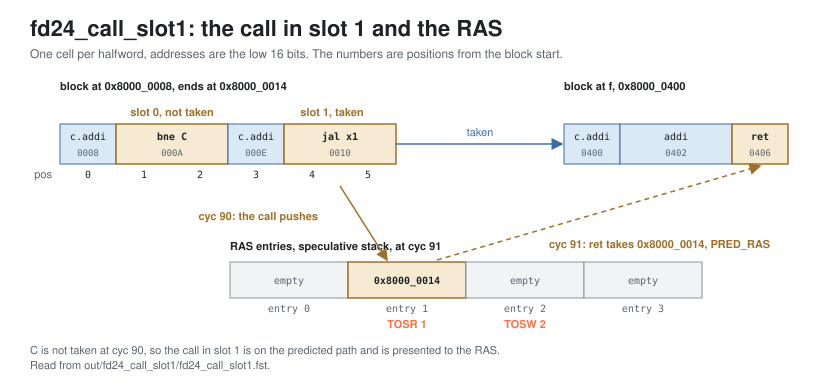

<!-- SPDX-License-Identifier: CC-BY-4.0                        -->
<!-- Copyright (c) 2026 Jeff Nye, uarchlabs.com                -->
<!-- SPDX-FileCopyrightText: 2026 Jeff Nye <jeff@uarchlabs.com> -->
# fd24_call_slot1: A Call in Slot 1
```
 FILE:    fd24_call_slot1.md
 SOURCE:  DOC-006, DOC-007
 STATUS:  WORKING
 UPDATED: 2026-11-04
 CONTACT: Jeff Nye
```

## 1. Introduction

`fd24_call_slot1` (FD-24) demonstrates a call in slot 1. A prediction block
holds a conditional branch followed by a call, so the conditional branch is in
slot 0 and the call in slot 1. When the conditional branch is predicted not
taken, the call is on the predicted path, and the return address stack (RAS)
pushes its return address at p2. The return from the function is then predicted
from the stack.

The program runs a 24-pass loop whose first block holds C, a never-taken
conditional branch, followed by a call to a function, f.

The result line in the log file reports the RAS pushes from slot 1 and the
returns predicted by the RAS.

This scenario runs in the 2-prediction slot Pacino configuration,
NUM_PRED_SLOTS=2.

### 1.1 Files

`DEMO=$RVA_ROOT/examples/fe_demo`

  | File               | Path                                          |
  |--------------------|-----------------------------------------------|
  | This file          | $DEMO/docs/fd24_call_slot1.md                 |
  | Program (stimulus) | $DEMO/programs/fd24_call_slot1.svh            |
  | Surfer sucl        | $DEMO/waves/fd24_call_slot1.sucl              |
  | Log                | $DEMO/out/fd24_call_slot1/fd24_call_slot1.log |
  | Waveform           | $DEMO/out/fd24_call_slot1/fd24_call_slot1.fst |
  | Waveform (online)  | [Link](https://app.surfer-project.org/?load_url=https%3A%2F%2Fuarchlabs.github.io%2Fpacino-waves%2Ffd24_call_slot1.fst&startup_commands=run_command_file_from_url%20https%3A%2F%2Fuarchlabs.github.io%2Fpacino-waves%2Ffd24_call_slot1.sucl) |
  | Block connectivity | [$DEMO/docs/fe_block.svg](fe_block.svg)       |
  | Pipeline view      | [$DEMO/docs/fe_pipe.svg](fe_pipe.svg)         |
  | Common description | [$DEMO/docs/demo_explainer.md](demo_explainer.md) |

---

## 2. Run the scenario

Run simulation:
```
make -C examples/fe_demo fd24_call_slot1
```

View the waveform (runs simulation first if FST is not up to date):
```
make -C examples/fe_demo view S=fd24_call_slot1
```

Console output:
```
-I: fd24_call_slot1 : PASS : cyc = 270
```

Log file output:
```
-I: fd24_call_slot1: PASS,
    RAS pushes from slot 1 behind a not-taken conditional 24,
    returns predicted by the RAS 21, events checked 10 of 10, cyc 270
```

The testbench monitor, `tb/fe_demo_mon.svh`, supplies the counts in the log
line.

| Item                                | Counter        | Counted                                                                                                                                       |
|-------------------------------------|----------------|-----------------------------------------------------------------------------------------------------------------------------------------------|
| RAS pushes from slot 1              | `n_push_s1`    | p2 groups accepted by the FTQ, `u_ftq.w_ok_slot_p2`, with slot 0 a conditional branch predicted not taken and slot 1 a call presented to the RAS |
| returns predicted by the RAS        | `n_ras_ret_ok` | retired returns whose slot has `pred_src` PRED_RAS and the correct target                                                                     |

---

## 3. The program

The program is written by the task `prog_fd24` in
`programs/fd24_call_slot1.svh`.

The code consists of a short prologue, a loop of 24 passes, and a short
epilogue. The first block of the loop holds C, never taken, followed by a call
to f. The function returns to the block that holds the back edge.

The program runs in M-mode with bare addressing.

```
Address      Label  Instruction              Purpose
0x8000_0000         c.addi a0, 1             ; prologue
0x8000_0002         addi   t0, t0, 1         ; prologue
0x8000_0006         c.addi a0, 1             ; prologue

0x8000_0008  top:   c.addi a0, 1             ; filler
0x8000_000A  C:     bne    x6, x0, 0x8000_0010 ; never taken
0x8000_000E         c.addi a0, 1             ; always executed
0x8000_0010         jal    x1, f             ; the call
0x8000_0014         c.addi a0, 1             ; return address
0x8000_0016         addi   t0, t0, 1         ; filler
0x8000_001A         bne    x6, x0, top       ; back edge, passes 0 to 22

0x8000_001E         c.addi a0, 1             ; epilogue
0x8000_0020         addi   t0, t0, 1         ; epilogue
0x8000_0024         c.addi a0, 1             ; epilogue
0x8000_0026  hold:  jal    x0, hold          ; termination

0x8000_0400  f:     c.addi a0, 1             ; function body
0x8000_0402         addi   t0, t0, 1         ; function body
0x8000_0406         ret                      ; return to 0x8000_0014
```

In the block at top, C is at halfword position 1 and the call at position 4.

The `c.addi` and `addi` instructions do no useful work. Their purpose is to mix
16-bit and 32-bit instructions and to place the branches.

The directions and targets are chosen by the program writer and resolved by the
modeled backend, and the register operands play no part in them. x6 is never
read.

---

## 4. Walkthrough

The walkthrough follows the call and its return. Section 4.1 describes how the
call reaches slot 1, section 4.2 the RAS push, and section 4.3 the return
predicted from the stack.

Cycle numbers below are events in [section 5](#5-events); each event is a marker
in the waveform.

The waveform group `bp_cluster_p2` contains the p2 group, `ras` the speculative
stack, `ftq` the accepted groups and the predecode redirects, `ras_commit` the
commit stack, and `backend` the backend redirects.

The figure below shows the block, the push and the return.

[](fd24_blocks.svg)

### 4.1 The call reaches slot 1

The FTB entry for the block at top holds C in its first conditional field and
the call in its jump field. At p2, the cluster places C in slot 0. The call goes
to the lowest slot that holds no conditional branch, which is slot 1.[^1] A
taken branch ends the block, so a slot is on the predicted path only when no
earlier slot is predicted taken.[^2]

### 4.2 The RAS operation of slot 1

At p2, a slot of a valid block is presented to the RAS when it holds a branch on
the predicted path.[^3] The RAS performs the operations of the slots in order,
slot 0 first, so a call in slot 1 pushes its return address after the operation
of slot 0.[^4] A push allocates an entry at the write pointer, TOSW, and the
read pointer, TOSR, moves to it.[^5]

The first counted push is at cyc 90 (event 5). It is also the first p2 group for
top with both slots valid. `u_bpu.r_pc_p2` is 0x8000_0008. `bpu_slot_p2.[0]` is
C, a COND at `pos` 1, not taken, `pred_src` PRED_TAGE. `bpu_slot_p2.[1]` is the
call, DIRECT_CALL at `pos` 4, taken, with `target` 0x8000_0400 and `pred_src`
PRED_FTB. `u_bpu.w_ras_pred_val_p2.[1]` is 1 with `u_bpu.w_br_type_p2.[1]`
DIRECT_CALL. `u_bpu.w_ras_pred_val_p2.[0]` is 1 for C, a conditional branch, on
which the RAS does not act.

At cyc 91 (event 6), `u_bpu.u_ras.tosr` has moved from 0 to 1 and
`u_bpu.u_ras.tosw` from 0 to 2. `u_bpu.u_ras.spec_ret_addr.[1]` holds
0x8000_0014, the return address of the call.

### 4.3 The return predicted from the stack

The block at f holds the return. At p2, a return slot takes the RAS pop address
as its target when the pop is valid, with `pred_src` PRED_RAS.[^6] Of the 25
accepted p2 groups for the block at 0x8000_0400, 23 predict the return from the
RAS with target 0x8000_0014. The first is at cyc 91 (event 6), the cycle after
the first counted push. The log count, 21, is of retired returns.

Before cyc 90, predecode finds the call four times, each time in a block whose
start has no FTB entry holding it yet. Each block start has its own entry.
`u_ftq.w_pd_redir_pc` is 0x8000_0400 at these cycles:

| cyc | Event | Block start | Reached by                                |
|-----|-------|-------------|-------------------------------------------|
| 19  | 1     | 0x8000_0000 | pass 0                                    |
| 60  |       | 0x8000_0008 | the first backend redirect of the back edge |
| 75  |       | 0x8000_0010 | the target of C, while C is predicted taken |
| 85  |       | 0x8000_000E | the fall-through of C, after the backend corrects C |

The commit stack follows when the call and the return retire, behind the
speculative pointers. `u_bpu.u_ras.csp` is 1 at cyc 98 (event 7), with
`u_bpu.u_ras.tosw` already at 3. The run has 48 RAS commits, `ras_commit_val`: a
push and a pop for each of the 24 passes.

[^1]: `p2_class_comb`: `rtl/core/frontend/bpu/rtl/bp_cluster.sv:1010-1046`. The
    jump: `:1037-1045`.
[^2]: `w_reach_p2`: `rtl/core/frontend/bpu/rtl/bp_cluster.sv:1076-1084`.
[^3]: `w_ras_pred_val_p2`: `rtl/core/frontend/bpu/rtl/bp_cluster.sv:1086-1091`.
[^4]: `rtl/core/frontend/bpu/rtl/ras.sv:24-27`.
[^5]: `st_push`: `rtl/core/frontend/bpu/rtl/ras.sv:406-454`. The p2 push:
    `:696-705`.
[^6]: `rtl/core/frontend/bpu/rtl/bp_cluster.sv:1164-1170`.

---

## 5. Events

| # | cyc | Event                                                                                      | Other                      |
|---|-----|--------------------------------------------------------------------------------------------|----------------------------|
| 0 | 0   | reset released (`tb.rstn`); the FTQ requests 0x8000_0000 the same cycle                    | fast init                  |
| 1 | 19  | predecode redirect to 0x8000_0400: the call found at F3, not yet known to the predictors   | pass 0                     |
| 2 | 40  | first return mispredicted, cold; redirect to 0x8000_0014                                   | backend                    |
| 3 | 51  | back edge mispredicted, cold; redirect to 0x8000_0008                                      | backend                    |
| 4 | 76  | C mispredicted taken; redirect to 0x8000_000E                                              | backend                    |
| 5 | 90  | first RAS push from slot 1, behind C not taken; the first p2 group for top with both slots | counted                    |
| 6 | 91  | TOSR 1, TOSW 2; entry 1 holds 0x8000_0014; first return predicted from the RAS             | PRED_RAS                   |
| 7 | 98  | the next call commits: `u_ras.csp` 1                                                       | speculative pointers ahead |
| 8 | 261 | back edge falls through, a misprediction; redirect to 0x8000_001E                          | pass 23                    |
| 9 | 270 | the run ends                                                                               |                            |

---

## 6. Waveform

`make -C examples/fe_demo view S=fd24_call_slot1` opens
`waves/fd24_call_slot1.sucl` in Surfer, with a marker at each event above.
Signal paths below are under `tb.dut` unless they start with `tb.`.

| group         | signal                          | description                                  |
|---------------|---------------------------------|----------------------------------------------|
| clock         | `tb.clk`                        | clock                                        |
|               | `tb.rstn`                       | active low reset                             |
|               | `tb.cyc`                        | cycle number                                 |
| bp_cluster_p2 | `u_bpu.r_val_p2`                | p2 valid                                     |
|               | `u_bpu.r_pc_p2`                 | block start address at p2                    |
|               | `bpu_slot_val_p2`               | slot valid mask                              |
|               | `bpu_slot_idx_p2`               | FTQ index of the p2 group                    |
|               | `u_bpu.w_ftb_valid_p2`          | FTB hit at p2                                |
|               | `bpu_slot_p2.[0].slot_valid`    | slot 0 holds a branch                        |
|               | `bpu_slot_p2.[0].br_type`       | slot 0 branch type                           |
|               | `bpu_slot_p2.[0].pos`           | slot 0 halfword position in the fetch block  |
|               | `bpu_slot_p2.[0].taken`         | slot 0 predicted direction                   |
|               | `bpu_slot_p2.[0].target`        | slot 0 predicted target                      |
|               | `bpu_slot_p2.[0].pred_src`      | slot 0 predictor that supplied the direction |
|               | `bpu_slot_p2.[1].slot_valid`    | slot 1 holds a branch                        |
|               | `bpu_slot_p2.[1].br_type`       | slot 1 branch type                           |
|               | `bpu_slot_p2.[1].pos`           | slot 1 halfword position in the fetch block  |
|               | `bpu_slot_p2.[1].taken`         | slot 1 predicted direction                   |
|               | `bpu_slot_p2.[1].target`        | slot 1 predicted target                      |
|               | `bpu_slot_p2.[1].pred_src`      | slot 1 predictor that supplied the direction |
|               | `bpu_redir_p2.[0].valid`        | p2 redirect from slot 0                      |
|               | `bpu_redir_p2.[0].target_pc`    | p2 redirect target from slot 0               |
|               | `bpu_redir_p2.[1].valid`        | p2 redirect from slot 1                      |
|               | `bpu_redir_p2.[1].target_pc`    | p2 redirect target from slot 1               |
|               | `bpu_redir_idx_p2`              | FTQ index of the p2 redirect                 |
| ras           | `u_bpu.u_ras.tosr`              | RAS read pointer                             |
|               | `u_bpu.u_ras.tosw`              | RAS write pointer                            |
|               | `u_bpu.u_ras.bos`               | RAS bottom of stack                          |
|               | `u_bpu.u_ras.ras_rst_done`      | RAS reset done                               |
|               | `u_bpu.w_ras_pred_val_p2.[0]`   | slot 0 presented to the RAS at p2            |
|               | `u_bpu.w_ras_pred_val_p2.[1]`   | slot 1 presented to the RAS at p2            |
|               | `u_bpu.w_br_type_p2.[0]`        | slot 0 branch type at p2                     |
|               | `u_bpu.w_br_type_p2.[1]`        | slot 1 branch type at p2                     |
|               | `u_bpu.u_ras.spec_ret_addr.[0]` | RAS entry 0 return address                   |
|               | `u_bpu.u_ras.spec_ret_addr.[1]` | RAS entry 1 return address                   |
|               | `u_bpu.u_ras.spec_ret_addr.[2]` | RAS entry 2 return address                   |
|               | `u_bpu.u_ras.spec_ret_addr.[3]` | RAS entry 3 return address                   |
|               | `u_bpu.u_ras.spec_rctr.[0]`     | RAS entry 0 recursion count                  |
|               | `u_bpu.u_ras.spec_rctr.[1]`     | RAS entry 1 recursion count                  |
|               | `u_bpu.u_ras.spec_rctr.[2]`     | RAS entry 2 recursion count                  |
|               | `u_bpu.u_ras.spec_rctr.[3]`     | RAS entry 3 recursion count                  |
| ftq           | `u_ftq.w_ok_pred_p1`            | the FTQ accepts the p1 prediction            |
|               | `u_ftq.w_ok_slot_p2`            | the FTQ accepts the p2 group                 |
|               | `u_ftq.w_ok_slot_p3`            | the FTQ accepts the p3 group                 |
|               | `u_ftq.w_ok_redir_p2`           | the FTQ accepts the p2 redirect              |
|               | `u_ftq.w_ok_redir_p3`           | the FTQ accepts the p3 redirect              |
|               | `u_ftq.w_redir_val`             | a redirect the FTQ takes                     |
|               | `u_ftq.w_redir_idx`             | FTQ index of the redirect                    |
|               | `u_ftq.w_commit_ptr`            | FTQ commit pointer                           |
|               | `ftq_full`                      | FTQ full                                     |
|               | `ftq_empty`                     | FTQ empty                                    |
|               | `u_ftq.w_pd_redir_val`          | predecode redirect                           |
|               | `u_ftq.w_pd_redir_pc`           | predecode redirect PC                        |
| ras_commit    | `ras_commit_val`                | RAS commit valid                             |
|               | `ras_commit_br_type`            | branch type of the RAS commit                |
|               | `ras_commit_ret_addr`           | return address pushed by a call              |
|               | `u_bpu.u_ras.csp`               | commit stack pointer                         |
|               | `u_bpu.u_ras.commit_top_valid`  | commit stack top valid                       |
|               | `u_bpu.u_ras.commit_top_addr`   | commit stack top address                     |
| backend       | `tb.bkend_ftq_redir_val`        | backend redirect                             |
|               | `tb.bkend_ftq_redir_pc`         | backend redirect PC                          |
